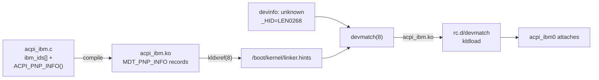

# acpi_ibm: why the ThinkPad driver never loads by itself

Patch: [acpi_ibm_pnp_info.patch](acpi_ibm_pnp_info.patch), one line, against
FreeBSD main f58613868b50 (2026-11-17), local branch `olivier-acpi-ibm-pnp`.
Machine: Lenovo ThinkPad X1 Carbon Gen 12 ("carbon"), see
[../X1.Carbon.Gen.12.md](../X1.Carbon.Gen.12.md).
Line numbers below are from the patched tree.

This document is written for a first-year computer science student: someone
who knows C and what an operating system does, but has never looked at how
FreeBSD decides which kernel modules to load.

## 1. Background

### 1.1 Drivers, modules, and devices without a driver

A *driver* is the kernel code that knows how to talk to one kind of device.
In FreeBSD most drivers are built as *kernel modules* (`.ko` files in
`/boot/kernel`), loaded at run time with kldload(8).

At boot, the kernel walks the buses (PCI, USB, ACPI, ...) and creates one
`device_t` per device it finds.  It offers each device to every driver
already in memory; a driver's *probe* function answers "this one is mine" or
not.  A device nobody claims stays in the tree with no name: `devinfo -v`
shows it as `unknown`, with its *pnpinfo*, the identifiers the bus found.
On carbon:

```
unknown pnpinfo _HID=LEN0268 _UID=0 _CID=none at handle=\_SB_.PC00.LPCB.EC__.HKEY
```

### 1.2 ACPI identifiers

ACPI is the firmware's description of the machine.  Each device in it has a
*hardware ID* (`_HID`), a string such as `LEN0268`, and optional *compatible
IDs* (`_CID`).  `LEN0268` is the ThinkPad "hotkey" device: the embedded
controller interface for the Fn keys, the mute and mic-mute LEDs, the fan,
and the radio switches.

The driver for it is `acpi_ibm` (`sys/dev/acpi_support/acpi_ibm.c`).  Its
list of IDs (line 379):

```c
static char    *ibm_ids[] = {"IBM0068", "LEN0068", "LEN0268", NULL};
```

and its probe function compares the device with that list
(`acpi_ibm_probe()`, line 453, `ACPI_ID_PROBE()` at line 459).  But the probe
only runs once the module is in memory.  Something has to decide to load
`acpi_ibm.ko` first.

### 1.3 devmatch(8): from device IDs to module names

That something is devmatch(8) (`sbin/devmatch/devmatch.c`), run at boot by
`/etc/rc.d/devmatch` (`libexec/rc/rc.d/devmatch:53`, enabled by
`devmatch_enable="YES"` in `/etc/defaults/rc.conf`).  It:

1. walks the device tree and keeps the devices with no driver
   (`find_unmatched()`, line 477);
2. looks up each one's bus and pnpinfo in a table of "module M handles ID X"
   records (`search_hints()`, line 280);
3. prints the matching module names; the rc script runs kldload(8) on them.

The table is the file `linker.hints` in each directory of
`kern.module_path` (`read_linker_hints()`, line 98).  kldxref(8) builds it by
reading special records inside every `.ko` file
(`usr.sbin/kldxref/kldxref.c:612`, `case MDT_PNP_INFO`).

### 1.4 Where those records come from: MODULE_PNP_INFO

A driver puts its ID table into its module file with the macro
`MODULE_PNP_INFO()` (`sys/sys/module.h:181`).  It records a description of
the table, the bus name, a pointer to the table and its size, in a section
of the `.ko` that kldxref(8) reads without loading the module.

ACPI drivers use a wrapper (`sys/dev/acpica/acpivar.h:255-258`):

```c
#define	ACPICOMPAT_PNP_INFO(t, busname)					\
	MODULE_PNP_INFO("Z:_HID", busname, t##hid, t, nitems(t)-1);	\
	MODULE_PNP_INFO("Z:_CID", busname, t##cid, t, nitems(t)-1);
#define	ACPI_PNP_INFO(t)	ACPICOMPAT_PNP_INFO(t, acpi)
```

`Z:_HID` means "each entry is a C string, compare it with the device's
`_HID`".  `nitems(t)-1` skips the NULL that ends the list.  Example of a
driver that has it: `acpi_wmi` (`sys/dev/acpi_support/acpi_wmi.c:201`,
`ACPI_PNP_INFO(wmi_ids);`).



Without `ACPI_PNP_INFO()`, the first arrow produces a module with no
records, and the chain stops at `linker.hints`.

## 2. The problem

`acpi_ibm.c` has the ID list but no `ACPI_PNP_INFO()`, so kldxref(8) never
learns which devices it handles.  Measured on carbon (2026-11-17, kernel
main-n290543-584f44221f45, stock world):

```
$ kldxref -d /boot/kernel/acpi_ibm.ko | grep -c "pnp info"
0
$ grep -a -c LEN0268 /boot/kernel/linker.hints
0
$ grep -a -c PNP0C14 /boot/kernel/linker.hints     # acpi_wmi, for comparison
1
$ devmatch -p "? at _HID=PNP0C14 _UID=0 _CID=none on acpi0"
acpi_wmi.ko
$ devmatch -p "? at _HID=LEN0268 _UID=0 _CID=none on acpi0"
$                                                    # nothing
```

After every boot `kldstat` has no `acpi_ibm`, and the device stays `unknown`.
`kldload acpi_ibm` by hand works at once:

```
acpi_ibm0: <ThinkPad ACPI Extras> on acpi0
acpi_ibm0: Firmware version is 0x200
```

so the driver supports the device; only the automatic load is missing.

## 3. The fix

```diff
 static char    *ibm_ids[] = {"IBM0068", "LEN0068", "LEN0268", NULL};
+ACPI_PNP_INFO(ibm_ids);
```

Why here: the macro needs the table already declared, and `acpi_wmi` puts it
right after its ID table the same way (14 other files under `sys/` use `ACPI_PNP_INFO()`).
The table already ends with NULL, which the macro expects.

Proposed commit message:

```
acpi_ibm: Add PNP info for devmatch

Without it devmatch(8) cannot match the ThinkPad hotkey device, so
acpi_ibm is never loaded at boot.
```

### 3.1 Alternatives

| Alternative | Why not |
|---|---|
| `kld_list="acpi_ibm"` in `/etc/rc.conf` | Works on one machine, but every ThinkPad owner must know to do it; devmatch exists so that they do not. |
| `acpi_ibm_load="YES"` in `/boot/loader.conf` | Same problem, and loader.conf is for modules needed to boot. |
| `device acpi_ibm` in GENERIC | Puts ThinkPad code in every amd64 kernel; the module is the right form for a vendor driver. |

### 3.2 What this patch does NOT do

- It does not change what `acpi_ibm` supports: same three IDs, same code.
  Newer ThinkPads with other hotkey IDs, if any, still need them added.
- The hotkey events, LEDs and fan control were not tested in detail; see
  section 4.
- A user who runs `kldunload acpi_ibm` keeps it unloaded until the next
  boot: devmatch skips devices that were attached once
  (`DF_ATTACHED_ONCE`, `devmatch.c:487`), unless run with `-a`.

## 4. Tested

On carbon.  The patched module was built from main 584f44221f45, the
revision of carbon's kernel (a module built from f58613868b50 is refused,
"depends on kernel - not available or version mismatch": `__FreeBSD_version`
1600031 against 1600030), with `KERNBUILDDIR` pointing to a GENERIC-NODEBUG
build so `EVDEV_SUPPORT` matches.  To test without replacing
`/boot/kernel/acpi_ibm.ko`, the module went into `/tmp/acpiibm`, with its
own `linker.hints` (`kldxref /tmp/acpiibm`), and that directory was put
first in `kern.module_path` for the test only.

| Configuration | Result |
|---|---|
| `kldxref -d` on the stock module | no "pnp info" line |
| `kldxref -d` on the patched module | `pnp info for bus acpi format Z:_HID 3 entries of 8 bytes`, same for `Z:_CID` |
| `devmatch -h /tmp/acpiibm/linker.hints -p "? at _HID=LEN0268 ... on acpi0"` | `acpi_ibm.ko` |
| `devmatch -a`, stock `kern.module_path` | no `acpi_ibm` |
| `devmatch -a`, `/tmp/acpiibm` first in `kern.module_path` | `unattached: acpi_ibm.ko` |
| `kldload acpi_ibm` with that path | loaded from `/tmp/acpiibm/acpi_ibm.ko`; `acpi_ibm0` attaches, `%pnpinfo` `_HID=LEN0268` |
| `dev.acpi_ibm.0.mic_led=1` (earlier, stock module) | reads back 1; the LED itself was not looked at |

The plain `devmatch` run (as `/etc/rc.d/devmatch` does it) printed nothing
during the test, because `acpi_ibm` had been loaded and unloaded earlier,
so the device carried `DF_ATTACHED_ONCE`.  `devmatch -a` lifts that filter
and reproduces the state after a fresh boot.

Not tested:

- a real boot with the patched module in `/boot/kernel` (the end-to-end
  path through `/etc/rc.d/devmatch`);
- older ThinkPads with `IBM0068` or `LEN0068`;
- hotkey events through devd, and the evdev keys.

## 5. Reproduce

```sh
# Build only the module, against the kernel revision of the target
cd ~/freebsd-src-acpiibm/sys/modules/acpi/acpi_ibm
export MAKEOBJDIRPREFIX=/tmp/acpiibm-obj
make WITHOUT_CCACHE_BUILD=yes \
    KERNBUILDDIR=/usr/obj/usr/src/amd64.amd64/sys/GENERIC-NODEBUG \
    SYSDIR=$HOME/freebsd-src-acpiibm/sys obj all
kldxref -d "$(make -V .OBJDIR)/acpi_ibm.ko" | grep "pnp info"

# On the ThinkPad, without touching /boot/kernel
sudo kldunload acpi_ibm 2>/dev/null
mkdir -p /tmp/acpiibm && cp acpi_ibm.ko /tmp/acpiibm/
sudo kldxref /tmp/acpiibm
old=$(sysctl -n kern.module_path)
sudo sysctl kern.module_path="/tmp/acpiibm;$old"
devmatch -a | grep acpi_ibm          # expect: unattached: acpi_ibm.ko
sudo kldload acpi_ibm && kldstat -v -n acpi_ibm | sed -n 2p
sudo sysctl kern.module_path="$old"
```
