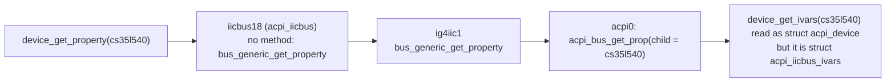

# acpi_iicbus: device properties of I2C devices froze the machine

Patch: [acpi_iicbus_prop.patch](acpi_iicbus_prop.patch), three commits on
FreeBSD main 6dc19a71f70c, in review as
[#117](https://ron-dev.freebsd.org/FreeBSD/src/pulls/117):

1. `acpi: Return the handle of a reference property, not its target`
   (section 3.1);
2. `acpi_iicbus: Free the ivars of deleted children` (a leak since
   9b7938dcf338: `acpi_iicbus_child_deleted()` replaced
   `iicbus_child_deleted()` without calling it, and used the ivars
   without a NULL check);
3. `acpi_iicbus: Return _DSD properties of the I2C children`, explained
   below.
Machine: HP ZBook Ultra G1a 14 (AMD Ryzen AI Max+ PRO 395); the device
used for the test is the CS35L54 speaker amplifier node `\_SB_.I2CB.SPKR`
behind the `ig4iic1` I2C controller.

Written for a first-year computer science student who knows C and what an
operating system does, but not FreeBSD's device tree.

## 1. Background

### 1.1 The device tree and ivars

FreeBSD keeps devices in a tree: `acpi0` has children such as `ig4iic1`
(an I2C controller), which has a child `iicbus18`, which has children such
as `cs35l540` (the amplifier driver). Each device has a parent bus, and the
bus stores per-child private data called *ivars* (`device_get_ivars()`).
Each bus decides what its ivars are: `acpi(4)` uses a `struct
acpi_device`, `acpi_iicbus` uses a `struct acpi_iicbus_ivars` (the I2C
address plus the ACPI handle, `sys/dev/iicbus/acpi_iicbus.c:73`). Only
the bus that created a child knows what its ivars are.

### 1.2 Device properties and _DSD

`device_get_property(dev, name, ...)` (`sys/kern/subr_bus.c:2328`) asks
for a named property of a device, such as `"cirrus,dev-index"`. It calls
the `bus_get_property` method of the device's parent. A bus that does not
implement it inherits `bus_generic_get_property()` (`subr_bus.c:3885`),
which forwards the request to its own parent, with the same child.

On ACPI systems the properties come from the device's `_DSD` object
("Device Specific Data"): a package of name/value pairs. `acpi(4)` answers
with `acpi_bus_get_prop()` (`sys/dev/acpica/acpi.c`), which reads the
child's ivars as a `struct acpi_device`, evaluates `_DSD` on its handle
(`acpi_find_dsd()`) and caches the result in that structure.

## 2. The problem

`acpi_iicbus` has no `bus_get_property` method. So for an I2C device:



`acpi_bus_get_prop()` then follows the fields of a structure that is not
there. Since `device_get_property()` was added (3f9a00e3b577), any
property request on a device below `acpi_iicbus` reached this code. On the
ZBook, the first version of the CS35L54 driver read `cirrus,dev-index` this
way and the laptop froze at `kldload`
([cs35l54_speaker_amp.md](cs35l54_speaker_amp.md), section 3.4). The
driver now evaluates `_DSD` itself to avoid it.

## 3. The fix

`acpi_iicbus` answers for its own children:

```c
static ssize_t
acpi_iicbus_get_property(device_t bus, device_t child, const char *propname,
    void *propvalue, size_t size, device_property_type_t type)
{
	struct acpi_iicbus_ivars *devi;

	/* Deeper devices do not carry our ivars. */
	if (device_get_parent(child) != bus)
		return (-1);
	devi = device_get_ivars(child);
	if (devi->handle == NULL)
		return (-1);
	devi->ad.ad_handle = devi->handle;
	return (acpi_ad_get_property(&devi->ad, propname, propvalue, size,
	    type));
}
```

- The ivars get a `struct acpi_device ad` used only as the `_DSD` cache;
  `acpi_iicbus_child_deleted()` frees the cached buffer.
- `acpi.c` already had all the `_DSD` parsing; it is split so the part
  that works on a `struct acpi_device` is exported as
  `acpi_ad_get_property()`. `acpi_bus_get_prop()` now just passes its
  child's ivars to it, so acpi's own behaviour does not change.
- A request for a device deeper than the I2C children (for example the
  children of an I2C mux) now gets -1 instead of reaching acpi with
  foreign ivars.

### 3.1 The reference property fix

A `_DSD` value can be a bare reference to another ACPI object. Asked for
it with `DEVICE_PROP_ANY` (or another type than `DEVICE_PROP_HANDLE`),
`acpi_bus_get_prop()` resolved the reference to a handle `h`, then did
`memcpy(propvalue, h, sizeof(ACPI_HANDLE))`: it copied the first 8 bytes
of the namespace node `h` points to, not `h`. The fix copies `&h`. The
bug dates from 99e6980fcf5e; `DEVICE_PROP_HANDLE` itself was not hit,
it uses a separate function. It goes first so it can be merged to
stable alone, and the refactor below keeps the fixed line.

### Alternatives

- Read every child's `_DSD` through `acpi_get_handle()` instead of its
  ivars, as [D60063](https://reviews.freebsd.org/D60063) proposes. That
  fixes every bus at once, but it frees `_DSD` before returning, so a
  package value (such as `cirrus,dev-index` here) cannot be returned,
  and it drops the cache for acpi's own children.
- Refuse, in `acpi_bus_get_prop()`, every child that is not a direct
  child of acpi. This was the first version. It breaks DPAA2:
  `dpaa2_mc_acpi` and `memac_mdio_acpi` give their own children a real
  `struct acpi_device` and forward property requests to acpi, which
  then must answer for those grandchildren (`dpaa2_mac_dev` reads `reg`,
  `memacphy_acpi` reads `phy-channel`).
- Return -1 from `acpi_iicbus` for everything: no freeze, but I2C drivers
  get no properties, while ACPI describes them for these devices.

### What it does not fix

Other buses that forward requests to acpi with foreign ivars keep the
problem: for example `acpi_gpiobus` children, or a PHY under `miibus`
whose request climbs to acpi. Each such bus needs its own method.


## 4. Tested

Test module [acpi_iicbus_prop_test.c](acpi_iicbus_prop_test.c)
([Makefile](acpi_iicbus_prop_test.Makefile)): on load it calls
`device_has_property()` and `device_get_property()` on `cs35l540` (child
of `iicbus18`), prints the `cirrus,dev-index` package, then asks for a
property that does not exist.

| Kernel | Result |
|---|---|
| ZBook kernel with the first version (direct-child check in acpi) | `has` 0, `get` -1: no freeze, no data |
| Test kernel (ZBook source, first version reverted, this patch), loaded twice | `has` 1, `get` 8 (one `ACPI_OBJECT *`), package `0x30 0x31 0x32 0x33`, missing property -1 |
| Stock main | freeze at the first request (see section 2; not repeated) |

The four values are the I2C addresses of the four amplifiers, the same
data the CS35L54 driver reads by evaluating `_DSD` itself. The test kernel
booted with Wi-Fi, amdgpu, amdsmu, the touchpad and `snd_cs35l54`
attached, and no fault in the log.

Child deletion: [acpi_iicbus_prop_deltest.sh](acpi_iicbus_prop_deltest.sh)
runs 20 cycles of `kldunload ig4` / `kldload ig4` (which deletes and
re-creates every `acpi_iicbus` child), loading the test module first each
time so the `cs35l540` `_DSD` cache is filled before its deletion, and
prints the `devbuf` and `acpica` malloc types (`vmstat -m`, in-use count)
before and after:

| Kernel | `devbuf` in use, before / after 20 cycles |
|---|---|
| ZBook kernel (no fix) | 2828 / 3928 (+55 per cycle) |
| Test kernel with both commits, run 1 | 2827 / 2827 |
| same, run 2 | 2827 / 2827 |

`acpica` ended 50 lower than at the start in both kernels (start-up
noise, unrelated). With both commits, the 20 `device_get_property()` calls
returned the package each time, the touchpad and amplifiers reattached
after every cycle, and there was no fault in the log.

Reference property: [acpi_prop_ref_test.c](acpi_prop_ref_test.c)
([Makefile](acpi_prop_ref_test.Makefile)) builds a synthetic `_DSD`
whose value is a bare reference to `\_SB_` and asks
`acpi_ad_get_property()` for it (the ZBook firmware has no such
property: its `reset-gpios` is a package).

| Kernel | `DEVICE_PROP_ANY` | `DEVICE_PROP_HANDLE` (one-element package) |
|---|---|---|
| ZBook test kernel with commits 2 and 3 only | 0xfffff80105cb1780, not `\_SB_` (0xfffff80101734b00): FAIL | `\_SB_`: PASS |
| same plus commit 1 | `\_SB_`: PASS | `\_SB_`: PASS |

On the second kernel the `cirrus,dev-index` test above still returns the
four values and a missing property -1, and the touchpad and amplifiers
attach.

All three commits build (`buildkernel GENERIC` with INVARIANTS, no
warning). Untested: DPAA2 (no hardware; this patch does not change its
path).

## 5. Review

- [#117](https://ron-dev.freebsd.org/FreeBSD/src/pulls/117): approved by
  wulf ("simpler and better" than D60063).
- [D60060 to D60063](https://reviews.freebsd.org/D60063) (yarshure, an
  external contributor, 2026-09-27, needs review): an ACPI I2C and mux
  series for arm64 DPAA2 boards. D60063 fixes the same crash for every
  bus but cannot return packages; it also carried the reference fix of
  section 3.1.

