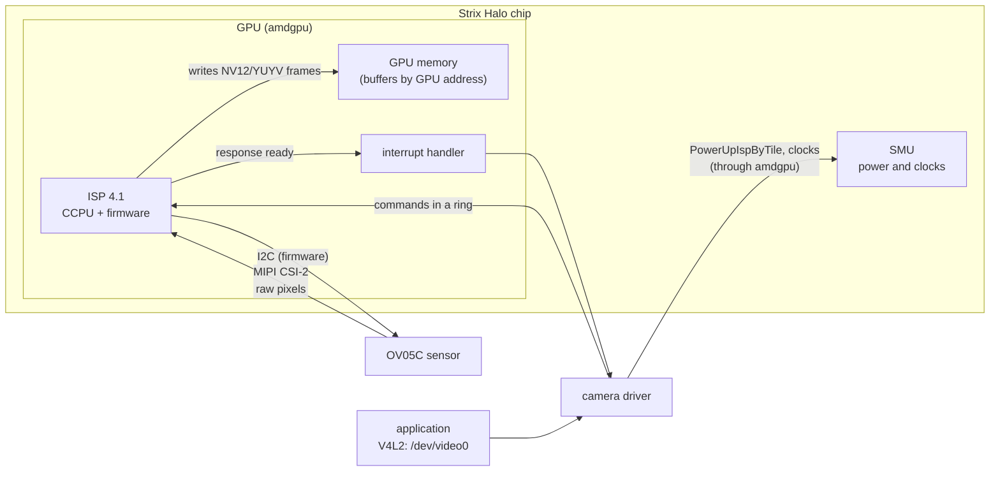
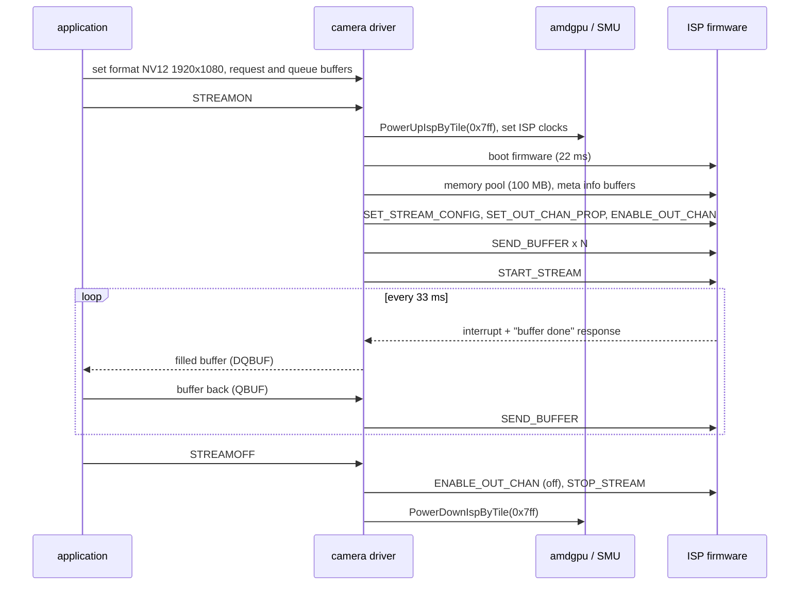

# The built-in camera of the HP ZBook Ultra G1a: how it works, and what FreeBSD needs

This is a study of the laptop's built-in camera, written so that a first-year
computer science student can follow it: you know C and roughly what an
operating system does, but not cameras, GPUs or FreeBSD drivers. The goal is to
write a FreeBSD driver for it. This first part explains the hardware and
records what the Linux driver does, measured on the laptop, so the FreeBSD
driver can be written from this description instead of from the Linux code.

Status (2026-11-15): the camera works on Linux; on FreeBSD there is no driver
yet. Hardware context: [HP.ZBook.Ultra.G1a.md](../HP.ZBook.Ultra.G1a.md#cameras-isp-41--sensors).
Raw traces: [amd_isp/](amd_isp/).

## 1. Background

### A camera is two chips, not one

A phone or laptop camera is usually split in two:

- The **sensor** turns light into numbers. Each pixel sees only red, green or
  blue (a "Bayer" mosaic), the values are noisy, and the colours are wrong
  until corrected. This raw data leaves the sensor over a fast serial link
  called **MIPI CSI-2**.
- The **image signal processor (ISP)** turns raw data into a usable picture:
  it fills in the missing colours, removes noise, sets exposure and white
  balance, and writes the result to memory in a standard format.

On this laptop the sensor is an **OmniVision OV05C** (5 megapixels, the RGB
camera) and the ISP is **AMD ISP 4.1**, a block inside the Strix Halo chip, next
to the GPU. A second sensor, a **Himax HM1092**, is an infrared camera for face
login; no operating system drives it today. A USB webcam is different: it
contains its own ISP and sends finished pictures over USB, so it needs only a
generic driver (`uvideo(4)` on FreeBSD).

### Firmware does the hard part

The ISP contains its own small processor (the driver calls it the "CCPU")
running AMD firmware. That firmware programs the sensor over its private I2C
bus, runs the exposure and colour algorithms, and fills memory buffers with
pictures. The operating system's driver only:

1. powers the ISP on and starts its firmware,
2. gives it memory and tells it which format and size to produce,
3. hands it empty buffers and takes back full ones,
4. stops it and powers it off.

So there is no sensor driver in Linux for the OV05C: the firmware knows the
sensor. The firmware file is `amdgpu/isp_4_1_1.bin`; on FreeBSD it is already
packaged and loaded with amdgpu (`amdgpu_isp_4_1_1_bin.ko`).

### Talking to the firmware: command and response rings

The driver and the firmware share memory. Commands go through **ring
buffers**: a fixed-size array used as a queue, with a write pointer (advanced
by the producer) and a read pointer (advanced by the consumer), both stored in
ISP registers. The driver writes a command and moves the write pointer; the
firmware reads it, executes it, and writes a response into another ring, then
raises an **interrupt** so the driver knows to read it. The trace below shows
two response rings ("fw resp thread [0]" and "[1]").

### Memory the ISP can reach

The ISP is part of the GPU, so it reaches memory through GPU addresses, not
CPU addresses. Every buffer the firmware uses is a GPU buffer object with a
GPU address (the `gpuva 0x7fff...` and `mc=0x7fff...` values in the trace).
In Linux the camera driver asks amdgpu to allocate them: a 100 MB pool for the
firmware's own use, small "meta info" buffers, and one buffer per frame.

### Power, clocks and the SMU

The ISP is off until used. The chip's power manager, the **SMU** (System
Management Unit, see [amdsmu_strix_halo.md](amdsmu_strix_halo.md)), switches
it on and off by message: `PowerUpIspByTile` and `PowerDownIspByTile` with the
mask `0x7ff` (all eleven ISP "tiles"), and sets its minimum clocks with
`SetHardMinIspxclkByFreq` and `SetHardMinIspiclkByFreq` (argument `0x314`, 788, presumably MHz).
amdgpu sends these messages; drm-kmod 6.12 on FreeBSD has the message
numbers but not the code that sends them (added to Linux after 6.12, commit
fba8d147472e).

### How the pieces are found

amdgpu discovers the ISP as IP block `isp_v4_1_1`. In Linux, amdgpu then
creates three child devices that share the GPU's register window: the capture
device (`amd_isp_capture`, ISP registers, the PHY registers for the MIPI link,
and the ISP interrupts routed through amdgpu's interrupt handler), an I2C
controller and a pin controller. ACPI describes the sensors (`_DDN`
"OV05C-RGB" and "HM1092-IR") and the ISP (`AMDI0201`, `\_SB.ISP1`).



### What the application sees: V4L2

Applications use **V4L2** (Video4Linux2), a set of `ioctl()` calls on
`/dev/videoN`: ask the capabilities, pick a format and size, request buffers,
map them with `mmap()`, queue them, start streaming, and dequeue each filled
buffer. FreeBSD 16 implements this interface in the kernel as `video(4)`
(`sys/dev/video/video.c`, commit 9c9428825f4c, 2026-08): the framework owns
`/dev/videoN`, the buffers and the ioctls, and a hardware driver only fills in
the methods of `sys/dev/video/video_if.m` (formats, frame sizes, controls,
`start_stream`, `stop_stream`) and calls `video_buf_done()` for each finished
frame. `uvideo(4)` (USB cameras) and `fwcam(4)` (FireWire) are written this
way.

## 2. What Linux does, measured

Ubuntu, Linux 7.0.0-43, module `amd_isp4_capture`. The device:

```
amd_isp_capture (platform:amd_isp_capture):
	/dev/video0
	/dev/media0
```

Formats: NV12 and YUYV, every size from 640x360 to 2888x1808, all at 30
frames per second. NV12 is "4:2:0": a full-size brightness (Y) plane, then a
half-size plane of interleaved colour (U, V) samples; a 1920x1080 frame is
1920 x 1080 x 1.5 = 3110400 bytes, which the driver splits into two parts of
2073600 and 1036800 bytes.

How to repeat the capture (with the privacy shutter open: closed, every frame
is black, brightness 2 to 9 out of 255):

```
sudo apt-get install v4l-utils
v4l2-ctl -d /dev/video0 --set-fmt-video=width=1920,height=1080,pixelformat=NV12 \
    --stream-mmap=4 --stream-count=60 --stream-to=cam.nv12
ffmpeg -f rawvideo -pix_fmt nv12 -s 1920x1080 -i cam.nv12 -frames 1 frame.png
```

Measured: 29.66 frames per second, correct picture. The driver's debug output
for one 30-frame session (dynamic debug on the `isp4` source files and on
amdgpu's `smu_cmn.c`) is in
[amd_isp/linux_stream_debug.txt](amd_isp/linux_stream_debug.txt), and the
number of calls per driver function (ftrace `function_graph` on the module)
in [amd_isp/linux_stream_function_counts.txt](amd_isp/linux_stream_function_counts.txt).

Nothing happens to the hardware when the device is opened or the format is
set: the ISP is powered and its firmware started only when streaming starts,
and everything is shut down again when streaming stops.

### The session step by step

Times are from the kernel log of that session (seconds since boot).

| Time | Step | Evidence in the log |
|---|---|---|
| 58.835 | streaming requested; power the ISP | `enable isp_subdev module`, `PowerUpIspByTile` (0x7ff) |
| | set minimum ISP clocks | `SetHardMinIspxclkByFreq`, `SetHardMinIspiclkByFreq` (0x314) |
| 58.858 | firmware boots (22 ms) | `ISP CCPU FW boot success` |
| | start the two response-ring readers | `[0] fw resp thread started`, `[1] ...` |
| | give the firmware its memory pool | `send fw mem pool 0x7fff03018000(104857600)` |
| | choose sensor and pipeline | `isp4fw_sensor_id 0, pipeId 0x5f91 EnableTnr 1` (TNR: temporal noise reduction) |
| | describe the output channel | `channel:prev,fmt NV12,w:h=1920:1080,lp:1920,cp1920` |
| | commands to the firmware | `SET_STREAM_CONFIG`, `SET_OUT_CHAN_PROP`, `ENABLE_OUT_CHAN` |
| | queue empty frame buffers | `SEND_BUFFER` commands; the driver waits until at least 4 are queued (`no send start, required 4, buf sent 1`) |
| 59.061 | start the stream | `START_STREAM` |
| 59.154 | first frame (93 ms after start) | `ts:...,streamId:1,poc:1,...,status:ISP4FW_BUFFER_STATUS_DONE(3)` |
| | each frame: interrupt, response, buffer returned to the application, a new buffer queued | about 33 ms apart (`ts` values 59160648988, 59195692966, 59230623212 ns) |
| 60.204 | stop | `ENABLE_OUT_CHAN` (disable), `STOP_STREAM`, `wait stop stream suc` |
| | stop the ring readers, power the ISP off | `fw resp thread quit`, `PowerDownIspByTile` (0x7ff), `power off isp_subdev suc` |

The firmware commands seen, with the identifiers the driver prints:

| Command | Identifier | Role |
|---|---|---|
| `SET_STREAM_CONFIG` | 0x02010001 | sensor, pipeline, stream settings |
| `SET_OUT_CHAN_PROP` | 0x02010003 | output format, width, height, line pitch |
| `ENABLE_OUT_CHAN` | 0x02010005 | turn an output channel on or off |
| `START_STREAM` | 0x02010007 | start capturing |
| `STOP_STREAM` | 0x02010008 | stop capturing |
| `SEND_BUFFER` | 0x02040001 | hand the firmware an empty frame buffer |

In one 30-frame session the driver sent 83 commands, the ISP raised 96
interrupts, and 285 firmware responses were read (including firmware log
messages, `isp_fw_log_print`).



### The register level

To see the registers, Linux's `mmiotrace` tracer logs every read and write
the driver makes to the memory-mapped registers it maps. A **register** here
is a 32-bit value at an address inside the GPU's register window (a PCI BAR,
the window of addresses through which the CPU talks to the device). The
camera driver maps one window, `0xa0300000` (size `0x629a5`); offsets below
are relative to it. Full trace of one 10-frame session (768 accesses to 52
registers): [amd_isp/linux_stream_mmio.txt](amd_isp/linux_stream_mmio.txt).

The roles in the right-hand column are inferred from the access pattern and
the values, not documented by AMD.

| Offset | Accesses | Pattern | Inferred role |
|---|---|---|---|
| `0x60000` | W | `0x7ff` at start, `0` at stop | enable the eleven ISP tiles (same mask as the SMU message) |
| `0x62054` | R/W | `0x50000` to `0x10000` at start, back at stop | firmware processor held/released (bit `0x40000`) |
| `0x62000` | R/W | `3` to `2` at start, `3` then `0` at stop | firmware processor reset (bit 0) |
| `0x62058` | W then R | written `0`, read `0x2000`, `0x2000`, `0x2402` | boot status: the driver polls until the firmware reports ready |
| `0x62010` | R/W, 143 | `0x410000`, toggles `0x400000`/`0x410000` | interrupt enable mask |
| `0x62014` | R, 43 | `0x10000` when a response is pending | interrupt status |
| `0x62018` | W, 45 | writes back the status bit | interrupt acknowledge |
| `0x62210`-`0x62220` | W once, then 52 W / 104 R | base (low, high `0x7fff`), size `0xa00`, write pointer `0x6221c`, read pointer `0x62220` | command ring (the driver advances the write pointer) |
| `0x62170`-`0x62180` | W once, then 43 W / 86 R | same layout, size `0xa00` | response ring (the driver advances the read pointer `0x62180`) |
| `0x62184`, `0x62198`, `0x621ac`, `0x62224`, `0x62238`, `0x6224c` | W once each | same five-register layout, size `0xa00` | further command and response rings, set up but idle here |
| `0x62148`-`0x62158` | W once | base, high `0x7fff`, size `0x200000` | 2 MB ring, probably the firmware log |

Each ring is five registers: GPU address low, GPU address high, size in
bytes, write pointer, read pointer. The high half `0x7fff` matches the GPU
addresses of every buffer in the debug log (`0x7fff...`).

The start-up order, from the trace:

1. write `0x7ff` to `0x60000`;
2. clear bit `0x40000` of `0x62054` and bit 0 of `0x62000` (with `0x62058`
   cleared first): the firmware processor starts;
3. program every ring (base, size, pointers to 0);
4. poll `0x62058` until it reads `0x2402` (about 2 ms here);
5. enable interrupts in `0x62010` (`0x410000`);
6. from then on: write a command into the command ring and advance
   `0x6221c`; on an interrupt, read `0x62014`, acknowledge in `0x62018`,
   read responses up to `0x6217c` and advance `0x62180`.

Stopping reverses it: set bit `0x40000` of `0x62054`, set bit 0 of
`0x62000` (value 3), then write `0` to `0x62000` and `0x60000`.

The trace shows only one window: the PHY registers of the MIPI link (the
second memory resource amdgpu gives the camera driver) were not accessed by
the driver in this session.

## 3. What a FreeBSD driver needs

| Piece | Linux | FreeBSD today | Work |
|---|---|---|---|
| `/dev/video0`, V4L2 ioctls, buffers | V4L2 core | `video(4)` | none: implement `video_if` methods |
| find the ISP, registers, interrupts | amdgpu child devices | amdgpu (drm-kmod) has the IP block | expose registers, interrupts and buffer allocation to a camera driver |
| ISP power and clocks | amdgpu SMU messages | message numbers only (drm 6.12) | send `PowerUpIspByTile`/`PowerDownIspByTile` and the two clock messages |
| firmware | `isp_4_1_1.bin` | packaged, loaded | none |
| firmware boot, rings, commands | `amd_isp4_capture` (about 4000 lines) | nothing | the core of the work |
| sensor | firmware | firmware | none |

Two rules shape the work:

- **No copying.** `amd_isp4_capture` is licensed GPL-2.0+, which cannot go
  into the FreeBSD base system. The FreeBSD driver is written from behaviour
  and interface facts (command identifiers, register roles, message order,
  measured timings) like the ones in this document, not from the Linux source.
- **The GPU driver is not in base.** amdgpu comes from the `drm-kmod` port,
  so the camera driver either lives there too, or amdgpu exports a small
  interface (registers, interrupts, GPU buffers, SMU messages) that a driver
  in base can use.

## 4. Next steps

1. Done: the register-level protocol above (`mmiotrace` needs the module
   reloaded: use `rmmod amd_isp4_capture`, never `modprobe -r`, see below;
   `mmiotrace` also takes every CPU but one offline until it is turned off).
2. Record the layout of each firmware command (the fields of
   `SET_STREAM_CONFIG`, `SET_OUT_CHAN_PROP`, `SEND_BUFFER`) and of the
   responses, from the shared-memory contents during a session.
3. Decide where the driver lives (drm-kmod or base) and what amdgpu must
   export.
4. Write a first FreeBSD driver that powers the ISP, boots the firmware and
   reports success, then add streaming.

## Pitfall met on the way

`modprobe -r amd_isp4_capture` on Ubuntu also unloads the modules it depended
on that nothing else uses, here amdgpu, and amdgpu's ISP teardown then crashed
the kernel (`BUG: unable to handle page fault for address: ffffffffffffffb8`
in `isp_genpd_remove_device+0x1d`, called from `isp_v4_1_1_hw_fini`,
`amdgpu_device_fini_hw`, `amdgpu_driver_unload_kms`). Use `rmmod`, which removes
one module only. The crash is a Linux bug worth reporting separately.

## Tested

| Configuration | Result |
|---|---|
| Ubuntu, Linux 7.0.0-43, shutter closed | 29.66 fps, black frames (brightness 2-9) |
| Ubuntu, shutter open | correct 1920x1080 NV12 picture |
| Ubuntu, 30-frame session with debug and ftrace | trace in [amd_isp/](amd_isp/) |
| Ubuntu, 10-frame session under `mmiotrace` after `rmmod`/`modprobe` | 768 register accesses, [amd_isp/linux_stream_mmio.txt](amd_isp/linux_stream_mmio.txt) |
| FreeBSD | no driver; `video(4)` and the firmware are present |
| IR camera (HM1092) | untested, no driver on any system |
