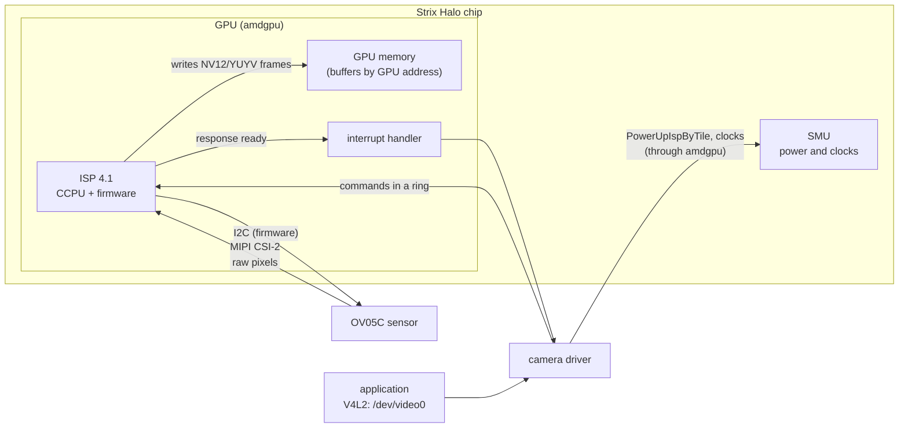
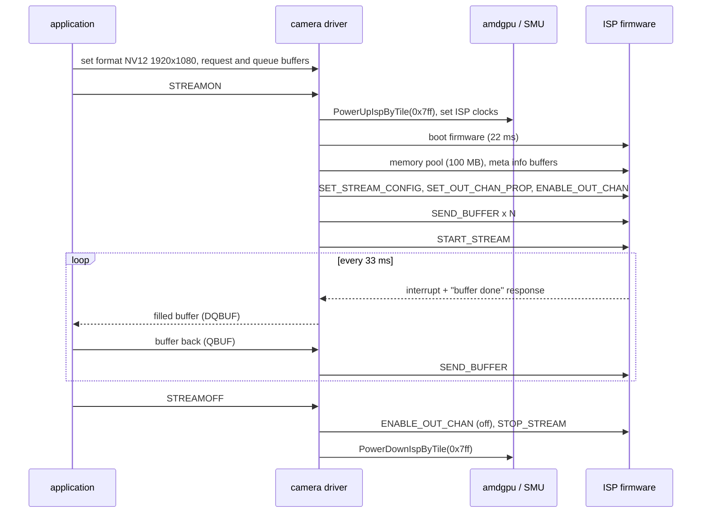
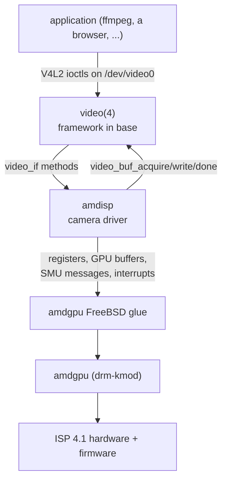

# The built-in camera of the HP ZBook Ultra G1a: how it works, and what FreeBSD needs

This is a study of the laptop's built-in camera, written so that a first-year
computer science student can follow it: you know C and roughly what an
operating system does, but not cameras, GPUs or FreeBSD drivers. The goal is to
write a FreeBSD driver for it. This first part explains the hardware and
records what the Linux driver does, measured on the laptop, so the FreeBSD
driver can be written from this description instead of from the Linux code.

Status (2026-11-15): the camera works on Linux; on FreeBSD there is no driver
yet. Hardware context: [HP.ZBook.Ultra.G1a.md](../HP.ZBook.Ultra.G1a.md#cameras-isp-41--sensors).
Raw traces: [amd_isp/](amd_isp/).

## 1. Background

### A camera is two chips, not one

A phone or laptop camera is usually split in two:

- The **sensor** turns light into numbers. Each pixel sees only red, green or
  blue (a "Bayer" mosaic), the values are noisy, and the colours are wrong
  until corrected. This raw data leaves the sensor over a fast serial link
  called **MIPI CSI-2**.
- The **image signal processor (ISP)** turns raw data into a usable picture:
  it fills in the missing colours, removes noise, sets exposure and white
  balance, and writes the result to memory in a standard format.

On this laptop the sensor is an **OmniVision OV05C** (5 megapixels, the RGB
camera) and the ISP is **AMD ISP 4.1**, a block inside the Strix Halo chip, next
to the GPU. A second sensor, a **Himax HM1092**, is an infrared camera for face
login; no operating system drives it today. A USB webcam is different: it
contains its own ISP and sends finished pictures over USB, so it needs only a
generic driver (`uvideo(4)` on FreeBSD).

### Firmware does the hard part

The ISP contains its own small processor (the driver calls it the "CCPU")
running AMD firmware. That firmware programs the sensor over its private I2C
bus, runs the exposure and colour algorithms, and fills memory buffers with
pictures. The operating system's driver only:

1. powers the ISP on and starts its firmware,
2. gives it memory and tells it which format and size to produce,
3. hands it empty buffers and takes back full ones,
4. stops it and powers it off.

So there is no sensor driver in Linux for the OV05C: the firmware knows the
sensor. The firmware file is `amdgpu/isp_4_1_1.bin`; on FreeBSD it is already
packaged and loaded with amdgpu (`amdgpu_isp_4_1_1_bin.ko`).

### Talking to the firmware: command and response rings

The driver and the firmware share memory. Commands go through **ring
buffers**: a fixed-size array used as a queue, with a write pointer (advanced
by the producer) and a read pointer (advanced by the consumer), both stored in
ISP registers. The driver writes a command and moves the write pointer; the
firmware reads it, executes it, and writes a response into another ring, then
raises an **interrupt** so the driver knows to read it. The trace below shows
two response rings ("fw resp thread [0]" and "[1]").

### Memory the ISP can reach

The ISP is part of the GPU, so it reaches memory through GPU addresses, not
CPU addresses. Every buffer the firmware uses is a GPU buffer object with a
GPU address (the `gpuva 0x7fff...` and `mc=0x7fff...` values in the trace).
In Linux the camera driver asks amdgpu to allocate them: a 100 MB pool for the
firmware's own use, small "meta info" buffers, and one buffer per frame.

### Power, clocks and the SMU

The ISP is off until used. The chip's power manager, the **SMU** (System
Management Unit, see [amdsmu_strix_halo.md](amdsmu_strix_halo.md)), switches
it on and off by message: `PowerUpIspByTile` and `PowerDownIspByTile` with the
mask `0x7ff` (all eleven ISP "tiles"), and sets its minimum clocks with
`SetHardMinIspxclkByFreq` and `SetHardMinIspiclkByFreq` (argument `0x314`, 788, presumably MHz).
amdgpu sends these messages; drm-kmod 6.12 on FreeBSD has the message
numbers but not the code that sends them (added to Linux after 6.12, commit
fba8d147472e).

### How the pieces are found

amdgpu discovers the ISP as IP block `isp_v4_1_1`. In Linux, amdgpu then
creates three child devices that share the GPU's register window: the capture
device (`amd_isp_capture`, ISP registers, the PHY registers for the MIPI link,
and the ISP interrupts routed through amdgpu's interrupt handler), an I2C
controller and a pin controller. ACPI describes the sensors (`_DDN`
"OV05C-RGB" and "HM1092-IR") and the ISP (`AMDI0201`, `\_SB.ISP1`).



### What the application sees: V4L2

Applications use **V4L2** (Video4Linux2), a set of `ioctl()` calls on
`/dev/videoN`: ask the capabilities, pick a format and size, request buffers,
map them with `mmap()`, queue them, start streaming, and dequeue each filled
buffer. FreeBSD 16 implements this interface in the kernel as `video(4)`
(`sys/dev/video/video.c`, commit 9c9428825f4c, 2026-08): the framework owns
`/dev/videoN`, the buffers and the ioctls, and a hardware driver only fills in
the methods of `sys/dev/video/video_if.m` (formats, frame sizes, controls,
`start_stream`, `stop_stream`) and calls `video_buf_done()` for each finished
frame. `uvideo(4)` (USB cameras) and `fwcam(4)` (FireWire) are written this
way.

## 2. What Linux does, measured

Ubuntu, Linux 7.0.0-43, module `amd_isp4_capture`. The device:

```
amd_isp_capture (platform:amd_isp_capture):
	/dev/video0
	/dev/media0
```

Formats: NV12 and YUYV, every size from 640x360 to 2888x1808, all at 30
frames per second. NV12 is "4:2:0": a full-size brightness (Y) plane, then a
half-size plane of interleaved colour (U, V) samples; a 1920x1080 frame is
1920 x 1080 x 1.5 = 3110400 bytes, which the driver splits into two parts of
2073600 and 1036800 bytes.

How to repeat the capture (with the privacy shutter open: closed, every frame
is black, brightness 2 to 9 out of 255):

```
sudo apt-get install v4l-utils
v4l2-ctl -d /dev/video0 --set-fmt-video=width=1920,height=1080,pixelformat=NV12 \
    --stream-mmap=4 --stream-count=60 --stream-to=cam.nv12
ffmpeg -f rawvideo -pix_fmt nv12 -s 1920x1080 -i cam.nv12 -frames 1 frame.png
```

Measured: 29.66 frames per second, correct picture. The driver's debug output
for one 30-frame session (dynamic debug on the `isp4` source files and on
amdgpu's `smu_cmn.c`) is in
[amd_isp/linux_stream_debug.txt](amd_isp/linux_stream_debug.txt), and the
number of calls per driver function (ftrace `function_graph` on the module)
in [amd_isp/linux_stream_function_counts.txt](amd_isp/linux_stream_function_counts.txt).

Nothing happens to the hardware when the device is opened or the format is
set: the ISP is powered and its firmware started only when streaming starts,
and everything is shut down again when streaming stops.

### The session step by step

Times are from the kernel log of that session (seconds since boot).

| Time | Step | Evidence in the log |
|---|---|---|
| 58.835 | streaming requested; power the ISP | `enable isp_subdev module`, `PowerUpIspByTile` (0x7ff) |
| | set minimum ISP clocks | `SetHardMinIspxclkByFreq`, `SetHardMinIspiclkByFreq` (0x314) |
| 58.858 | firmware boots (22 ms) | `ISP CCPU FW boot success` |
| | start the two response-ring readers | `[0] fw resp thread started`, `[1] ...` |
| | give the firmware its memory pool | `send fw mem pool 0x7fff03018000(104857600)` |
| | choose sensor and pipeline | `isp4fw_sensor_id 0, pipeId 0x5f91 EnableTnr 1` (TNR: temporal noise reduction) |
| | describe the output channel | `channel:prev,fmt NV12,w:h=1920:1080,lp:1920,cp1920` |
| | commands to the firmware | `SET_STREAM_CONFIG`, `SET_OUT_CHAN_PROP`, `ENABLE_OUT_CHAN` |
| | queue empty frame buffers | `SEND_BUFFER` commands; the driver waits until at least 4 are queued (`no send start, required 4, buf sent 1`) |
| 59.061 | start the stream | `START_STREAM` |
| 59.154 | first frame (93 ms after start) | `ts:...,streamId:1,poc:1,...,status:ISP4FW_BUFFER_STATUS_DONE(3)` |
| | each frame: interrupt, response, buffer returned to the application, a new buffer queued | about 33 ms apart (`ts` values 59160648988, 59195692966, 59230623212 ns) |
| 60.204 | stop | `ENABLE_OUT_CHAN` (disable), `STOP_STREAM`, `wait stop stream suc` |
| | stop the ring readers, power the ISP off | `fw resp thread quit`, `PowerDownIspByTile` (0x7ff), `power off isp_subdev suc` |

The firmware commands seen, with the identifiers the driver prints:

| Command | Identifier | Role |
|---|---|---|
| `SET_STREAM_CONFIG` | 0x02010001 | sensor, pipeline, stream settings |
| `SET_OUT_CHAN_PROP` | 0x02010003 | output format, width, height, line pitch |
| `ENABLE_OUT_CHAN` | 0x02010005 | turn an output channel on or off |
| `START_STREAM` | 0x02010007 | start capturing |
| `STOP_STREAM` | 0x02010008 | stop capturing |
| `SEND_BUFFER` | 0x02040001 | hand the firmware an empty frame buffer |

In one 30-frame session the driver sent 83 commands, the ISP raised 96
interrupts, and 285 firmware responses were read (including firmware log
messages, `isp_fw_log_print`).



### The register level

To see the registers, Linux's `mmiotrace` tracer logs every read and write
the driver makes to the memory-mapped registers it maps. A **register** here
is a 32-bit value at an address inside the GPU's register window (a PCI BAR,
the window of addresses through which the CPU talks to the device). The
camera driver maps one window, `0xa0300000` (size `0x629a5`); offsets below
are relative to it. Full trace of one 10-frame session (768 accesses to 52
registers): [amd_isp/linux_stream_mmio.txt](amd_isp/linux_stream_mmio.txt).

The roles in the right-hand column are inferred from the access pattern and
the values, not documented by AMD.

| Offset | Accesses | Pattern | Inferred role |
|---|---|---|---|
| `0x60000` | W | `0x7ff` at start, `0` at stop | enable the eleven ISP tiles (same mask as the SMU message) |
| `0x62054` | R/W | `0x50000` to `0x10000` at start, back at stop | firmware processor held/released (bit `0x40000`) |
| `0x62000` | R/W | `3` to `2` at start, `3` then `0` at stop | firmware processor reset (bit 0) |
| `0x62058` | W then R | written `0`, read `0x2000`, `0x2000`, `0x2402` | boot status: the driver polls until the firmware reports ready |
| `0x62010` | R/W, 143 | `0x410000`, toggles `0x400000`/`0x410000` | interrupt enable mask |
| `0x62014` | R, 43 | `0x10000` when a response is pending | interrupt status |
| `0x62018` | W, 45 | writes back the status bit | interrupt acknowledge |
| `0x62170`-`0x62180` | W once, then 43 W / 86 R | base (low, high `0x7fff`), size `0xa00`, read pointer `0x6217c`, write pointer `0x62180` | command ring: the driver advances the write pointer once per command (43 commands) and reads the firmware's read pointer |
| `0x62210`-`0x62220` | W once, then 52 W / 104 R | same layout, size `0xa00` | response ring: the firmware advances the write pointer `0x62220`, the driver advances the read pointer `0x6221c` |
| `0x62184`, `0x62198`, `0x621ac`, `0x62224`, `0x62238`, `0x6224c` | W once each | same five-register layout, size `0xa00` | further command and response rings, set up but idle here |
| `0x62148`-`0x62158` | W once | base, high `0x7fff`, size `0x200000` | 2 MB ring, probably the firmware log |

Each ring is five registers: GPU address low, GPU address high, size in
bytes, read pointer, write pointer. Which ring is which was confirmed by
dumping their memory (next section): the commands sit in the ring whose base
is programmed at `0x62170`. A first reading of this trace had the two swapped. The high half `0x7fff` matches the GPU
addresses of every buffer in the debug log (`0x7fff...`).

The start-up order, from the trace:

1. write `0x7ff` to `0x60000`;
2. clear bit `0x40000` of `0x62054` and bit 0 of `0x62000` (with `0x62058`
   cleared first): the firmware processor starts;
3. program every ring (base, size, pointers to 0);
4. poll `0x62058` until it reads `0x2402` (about 2 ms here);
5. enable interrupts in `0x62010` (`0x410000`);
6. from then on: write a command into the command ring and advance
   `0x62180`; on an interrupt, read `0x62014`, acknowledge in `0x62018`,
   read responses up to `0x62220` and advance `0x6221c`.

Stopping reverses it: set bit `0x40000` of `0x62054`, set bit 0 of
`0x62000` (value 3), then write `0` to `0x62000` and `0x60000`.

The trace shows only one window: the PHY registers of the MIPI link (the
second memory resource amdgpu gives the camera driver) were not accessed by
the driver in this session.

### The command and response layouts

To see what each command carries, Linux **kprobes** were placed on the
driver: a kprobe is a breakpoint the kernel can put on any function entry
and log chosen memory without stopping. One probe logged the identifier,
payload size and payload of every command sent; a return probe logged every
16-word response read from the response ring. Decoded output of one 5-frame
session: [amd_isp/linux_stream_commands.txt](amd_isp/linux_stream_commands.txt).
Field meanings are inferred from the values (sizes, addresses, the debug log),
not documented by AMD. All words are 32-bit little-endian.

`SEND_BUFFER` (`0x02040001`, 48 bytes) hands the firmware one memory buffer,
described as up to three (address low, address high, size) triplets, one per
plane:

| Word | Pool | Meta info | NV12 frame |
|---|---|---|---|
| 0: buffer type | `0xf` | `0xa` | `0x8` |
| 1 | 0 | 0 | 0 |
| 2 | 4 | 4 | 4 |
| 3, 4: plane 0 GPU address | `0x7fff03018000` | `0x7fff00878000` | `0x7fff01857000` |
| 5: plane 0 size | `0x6400000` (100 MB) | `0x8000` (32 KB) | `0x1fa400` (2073600, Y plane) |
| 6, 7: plane 1 GPU address | 0 | 0 | `0x7fff01a51400` |
| 8: plane 1 size | 0 | 0 | `0xfd200` (1036800, UV plane) |
| 9-11: plane 2 | 0 | 0 | 0 |

So the firmware's 100 MB working memory, the eight 32 KB "meta info"
buffers (per-frame results) and the frame buffers all go through the same
command, told apart by the type word.

| Command | Bytes | Payload seen | Inferred fields |
|---|---|---|---|
| `SET_STREAM_CONFIG` `0x02010001` | 20 | `1 0 0x5f91 1 0` | word 2: pipeline id (`pipeId 0x5f91` in the debug log), word 3: temporal noise reduction on (`EnableTnr 1`) |
| `SET_OUT_CHAN_PROP` `0x02010003` | 28 | `0 1 0x780 0x438 0x780 0x780 0` | channel 0 (preview), format 1 (NV12), width 1920, height 1080, luma pitch 1920, chroma pitch 1920 |
| `ENABLE_OUT_CHAN` `0x02010005` | 8 | `0 1` | channel 0, enable (at stop: disable) |
| `START_STREAM` `0x02010007` | 0 | none | |

Every response is 16 words (64 bytes):

| Word | Command done | Frame done |
|---|---|---|
| 0 | response sequence number | response sequence number (own counter) |
| 1: response type | `0x00010001` | `0x00030001` |
| 2 | sequence number of the command | meta info buffer address low |
| 3 | command identifier | meta info buffer address high (`0x7fff`) |
| 4 | 0 | `0xd38` (3384, probably the bytes of meta info written) |
| 5 | 0 | changes every frame (probably a timestamp or frame counter) |
| 6-14 | 0 | 0 |
| 15: checksum | 32-bit sum of words 0-14 | 32-bit sum of words 0-14 |

The checksum rule was checked by hand on both kinds, for example
`1 + 0x10001 + 0x2b + 0x2040001 = 0x205002e`.

The frame loop is therefore: the firmware returns a "frame done" pointing at
a meta info buffer (which describes the finished frame); the driver gives
that meta info buffer back and queues the next frame buffer, two
`SEND_BUFFER` commands per frame.

### The ring entries and the meta info buffer, from memory

`bpftrace` read the shared memory directly, through the driver's own state
(typed with the module's BTF type information, no module reload): the
command ring right after `START_STREAM` was sent, and the first meta info
buffer during streaming. Dumps:
[amd_isp/linux_command_ring.txt](amd_isp/linux_command_ring.txt) and
[amd_isp/linux_meta_info.txt](amd_isp/linux_meta_info.txt).

The command ring is the first ring of the ISP's command/response memory
(GPU address `0x7fff09418000` in that session). Each command is a 64-byte
entry, the same shape as a response:

| Word | Content | Example (`SET_OUT_CHAN_PROP`) |
|---|---|---|
| 0 | sequence number, counting every command since the module loaded | `0x4e` |
| 1 | command identifier | `0x02010003` |
| 2-13 | payload, 48 bytes, zero-padded (the payloads of the previous section) | `0 1 0x780 0x438 0x780 0x780 0 ...` |
| 14 | 0 in every entry (stream and flag fields, unused here) | `0` |
| 15 | checksum: 32-bit sum of words 0-14 | `0x02011b0a` |

The 17 entries present after `START_STREAM` were, in order: the memory pool,
`SET_STREAM_CONFIG`, `SET_OUT_CHAN_PROP`, `ENABLE_OUT_CHAN`, eight meta info
buffers, four frame buffers, `START_STREAM`. All 17 checksums match the rule.

The meta info buffer (32 KB) describes one finished frame. Non-zero fields at
the start:

| Offset | Value | Inferred meaning |
|---|---|---|
| `0x00` | 1 | frame number (the debug log's `poc:1`) |
| `0x08` | `0xa7bea99d` | changes every frame: timestamp (same role as word 5 of "frame done") |
| `0x10`, `0x14` | 1, 3 | preview channel enabled, buffer status 3 = done (debug log: `en:1,stat:ISP4FW_BUFFER_STATUS_DONE(3)`) |
| `0x30`-`0x40` | 1, 1920, 1080, 1920, 1920 | format NV12, width, height, the two line pitches |
| `0x48` | 8 | buffer type of the frame (as in `SEND_BUFFER`) |
| `0x50`-`0x64` | `0x7fff01857000`, 2073600, `0x7fff01a51400`, 1036800 | the frame buffer's two planes: tells the driver which buffer is finished |
| `0x9c`, `0xa0` | 2888, 1624 | the sensor's raw frame size |

From `0x798` on there are further values (counters and what look like
statistics), not needed to deliver frames.

## 3. What a FreeBSD driver needs

| Piece | Linux | FreeBSD today | Work |
|---|---|---|---|
| `/dev/video0`, V4L2 ioctls, buffers | V4L2 core | `video(4)` | none: implement `video_if` methods |
| find the ISP, registers, interrupts | amdgpu child devices | amdgpu (drm-kmod) has the IP block | expose registers, interrupts and buffer allocation to a camera driver |
| ISP power and clocks | amdgpu SMU messages | message numbers only (drm 6.12) | send `PowerUpIspByTile`/`PowerDownIspByTile` and the two clock messages |
| firmware | `isp_4_1_1.bin` | packaged, loaded | none |
| firmware boot, rings, commands | `amd_isp4_capture` (about 4000 lines) | nothing | the core of the work |
| sensor | firmware | firmware | none |

Two rules shape the work:

- **No copying.** `amd_isp4_capture` is licensed GPL-2.0+, which cannot go
  into the FreeBSD base system. The FreeBSD driver is written from behaviour
  and interface facts (command identifiers, register roles, message order,
  measured timings) like the ones in this document, not from the Linux source.
- **The GPU driver is not in base.** amdgpu comes from the `drm-kmod` port,
  so the camera driver either lives there too, or amdgpu exports a small
  interface (registers, interrupts, GPU buffers, SMU messages) that a driver
  in base can use.

## 4. FreeBSD driver design

### What FreeBSD already has, and what is missing

Checked in drm-kmod `drm_v6.12.85_3` (the amdgpu FreeBSD uses) and FreeBSD
main:

- amdgpu already runs the ISP's hardware init (`isp_v4_1_1.c`, MIT
  licensed) and the ISP firmware module is loaded with amdgpu. amdgpu
  requests the firmware and hands it to its security processor (PSP) as
  `AMDGPU_UCODE_ID_ISP` (`amdgpu_isp.c`, present in drm 6.12 too), which
  places it in memory at init; the camera driver never uploads it, it only
  releases the ISP processor from reset (the boot handshake above).
- But on FreeBSD that init does nothing visible: in Linux it creates the
  camera child devices with `mfd_add_hotplug_devices()`, and FreeBSD's
  LinuxKPI version of that function is an empty stub
  (`sys/compat/linuxkpi/common/include/linux/mfd/core.h`: "TODO"). The
  interrupt mapping it needs, `amdgpu_irq_create_mapping()`, returns 0 on
  FreeBSD.
- The facts the camera driver needs from amdgpu are in that MIT-licensed
  file: the ISP window starts at the GPU register base, the MIPI PHY at
  offset `0x66700` (size `0xd30`), the ISP's I2C controller at `0x66400`, a
  sensor GPIO register at `0x6613c`, and the ISP raises its interrupts on
  amdgpu's interrupt ring as sources `ISP_RINGBUFFER_WPT9` to `WPT16`.
- Missing in drm 6.12: the ISP power and clock messages (Linux added
  `dpm_set_isp_enable` later), and helpers to allocate GPU memory for the
  camera (Linux's `isp_kernel_buffer_alloc()` and `isp_user_buffer_alloc()`
  came after 6.12).
- `video(4)` provides everything on the application side. Its buffers are
  ordinary kernel memory owned by the framework; a driver fills one with
  `video_buf_acquire()`, `video_buf_write()` and `video_buf_done()`, as
  `uvideo(4)` does for each USB frame.

### Proposed structure

Two parts, both in the drm-kmod port, because the camera needs amdgpu's
internals (its register mapping, interrupt ring, GPU memory manager and SMU
messages) and those exist only there:

1. **A small FreeBSD-only glue in amdgpu** (new file, BSD licence): when the
   ISP block initializes, add a newbus child device `amdisp` under the GPU
   device, and give it five services:
   - read and write a 32-bit ISP register (through amdgpu's existing
     register mapping);
   - allocate and free a GPU buffer that the CPU can also map (a GTT buffer
     object), returning its CPU pointer and GPU address;
   - send an SMU message (`PowerUpIspByTile`, `PowerDownIspByTile`, the two
     clock messages);
   - register a handler for the ISP interrupt sources on amdgpu's interrupt
     ring;
   - tell the child when amdgpu suspends or resumes;
   - drive the ISP enable line, AMD GPIO 85 (through `amdgpio(4)`).
2. **The camera driver `amdisp`** (new file, BSD licence, written from this
   document): a newbus driver that registers with `video(4)` and implements
   its methods.



### How the `video(4)` methods map to the protocol

| `video_if` method | `amdisp` does |
|---|---|
| `querycap`, `enum_format`, `enum_framesizes`, `enum_frameintervals` | report NV12 and YUYV, the ten sizes from 640x360 to 2888x1808, 30 fps (static tables) |
| `try_format`, `set_format`, `get_format` | check and remember the size and format; no hardware access |
| `start_stream` | GPIO 85 high, power up through the SMU, set clocks, enable the tiles (`0x60000`), program the rings, release the processor, poll `0x62058` for `0x2402`, enable interrupts, send the memory pool, `SET_STREAM_CONFIG`, `SET_OUT_CHAN_PROP`, `ENABLE_OUT_CHAN`, eight meta info buffers, four or more frame buffers, `START_STREAM` |
| interrupt | acknowledge, read responses; on "frame done", read the meta info to find the finished frame buffer, copy it into a `video(4)` buffer (`video_buf_write`, `video_buf_done`), then give the meta info buffer and the frame buffer back with `SEND_BUFFER` |
| `stop_stream` | `ENABLE_OUT_CHAN` off, `STOP_STREAM`, wait for the responses, stop the processor, tiles off, power down through the SMU, GPIO 85 low |

Copying each frame (3 MB at 1920x1080, about 93 MB/s at 30 fps) is the
simple first step, the way `uvideo(4)` works. Letting the ISP write straight
into the `video(4)` buffers would avoid the copy, but needs those buffers to
be visible to the GPU, which the framework does not offer today.

### Open questions

- Answered: the PSP loads the ISP firmware on FreeBSD too; the boot
  handshake succeeds (below).
- Answered (traced on Linux, see below): one GPIO must be driven, the I2C
  controller and the ISP's own GPIO are not used.
- The MIPI PHY window (`0x66700`) was not accessed by the capture driver
  either: the firmware probably programs it.
- Suspend: the ISP must be stopped before amdgpu suspends (and it is one of
  the S0i3 constraints, see [amdsmu_strix_halo.md](amdsmu_strix_halo.md)).

### The enable GPIO, the ISP I2C bus and the ISP GPIO: traced

Linux also loads `pinctrl_amdisp` (a 3-line GPIO controller inside the ISP,
`amdisp-pinctrl`), `i2c_designware_amdisp` (the ISP's I2C controller,
"AMDISP DesignWare I2C adapter") and `amd_isp4` (matches ACPI `OMNI5C10`, the
sensor, and creates an I2C device `ov05c10` at address `0x10` on that bus).
An ftrace function trace of those three modules plus the generic DesignWare
I2C and GPIO-set functions, over one capture session, and a `bpftrace` probe
on `gpiod_set_value_nocheck()` that printed which GPIO line changed, show:

```
gpio chip=AMDI0030:00 line=85 value=1 comm=v4l2-ctl
gpio chip=AMDI0030:00 line=85 value=0 comm=v4l2-ctl
```

- The capture driver drives **line 85 of the main AMD GPIO controller**
  (`AMDI0030`, the one FreeBSD's `amdgpio(4)` drives) high when streaming
  starts and low when it stops (`gpiod_set_value()` from
  `isp4sd_module_enable`). The mapping comes from amdgpu: Linux's
  `isp_v4_1_1.c` (MIT) declares `GPIO_LOOKUP("AMDI0030:00", 85, "enable_isp",
  GPIO_ACTIVE_HIGH)`. The ACPI sensor device `CAMF` has no GPIO resource, so
  this number exists only in the driver. drm-kmod 6.12 does not have that
  table yet.
- No function of `pinctrl_amdisp`, `i2c_designware_amdisp` or the DesignWare
  I2C core ran during the session: the host never talks to the sensor. The
  `ov05c10` I2C device has no driver bound; Linux's table maps its "enable"
  to `amdisp-pinctrl` line 0 for a sensor driver that does not exist. The
  firmware drives the sensor and the MIPI PHY itself.

The camera's activity LED, next to the lens, is on exactly while streaming
(checked by eye over a 10 s capture: on during, off after). Its control is
not on the I2C bus, which stays silent. It follows the only signal that
changes on the host side, GPIO 85. But GPIO 85 alone does not light it:
with the capture driver unloaded (`rmmod amd_isp4_capture`, which frees the
line; the driver holds it from load to unload), `gpioset -c gpiochip0 85=1`
held the line high for 6 s, then toggled it three times (3 s high, 3 s low),
and the LED stayed off every time. So the LED follows the camera module
actually running (sensor powered and streaming, which the ISP firmware
controls once the SMU has powered the ISP), not the enable line by itself.
For a FreeBSD driver this means the LED comes for free: it lights when the
stream really runs.

So the FreeBSD glue needs one more service: set AMD GPIO line 85 through
`amdgpio(4)` (a GPIO pin set on its `gpiobus`), high before the power-up
sequence and low after power-down.

### First FreeBSD step: the firmware boots

A FreeBSD-only file in amdgpu, `amdgpu_isp_freebsd.c` (BSD licence, branch
`olivier-amdisp` of a local drm-kmod tree based on `drm_v6.12.85_3`), adds a
test switch, `sysctl hw.amdgpu.isp_boot`. Writing 1 runs the measured
start-up: allocate the ring memory (16 MB) and the log ring (2 MB) as GPU
buffers, send `PowerUpIspByTile(0x7ff)` and the two clock messages, enable
the tiles, hold the processor, program the eight rings and the log ring,
release the processor, and poll the boot status; writing 0 reverses it.
With AMD GPIO 85 driven high first (`gpioctl -f /dev/gpioc0 85 1`, through
`amdgpio(4)`):

```
amdisp: rings at GPU 0x7fff014b0000, log at GPU 0x7fff024b0000
amdisp: boot status 0x2000 after 0 ms
amdisp: boot status 0x2402 after 2 ms
amdisp: firmware booted
amdisp: stopped
```

The firmware reports ready after 2 ms, the same values and timing as on
Linux, and stopping it leaves amdgpu working (no errors in the log). This
also confirms that FreeBSD's amdgpu has the ISP firmware loaded. The GPU
addresses have the same `0x7fff` high half as on Linux.

### Second FreeBSD step: the first command is answered

The same file gained a command sender and a response reader:
`isp_send_cmd()` builds the 64-byte entry (sequence number, identifier,
payload, checksum), writes it at the command ring's write pointer and
advances `0x62180` by 64 bytes; `isp_poll_resp()` reads and acknowledges
the interrupt status, then reads every response between `0x6221c` and
`0x62220`, checks its checksum and advances `0x6221c`. `sysctl
hw.amdgpu.isp_cmd=1` sends the first command Linux sends, `SEND_BUFFER`
with the 100 MB memory pool (type `0xf`):

```
amdisp: sent cmd 0x02040001 seq 1 at ring offset 0x0
amdisp: interrupt status 0x10000 at 10 ms
amdisp: resp seq 1 type 0x00010001 w2 0x1 w3 0x2040001 w4 0x0 w5 0x0 checksum ok
```

The firmware answered in 10 ms with a valid "command done" (type
`0x00010001`) that echoes the command's sequence number (1) and identifier,
and raised the interrupt status bit `0x10000` seen on Linux. This confirms
the command entry layout, the checksum rule, both ring pointer roles and
the response format on FreeBSD.

### Third FreeBSD step: the stream starts, but no frame comes

`sysctl hw.amdgpu.isp_cmd=2` sends the whole Linux set-up, waiting for each
answer: memory pool, `SET_STREAM_CONFIG`, `SET_OUT_CHAN_PROP` (NV12
1920x1080), `ENABLE_OUT_CHAN`, eight meta info buffers, four frame buffers
(UV plane right after the Y plane), `START_STREAM`; then it waits for a
frame and stops. All 19 commands got a valid "command done". But instead of
a "frame done" the firmware sent, 1.1 s after the start and again 0.27 s
later:

```
amdisp: resp seq 1 type 0x00030002 w2 0xe w3 0x11 w4 0x0 w5 0x0 checksum ok
```

Type `0x00030002` is a second kind of notification that the Linux driver
does not handle and that never appeared in the Linux traces. Word 3 is 17,
the sequence number of `START_STREAM`, so this reads as "the stream started
by command 17 failed, reason 14", and the 1.1 s delay as a timeout waiting
for the sensor. The disable answer carried `0x1e0001` in word 4. Stopping
worked.

The likely difference: something Linux sets up when its drivers load, which
the session traces did not cover. Candidates: the ISP's I2C controller
(`i2c_designware_amdisp` configures it at probe, and the firmware probably
uses it to talk to the sensor) and the ISP's own GPIO block
(`pinctrl_amdisp`). Next: compare those register blocks on Linux and
FreeBSD.

### Fourth step: separate module, register comparison, I2C watch

The test code moved out of amdgpu into its own module, `amdisp.ko`
(`amd/amdisp/` in the drm-kmod branch): amdgpu keeps a small glue
(`amdgpu_isp_freebsd.c`, interface in `amdgpu_isp_freebsd.h`: register
read/write, GPU buffers, the four SMU ISP requests). amdgpu cannot be
reloaded while the display runs, so before the split every change needed a
reboot; now it is `kldunload amdisp; kldload amdisp`. The sysctls are now
`hw.amdisp.boot`, `hw.amdisp.cmd`, `hw.amdisp.frame` and `hw.amdisp.log`.

Register snapshot, Linux while streaming (`amdgpu_regs` debugfs, all
registers read `0xffffffff` with the ISP off,
[amd_isp/linux_regs_streaming.txt](amd_isp/linux_regs_streaming.txt)) against
FreeBSD 1.5 s after `START_STREAM`:

| Register | Linux | FreeBSD | Meaning |
|---|---|---|---|
| `0x6613c` (sensor GPIO) | `0x11` | `0x01`, `0x11` after writing bit 4 | made equal; the stream still fails |
| `0x66404` (I2C0 target address) | `0x10` (the sensor) | `0x50` | the firmware never reaches the sensor |
| `0x66700`-`0x66728` (MIPI PHY) | programmed | all 0 | the sensor link is never started |
| `0x60000` | `0xf` | `0x3ef` | not understood |

The ISP has three DesignWare I2C controllers (`0x66400`, `0x66500`,
`0x66600`, each with the DesignWare identifier `0x44570140` at `+0xfc`);
the firmware itself programs and uses the first one. The host never touches
them on Linux. AMD GPIO 85 is really driven on FreeBSD: its pin register
reads `0x00d50000` when set (output enable, output high, pin high) and
`0x00940000` when cleared.

Watching the first I2C controller every 100 microseconds on FreeBSD:

```
SET_STREAM_CONFIG sent
i2c    0.1 ms tar 0x55 st 0x6  ...                    target 0x55, idle
i2c    0.2 ms tar 0x50 st 0x23 raw 0x510 txfl 30 ...  busy with 0x50
i2c    6.5 ms tar 0x50 st 0x6  ...                    short pause
i2c    6.6 ms tar 0x50 st 0x23 txfl 107 ...           busy again
i2c   98.8 ms tar 0x50 st 0x6  ...                    idle
command done
START_STREAM sent
i2c    0.0 ms tar 0x50 st 0x6 ...                     no bus activity at all
notification 0x00030002 code 0xe (twice)
```

During `SET_STREAM_CONFIG` the firmware keeps the bus busy with address
`0x50` for about 98 ms, refilling the transmit queue (in a DesignWare
controller read requests also go through it), with no abort. A long read
from a module memory chip (calibration data) at `0x50` fits, but is not
proven. After `START_STREAM` it does nothing on the bus and reports the
failure; the sensor address `0x10` never appears.

The same watch on Linux, from user space
([amd_isp/linux_i2cwatch.c](amd_isp/linux_i2cwatch.c) reading `amdgpu_regs`
every 66 microseconds,
[amd_isp/linux_i2c_watch.txt](amd_isp/linux_i2c_watch.txt)):

```
559.3 ms  tar 0x55 st 0x6               idle
565.5 ms  tar 0x10 st 0x23  busy        the sensor
565.9 ms  tar 0x10 st 0x27  ...
573.9 ms  all ISP registers 0xffffffff  powered off by the polling
```

Linux also sets `0x55` first, then goes straight to the sensor at `0x10`
(less than a millisecond of traffic), where FreeBSD goes to `0x50` for
98 ms. Reading `amdgpu_regs` during a capture made the ISP lose power after
14 ms (the driver then logged `rb invalid: ... rd=4294967295` and failed to
stop the stream; probably the GPU's runtime power management cutting the
ISP domain), so this trace stops there; a capture without the polling
worked. Working hypothesis: the firmware probes the sensor at `0x10`, gets
no answer on FreeBSD, and falls back to another path (`0x50`). Suspects:
the sensor's power, reset or clock sequence.

## 5. Next steps

1. Done: the register-level protocol above (`mmiotrace` needs the module
   reloaded: use `rmmod amd_isp4_capture`, never `modprobe -r`, see below;
   `mmiotrace` also takes every CPU but one offline until it is turned off).
2. Done: command payloads, ring entries, responses and the meta info
   fields above.
3. Done: design above (drm-kmod glue plus an `amdisp` driver on `video(4)`).
4. Done: GPIO and I2C use traced (only AMD GPIO 85 matters).
5. Done: firmware boot on FreeBSD (`hw.amdgpu.isp_boot`).
6. Done: first command and its response, by polling.
7. The stream set-up commands and the meta info and frame buffers, then
   one frame by polling, then the interrupt through amdgpu's interrupt
   ring, then streaming into `video(4)` buffers, then move the code into
   the `amdisp` child device.

## Pitfall met on the way

`modprobe -r amd_isp4_capture` on Ubuntu also unloads the modules it depended
on that nothing else uses, here amdgpu, and amdgpu's ISP teardown then crashed
the kernel (`BUG: unable to handle page fault for address: ffffffffffffffb8`
in `isp_genpd_remove_device+0x1d`, called from `isp_v4_1_1_hw_fini`,
`amdgpu_device_fini_hw`, `amdgpu_driver_unload_kms`). Use `rmmod`, which removes
one module only. The crash is a Linux bug worth reporting separately.

A second Linux bug: after the module is reloaded, starting a stream without
first setting a format fails (`fail to get out prop`, `fail to setup output`)
and the error path then blocks forever in `isp4sd_stop_stream` (called from
`isp4sd_enable_streams`). The process is stuck in uninterruptible sleep and
the next reboot hung; a forced power off was needed. Always set the format
(`--set-fmt-video`) in the same `v4l2-ctl` call.

## Tested

| Configuration | Result |
|---|---|
| Ubuntu, Linux 7.0.0-43, shutter closed | 29.66 fps, black frames (brightness 2-9) |
| Ubuntu, shutter open | correct 1920x1080 NV12 picture |
| Ubuntu, 30-frame session with debug and ftrace | trace in [amd_isp/](amd_isp/) |
| Ubuntu, 5-frame session with kprobes on command send and response read | 33 commands, 38 responses (plus 38 empty ring reads), [amd_isp/linux_stream_commands.txt](amd_isp/linux_stream_commands.txt) |
| Ubuntu, 10-frame sessions with `bpftrace` reading the command ring and a meta info buffer | 17 ring entries, all checksums valid; meta info fields decoded |
| Ubuntu, 5-frame sessions with ftrace on `pinctrl_amdisp`, `i2c_designware_amdisp`, `amd_isp4`, DesignWare I2C, and `bpftrace` on GPIO sets | only AMD GPIO 85 toggles (high at start, low at stop); no I2C traffic |
| Ubuntu, activity LED: 10 s capture, then GPIO 85 driven by hand with the driver unloaded | LED on during the capture only; GPIO 85 alone (6 s high, then 3 toggles) leaves it off |
| Ubuntu, 10-frame session under `mmiotrace` after `rmmod`/`modprobe` | 768 register accesses, [amd_isp/linux_stream_mmio.txt](amd_isp/linux_stream_mmio.txt) |
| FreeBSD, `hw.amdgpu.isp_boot=1` with GPIO 85 high | firmware boot status `0x2402` after 2 ms; stop leaves amdgpu working |
| FreeBSD, `hw.amdgpu.isp_cmd=1` (memory pool `SEND_BUFFER`) | "command done" in 10 ms, sequence and identifier echoed, checksum valid |
| FreeBSD, `hw.amdgpu.isp_cmd=2` (full set-up, `START_STREAM`) | all 19 commands acknowledged; no frame, notification `0x00030002` code `0xe` after 1.1 s |
| FreeBSD, streaming | not working yet |
| IR camera (HM1092) | untested, no driver on any system |
