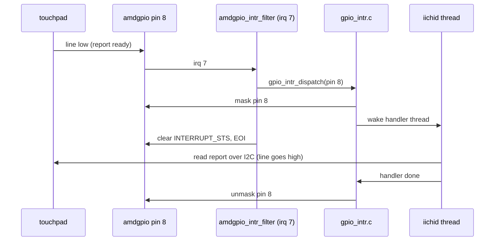

# GPIO interrupts on AMD: the ZBook touchpad stops polling

Patch: [amdgpio_intr.patch](amdgpio_intr.patch), two commits on branch
`olivier-amdgpio-intr` of github.com/ocochard/freebsd-src, on top of
`olivier-s2idle-wake` (a413caa2444c), whose `amdgpio` suspend code it
changes: 3a2f5d665cca "x86: Map GPIO pins to interrupt sources" and
154ee2ac2dd8 "amdgpio: Support pin interrupts".
Also in branch `zbook` (117cc1503848, 3d77c8d39e7e), where they were tested.
Machine: HP ZBook Ultra G1a, AMD Ryzen AI Max (Strix Halo), GPIO controller
AMDI0030.

This document explains the work for a first-year computer science student:
someone who knows C and what an operating system does, but has never looked
at FreeBSD interrupts, GPIO controllers or ACPI.
The generic half of the patch was written first for an Intel laptop and is
explained in [x86_gpio_intr_mtl.md](x86_gpio_intr_mtl.md); this document
summarizes it and explains the AMD half in detail.

## 1. Background

### 1.1 Interrupt or polling

A device raises an *interrupt* to tell the CPU "I have data for you".
Without an interrupt the driver must *poll*: ask the device again and again
whether it has data.
Polling wastes power when nothing happens and adds latency when something
does.

The touchpad and the touchscreen of this laptop are *I2C HID* devices:
they speak the USB HID report format over an I2C bus, and FreeBSD drives
them with `iichid(4)`.
An I2C bus has no interrupt line of its own, so each device has an extra
wire to signal "I have a report".
On this laptop that wire goes to a pin of the GPIO controller, not to the
interrupt controller of the CPU.

When `iichid` cannot get an interrupt it falls back to polling
(`sys/dev/iicbus/iichid.c:1182`):

```
iichid0: Interrupt setup failed
iichid0: Using sampling mode
```

### 1.2 How ACPI describes the wire

The firmware describes each device in ACPI tables.
The `_CRS` method ("current resource settings") of the touchpad returns,
among others, a `GpioInt` resource: "my interrupt is pin 8 of the GPIO
controller `\_SB.GPIO`, level triggered, active low".

| Device | ACPI path | I2C address | Interrupt |
|---|---|---|---|
| Touchpad SYNA3133 | `\_SB_.I2CA.TPAD` (DSDT) | 0x2c | GpioInt, pin 8, level, active low |
| Touchscreen ELAN2513 | `\_SB_.I2CC.TPL0` (SSDT) | 0x10 | GpioInt, pin 9, level, active low |

The touchscreen descriptor is a trap for anyone reading the table by hand:
its static buffer `SBFG` says pin 0, but its `_INI` method (run once when
the ACPI namespace is initialized) overwrites the pin field with
`INT1 = 0x09`.
The value that `_CRS` returns, and that the kernel uses, is pin 9.

### 1.3 Why x86 FreeBSD could not use a GpioInt

On arm64 and riscv, FreeBSD uses INTRNG, an interrupt framework where any
driver, including a GPIO controller, can be an interrupt controller for
other devices.
x86 does not use INTRNG: its interrupt sources are I/O APIC pins and MSI
messages only (`struct pic` and `struct intsrc` in
`sys/x86/include/intr_machdep.h`).
So on x86 `gpio_alloc_intr_resource()` returned NULL and
`acpi_iicbus.c` ignored GpioInt resources ("Not supported by FreeBSD yet").

The generic half of the patch (section 3.1) adds a small "GPIO PIC" to x86.
Each GPIO controller driver must then provide three operations for its own
hardware: configure the trigger mode of a pin, mask it, and unmask it.
This patch writes those operations for `amdgpio(4)`.

### 1.4 The AMD GPIO controller

`amdgpio` (`sys/dev/amdgpio/amdgpio.c`) drives the AMD FCH GPIO block,
memory-mapped at 0xfed81500 on this laptop.
Every pin has one 32-bit register at offset `pin * 4`.
The bits used here (`sys/dev/amdgpio/amdgpio.h`, same names as Linux
`drivers/pinctrl/pinctrl-amd.h`):

| Bits | Name | Meaning |
|---|---|---|
| 8 | `LEVEL_TRIG` | 1 = level triggered, 0 = edge triggered |
| 9-10 | `ACTIVE_LEVEL` | 0 = active high / rising, 1 = active low / falling, 2 = both edges |
| 11 | `INTERRUPT_ENABLE` | the pin records events in its status bit |
| 12 | `INTERRUPT_MASK` | despite the name, 1 = the event is delivered (unmasked) |
| 16 | `PIN_STS` | current level of the pin |
| 28 | `INTERRUPT_STS` | an event is pending; write 1 to clear |
| 29 | `WAKE_STS` | a wake event is pending; write 1 to clear |

All pins share one interrupt line to the I/O APIC (`irq 7` here).
After servicing it, the driver writes `EOI_MASK` into `WAKE_INT_MASTER_REG`
(offset 0xfc) so the block can raise the line again.

Before this patch, `amdgpio` already had a filter on irq 7, but only to
clear status bits: it masked and disabled every pin at attach, and nothing
could map a pin to a handler.

## 2. The problem

Every boot of the stock `zbook` kernel (`dmesg`, 2026-11-17):

```
iichid0: <SYNA3133:01 06CB:CFE2 I2C HID device> at addr 0x2c on iicbus17
iichid0: Interrupt setup failed
iichid0: Using sampling mode
iichid1: <ELAN2513:02 04F3:4356 I2C HID device> at addr 0x10 on iicbus19
iichid1: Interrupt setup failed
iichid1: Using sampling mode
```

`vmstat -i` shows no interrupt line for either device; the touchpad's I2C
controller `ig4iic0` takes 31 interrupts per second on average, the cost of
the polling transfers.

## 3. The fix

### 3.1 Generic part (from the Intel work, unchanged)

- `sys/x86/x86/gpio_intr.c` (new): reserves 32 IRQ numbers after the MSI
  range at boot (`gpio_intr_init()`, line 177), lets a GPIO controller
  register its operations (`gpio_intr_register()`, line 194), maps a pin to
  an IRQ (`gpio_intr_map()`, line 291) and runs the handlers of a pin
  (`gpio_intr_dispatch()`, line 351).
- `sys/dev/iicbus/acpi_iicbus.c`: maps the GpioInt of a child each time it
  allocates its interrupt (`acpi_iicbus_alloc_resource()`, line 464), so
  the GPIO driver may attach after the I2C bus.
- `sys/dev/gpio/gpiobus.c`: `gpio_alloc_intr_resource()` uses
  `gpio_intr_map()` on x86.

The Intel-only files of that patch (`intelgpio.c`, `mtlgpio.c`) are not
included.

### 3.2 AMD part

Three operations, modelled on Linux `pinctrl-amd.c`
(`amd_gpio_irq_set_type()`, `amd_gpio_irq_mask()`, `amd_gpio_irq_unmask()`):

- `amdgpio_intr_config()` (`amdgpio.c:399`) writes `LEVEL_TRIG` and
  `ACTIVE_LEVEL` for the requested mode, sets `INTERRUPT_ENABLE`, leaves the
  pin masked, and clears a stale event.
  A write to a pin register can block status generation while the debounce
  logic settles; during that time `INTERRUPT_ENABLE` reads 0.
  Linux waits for it to read 1 again with no limit; the patch waits at most
  10 ms and then fails the mapping, so `iichid` falls back to polling instead
  of hanging the boot.
- `amdgpio_intr_set_mask()` (`amdgpio.c:450`) clears or sets
  `INTERRUPT_MASK`.
  It clears the two status bits in the value it writes back: they are
  "write 1 to clear", so writing back what it read would drop a pending
  event.
  Linux writes back the read value, which drops a pending edge.

The filter on irq 7 (`amdgpio_intr_filter()`, `amdgpio.c:488`) now, for each
pin with a pending status:

1. skips the pin if it is enabled but masked: a handler is still running
   (the kernel masks a level-triggered source while its handler thread
   runs), so the event waits until the pin is unmasked;
2. if the pin is unmasked, calls `gpio_intr_dispatch()`, which runs the
   pin's handlers or wakes their thread;
3. reads the register again and writes it back, which clears the status.

The spin lock of the driver is dropped around `gpio_intr_dispatch()`: the
dispatch calls back into `amdgpio_intr_set_mask()`, which takes the same
lock, and a spin mutex may not be taken twice.



Smaller changes in the same file:

- The old filter looped over register indexes 0 to N-1 (N = number of
  exposed pins) instead of over the exposed pin numbers; it now uses
  `kernzp_pins[i].pin_num`.
- `amdgpio_detach()` (`amdgpio.c:677`) refuses with EBUSY while a device
  still has a handler on one of its pins, and restores the bus and its
  filter before returning.
- `amdgpio_suspend()` (`amdgpio.c:712`) masks and disables every pin that is
  not a wake pin, but `amdgpio_resume()` (`amdgpio.c:784`) only restored the
  wake pins: a mapped touchpad pin would stay masked after `zzz`.
  Suspend now saves each pin register in `sc_saved[]`, and resume writes it
  back.

### 3.3 What the patch does not fix

- The touchscreen.
  Its interrupt is mapped correctly, but the device sends nothing, in
  polling mode as well (section 4).
  That is a separate problem.
- The `_AEI` (ACPI event) pins 61-62, 58-59, 18 and 54.
  `gpiobus0: <unknown device> at pins 61-62,58-59,18,54` is unchanged: no
  driver attaches to that child at boot.
  If `gpioaei` attaches (it did after a manual `kldload amdgpio` on
  2026-11-11), it now gets real interrupts through the same path and runs
  the `_EVT` method; that case is untested.
- The `WAKE_INT_STATUS_REG0/1` optimization (read which groups of 4 pins
  are pending instead of every pin register) stays a TODO.

### 3.4 Alternatives

| Alternative | Why not |
|---|---|
| Port INTRNG to x86 | The right long-term design, but a rewrite of all x86 interrupt code. |
| Route the touchpad pin to an I/O APIC line | The AMD block has no per-pin routing to the I/O APIC; all pins share irq 7. |
| Keep polling, poll faster | Costs power and still adds latency; the hardware has an interrupt. |
| Copy Linux mask/unmask exactly | Linux writes back the status bits and drops a pending edge (section 3.2). |

## 4. Tested

Kernel `olivier-amdgpio-intr-n291263-fcbccb606aad-dirty` (GENERIC-NODEBUG,
built on the build host), booted once with `nextboot -k kernel.gpiointr` on the
laptop, 2026-11-17.
Counters from `vmstat -i`, sampled every 5 s.

| Configuration | Measured result |
|---|---|
| Boot | no "Interrupt setup failed", `dev.iichid.0.sampling_rate_slow: -1` (interrupt mode); `irq2104: iichid0`, `irq2105: iichid1` |
| Mapped pins (dtrace on `gpio_srcs`) | irq 2104 = pin 8, irq 2105 = pin 9, both mode 0x10000 (`GPIO_INTR_LEVEL_LOW`) |
| Touchpad idle | 0 interrupts/s on `gpio0` and `iichid0` (no interrupt storm) |
| Touchpad in use (move, click, drag) | `gpio0` and `iichid0` grow by the same amount in each burst: +164, +62, +125; pointer and clicks work |
| `kldunload amdgpio` while the touchpad uses it | refused, "Device busy"; the touchpad still works afterwards |
| Pin registers (read from `/dev/mem`) | pin 8 `0x08053b00`, pin 9 `0x00151b00`: level, active low, enabled, unmasked, no pending status |
| `zzz`, woken by a key | touchpad works: `gpio0` 965 to 1169 and `iichid0` 857 to 1061 (+204 each); 0/s idle for 90 s after resume; same pin registers as before suspend; no "unserviced interrupt" message |
| Touchscreen, interrupt mode | 105 interrupts at boot, then none while touched; pin 9 stays high |
| Touchscreen, polling mode (`dev.iichid.1.sampling_rate_slow=10`) | 0 bytes from `/dev/input/event7` in 2 minutes of touching, with `open 1 power_on 1 reset_acked 1` |

Not tested:

- `gpioaei` on these pins (it does not attach at boot);
- an edge-triggered GpioInt (both devices here are level triggered);
- a debounce timeout in `amdgpio_intr_config()`;
- other AMD platforms.

## 5. Reproduce

```sh
# Build (build host), ccache disabled: it can serve stale module objects
cd /tmp/fbsd-zbook            # a checkout of branch zbook
CCACHE_DISABLE=1 MAKEOBJDIRPREFIX=/tmp/obj-gpiointr-amd \
    make -j64 buildkernel KERNCONF=GENERIC-NODEBUG
MAKEOBJDIRPREFIX=/tmp/obj-gpiointr-amd make installkernel \
    KERNCONF=GENERIC-NODEBUG DESTDIR=/tmp/gpiointr-amd-dest \
    KODIR=/boot/kernel.gpiointr -DNO_ROOT

# Install next to the current kernel (laptop), keeping the out-of-tree
# modules (mt7925, amdgpu, amdisp) of /boot/kernel.zbook
cp -a /boot/kernel.zbook /boot/kernel.gpiointr
tar xf kernel.gpiointr.tar -C /boot     # the files of the DESTDIR above
kldxref /boot/kernel.gpiointr
nextboot -k kernel.gpiointr && shutdown -r now

# Check
dmesg | grep iichid                      # no "Using sampling mode"
vmstat -i | grep -E 'gpio0|iichid'       # counters move only on touch
sysctl dev.iichid.0.sampling_rate_slow   # -1 = interrupt mode
```
