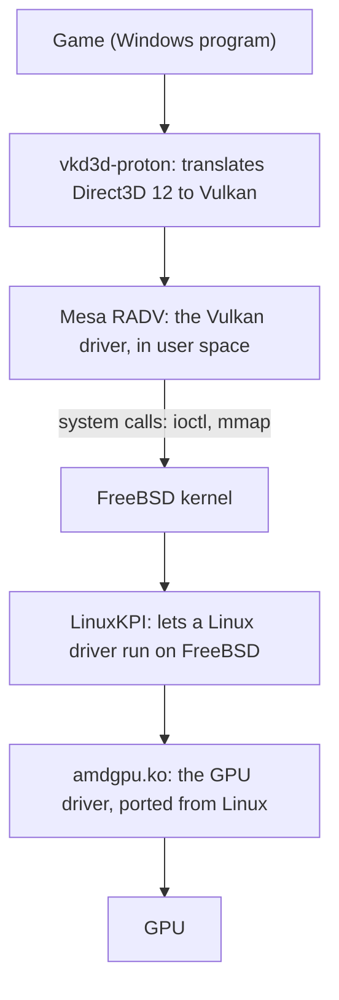
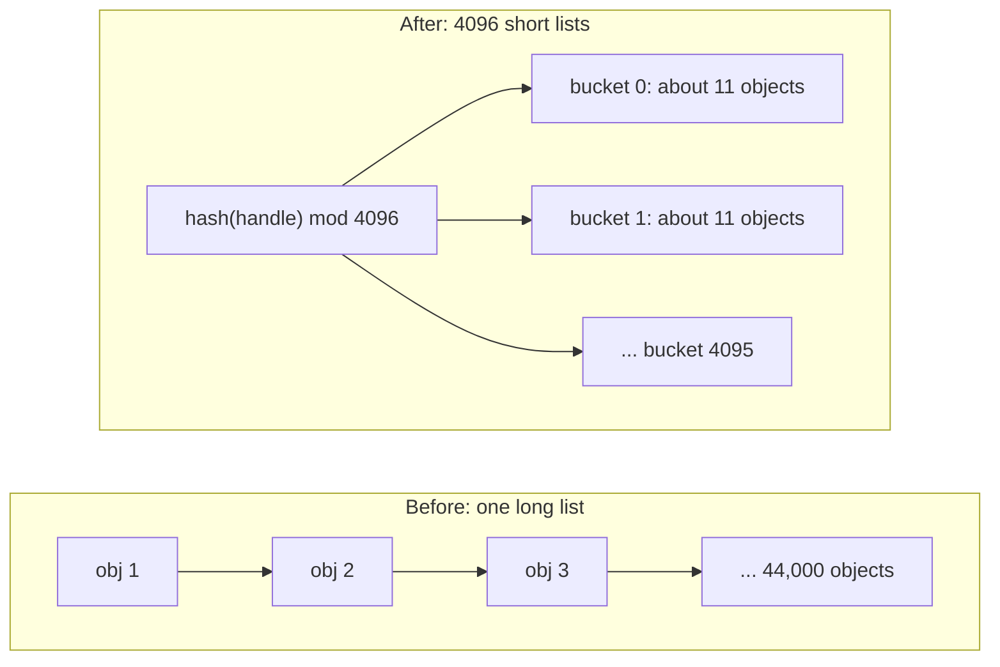
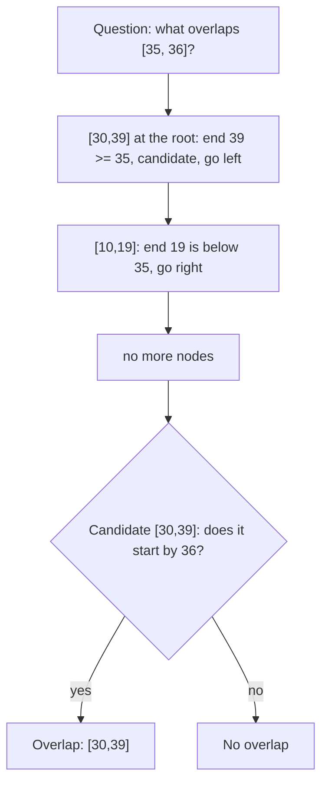
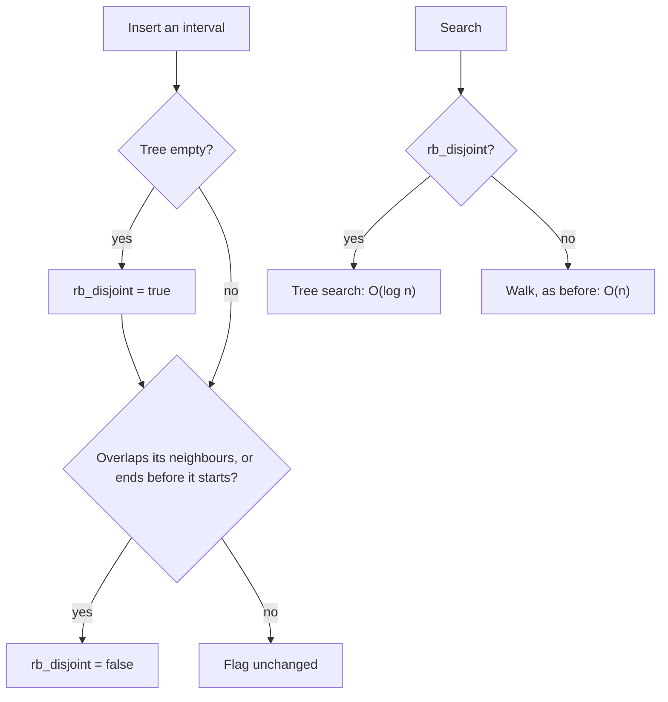
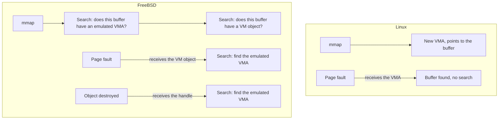

# Why a game was slow on FreeBSD: three linear scans in the kernel

```
Status:    both fixes booted and measured against the same kernel without them;
           another game fails with and without them, see section 7
Files:     sys/vm/device_pager.c
           sys/compat/linuxkpi/common/src/linux_compat.c
           sys/compat/linuxkpi/common/include/linux/interval_tree_generic.h
           sys/compat/linuxkpi/common/include/linux/rbtree.h
Base:      main at 7806832f23fb
Machine:   ser6, AMD Ryzen 7 7735HS, Radeon 680M, drm-latest-kmod 6.12.85
```

- Patch: [`amdgpu_map_cost_linear_scans.patch`](amdgpu_map_cost_linear_scans.patch) (both fixes, not committed)
- Reproducer: [`amdgpu_bo_scale.c`](amdgpu_bo_scale.c)
- Profiler: [`amdgpu_map_cost_profile.sh`](amdgpu_map_cost_profile.sh)

**Summary.** A Windows game running on FreeBSD managed 10 to 19 frames per
second, while the graphics chip sat idle about 78% of the time.  The chip was
waiting for the CPU, and the CPU was busy inside the kernel searching long lists
one item at a time.  Replacing two of those searches with hash tables removed
50% of the CPU work.  The profile then showed a third search of the same kind, and
fixing it too brought the searches down to well under 1% of the CPU work.  On the same
kernel source and driver, with and without the patch, the game went from a median of 10
to 40 frames per second, and its slowest moments from 2 to 38.  This document explains how we found them and how each one is fixed.  It assumes
you know what a list, a binary tree and a function call are, and nothing about
kernels or graphics.

---

## 1. The problem

### 1.1 The symptom

The game is a Windows title built with Unreal Engine 5, running through Wine at a
low resolution (1024x768).  Lowering the resolution should make the game faster
if the graphics chip (GPU) is the limit.  Here it did not help much:

| Measure | Value |
|---|---|
| Frames per second | median 10 to 14, about 19 while profiling |
| GPU busy | about 22% |
| Time in the kernel | 75% of CPU cycles |

A busy GPU would mean "draw less".  A GPU that is mostly idle means something
else is holding it back, so we looked at the CPU.

### 1.2 What the game asks the kernel to do

A program cannot touch the GPU directly.  It asks the kernel, through a chain of
translators:



The game and the drivers under it keep textures, geometry and the GPU's commands in
*buffer objects*, which are blocks of memory the GPU can use.  Section 1.5 shows
that most of them hold commands.  Each one needs two kinds of *mapping*, a record saying
"this address means this memory":

- a **CPU mapping**, created with `mmap`, so the program can write into the buffer;
- a **GPU mapping**, created with an `ioctl`, so the GPU can read it.

This game creates a lot of them: 45,000 CPU-visible mappings less than a minute
after starting, and 73,000 two minutes later.  Before creating a mapping, the
kernel has to look up what already exists.  This lookup is where the time goes.

### 1.3 What a linear scan costs

The simplest way to search a list is to look at each item until you find the
right one.  This is a *linear scan*.  With `n` items, it takes about `n / 2` steps
on average, so we write its cost as `O(n)`: twice as many items means twice as
much work *per search*.

If a program does `n` searches on a list that grows to `n` items, the total work
grows with `n * n`.  With 100 mappings nobody notices.  With 70,000, one lookup
takes more time than a whole frame has to spare.

### 1.4 Finding the guilty functions

A *profiler* interrupts the CPU thousands of times per second and records which
function was running.  A function that shows up in 20% of the samples used about
20% of the time.  On FreeBSD this is `pmcstat`.  It reported:

| Function | Share of CPU cycles | Searches |
|---|---|---|
| `vm_pager_object_lookup` | 18.35% | list of device memory objects |
| `linux_file_mmap` | 14.04% | list of CPU mappings |
| `linux_cdev_pager_populate` | 11.83% | same list |
| `linux_cdev_pager_dtor` | 5.97% | same list |
| **Total** | **50.2%** | |

Half of the machine's work was walking two lists.  The GPU driver itself used only
about 1%.

### 1.5 Where all these buffers come from

A benchmark that draws a lot does not trigger the problem.  GravityMark 1.89 can draw
millions of asteroids, so we tried it, in its Linux build with Vulkan and its Windows
build with Direct3D 12 through vkd3d-proton.  With 2,000,000 asteroids it created 54
and 190 buffer objects, and the Linux build held about 460 mappings for the whole run.  It
draws all the asteroids from a few large buffers.  The number of objects on screen does
not matter: what matters is how many separate buffers the program asks the kernel for.

So we counted the game's buffers with DTrace, on the patched kernel, by tracing the
`ioctl` that creates them (`amdgpu_gem_create_ioctl`) and recording the program code that
called it.  In 20 minutes of play the game created 60,774 buffers and freed 7,054:

| Size of a buffer | Buffers |
|---|---|
| 16 to 32 KiB | 27,925 |
| 64 to 128 KiB | 28,388 |
| 128 to 256 KiB | 2,581 |
| 2 MiB or more | about 1,200 |

Almost every buffer got one GPU mapping and one CPU mapping (60,750 and 60,278).  The
small ones are not
textures.  vkd3d-proton already places small textures and buffers inside large blocks
(16 or 32 MiB), so a 16 KiB texture never becomes a buffer of its own.  The game's
memory came to 721 buffers for 10 GB in a later 15-minute trace.

The small buffers come from the GPU's command lists.  A program records the GPU's work
in *command buffers*, and the Vulkan driver, Mesa RADV, gives each command buffer two
kernel buffers: one of 64 to 128 KiB for the commands, allocated with the command buffer,
and one of 16 KiB for data, allocated when recording starts.  These two kinds were 74%
of the buffers in that 15-minute trace.

The number of command buffers grows because nothing is given back:

- Direct3D 12 programs record commands through *command allocators*.  The game (Unreal
  Engine 5) creates new ones as it plays, and almost never destroys them: 19 created
  and 2 destroyed in 10 minutes, while 229 were in use.
- vkd3d-proton turns each command allocator into a Vulkan command pool.  When the game
  resets an allocator, vkd3d-proton keeps its command buffers for reuse, up to 256 per
  allocator, instead of freeing them.  New allocators received up to 64 each.
- RADV keeps the two kernel buffers of a command buffer for as long as the command
  buffer exists.

Over those 10 minutes, the mappings stayed flat at about 18,400 while no allocator was
created, and rose by about 800 in the two minutes that created 19 allocators and 357
command buffers.  Each new command buffer adds about two buffers, and so about four
kernel mappings.

None of these layers does anything wrong on its own.  We do not know what makes the game create
more allocators.  One guess, not checked: Unreal Engine creates one when all the others
are still waiting for the GPU, so a slow frame would lead to more allocators, more
buffers, and slower searches on the unpatched kernel.

The amount also varies between sessions: one reached 32,000 mappings after 6 minutes
and 77,000 later, another stayed near 19,000 after 30 minutes.  This is why section 3.9
started its profiles at the same number of mappings.

---

## 2. Fix 1: hash tables

### 2.1 The idea

Think of a library.  A linear scan means reading every shelf until you find the
book.  A hash table means computing the shelf number from the title, then looking
only at that shelf.

A *hash function* turns a key into a number.  Here the key is a pointer that
identifies the object, called its handle.  That number, modulo the table size,
picks a *bucket*: a short list.



With 44,000 objects and 4096 buckets, each bucket holds about 11 objects.  A
search goes from about 22,000 steps to about 6.

### 2.2 The change

Both lists became arrays of 4096 lists, and every access goes through one small
function that picks the bucket:

```c
#define	DEV_PAGER_HASH_SIZE	4096
static struct pagerlst dev_pager_object_list[DEV_PAGER_HASH_SIZE];

static struct pagerlst *
dev_pager_bucket(void *handle)
{

	return (&dev_pager_object_list[jenkins_hash(&handle, sizeof(handle),
	    0) & (DEV_PAGER_HASH_SIZE - 1)]);
}
```

The size is a power of two so that `& (size - 1)` gives the remainder cheaply.

### 2.3 What can go wrong

An object must be removed from the same bucket it was inserted in, so **its key
must not change while it is in the table**.  If it did, removal would search the
wrong bucket and corrupt the list.  This was checked in the source: the device
pager clears the handle only after removal, and the Linux compatibility code finds
the entry using the same key just before removing it.

The cost is 128 KB of kernel memory (64 KB per table), even on a machine without a
GPU.

### 2.4 The result

| Measure | Before | With fix 1 |
|---|---|---|
| The four functions above | 50.2% of cycles | about 0.2% |
| Frames per second | median 10 to 14 | median about 32 |
| GPU busy | about 22% | 67% |

The first line is direct evidence.  The frame rate is only suggestive: the kernel
also contained 234 unrelated commits, and the two runs may not have shown the same
scene.

---

## 3. Fix 2: the interval tree

### 3.1 A new function at the top

With the first bottleneck gone, the profile showed the next one:

```
26.96%  linux_root_RB_NEXT        called by amdgpu_vm_bo_map (99.9%)
```

That share comes from one 30-second run, and it changes a lot with what the game is
doing (see section 5).  This is normal when optimizing: removing the slowest step
reveals the next slowest.  `RB_NEXT` moves to the next item of a red-black tree.  Nobody calls it
27% of the time unless they are walking through the tree, which looks suspicious,
because the point of a tree is to *avoid* walking.

### 3.2 What the code does

Every GPU mapping covers a range of addresses, an *interval* such as `[1000, 1999]`.
Before adding one, `amdgpu_vm_bo_map` asks: does an existing mapping overlap this
range?  If so, the request is refused.

The driver stores its mappings in an *interval tree*, sorted by start address.  In
Linux, this search is `O(log n)`.  The FreeBSD compatibility version does this:

```c
/* start at the smallest item */
while (rb != NULL) {
	node = rb_entry(rb, type, field);
	if (LAST(node) >= start && START(node) <= last)
		return (node);		/* overlap found */
	else if (START(node) > last)
		break;			/* past the range, stop */
	rb = rb_next(rb);		/* next item */
}
```

It is a linear scan wearing a tree's clothes.  It starts from the lowest address
and visits items in order until it passes the requested range.

### 3.3 Why it cannot simply search the tree

The tree is sorted by start address, so why not jump straight to the right place?
Because an interval that starts *much earlier* can still reach the range:

```
Mappings:   [0 ........................ 100]
                [10,11]     [50,51]
Question:   does anything overlap [60, 60]?
```

The closest start address below 60 is 50, and `[50, 51]` does not overlap.  Stopping
there gives the wrong answer: `[0, 100]` does overlap.  Linux solves this by storing
in each tree node the highest end address found below it.  That needs a hook that
runs whenever the tree rebalances, and the tree code in LinuxKPI has none.

### 3.4 The observation that makes it simple

The example above needs intervals that overlap each other.  **The amdgpu driver
never stores overlapping mappings**: `amdgpu_vm_bo_map` refuses them, and
`amdgpu_vm_bo_clear_mappings` removes the old ones before inserting the new
pieces.

If no intervals overlap, each one ends before the next one starts.  So when they
are sorted by start, they are *also sorted by end*:

```
[10,19]   [30,39]   [50,59]   [70,79]     starts: 10 30 50 70
                                          ends:   19 39 59 79
```

Now an ordinary tree search works: find the first interval whose end is at or above
the start of the question, then check that it starts early enough.



With 73,000 mappings, a red-black tree needs at most about 32 steps.

### 3.5 Knowing when the shortcut is safe

The interval tree is generic code, used by other drivers that may allow overlaps.
So the tree needs to know if the shortcut is valid.  We added one flag to its root:

```c
struct rb_root_cached {
	struct rb_root rb_root;
	struct rb_node *rb_leftmost;
	bool rb_disjoint;	/* interval_tree: no intervals overlap */
};
```



Three details matter:

- **Checking only the two neighbours is enough.**  If the tree has no overlaps and
  the new interval does not overlap the items just before and after it, it overlaps
  nothing.  The search for the insertion point has already visited both neighbours,
  so this costs almost nothing.
- **The flag starts false, and only an insert into an empty tree sets it.**  One
  driver, `drm_mm`, adds items directly without going through this code.  Its tree
  never gets the flag, so it keeps using the walk and stays correct.
- **Removing an item never clears the flag**, because removing cannot create an
  overlap.

The worst case is the old behaviour, so no tree can become slower at searching.

### 3.6 Testing it

The change was tested outside the kernel, in a small program that includes the real
header.  It compared 748,080 searches against a brute-force check, with disjoint,
overlapping and malformed intervals, and with a tree filled the way `drm_mm` does.

A test that cannot fail proves nothing, so we also broke the logic on purpose in
five ways.  Four were caught immediately.  The fifth survived, which revealed that
the test did not cover it, so a test mode was added and it was caught too.

On 73,000 intervals in that program:

| Search | Time per lookup |
|---|---|
| Walk | about 525,000 ns |
| Tree search | about 86 ns |

These are userland numbers.  The kernel will not match them exactly.

### 3.7 The price

The structure grows from 16 to 24 bytes.  Unlike fix 1, this code is a macro that
gets compiled *into* the driver, so **a new kernel alone changes nothing: the
drm-kmod modules must be rebuilt** against the new headers.  An old `radeon.ko` must
not be loaded on the new kernel: it calls functions in the kernel while passing the
old, smaller structure, and the kernel would read and write past its end.  A commit
needs a `__FreeBSD_version` bump so that ports get rebuilt.

### 3.8 The result

With both fixes, the game was profiled twice in one session, for 60 seconds each:

| Measure | Run 1 | Run 2 |
|---|---|---|
| Mappings at the end of the run | 35,537 | 77,833 |
| New mappings per second | 231 | 322 |
| `linux_root_RB_NEXT` | 0.03% | 0.03% |
| `vm_pager_object_lookup` | 0.02% | 0.07% |
| `linux_file_mmap` | 0.02% | 0.06% |
| `linux_cdev_pager_populate` | 0.01% | 0.02% |
| `linux_cdev_pager_dtor` | 0.00% | 0.00% |
| **All five functions** | **0.08%** | **0.18%** |
| Kernel share of the game's CPU time | 10.2% | 10.0% |
| Frames per second, median | 49.9 | 45.3 |
| Frames per second, slowest 10% below | 46.1 | 42.6 |

The tree search did not get slower when the mappings more than doubled.  The hash
table functions did, as expected: with 77,833 mappings a bucket holds about 19 items
instead of 9.  The cost is still far too small to justify a larger table here.  Section 4
shows where this table size reaches its limit.

Over the whole work, the same five functions went from more than 50% of CPU cycles
to 0.18%, and the median frame rate from 10 to 14 to 45 to 50.  The first number is
direct evidence.  The frame rate is only suggestive: the scene was not controlled, and
the runs also differ by 234 unrelated commits and a newer driver (6.12.85).  So we
cannot say how much of the gain comes from fix 2 alone.  Section 3.9 removes those
differences.  The frame rate also fell
between the two runs while the searches stayed negligible, so that fall has another
cause, which we did not identify.  GPU load was not recorded in these runs.

### 3.9 The same kernel without the fixes

To remove the 234 commits and the driver from the comparison, we built the same source
commit and the same driver version without the patch, and booted them once.  The game
gave this after a few minutes:

| Measure | No fixes |
|---|---|
| Mappings at the end of the run | 20,156 |
| New mappings per second | 13 |
| `linux_root_RB_NEXT` | 0.40% |
| `vm_pager_object_lookup` | 6.02% |
| `linux_file_mmap` | 5.07% |
| `linux_cdev_pager_populate` | 4.31% |
| `linux_cdev_pager_dtor` | 2.91% |
| **All five functions** | **18.71%** |
| Kernel share of the game's CPU time | 15.7% |
| Frames per second, median | 38.5 |
| Frames per second, slowest 10% below | 36.5 |

This is one run with far fewer mappings than the runs of section 3.8, so it cannot be
compared with them directly.  It does show the searches at 18.71% with only 20,156
mappings.  The game creating only 13 mappings per second also explains the low share for
`linux_root_RB_NEXT`.

The frame rate is a warning about our first numbers.  This kernel stayed at about 34 to
47 frames per second for most of a 37-minute session, against 10 to 14 on the older
kernel.  We did not record the mapping count over that session, and it may have been an
easier scene, but some of the early gain may come from the other commits or the newer
driver.  Near the end, the rate fell to about 3 frames per second and the game stopped.
It left no crash report and no GPU error, and it was not out of memory.  The profiler
missed that moment, so we do not know the cause.

For a real before and after, the game was then played in the same area on both kernels,
with the same in-game light source equipped, and a profile started by itself once the
game passed 35,000 mappings:

| Measure | No fixes | Both fixes, first profile | Both fixes, second profile |
|---|---|---|---|
| Mappings at the end of the run | 42,272 | 70,305 | 76,798 |
| New mappings per second | 110 | 553 | 22 |
| `linux_cdev_pager_populate` | 25.55% | 0.03% | 0.01% |
| `vm_pager_object_lookup` | 10.42% | 0.08% | 0.02% |
| `linux_file_mmap` | 10.05% | 0.10% | 0.03% |
| `linux_root_RB_NEXT` | 9.20% | 0.04% | 0.02% |
| `linux_cdev_pager_dtor` | 2.26% | 0.00% | 0.00% |
| **All five functions** | **57.49%** | **0.26%** | **0.07%** |
| `lock_delay` | 15.74% | 1.41% | below the top 10 |
| Kernel share of the game's CPU time | 66.8% | 11.6% | 11.0% |
| Frames per second, median | **10.3** | **40.2** | **41.8** |
| Frames per second, slowest 10% below | **2.3** | **38.3** | **39.4** |
| CPU cores used by the game | 2.03 | 3.69 | 3.49 |

The first patched profile is the one to compare: it was creating mappings five times
faster than the unpatched run and held more of them, and it still spent almost nothing
on the searches.  The second one created few mappings, so its 0.07% proves little, but
its frame rate shows the game holding up at a size the unpatched kernel never reached:
that game stopped at 56,077 mappings.  Over the whole 18-minute patched session, the
median was 43.0 frames per second.

`lock_delay` is time spent waiting for a lock.  It probably falls because the searches no
longer hold their global locks for so long, but we did not trace which lock it was.

This is one session on each kernel, and the area was matched by hand, so the frame rates
are approximate.  The search shares are the stronger evidence.  The unpatched rate also
varies a lot with what the game is doing, as the earlier 37-minute session shows.  The
game stopping is a separate problem, because it also happens with the fixes (section 7).

---

## 4. Reproducing it without the game

Asking people to install a large game to test a kernel patch is not practical.  The
problem needs only one thing: many buffer objects.  [`amdgpu_bo_scale.c`](amdgpu_bo_scale.c) is about 200 lines, draws
nothing, and needs only libdrm:

```sh
pkg install libdrm
cc -O2 -Wall -I/usr/local/include -I/usr/local/include/libdrm \
    -L/usr/local/lib amdgpu_bo_scale.c -ldrm_amdgpu -o amdgpu_bo_scale
./amdgpu_bo_scale 30000
```

It needs an AMD GPU, membership of the `video` group and 120 MB of GPU-visible
memory.  It takes about a minute on the affected kernel.

The program explains its columns before the results, and `-h` shows the same text.
Each line is the average cost of one operation in microseconds.  **A healthy kernel
gives flat columns.**  A column that grows means a linear scan.  Here are the results
for the kernel with fix 1 but not fix 2, while a `buildworld` ran on the same machine
(this run predates the explanations and the growth lines):

```
 objects   bo_alloc gpu_va_map   cpu_mmap
   10000        6.8      267.3        6.3
   20000       10.2     1598.9       10.1
   30000       14.0     3351.5       15.0
   40000       17.9     5035.2       29.8
   50000       18.1     5915.4       30.5
   60000       21.4     8982.5       25.8
```

`gpu_va_map` is the interval tree: about 34 times slower at 60,000 objects than at
the start.  (This run asked for more objects than the default 30,000.)  The profiler
confirms it is the same bug as in the game, with 95% of the program's cycles in
`linux_root_RB_NEXT`.

With both fixes, on an idle machine, the column is flat:

```
 objects   bo_alloc gpu_va_map   cpu_mmap
   10000        2.1        3.7        1.4
   20000        2.3        3.9        1.6
   30000        2.5        3.4        1.8

growth from first to last line:
  bo_alloc    x1.2  flat
  gpu_va_map  x0.9  flat
  cpu_mmap    x1.3  flat

teardown (freeing everything): cpu_munmap 1.0 gpu_va_unmap 4.7 bo_free 2.0
```

The program calls a column "growing" above x3, and "flat" below.  This limit is a
rule of thumb: we measured at most x1.3 with both fixes, and x12.5 for `gpu_va_map` at
30,000 objects without fix 2.  It needs at least three result lines and batches of 10,000
objects, so a smaller run prints no verdict: with both fixes, `gpu_va_map` still rose
about x3 from 1,000 to 3,000 objects, before staying flat from 10,000 on.  We do not
know why, and the verdict is not a pass or fail: a busy machine can move these values.

The two runs above should not be compared number by number, because the first one
shared the machine with a build.  What matters is the shape: `gpu_va_map` no longer
grows with the number of objects.

The fair comparison is the same source commit and the same driver version, with and
without the patch, on an idle machine.  Without the patch, every column grows.  One run
with 50,000 objects, with the profiler below sampling its first 30 seconds:

```
 objects   bo_alloc gpu_va_map   cpu_mmap
   10000       31.4       62.8      101.6
   20000      109.0      273.2      439.5
   30000      201.9     1068.5     1496.5
   40000      345.3     2178.2     2968.2
   50000      577.9     2861.7     4053.8

growth from first to last line:
  bo_alloc    x18.4  growing
  gpu_va_map  x45.6  growing
  cpu_mmap    x39.9  growing

teardown (freeing everything): cpu_munmap 1.1 gpu_va_unmap 4.4 bo_free 2.3
```

And at 30,000 objects, the default, in microseconds per operation:

| Kernel | Runs | `bo_alloc` | `gpu_va_map` | `cpu_mmap` |
|---|---|---|---|---|
| No fixes | 4 | 137 to 223 | 861 to 1015 | 876 to 1403 |
| Both fixes | 5 | 2.3 to 2.5 | 3.4 to 4.0 | 1.6 to 1.8 |

That makes `gpu_va_map` about 250 times faster, and `cpu_mmap` about 500 to 850 times
faster.  The whole default run takes about 36 seconds without the fixes, and 0.48 seconds
with them.  Freeing is not affected: the teardown costs the same on both kernels, so these
scans only cost anything when creating objects.

The unpatched values vary a lot between runs.  The first value of a run can double, so
the growth ratio moves too (x7 to x15 for `cpu_mmap` at 30,000 objects).  Quote the
values at 30,000 objects rather than the ratios.

The profiler from section 5 also works on this program, with no game and no scene to
control.  While it ran, 95.34% of all CPU cycles on the machine were in three scans:

```
sudo sh amdgpu_map_cost_profile.sh -d 30 -o report.txt amdgpu_bo_scale

scan_linux_root_RB_NEXT_pct=34.26
scan_vm_pager_object_lookup_pct=28.86
scan_linux_file_mmap_pct=32.22
scan_linux_cdev_pager_populate_pct=0.00
scan_linux_cdev_pager_dtor_pct=0.00
scan_total_pct=95.34
```

Start it just after the program, and ask for at least 50,000 objects so that the program
outlives the sampling.  The last two scans stay at zero because this program never touches
the mapped memory and frees nothing during the sampling, so it covers three of the five
scans.

With the fixes the program is too fast to sample at this size, so we ran it with 800,000
objects, ten times more than the game used:

```
 objects   bo_alloc gpu_va_map   cpu_mmap
  100000        2.8        2.9        2.1
  400000       10.1        2.0       10.3
  800000       19.7        1.9       20.5

growth from first to last line:
  bo_alloc    x7.0  growing
  gpu_va_map  x0.7  flat
  cpu_mmap    x9.5  growing
```

This shows the difference between the two fixes.  The tree search stays flat, as `O(log n)`
should.  A hash table with a fixed size is still `O(n)`: it only makes each list 4096 times
shorter.  At about 370,000 objects, the two hash lookups took 61.97% of the cycles.  This
does not matter for this game, which reached about 78,000 mappings and spent 0.26% on all
the searches, and 20 microseconds is still far from the 4,000 microseconds at 50,000 objects
without the fixes.  But a table that grows with its content would remove this limit.  The
growth in `bo_alloc` follows `cpu_mmap` here, which suggests it depends on these lookups.

We have not traced why `bo_alloc` grows without the patch: no other function shows up in
the profile, so its time must go to these same scans.

This program proves the scaling problem and whether it is gone.  It says nothing
about frames per second.

---

## 5. Measuring a real game, before and after

[`amdgpu_map_cost_profile.sh`](amdgpu_map_cost_profile.sh) samples all CPUs with `pmcstat` while the game runs, and
writes a report.  `-h` explains every value in it:

```sh
# Boot the kernel to test, start the game, and play for a few minutes
sudo sh amdgpu_map_cost_profile.sh -o before.txt Win64-Shipping

# Boot the other kernel, and reach the same scene
sudo sh amdgpu_map_cost_profile.sh -o after.txt Win64-Shipping

sh amdgpu_map_cost_profile.sh -c before.txt after.txt
```

The main number is `scan_total_pct`, the share of all CPU samples spent in the
scans.  With both fixes it was 0.08% and 0.18% in our runs (section 3.8).

With Wine, target the game (`Win64-Shipping`), not the idle `wine` launcher.  The
script refuses a process that used no CPU.

To record frames per second as well, start the game with the Mesa overlay and pass
its log with `-f`:

```sh
VK_INSTANCE_LAYERS=VK_LAYER_MESA_overlay \
VK_LAYER_MESA_OVERLAY_CONFIG=output_file=$HOME/frames.csv,frame_timing,gpu_timing \
    ./game
sudo sh amdgpu_map_cost_profile.sh -f $HOME/frames.csv -o after.txt Win64-Shipping
```

For a fair comparison:

- **Use the same scene, and the same time since the game started.**  The scans get
  longer as the game runs, so a run made just after starting looks better.
- **Check that the game is creating mappings.**  The scans only run when it does.
  On the same kernel, `linux_root_RB_NEXT` took about 20% of samples in two
  30-second runs and 0.01% in the next one.  A later 20-second run with
  `new_mappings_per_s=0` gave 0.02%.  So a low share proves nothing if the game was
  not creating mappings: repeat the runs, and compare `new_mappings_per_s`.
- **Keep the machine idle.**  Samples come from all CPUs, so a build running in
  parallel lowers every share and slows the game down.  `other_cores` shows this:
  above about 1, the run is not comparable.
- **Compare the same kernel base if you can.**  Otherwise other commits are part of
  the difference.

We first sampled only the game, to ignore other load.  On this game, with 125
threads, that lost most samples and sometimes all of them, so the script samples
all CPUs.

The script knows the AMD cycles event, and the Intel ones by name only: it has not
been run on an Intel CPU.  Set `PMC_EVENT` if it cannot find one (see `pmcstat -L`).

---

## 6. How Linux avoids these scans

The driver comes from Linux, where these scans do not happen.  The reasons differ:
the GPU mapping search is an optimization that LinuxKPI left out, and the CPU
mapping searches come from a difference in how the two kernels manage memory.

The driver code quoted here was read in the drm-kmod 6.12-lts branch.  The
description of the Linux memory manager was not checked against the Linux source
for this document.

### 6.1 GPU mappings: an optimization left out

Section 3.3 described the Linux method: each tree node stores the highest end
address found below it, so a search can skip whole branches.  The driver is already
written for this.  Its mapping structure has the field, and it gives the field's
name to the macro that creates the tree:

```c
uint64_t __subtree_last;	/* in struct amdgpu_bo_va_mapping */

INTERVAL_TREE_DEFINE(struct amdgpu_bo_va_mapping, rb, uint64_t, __subtree_last,
    START, LAST, static, amdgpu_vm_it)
```

The LinuxKPI version of this macro names that argument `dummy` and ignores it, so
the field is never filled in.  `drm_mm.c` shows the same split: it calls
`rb_insert_augmented_cached` on Linux and plain `rb_insert_color_cached` on FreeBSD.

Keeping the field correct means updating it on every tree rotation.  LinuxKPI
generates its rotation code once, for all users of its trees, and that code has no
hook for it.  A hook would also need per-type code, because the field is at a
different place in each structure.

So fix 2 is a shortcut, not what Linux does:

| | Fix 2 (flag) | Linux method (subtree maximum) |
|---|---|---|
| Trees that get faster | only those where nothing overlaps | all of them |
| `drm_mm` | keeps the walk | fast |
| Changes needed | one flag and the search macros | a rotation hook in LinuxKPI, and a drm-kmod change |

`drm_mm` has not been a hotspot in our profiles, so the shortcut covers the search
we measured: `linux_root_RB_NEXT` fell to 0.03% (section 3.8).  A FreeBSD reviewer may
still prefer the complete version, so we plan to name the Linux method as the
alternative when proposing this one.

### 6.2 CPU mappings: two different designs

On Linux, `mmap` creates a record of the mapping, a VMA, that points to the buffer
object.  When the program first touches the memory, a *page fault* happens, and the
handler receives that VMA directly.  Nothing has to be searched by handle.

On FreeBSD, every mapping must be backed by a *VM object*, the kernel's description
of a piece of memory, and all the mappings of one buffer must share the same object.
So `mmap` has to answer a question that Linux never asks: does this buffer already
have an object?



There is no Linux code to port here.  The hash tables of fix 1 speed up these
searches without changing the design.

### 6.3 Could FreeBSD remove the searches completely?

Partly.  These ideas come from reading the code, and none has been written or tested.

| Function | Can it go? | How |
|---|---|---|
| `linux_cdev_pager_populate` | Yes, easily | The page fault already has the VM object, so a new field in it could point to the emulated VMA. |
| `vm_pager_object_lookup` | Mostly | It repeats a search LinuxKPI has just done.  A buffer already mapped could reuse its stored object, and a new one would need an allocate call that skips the lookup. |
| `linux_cdev_pager_dtor` | Only with an API change | `cdev_pg_dtor` receives only the handle, and every device pager user would have to change. |
| `linux_file_mmap` | Only with driver changes | This is the search that finds a shared object.  Skipping it means keeping a pointer in each buffer object, so drm-kmod and every other LinuxKPI user with an `mmap` handler would have to provide one. |

A bigger idea is to copy the Linux layout, where one device has one address space and
each buffer sits at its own offset.  With one VM object per device, `mmap` would need
no per-buffer lookup.  The obstacle is that FreeBSD has no callback for each mapping.
LinuxKPI calls the driver's `close` function from the object's destructor, so
per-buffer objects are how it knows that a buffer's mappings are gone.  Changing this
means redesigning the pager, which is far beyond this bug.

**Conclusion: keep the hash tables.**  With fix 1, these four functions already take
about 0.2% of CPU cycles in the scene we measured, so removing the searches could gain
no more than that.  Fix 1 changes about 60 lines and no API, and it has been measured.
A hash table is the right tool when a search cannot be designed away cheaply.

---

## 7. What this does not fix

- **Another game fails with and without the patch.**  Fort Solis, also built with Unreal
  Engine 5, never reached a playable world in six runs on this machine.  It failed in
  several ways, on both kernels:

  | Result | No fixes (4 runs) | Both fixes (2 runs) |
  |---|---|---|
  | `ring gfx_0.0.0 timeout`, and the game loses the GPU | 1 | 1 |
  | `[gfxhub] page fault`, then `ring comp_1.0.1 timeout` | 0 | 1 |
  | The game crashes on a null pointer after 15 to 20 seconds | 2 | 0 |
  | Reaches the menu, but the game world stays black | 1 | 0 |

  The GPU hang happens without the patch, so the patch does not cause it.  The cause is
  somewhere else in the stack (the game, vkd3d-proton, Mesa or the driver), and we have not
  found it.  The page fault has only been seen with the patch, once.  It means the GPU used
  an address with no valid mapping, and fix 2 changes the tree that tracks those mappings,
  so we cannot rule fix 2 out.  Reading how `amdgpu_vm.c` uses the tree found no bug: the
  driver only changes an interval while it is outside the tree.  With so few runs and such
  varied failures, one fault does not point at the patch either.  It is worth watching
  for when testing this patch.
- The game of the main test also stopped three times without the fixes: after about 37
  minutes, 1 minute and 5 minutes.  There was no crash report, GPU error or out-of-memory
  kill, and two of the stops came after the frame rate fell to about 1 to 3 per second.
  We do not know why.  It also stopped with both fixes, after about 18 minutes and with no
  fall in the frame rate before it, at about 47 frames per second.  So the searches do not
  explain these stops.  It left no crash report or GPU error there either.
- The global locks stay.  They should be held for much less time now, but the lists
  are still protected by one lock each.
- A tree with even one overlapping interval keeps the slow walk until it is emptied.
- A game may be limited by something else once these are gone.  With fix 1, the GPU
  went from 22% to 67% busy, so at some point the GPU becomes the real limit, which
  is a good problem to have.

## 8. What to remember

1. **Profile before guessing.**  We first blamed the GPU, then guessed a modest gain.
   The profiler showed 50%.
2. **`O(n)` is invisible until `n` is large.**  This code worked for years, because
   typical programs do not have 70,000 mappings.
3. **Fixing a bottleneck reveals the next one.**  Measure again after each fix.
4. **Look for a property of your data.**  A general interval tree is hard.  An
   interval tree where nothing overlaps needs a flag and a normal tree search.
5. **Break your code on purpose to test your test.**
