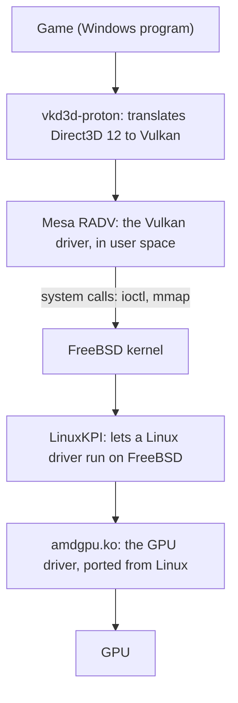
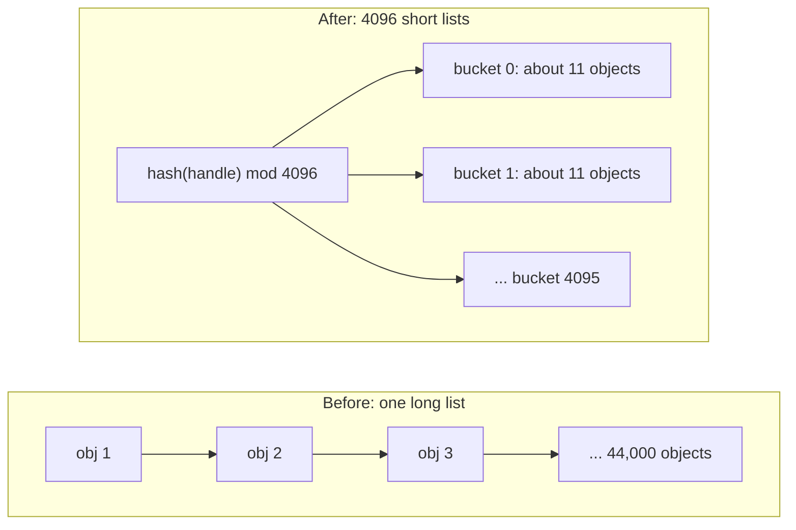
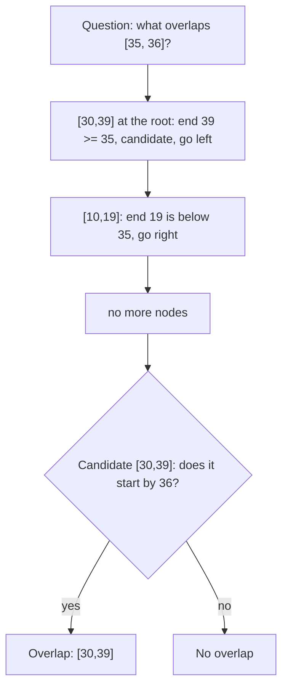
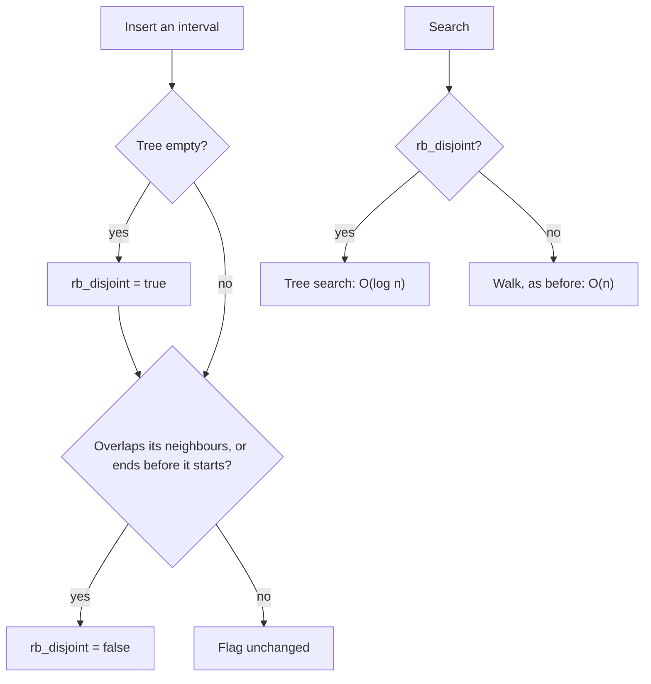

# Why a game was slow on FreeBSD: three linear scans in the kernel

```
Status:    fix 1 (hash tables) booted and measured; fix 2 (interval tree) written
           and tested in userland only, not built into a kernel yet
Files:     sys/vm/device_pager.c
           sys/compat/linuxkpi/common/src/linux_compat.c
           sys/compat/linuxkpi/common/include/linux/interval_tree_generic.h
           sys/compat/linuxkpi/common/include/linux/rbtree.h
Patch:     amdgpu_map_cost_linear_scans.patch (both fixes, not committed)
Base:      main at 7806832f23fb
Machine:   ser6, AMD Ryzen 7 7735HS, Radeon 680M, drm-latest-kmod 6.12
Tools:     amdgpu_bo_scale.c (reproducer), amdgpu_map_cost_profile.sh (profiler)
```

**Summary.** A Windows game running on FreeBSD managed 10 to 19 frames per
second, while the graphics chip sat idle about 78% of the time.  The chip was
waiting for the CPU, and the CPU was busy inside the kernel searching long lists
one item at a time.  Replacing two of those searches with hash tables removed
50% of the CPU work.  The profile then showed a third search of the same kind.
This document explains how we found them and how each one is fixed.  It assumes
you know what a list, a binary tree and a function call are, and nothing about
kernels or graphics.

---

## 1. The problem

### 1.1 The symptom

The game is a Windows title built with Unreal Engine 5, running through Wine at a
low resolution (1024x768).  Lowering the resolution should make the game faster
if the graphics chip (GPU) is the limit.  Here it did not help much:

| Measure | Value |
|---|---|
| Frames per second | median 10 to 14, about 19 while profiling |
| GPU busy | about 22% |
| Time in the kernel | 75% of CPU cycles |

A busy GPU would mean "draw less".  A GPU that is mostly idle means something
else is holding it back, so we looked at the CPU.

### 1.2 What the game asks the kernel to do

A program cannot touch the GPU directly.  It asks the kernel, through a chain of
translators:



The game stores its textures and geometry in *buffer objects*, which are blocks
of memory the GPU can use.  Each one needs two kinds of *mapping*, a record saying
"this address means this memory":

- a **CPU mapping**, created with `mmap`, so the program can write into the buffer;
- a **GPU mapping**, created with an `ioctl`, so the GPU can read it.

This game creates a lot of them: 45,000 CPU-visible mappings less than a minute
after starting, and 73,000 two minutes later.  Before creating a mapping, the
kernel has to look up what already exists.  This lookup is where the time goes.

### 1.3 What a linear scan costs

The simplest way to search a list is to look at each item until you find the
right one.  This is a *linear scan*.  With `n` items, it takes about `n / 2` steps
on average, so we write its cost as `O(n)`: twice as many items means twice as
much work *per search*.

If a program does `n` searches on a list that grows to `n` items, the total work
grows with `n * n`.  With 100 mappings nobody notices.  With 70,000, one lookup
takes more time than a whole frame has to spare.

### 1.4 Finding the guilty functions

A *profiler* interrupts the CPU thousands of times per second and records which
function was running.  A function that shows up in 20% of the samples used about
20% of the time.  On FreeBSD this is `pmcstat`.  It reported:

| Function | Share of CPU cycles | Searches |
|---|---|---|
| `vm_pager_object_lookup` | 18.35% | list of device memory objects |
| `linux_file_mmap` | 14.04% | list of CPU mappings |
| `linux_cdev_pager_populate` | 11.83% | same list |
| `linux_cdev_pager_dtor` | 5.97% | same list |
| **Total** | **50.2%** | |

Half of the machine's work was walking two lists.  The GPU driver itself used only
about 1%.

---

## 2. Fix 1: hash tables

### 2.1 The idea

Think of a library.  A linear scan means reading every shelf until you find the
book.  A hash table means computing the shelf number from the title, then looking
only at that shelf.

A *hash function* turns a key into a number.  Here the key is a pointer that
identifies the object, called its handle.  That number, modulo the table size,
picks a *bucket*: a short list.



With 44,000 objects and 4096 buckets, each bucket holds about 11 objects.  A
search goes from about 22,000 steps to about 6.

### 2.2 The change

Both lists became arrays of 4096 lists, and every access goes through one small
function that picks the bucket:

```c
#define	DEV_PAGER_HASH_SIZE	4096
static struct pagerlst dev_pager_object_list[DEV_PAGER_HASH_SIZE];

static struct pagerlst *
dev_pager_bucket(void *handle)
{

	return (&dev_pager_object_list[jenkins_hash(&handle, sizeof(handle),
	    0) & (DEV_PAGER_HASH_SIZE - 1)]);
}
```

The size is a power of two so that `& (size - 1)` gives the remainder cheaply.

### 2.3 What can go wrong

An object must be removed from the same bucket it was inserted in, so **its key
must not change while it is in the table**.  If it did, removal would search the
wrong bucket and corrupt the list.  This was checked in the source: the device
pager clears the handle only after removal, and the Linux compatibility code finds
the entry using the same key just before removing it.

The cost is 128 KB of kernel memory (64 KB per table), even on a machine without a
GPU.

### 2.4 The result

| Measure | Before | With fix 1 |
|---|---|---|
| The four functions above | 50.2% of cycles | about 0.2% |
| Frames per second | median 10 to 14 | median about 32 |
| GPU busy | about 22% | 67% |

The first line is direct evidence.  The frame rate is only suggestive: the kernel
also contained 234 unrelated commits, and the two runs may not have shown the same
scene.

---

## 3. Fix 2: the interval tree

### 3.1 A new function at the top

With the first bottleneck gone, the profile showed the next one:

```
26.96%  linux_root_RB_NEXT        called by amdgpu_vm_bo_map (99.9%)
```

That share comes from one 30-second run, and it changes a lot with what the game is
doing (see section 5).  This is normal when optimizing: removing the slowest step
reveals the next slowest.  `RB_NEXT` moves to the next item of a red-black tree.  Nobody calls it
27% of the time unless they are walking through the tree, which looks suspicious,
because the point of a tree is to *avoid* walking.

### 3.2 What the code does

Every GPU mapping covers a range of addresses, an *interval* such as `[1000, 1999]`.
Before adding one, `amdgpu_vm_bo_map` asks: does an existing mapping overlap this
range?  If so, the request is refused.

The driver stores its mappings in an *interval tree*, sorted by start address.  In
Linux, this search is `O(log n)`.  The FreeBSD compatibility version does this:

```c
/* start at the smallest item */
while (rb != NULL) {
	node = rb_entry(rb, type, field);
	if (LAST(node) >= start && START(node) <= last)
		return (node);		/* overlap found */
	else if (START(node) > last)
		break;			/* past the range, stop */
	rb = rb_next(rb);		/* next item */
}
```

It is a linear scan wearing a tree's clothes.  It starts from the lowest address
and visits items in order until it passes the requested range.

### 3.3 Why it cannot simply search the tree

The tree is sorted by start address, so why not jump straight to the right place?
Because an interval that starts *much earlier* can still reach the range:

```
Mappings:   [0 ........................ 100]
                [10,11]     [50,51]
Question:   does anything overlap [60, 60]?
```

The closest start address below 60 is 50, and `[50, 51]` does not overlap.  Stopping
there gives the wrong answer: `[0, 100]` does overlap.  Linux solves this by storing
in each tree node the highest end address found below it.  That needs a hook that
runs whenever the tree rebalances, and the tree code in LinuxKPI has none.

### 3.4 The observation that makes it simple

The example above needs intervals that overlap each other.  **The amdgpu driver
never stores overlapping mappings**: `amdgpu_vm_bo_map` refuses them, and
`amdgpu_vm_bo_clear_mappings` removes the old ones before inserting the new
pieces.

If no intervals overlap, each one ends before the next one starts.  So when they
are sorted by start, they are *also sorted by end*:

```
[10,19]   [30,39]   [50,59]   [70,79]     starts: 10 30 50 70
                                          ends:   19 39 59 79
```

Now an ordinary tree search works: find the first interval whose end is at or above
the start of the question, then check that it starts early enough.



With 73,000 mappings, a red-black tree needs at most about 32 steps.

### 3.5 Knowing when the shortcut is safe

The interval tree is generic code, used by other drivers that may allow overlaps.
So the tree needs to know if the shortcut is valid.  We added one flag to its root:

```c
struct rb_root_cached {
	struct rb_root rb_root;
	struct rb_node *rb_leftmost;
	bool rb_disjoint;	/* interval_tree: no intervals overlap */
};
```



Three details matter:

- **Checking only the two neighbours is enough.**  If the tree has no overlaps and
  the new interval does not overlap the items just before and after it, it overlaps
  nothing.  The search for the insertion point has already visited both neighbours,
  so this costs almost nothing.
- **The flag starts false, and only an insert into an empty tree sets it.**  One
  driver, `drm_mm`, adds items directly without going through this code.  Its tree
  never gets the flag, so it keeps using the walk and stays correct.
- **Removing an item never clears the flag**, because removing cannot create an
  overlap.

The worst case is the old behaviour, so no tree can become slower at searching.

### 3.6 Testing it

The change was tested outside the kernel, in a small program that includes the real
header.  It compared 748,080 searches against a brute-force check, with disjoint,
overlapping and malformed intervals, and with a tree filled the way `drm_mm` does.

A test that cannot fail proves nothing, so we also broke the logic on purpose in
five ways.  Four were caught immediately.  The fifth survived, which revealed that
the test did not cover it, so a test mode was added and it was caught too.

On 73,000 intervals in that program:

| Search | Time per lookup |
|---|---|
| Walk | about 525,000 ns |
| Tree search | about 86 ns |

These are userland numbers.  The kernel will not match them exactly.

### 3.7 The price

The structure grows from 16 to 24 bytes.  Unlike fix 1, this code is a macro that
gets compiled *into* the driver, so **a new kernel alone changes nothing: the
drm-kmod modules must be rebuilt** against the new headers.  An old `radeon.ko` must
not be loaded on the new kernel: it calls functions in the kernel while passing the
old, smaller structure, and the kernel would read and write past its end.  A commit
needs a `__FreeBSD_version` bump so that ports get rebuilt.

---

## 4. Reproducing it without the game

Asking people to install a large game to test a kernel patch is not practical.  The
problem needs only one thing: many buffer objects.  `amdgpu_bo_scale.c` is about 150 lines, draws
nothing, and needs only libdrm:

```sh
pkg install libdrm
cc -O2 -Wall -I/usr/local/include -I/usr/local/include/libdrm \
    -L/usr/local/lib amdgpu_bo_scale.c -ldrm_amdgpu -o amdgpu_bo_scale
./amdgpu_bo_scale 30000
```

It needs an AMD GPU, membership of the `video` group and 120 MB of GPU-visible
memory.  It takes about a minute on the affected kernel.

Each line is the average cost of one operation in microseconds.  **A healthy kernel
gives flat columns.**  A column that grows means a linear scan.  Here is the kernel
with fix 1 but not fix 2, while a `buildworld` ran on the same machine:

```
 objects   bo_alloc gpu_va_map   cpu_mmap
   10000        6.8      267.3        6.3
   20000       10.2     1598.9       10.1
   30000       14.0     3351.5       15.0
   40000       17.9     5035.2       29.8
   50000       18.1     5915.4       30.5
   60000       21.4     8982.5       25.8
```

`gpu_va_map` is the interval tree: about 34 times slower at 60,000 objects than at
the start.  (This run asked for more objects than the default 30,000.)  The profiler
confirms it is the same bug as in the game, with 95% of the program's cycles in
`linux_root_RB_NEXT`.

We have not yet run this program on a kernel without fix 1, where `cpu_mmap` should
grow too, nor on one with fix 2.  The smaller growth in `bo_alloc` is not explained
and may be noise from the build.

This program proves the scaling problem and whether it is gone.  It says nothing
about frames per second.

---

## 5. Measuring a real game, before and after

`amdgpu_map_cost_profile.sh` samples all CPUs with `pmcstat` while the game runs, and
writes a report.  `-h` explains every value in it:

```sh
# Boot the kernel to test, start the game, and play for a few minutes
sudo sh amdgpu_map_cost_profile.sh -o before.txt Win64-Shipping

# Boot the other kernel, and reach the same scene
sudo sh amdgpu_map_cost_profile.sh -o after.txt Win64-Shipping

sh amdgpu_map_cost_profile.sh -c before.txt after.txt
```

The main number is `scan_total_pct`, the share of all CPU samples spent in the
scans.  It is expected to fall close to zero with both fixes.

With Wine, target the game (`Win64-Shipping`), not the idle `wine` launcher.  The
script refuses a process that used no CPU.

To record frames per second as well, start the game with the Mesa overlay and pass
its log with `-f`:

```sh
VK_INSTANCE_LAYERS=VK_LAYER_MESA_overlay \
VK_LAYER_MESA_OVERLAY_CONFIG=output_file=$HOME/frames.csv,frame_timing,gpu_timing \
    ./game
sudo sh amdgpu_map_cost_profile.sh -f $HOME/frames.csv -o after.txt Win64-Shipping
```

For a fair comparison:

- **Use the same scene, and the same time since the game started.**  The scans get
  longer as the game runs, so a run made just after starting looks better.
- **Check that the game is creating mappings.**  The scans only run when it does.
  On the same kernel, `linux_root_RB_NEXT` took about 20% of samples in two
  30-second runs and 0.01% in the next one.  A later 20-second run with
  `new_mappings_per_s=0` gave 0.02%.  So a low share proves nothing if the game was
  not creating mappings: repeat the runs, and compare `new_mappings_per_s`.
- **Keep the machine idle.**  Samples come from all CPUs, so a build running in
  parallel lowers every share and slows the game down.  `other_cores` shows this:
  above about 1, the run is not comparable.
- **Compare the same kernel base if you can.**  Otherwise other commits are part of
  the difference.

We first sampled only the game, to ignore other load.  On this game, with 125
threads, that lost most samples and sometimes all of them, so the script samples
all CPUs.

The script knows the AMD cycles event, and the Intel ones by name only: it has not
been run on an Intel CPU.  Set `PMC_EVENT` if it cannot find one (see `pmcstat -L`).

---

## 6. What this does not fix

- The global locks stay.  They should be held for much less time now, but the lists
  are still protected by one lock each.
- A tree with even one overlapping interval keeps the slow walk until it is emptied.
- A game may be limited by something else once these are gone.  With fix 1, the GPU
  went from 22% to 67% busy, so at some point the GPU becomes the real limit, which
  is a good problem to have.

## 7. What to remember

1. **Profile before guessing.**  We first blamed the GPU, then guessed a modest gain.
   The profiler showed 50%.
2. **`O(n)` is invisible until `n` is large.**  This code worked for years, because
   typical programs do not have 70,000 mappings.
3. **Fixing a bottleneck reveals the next one.**  Measure again after each fix.
4. **Look for a property of your data.**  A general interval tree is hard.  An
   interval tree where nothing overlaps needs a flag and a normal tree search.
5. **Break your code on purpose to test your test.**
