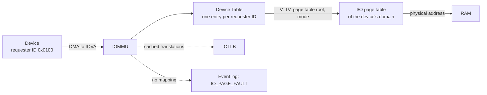

# AMD IOMMU on the Beelink SER6

Machine: Beelink SER6, AMD Ryzen 7 7735HS (Rembrandt-R), IOMMU at PCI 0:0:2 (1022:14b6).
FreeBSD 16.0-CURRENT main-n290674 (7806832f23fb), GENERIC-NODEBUG. Tests from 2026-11-16.

Patches, on FreeBSD main 563c2f27e0ff (branch `olivier-amdiommu`):

1. [`iommu_idmap_when_dma_disabled.patch`](iommu_idmap_when_dma_disabled.patch),
   `iommu: Identity-map contexts when DMA remapping is disabled`: fixes the endless USB re-attach loop with `hw.amdiommu.enable=1` alone.
2. [`amdiommu_skip_map_invalidation.patch`](amdiommu_skip_map_invalidation.patch),
   `amdiommu: Skip the invalidation after a map that only fills PTEs`: removes most waits on DMA mapping.

Status: both patches tested on the SER6 (see [Tested](#tested)).

## 1. Background

### 1.1 What an IOMMU is for

A device such as an NVMe drive, a network card or a USB controller moves data with DMA (direct memory access):
the driver gives the device a memory address, and the device reads or writes RAM by itself, without the CPU.

Without an IOMMU, that address is a physical RAM address, and the device can reach all of RAM.
A buggy driver, buggy device firmware, or a hostile device can then overwrite any memory, including the kernel.

An IOMMU (I/O memory management unit) sits between the devices and RAM, and does for devices what the MMU does for programs:

- Each device gets its own I/O page table. The driver gives the device an I/O virtual address (IOVA),
  and the IOMMU translates it to a physical address with that table.
- A device can reach only the pages its driver mapped. Any other access is blocked and logged as an `IO_PAGE_FAULT` event.

Uses:

- Protection against DMA attacks: a malicious Thunderbolt/USB4 or PCIe device cannot read or patch kernel memory.
- Fault containment: a device that DMAs to a stale or wrong address faults instead of corrupting memory.
- Device passthrough to virtual machines (bhyve `ppt`): the guest programs guest-physical addresses, and the IOMMU maps them to the right host memory.
- Devices limited to 32-bit addresses can reach memory above 4 GB through the IOMMU, without bounce buffers.
- Interrupt remapping: device interrupts (MSI) go through an IOMMU table too, so a device cannot inject arbitrary interrupts.
  Needed for safe passthrough, and for x2APIC with more than 255 CPUs.

### 1.2 How the AMD IOMMU finds a device's table



- Every DMA carries the device's PCI requester ID (bus, device, function).
- The IOMMU indexes the Device Table with it. Each Device Table Entry (DTE) says whether the entry is valid (V),
  whether translation is on (TV), the page table root, and the page mode. Mode 0 means "no translation": identity, pass-through.
- The entry also points to the device's interrupt remapping table (IV bit, `intrroot`).
- Firmware describes which requester IDs each IOMMU serves in the ACPI IVRS table.

FreeBSD code:

- `sys/x86/iommu/amd_drv.c`: attach, IVRS parsing (`amdiommu_find_unit_scan_ivrs()`), Device Table allocation.
- `sys/x86/iommu/amd_ctx.c`: one context per requester ID; `dte_entry_init_one()` fills the DTE.
- `sys/x86/iommu/amd_idpgtbl.c`: I/O page tables; `amdiommu_map_buf()` maps a range.
- `sys/x86/iommu/amd_intrmap.c`: interrupt remapping; `amdiommu_ir_find()` gets the context of an MSI source.
- `sys/dev/iommu/busdma_iommu.c`: the busdma back end. Drivers keep calling `bus_dmamap_load()`;
  with the IOMMU on, it allocates an IOVA range and maps it instead of returning physical addresses.

Tunables: `hw.amdiommu.enable` (default 0, the driver does not attach),
`hw.iommu.dma` (DMA remapping, default 0), `hw.iommu.ir` (interrupt remapping, default 1),
`hw.busdma.pciD.B.S.F=bounce` (no translation for one device).

### 1.3 Why an IOMMU costs performance

Without an IOMMU, mapping a buffer for DMA is nearly free: the driver hands over the physical address.
With an IOMMU, each DMA buffer costs:

1. Mapping: allocate an IOVA range (`iommu_gas_map()`, a red-black tree of address ranges) and write page table entries.
2. Invalidation: after an unmap, the IOMMU may still hold the old translation in its IOTLB.
   The driver must queue an `INVALIDATE_IOMMU_PAGES` command, then a `COMPLETION_WAIT` command, and wait for the IOMMU to answer,
   usually with an interrupt. That is a round trip to the hardware, microseconds each time.
   Without it, a device could still reach a page the kernel already reused: a security hole and a corruption bug.
3. Translation misses: when a translation is not in the IOTLB, the IOMMU walks the page table in RAM, which adds latency to the DMA.

Operating systems reduce the cost:

- Batch invalidations: one wait for many unmaps (FreeBSD `hw.iommu.batch_coalesce`, Linux "lazy" mode).
  The window between unmap and invalidation is a small security tradeoff.
- Pass-through for trusted devices: identity mapping, no per-buffer work (Linux `iommu=pt`, FreeBSD `hw.busdma.pci...=bounce`).
- Skip work the hardware does not need, such as invalidating after a map (see section 3.2).

### 1.4 When to turn it on

An IOMMU trades I/O speed for safety. Turn it on when the protection is worth that cost:

- Untrusted devices can be plugged in. Thunderbolt/USB4 tunnels PCIe through a cable, so a hostile device could otherwise read or patch all of RAM.
  This is why Windows ("Kernel DMA Protection"), macOS and most Linux distributions enable the IOMMU by default on laptops.
- You want faults instead of silent corruption from buggy drivers or device firmware.
  The NVMe faults in section 4.2 are an example: blocked and logged, not written to random memory.
- PCI passthrough to virtual machines. bhyve uses its own AMD-Vi code in `vmm.ko`, not `amdiommu`.
- Interrupt remapping is required: safe passthrough, or x2APIC with more than 255 CPUs.
- AMD XDNA NPU (Strix Halo): its firmware answers about 1000 times slower with the IOMMU unit off (section 5.1).

The cost falls on high-rate small I/O, because every buffer is mapped, unmapped and invalidated.
On this machine ([Tested](#tested)), 128 KB NVMe reads lost about 45% with the stock kernel and about 25% with patch 2
(averages of three runs: 1350 MB/s without IOMMU, 722 stock, 999 patched),
and `rge0` still reached its 117 MB/s link limit but cost about 41000 IOMMU interrupts per second.
Typical desktop or small-server load rarely shows the difference.

Middle ground: keep translation for most devices, and exempt trusted fast ones with `hw.busdma.pciD.B.S.F=bounce`
(Linux `iommu=pt` does the same for all devices).

On the SER6 the protection buys little today:
its only external PCIe path is the USB4 port, and FreeBSD cannot tunnel PCIe over it
(`thunderbolt(4)` is not in GENERIC and does not list the Rembrandt NHI 1022:162e), so a USB4 device has no DMA path anyway.
It has no untrusted internal device and no passthrough guest.
Leave `hw.amdiommu.enable` at 0 there, unless bhyve passthrough through `amdiommu` or USB4 PCIe tunneling is wanted;
then use `hw.amdiommu.enable=1 hw.iommu.dma=1` with both patches.

The patches matter anyway: patch 1 turns `hw.amdiommu.enable=1` from a boot loop into a working setting,
and patch 2 lowers the cost for machines that need the IOMMU: laptops with Thunderbolt, passthrough hosts, hardened systems.

## 2. Linux and FreeBSD compared

Linux: `drivers/iommu/amd/` at 3b5f4b83c4ab (2026-07-28). FreeBSD: `sys/x86/iommu/amd_*.c` at main 563c2f27e0ff.

| Topic | Linux | FreeBSD |
|---|---|---|
| DTE of a device no driver claimed | V=1, TV=1, no permission: DMA blocked and logged (`init_device_table_dma()`) | V=0: DMA passes untranslated |
| Defaults | DMA and interrupt remapping on | driver off; once on, DMA remapping off, interrupt remapping on |
| Interrupt remapping with DMA remapping off | not a supported mix | context with translation and an empty page table: patch 1 |
| Invalidation after a map | only with NpCache, i.e. a virtual IOMMU (`amd_iommu_iotlb_sync_map()`) | always, and waits: patch 2 |
| IVMD unity-map blocks | identity-mapped as reserved regions | not implemented ("XXXKIB IVMD ... Not implemented for now") |
| DMA aliases | DTE copied to the IVRS alias and to every PCI DMA alias (`clone_aliases()`) | IVRS alias only |
| ACPI HID devices (IVHD type 0xF0) | mapped to their requester ID | length parsed, entry skipped ("XXXKIB") |
| Page fault events | logged with a rate limit; event log restarted on overflow | logged |

The SER6 IVRS table is simple: one range 0x0008-0xFFFE, one alias range FF00-FFFF to 00A5, IOAPIC and HPET entries,
and four AMDI0020 (UART) HID entries for disabled devices. It has no IVMD block.
So the IVMD, alias and HID gaps do not matter on this machine.

## 3. The problems

### 3.1 `hw.amdiommu.enable=1` alone: USB devices attach in a loop

How to repeat: `nextboot -e hw.amdiommu.enable=1 -e boot_verbose=YES`, reboot.
Result on the SER6: the kernel boots, then USB devices attach again and again.
The console never reaches a usable shell; only a power cycle recovers.

Cause (from the code; no event log could be captured):

1. `hw.iommu.dma` defaults to 0, so busdma does not use the IOMMU:
   `iommu_get_dev_ctx()` returns NULL when `!unit->dma_enabled`, and drivers get physical addresses.
2. `hw.iommu.ir` defaults to 1. When a driver sets up MSI, `amdiommu_ir_find()` calls
   `iommu_instantiate_ctx(unit, dev, false)` to get a context for the interrupt table.
3. `iommu_instantiate_ctx()` asks for an identity mapping only when the user disabled the device
   with a `hw.busdma.pci...` tunable. Otherwise the new domain translates (`id_mapped=false`) through an empty page table.
4. `dte_entry_init_one()` sets V=1, TV=1 and the empty table root in the device's DTE.
5. The device DMAs to physical addresses that are not mapped: every transfer is blocked. xHCI controllers fail and reset,
   and their USB devices re-attach in a loop.

Intel VT-d keeps interrupt remapping apart from DMA contexts, so the same defaults work there.
On AMD both live in the same DTE.

The bug is older than the per-device fix 35170408a7b8:
the first version of `amdiommu_ir_find()` passed `false /* XXXKIB */` for `id_mapped`.

### 3.2 `hw.iommu.dma=1`: a wait on every mapping

With full DMA remapping (`hw.amdiommu.enable=1 hw.iommu.dma=1`), the machine works:
NVMe, USB, `rge` Ethernet and `iwlwifi` Wi-Fi run translated, and the IOMMU logs no event.
But the IOMMU interrupt rate is high, and disk reads slow down:

| Measure | IOMMU off | IOMMU, DMA remapping |
|---|---|---|
| IOMMU interrupts per 128 KB read | n/a | 46 to 51 |
| IOMMU interrupts per 1 MB read | n/a | 409 |
| IOMMU command/event interrupts, idle | n/a | 105 to 118/s |
| IOMMU interrupts during a 1 GB ssh transfer over `rge0` | n/a | about 41000/s |

Throughput is in [Tested](#tested). The drive is a DRAM-less Kingston NV2 that also runs hot
(see [../Beelink.SER6.md](../Beelink.SER6.md#nvme-event-flood)): the same read ran at 44.7 MB/s in one boot and 750 MB/s in another,
so throughput only compares within one session. Interrupt counts per read do not depend on the drive.

dtrace on `amdiommu_cmd_event_intr()` shows the interrupts come from the map path:
`nvme_qpair_submit_request()`, `bus_dmamap_load_mem()`, `iommu_gas_map()`, `amdiommu_map_buf()`.

`amdiommu_map_buf()` (`amd_idpgtbl.c`) ends with:

```c
	/*
	 * XXXKIB invalidation seems to be needed even for non-valid->valid
	 * updates.  Recheck.
	 */
	iommu_qi_invalidate_sync(iodom, base, size,
	    (flags & IOMMU_PGF_WAITOK) != 0);
```

`iommu_qi_invalidate_sync()` queues an invalidation plus a completion wait, and sleeps or spins until the IOMMU answers.

The AMD IOMMU caches only valid translations, unless its capability header sets NpCache ("not present cache").
NpCache is for virtual IOMMUs, where the hypervisor shadows the guest's tables.
Linux flushes on map only in that case (`amd_iommu_iotlb_sync_map()`: "It is a NOP if the IOMMU doesn't have non present caching").

The SER6 capability header (`pciconf -r pci0:0:0:2 0x40`) is `0x190b640f`:
bits 24 (IOTLB), 27 (EFR) and 28 (CapExt) set, bit 26 (NpCache) clear.
Most maps wait for an invalidation that this hardware does not need. Section 4.2 shows the one case where it is needed after all.

## 4. The fixes

### 4.1 Patch 1: identity mapping when DMA remapping is off

`sys/dev/iommu/busdma_iommu.c`, `iommu_instantiate_ctx()`:

```c
	disabled = !unit->dma_enabled ||
	    iommu_bus_dma_is_dev_disabled(pci_get_domain(requester),
	    pci_get_bus(requester), pci_get_slot(requester),
	    pci_get_function(requester));
```

A unit with DMA remapping off is handled like a device with remapping off: the context gets the identity mapping (DTE mode 0),
and the interrupt table still works.

Why here: it is the place that already turns "remapping disabled" into an identity context, and the IR path goes through it since 35170408a7b8.
Other IOMMUs: `iommu_instantiate_ctx()` has three callers, `amdiommu_ir_find()`, `iommu_get_dev_ctx()` (after its `dma_enabled` check)
and Intel's `dmar_instantiate_rmrr_ctxs()`, which runs only from `iommu_get_dev_ctx()` through `unit_pre_instantiate_ctx`.
So Intel, arm64 and riscv reach it only with DMA remapping on, and see no change.

Alternative: pass `id_mapped` from `amdiommu_ir_find()` directly. AMD-only, but it would bypass the per-device tunable logic again.

### 4.2 Patch 2: no invalidation after a map that only fills PTEs

First version, dropped: invalidate on map only if `PCIM_AMDIOMMU_CAP_NPCACHE` is set, exactly as Linux does.
Under load it produced 1303 `IO_PAGE_FAULT` events from `nvme0`, all "page not present" (`pr 0`), all device writes to RAM (`rw 1`, disk reads),
and the event log overflowed 4 times. All 1303 faulting addresses were in one 2 MB IOVA region, 0x4200000-0x43fffff,
which is the span of one leaf page table page. ZFS reported no checksum error; no fault was a disk write.

Why Linux gets away with it and FreeBSD does not:

- FreeBSD frees a page table page as soon as its last PTE is unmapped (`amdiommu_unmap_clear_pte()`, `amd_idpgtbl.c`):
  it clears the PDE that points to it at once, and queues the page for release after the deferred invalidation (`iommu_pgfree()` with an `entry`).
- Before that invalidation runs, a new map in the same 2 MB region allocates a new table page and writes a new PDE.
- The IOMMU can still hold the old PDE in its cache. It walks the old, cleared table and finds no PTE: fault.
- Linux's v1 page table code keeps intermediate tables after unmap, so a PDE never changes while it may be cached.

The kept version:

- `amd_iommu.h`: `cap_hdr` in `struct amdiommu_unit`; `pde_set` in `struct amdiommu_domain`, protected by the page table lock.
- `amd_drv.c`, `amdiommu_attach()`: read the capability header.
- `amd_idpgtbl.c`, `amdiommu_pgtbl_map_pte()`: set `pde_set` when it writes a PDE for a new table page.
- `amd_idpgtbl.c`, `amdiommu_map_buf()`: clear `pde_set`, map, then call `iommu_qi_invalidate_sync()` only if a PDE was written or NpCache is set.

Unmap still invalidates; that is the part that protects memory.

Alternative: keep empty page table pages, as Linux does. Then no map would ever need an invalidation,
at the cost of page table memory that is never given back while the domain lives. A larger change; not done.

What the patches do NOT fix:

- IVMD unity maps, PCI DMA aliases and IVHD HID entries (section 2): not needed on this machine.
- DTEs of unclaimed devices stay V=0 (pass-through), unlike Linux, which blocks them.
- About 19 IOMMU interrupts per 128 KB read remain, from unmap invalidations and the maps that write a PDE. Not investigated further.
- Disk writes under DMA remapping: not tested, to avoid risking the pool.
- The first boot with `hw.iommu.dma=1` lost Ethernet for minutes (82 `rge0` interrupts in 6 minutes, DHCP after 53 s, no ssh);
  a second boot with the same settings worked. Cause unknown.

## 5. Other machines: Framework Desktop (Strix Halo)

Read-only checks on 2026-11-16 (`pciconf`, `acpidump -t -T IVRS`, `kenv`), then a boot test by the amdxdna (NPU) work the same day: see [5.1](#51-tested-npu-firmware-latency).
Machine: Framework Desktop, AMD Ryzen AI Max+ 395, IOMMU 1022:1508 at 0:0:2 (`none0`, no driver),
FreeBSD main n291187 (6871285f194d). See [../Framework-desktop.md](../Framework-desktop.md).

What is the same as on the SER6:

- Driver code: no commit touches `sys/x86/iommu` or `sys/dev/iommu` between 6871285f194d and the patches' base 563c2f27e0ff, so both patches apply unchanged.
- Capability header `0x190b640f` (NpCache clear) and EFR `0x246577efa2254afa`: the reasoning of patch 2 holds.
- IVHD device entries: range 0x0003-0xfffe, alias FF00-FFFF to 00A5, HPET and two IOAPIC special entries, AMDI0020 UART HID entries.
  With `hw.amdiommu.enable=1` alone the stock kernel builds the same translating interrupt-remapping contexts, so the USB loop of section 3.1 is expected there too.

What differs:

- Two IVMD blocks, which FreeBSD ignores (section 2):
  a 1 MB unity map at 0x7d900000 (IR, IW) for requester 0x0060, the Pluton security processor (`MSFT0201`, `\_SB_.MHSP`),
  and a 128 KB exclusion range at 0x77e00000 for requester 0xc107.
  Neither requester is a PCI device on FreeBSD (no 0:12:0, no 193:0:7 in `pciconf -l`), so no context is created for them.
  Their DTEs stay invalid, that is pass-through, so ignoring the IVMDs should be harmless there. Inferred from the code, not tested.
- amdgpu: with `hw.iommu.dma=1`, its LinuxKPI busdma traffic is translated. Linux gives AMD GPUs an identity mapping by default.
  Not tested on FreeBSD; exempt the GPU with `hw.busdma.pci0.B.S.F=bounce` for a first test.
- amdxdna NPU port (in progress): on Linux it normally relies on the IOMMU (PASID, SVA).
  FreeBSD's `amdiommu` has no PASID support, so no SVA; but turning the unit on removes a 1000x firmware slowdown, see 5.1.

### 5.1 Tested: NPU firmware latency

Tested on 2026-11-16 during the amdxdna NPU port (NPU 1022:17f0 at pci0:194:0:1, drm-kmod branch `olivier-amdxdna`, "carveout" mode:
NPU buffers in one physically contiguous region, firmware DMA by physical address).
Kernel: 6871285f194d plus both patches and a LinuxKPI SRCU patch, GENERIC-NODEBUG.
Boot: `nextboot -k kernel.amdiommu -e hw.amdiommu.enable=1 -e hw.iommu.dma=1 -e hw.busdma.pci0.194.0.1=bounce -e hw.busdma.pci0.193.0.0=bounce`,
so the NPU and the GPU get identity (pass-through) contexts and the other devices are translated.
Second boot: `hw.amdiommu.enable=1` alone (interrupt remapping on, DMA remapping off), no busdma tunable:
all contexts "id-mapped", for example `amdxdna0: amdiommu0 pci0:194:0:1 rid c201 domain 11 id-mapped`, none "re-mapped".

| Measure | IOMMU off | `hw.iommu.dma=1`, NPU and GPU pass-through | `hw.amdiommu.enable=1` alone |
|---|---|---|---|
| NPU firmware CREATE_CONTEXT round trip | 476 us first, then about 141 ms | 160 and 224 us | 169 us |
| MAP_HOST_BUFFER | 142 ms | 91 and 110 us | 73 us |
| DESTROY_CONTEXT | 142 ms | 130 and 134 us | 119 us |
| `xrt-smi validate` latency test | about 95 ms per job | 47.0 us, PASSED | 49.0 us, PASSED |
| `xrt-smi validate` throughput test | about 10 jobs/s | 93807 ops/s, PASSED | 93777 ops/s, PASSED |
| `xrt-smi validate` gemm | 51 TOPS, PASSED | 51.0 TOPS, PASSED | 51.0 TOPS, PASSED |
| `amdiommu0: event` lines | n/a | 0, after boot, amdxdna load and a full validate | 0 |

Other results: the machine boots; `rge0`, `nvme0`, `hdac0`, `xhci0`, `hdac1` and the bridges are "re-mapped" in their own domains; amdgpu loads.

So the AIE2 firmware is slow when the IOMMU unit is off, and fast as soon as it is on, even with the NPU's own DTE in pass-through (mode 0).
amdxdna therefore needs only `hw.amdiommu.enable=1`, with patch 1 so that this setting boots, and no DMA translation cost for the rest of the machine.
amdgpu loads in both boots. The machine has no display, so the amdgpu display stall seen on the ZBook with interrupt remapping alone cannot show there.
Upstream Linux refuses to run amdxdna without an IOMMU (a8878e19d2f5, "The AIE2 device firmware requires IOMMU on"); this measurement matches that.
Why the firmware cares is not known.

Not tested there: the NPU with a translated domain (no `bounce`; needs the driver's buffers to go through busdma), suspend and resume.

## Tested

Beelink SER6, 2026-11-16, one-shot `nextboot` settings.
Stock kernel: main-n290674 (7806832f23fb). Patched kernel: the same commit plus both patches, `/boot/kernel.amdiommu`.

### Function

| Kernel | Tunables | Result |
|---|---|---|
| stock | `hw.amdiommu.enable=1 hw.iommu.dma=1`, first boot | boots; all devices "re-mapped"; `rge0`: DHCP after 53 s, then no ssh; 82 `rge0` interrupts in 6 min |
| stock | same, second boot | works: ssh over `rge0`, 0/20 ping loss, 117 MB/s in and 103 MB/s out; Wi-Fi associates; no IOMMU event |
| stock | `hw.amdiommu.enable=1` | USB devices attach in an endless loop; no shell; power cycle needed |
| patched | `hw.amdiommu.enable=1` | boots normally; 11 contexts "id-mapped", none "re-mapped"; `ir: 1`; USB enumerated once (8 devices); no IOMMU event |
| patched, first version of patch 2 | `hw.amdiommu.enable=1 hw.iommu.dma=1` | 1303 nvme `IO_PAGE_FAULT` events, event log overflow; pool healthy |
| patched | `hw.amdiommu.enable=1 hw.iommu.dma=1` | 0 IOMMU events after 6 GB of reads and 2 GB over ssh; `rge0` 117 MB/s in, 115 MB/s out; pool healthy |

### NVMe reads, back to back in one session

`dd if=/dev/nda0 of=/dev/null`, 1000 MB in 128 KB blocks three times, then 3000 MB in 1 MB blocks; same offsets in every boot.

| Kernel, tunables | 128 KB reads | 1 MB reads | IOMMU interrupts per read (128 KB / 1 MB) | Idle IOMMU interrupts |
|---|---|---|---|---|
| stock, no IOMMU | 1205, 1568, 1276 MB/s | 877 MB/s | n/a | n/a |
| stock, `hw.iommu.dma=1` | 752, 760, 653 MB/s | 952 MB/s | 51 / 409 | 118/s |
| patched, `hw.iommu.dma=1` | 904, 1032, 1062 MB/s | 1119 MB/s | 19 / 138 | 62/s |

- Patch 2 cuts IOMMU interrupts per read by 2.7 to 3 times, and raises 128 KB read throughput by about 35% against the stock IOMMU.
- The 1 MB row is noise-bound: the no-IOMMU run is the slowest of the three.
- Earlier the same day, in a boot where the drive was slow, the stock IOMMU gave 44.7 MB/s against 81 to 91 MB/s without it.

Not tested:

- Disk writes with DMA remapping.
- Suspend and resume with the IOMMU on.
- bhyve PCI passthrough.
- Any other AMD machine; Intel is not affected by the code paths changed (section 4.1).
