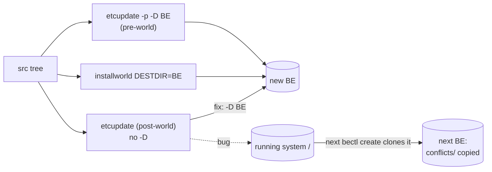

# beinstall.sh: post-world etcupdate merges into the running system

Patch: [beinstall_etcupdate_destdir.patch](beinstall_etcupdate_destdir.patch)
(against `freebsd/main` 698d94219061, branch `olivier-beinstall-etcupdate`).

## Background

**Boot environment (BE).** A ZFS clone of the root file system. You can
upgrade a BE while the old system keeps running, then reboot into it.
`bectl create` clones the running root, and `bectl mount` mounts the clone
somewhere, for example `/tmp/beinstall.XXXXXX/mnt`.

**beinstall.sh** (`tools/build/beinstall.sh`) upgrades a host with a BE.
After `buildworld` and `buildkernel` it does the following:

1. Creates and mounts a new BE at `BE_MNTPT` (lines 192-202).
2. Installs the new kernel into it (`make DESTDIR=${BE_MNTPT} installkernel`,
   line 204).
3. Runs the "pre-world" config update (`update_etcupdate_pre`, lines 122-125).
4. Installs the new world into it (`make DESTDIR=${BE_MNTPT} installworld`,
   line 218).
5. Runs the "post-world" config update (`update_etcupdate`, lines 127-130).
6. Activates the BE, so the next boot uses it (line 245).

The running system must not change. That is the whole point of a BE: if the
new world is bad, reboot into the old BE and nothing is lost.

**etcupdate** (`usr.sbin/etcupdate/etcupdate.sh`) merges the new `/etc`
from the source tree with your local edits. It keeps state in a work
directory:

- `current/` holds the pristine files of the last update (line 45).
- `conflicts/` holds files where a three-way merge failed, with
  `<<<<<<< yours` markers (line 49).

Two options decide which tree it touches:

- `-D destdir` sets `DESTDIR` (line 1841). Without it, `DESTDIR` is empty
  (line 1753), so the merge goes into `/etc` of the running system.
- The work directory defaults to `$DESTDIR/var/db/etcupdate` (line 1889).
  With no `-D` this is the running system's `/var/db/etcupdate`.

An update refuses to start while `conflicts/` is not empty (lines 1554-1561):

```
Conflicts remain from previous update, aborting.
```

## The problem

Commit 7fde3e62231a ("beinstall: Avoid chrooting into new world") stopped
using `chroot ${BE_MNTPT}`, because the new world can need system calls
that the running kernel lacks. Each command now has to name the BE with
`-D` or `DESTDIR=`. The post-world call did not get `-D`:

```sh
update_etcupdate() {
	${ETCUPDATE_CMD} -s ${srcdir} ${ETCUPDATE_FLAGS} || return $?
	${ETCUPDATE_CMD} resolve -D ${BE_MNTPT}
}
```

The first line merges into `/` of the **running** system. The second line
resolves conflicts in the BE, which has none. The conflicts stay on the
running system.

The commit is in main and in stable/15 (1ad1e7b13d94), not in stable/14.



### Observed on a 15.0-PRERELEASE build host

The host ran:

```
cd /usr/src ; sudo env NO_PKG_UPGRADE=YES \
    LD_PRELOAD=/usr/obj/usr/src/amd64.amd64/lib/libc/libc.so.7 \
    tools/build/beinstall.sh -j 16
```

The running system's `/var/db/etcupdate/log` shows the merge wrote live
paths, with no BE mount point in them:

```
>>> cp -Rp /var/db/etcupdate/etcupdate-j1CedZK/etc/ttys /etc/ttys
>>> cp -Rp /var/db/etcupdate/etcupdate-j1CedZK/root/.profile /root/.profile
>>> cp -Rp /var/db/etcupdate/etcupdate-j1CedZK/etc/rc.d/msconvd /etc/rc.d/msconvd
```

The running world was 15.0-PRERELEASE, but its `/etc` changed under it.
Files were removed (`/etc/rc.d/ftpd`, `/etc/rc.d/apm`, `/etc/ftpusers`) and
new files were added (`/etc/rc.d/virtual_oss`, `/etc/rc.d/blocklistd`). A
local edit to `/etc/pkg/FreeBSD.conf` conflicted:

```
$ sudo etcupdate status
  C /etc/pkg/FreeBSD.conf
```

The next beinstall run cloned the running system, including `conflicts/`,
into the new BE. The pre-world step (`etcupdate -p -D ${BE_MNTPT}`) then
stopped:

```
Conflicts remain from previous update, aborting.
```

Every later run fails the same way until someone resolves the conflict on
the running system.

## The fix

```diff
 update_etcupdate() {
-	${ETCUPDATE_CMD} -s ${srcdir} ${ETCUPDATE_FLAGS} || return $?
+	${ETCUPDATE_CMD} -s ${srcdir} -D ${BE_MNTPT} ${ETCUPDATE_FLAGS} || return $?
 	${ETCUPDATE_CMD} resolve -D ${BE_MNTPT}
 }
```

This is the right place because it matches the two other etcupdate calls in
the same file. `update_etcupdate_pre` (line 123) and the `resolve` on the
next line both pass `-D ${BE_MNTPT}`. With `-D`, the work directory also
moves into the BE (line 1889). So the state files and any conflicts stay
with the BE that will boot them.

The new line is 84 columns. The pre-world line above it is 87 columns, so
the patch keeps that style and does not wrap the line.

Alternatives:

- **Restore the chroot.** No. A chroot into the new world is what
  7fde3e62231a removed, because new binaries can call system calls that the
  running kernel does not have.
- **Set `ETCUPDATE_FLAGS="-BF -D ..."` from the environment.** That is a
  workaround for users, not a fix. `ETCUPDATE_FLAGS` is also used by the
  pre-world call, which already has `-D`.

What the patch does NOT fix:

- Hosts that already ran the buggy script. Their running `/etc` is already
  merged, and any conflict is still in `/var/db/etcupdate/conflicts`. Run
  `etcupdate status` and `etcupdate resolve` on them once. There is no
  simple undo for the live merge. The files match the new world, which the
  next BE gets anyway.
- Nothing in the script checks that a command uses `DESTDIR` or `-D`. A
  future edit can repeat this mistake.

## Tested

Test setup: bigone (16.0-CURRENT), `/usr/src` built. The scratch BE stands
in for `BE_MNTPT`:

1. Run `etcupdate extract -N -D $D` to fill `$D/var/db/etcupdate/current`,
   as `update_etcupdate_pre` does.
2. Copy that tree into `$D` to stand in for installworld.
3. Add one line to `etc/motd.template` in both `current/` and `$D`, so the
   source tree differs from the recorded old tree.

| Case | Command | Result |
|---|---|---|
| Buggy line, non-root | `etcupdate -s /usr/src -BF -N` | `cannot create /var/db/etcupdate/log: Permission denied`: it targets the running system |
| Buggy line, root | not run | Would merge into bigone's own `/etc`. The build host log above is the evidence |
| Fixed line, root | `etcupdate -s /usr/src -D $D -BF` | rc=0, `U /etc/motd.template` |
| Fixed line, BE file | `tail -1 $D/etc/motd.template` | Test line gone, file updated |
| Fixed line, BE log | `$D/var/db/etcupdate/log` | `cp -Rp ... /tmp/beinst-test.PDkm/be/etc/motd.template` |
| Fixed line, running system | `md5 -q /etc/motd.template`, `ls -lT /var/db/etcupdate/log` | Same before and after (`f71a9792...`, `Nov  1 13:32:37`) |
| `resolve -D $D` after fix | | rc=0 |
| Full beinstall run with fix | not run yet | The build host has a patched copy (`~/beinstall.sh`) to rerun |
