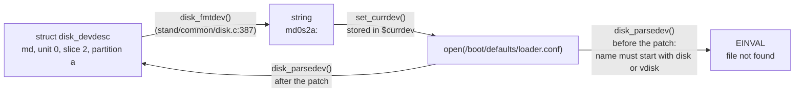

# loader disk_parsedev() refuses device names it printed itself

```
Category:  base
Component: boot
Version:   16.0-CURRENT
```

Patch: `loader_disk_parsedev.patch` (`stand/common/disk.c`).  Patch #3 of
six; the full list is in `FreeBSD/iPXE.md`, section 7(f).

**Summary.** The loader names disks with one function and reads names back
with another, and the two disagree.  `disk_fmtdev()` writes any driver's
name (`md0s2a:`), but `disk_parsedev()` only accepts names that start with
`disk` or `vdisk`.  So the loader can print a device name and then refuse it.

---

## 1. Background

### 1.1 Devices are passed around as strings

The FreeBSD loader remembers "the device we boot from" as a string in the
`currdev` environment variable, for example `disk0p2:` or `md0s2a:`.  The
string is built by a driver's `dv_fmtdev` hook and turned back into a
device by its `dv_parsedev` hook, every time a file is opened:



For this to work, parsing must accept everything formatting can produce: the
two functions must be a *round trip*.

### 1.2 The two functions

`disk_fmtdev()` writes the driver's own name, whatever it is:

```c
cp = buf + sprintf(buf, "%s%d", dev->dd.d_dev->dv_name, dev->dd.d_unit);
```

`disk_parsedev()` skips the name before reading the unit, slice and
partition numbers, but only knows two names:

```c
if (strncmp(devspec, "disk", 4) == 0)
        np = devspec + 4;
else if (strncmp(devspec, "vdisk", 5) == 0)
        np = devspec + 5;
else
        return (EINVAL);
```

Its comment says the literal check exists because the function has no
access to the driver table to check the name.  That is a reason to check
that a name is *present*, not to decide which names are *allowed*.

---

## 2. The problem

### How to repeat

Any `DEVT_DISK` device whose `dv_name` is neither `disk` nor `vdisk`.  Today
none exists in tree, so nothing fails: this is a latent defect.  It becomes
real as soon as another driver uses the generic disk hooks.  The md driver
does exactly that with patch #2 (`loader_md_partition_probe.patch`), after
which the loader prints

```
Setting currdev to md0s2a:
```

and then cannot open any file on `md0s2a:`, because the parse of that name
returns `EINVAL`.

---

## 3. The fix

Skip whatever alphabetic prefix the name has, and fail only when there is
none:

```c
np = devspec;
while (isalpha(*np))
        np++;
if (np == devspec)
        return (EINVAL);
```

The rest of `disk_parsedev()` (unit number, `s<n>` slice, `p<n>` GPT
partition, partition letter) is unchanged.  `isalpha()` is already
available: it is a static inline in `stand/libsa/stand.h`, which `disk.c`
includes.  8 lines, no new includes.

* **Why not add `md` to the list:** that fixes md today and breaks the next
  disk driver the same way.  The function is reached only through a
  driver's own `dv_parsedev`, so the driver has already been chosen; the
  prefix needs skipping, not checking.
* **What it does not do:** it still cannot tell whether the prefix matches
  the driver that called it.  It did not before either; the driver table is
  not available here.

---

## 4. Tested

| Patches | Platform | Result |
|---|---|---|
| #2 without #3 | Supermicro A1SRi-2758F, md fallback | `md0s2a:` printed, then refused |
| #1 to #4 | Supermicro A1SRi-2758F, md fallback | multi-user, `Setting currdev to md0s2a:` |
| #1 to #4 | qemu and bhyve (edk2) | installer prompt; `disk` and `vdisk` names still parse (no regression), md not exercised |

Base: main at `c14281f6bb46` (2026-09-24).
