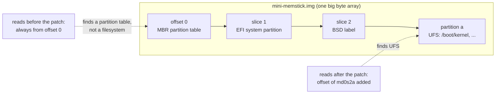

# loader md(4) device never reads the partition table ("MD not present")

```
Category:  base
Component: boot
Version:   16.0-CURRENT
```

Patch: `loader_md_partition_probe.patch` (`stand/common/md.c`,
`stand/common/bootstrap.h`).  Patch #2 of six; the full list is in
`FreeBSD/iPXE.md`, section 7(f).

**Summary.** When `loader.efi` boots a disk image from RAM through its `md`
device, it reads the image as if the filesystem started at byte 0.  On a
partitioned image, such as the FreeBSD memstick images, byte 0 is the
partition table, so the loader finds no filesystem and stops with `MD not
present`.

---

## 1. Background

### 1.1 The md fallback

With `memdisk=URL`, `loader.efi` downloads a disk image into RAM.  If the
firmware provides `EFI_RAM_DISK_PROTOCOL` (edk2 in qemu and bhyve does), the
firmware turns that RAM into a disk and the loader reads it like any other.
Older firmware has no such protocol; the loader then falls back to its own
RAM disk driver, `md` (`stand/common/md.c`), and has to do the disk work
itself.

### 1.2 An image is a disk, not a filesystem

A memstick image is a copy of a whole USB stick.  Like a real disk, it starts
with a partition table, and the filesystem is inside one of the partitions:



To read a file, the loader must first decode that table, pick the partition,
and add its starting offset to every read.  The loader has a library that
does exactly this for every disk driver: `disk_open()` in
`stand/common/disk.c`.  It reads the partition table, chooses the slice and
partition (or the best one automatically when asked with `D_SLICEWILD`), and
stores the partition's start in `d_offset`.  The driver then adds `d_offset`
to each block number in its read function (`dv_strategy`).

### 1.3 What a disk driver has to do

A loader device driver is a `struct devsw` (`stand/libsa/stand.h:152`): a
name, a type, and function pointers for open, close, read (`dv_strategy`),
format a name (`dv_fmtdev`) and parse a name (`dv_parsedev`).  A driver whose
type is `DEVT_DISK` promises to behave like a partitioned disk: call
`disk_open()` when opened, `disk_close()` when closed, and add `d_offset` in
`dv_strategy`.  Its per-open state is a `struct disk_devdesc`
(`stand/common/disk.h:91`), which carries `d_slice`, `d_partition` and
`d_offset`.

---

## 2. The problem

### How to repeat

Boot `loader.efi` with `memdisk=` pointing at any partitioned image, such as
the release memstick images, on firmware without `EFI_RAM_DISK_PROTOCOL` so
the md fallback is used (measured on a Supermicro A1SRi-2758F, AMI rev 5.09,
EFI 2.31):

```
chain --replace loader.x64.efi \
    memdisk=.../FreeBSD-15.1-RELEASE-amd64-mini-memstick.img.xz
```

The download succeeds and the byte count matches the source, then:

```
No RamDisk protocol, falling back to md image
MD not present
```

The image is intact in memory.  The problem is that nothing looks at its
partition table.

### Cause

md is registered as `DEVT_DISK`, but `stand/common/md.c` does none of the
work that implies.  `md_open()` only validates the unit:

```c
md_open(struct open_file *f, ...)
{
        ...
        if (md_get_info(dev->d_unit) == NULL)
                return (ENXIO);

        return (0);
}
```

Without a `disk_open()` call the slice and partition are never resolved and
`d_offset` stays 0, so every read lands at offset 0 of the raw image.  On a
memstick image that is the MBR, not a filesystem, so the probe for
`/boot/defaults/loader.conf` fails and the loader prints `MD not present`.

The devsw also lacks `dv_fmtdev` and `dv_parsedev`, so the device cannot be
named or parsed the way other `DEVT_DISK` devices are (`md0s2a:`).

---

## 3. The fix

Make md do what its type promises:

* `md_open()` calls `disk_open(dev, md->md_size, MD_BLOCK_SIZE)`, which reads
  the partition table and fills in `d_slice`, `d_partition` and `d_offset`;
* `md_close()` calls `disk_close()`;
* `md_strategy()` adds `dev->d_offset` to the block number before reading;
* the devsw gains `dv_fmtdev = disk_fmtdev` and `dv_parsedev =
  disk_parsedev`, so the device is named like any other disk;
* a small `md_get_size()` accessor and `MD_SECTOR_SIZE`, so code outside
  `md.c` (patch #4) can open the device without reaching into the private
  `struct md_info`.

The functions now take a `struct disk_devdesc` instead of a plain
`struct devdesc`, because that is where `d_offset` lives.  About 40 lines.

### Why it is not enough on its own

Giving md the generic disk hooks exposes two latent loader bugs that no
device had hit before, both on the path that turns the device into the
`currdev` string and back:

* **#3, `loader_disk_parsedev.patch`:** `disk_parsedev()` only accepts names
  starting with `disk` or `vdisk`, so `md0s2a:` is printed but refused.
* **#4, `loader_set_currdev_disk_devdesc.patch`:** the md probe passes a
  plain `struct devdesc`, and `disk_fmtdev()` reads `d_slice` and
  `d_partition` past its end.

A bootable root also needs #1, `loader_memdisk_memtype.patch`, or the kernel
overwrites the ram disk once it runs.

---

## 4. Tested

| Patches | Platform | Result |
|---|---|---|
| none | Supermicro A1SRi-2758F, md fallback | `MD not present` |
| #1 to #4 | Supermicro A1SRi-2758F, md fallback | multi-user from the memstick: `Setting currdev to md0s2a:` |
| #1 to #4 | qemu and bhyve (edk2) | installer prompt, but this code is **not exercised** (see below) |

Console with all four fixes on the Supermicro:

```
No RamDisk protocol, falling back to md image
Setting currdev to md0s2a:
Loading /boot/defaults/loader.conf
```

qemu and bhyve both have `EFI_RAM_DISK_PROTOCOL`, so they take the
`VirtualDisk` path and never call `md_open()`.  The md fallback is only
reachable on firmware without the protocol, so hardware is the only test of
this fix.

Base: main at `c14281f6bb46` (2026-09-24).
