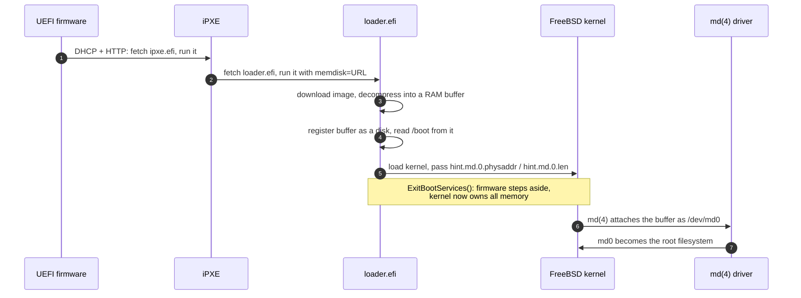
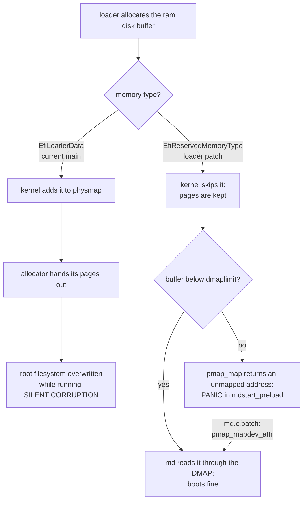
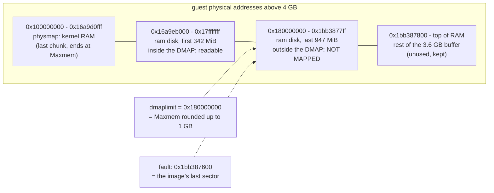

# loader.efi ram disk: reclaimed by the kernel, or out of its reach

```
Category:  base
Component: boot
Version:   16.0-CURRENT
Keywords:  regression
```

**Summary.** When `loader.efi` downloads a disk image into RAM (`memdisk=`)
and boots FreeBSD from it, the kernel either silently overwrites that image
while it is the root filesystem, or panics trying to read it.  Which one you
get depends on a single constant in the loader.  Fixing it properly takes two
patches: one in the loader (memory type) and one in the kernel's `md(4)`
driver (how it maps the image).

Both failures are reproduced below, with console output, on real hardware
and in bhyve.

---

## 1. Background, for readers new to the boot path

Skip this section if you know how a FreeBSD UEFI netboot works.

### 1.1 What is being booted

The goal is to boot an unmodified FreeBSD installer image (a memstick `.img`
or a CD `.iso`) **over the network, entirely from RAM**, with no USB stick
and no local disk.  The chain is:



Steps 3 to 5 are the new `memdisk=` code in `stand/efi/loader/memdisk.c` and
`decompress.c`.  The image never touches a disk: from step 3 on it lives
only in that RAM buffer, and it must stay intact **for as long as the system
runs**, because it *is* the root filesystem.

### 1.2 Who owns which memory

Two programs manage memory one after the other:

* **Before the kernel starts**, the UEFI firmware owns RAM.  The loader asks
  for memory with `AllocatePages()` and must give each allocation a *memory
  type*, a label such as `EfiLoaderData` or `EfiRuntimeServicesData`.
* **When the kernel starts**, it receives the firmware's *memory map*: a list
  of every physical range and its type.  The kernel decides, type by type,
  which ranges it may reuse.

On amd64 that decision is `add_efi_map_entries()` in
`sys/amd64/amd64/machdep.c:819`:

```c
        case EFI_MD_TYPE_CODE:     /* EfiLoaderCode         */
        case EFI_MD_TYPE_DATA:     /* EfiLoaderData         */
        case EFI_MD_TYPE_FREE:     /* EfiConventionalMemory */
                /*
                 * We're allowed to use any entry with these types.
                 */
                break;
        default:
                continue;          /* everything else: not ours, skip it */
```

The ranges it keeps form **physmap**, the list of RAM the kernel's page
allocator hands out.  The top of physmap is called **Maxmem**.

### 1.3 How the kernel reads a physical address: the direct map

The kernel runs with virtual memory on, so it cannot just dereference a
physical address.  amd64 (like arm64 and riscv) keeps a **direct map
(DMAP)**: one large region of kernel virtual addresses where virtual address
`0xfffff80000000000 + P` always points to physical address `P`.
`PHYS_TO_DMAP(P)` is just that addition.

The DMAP is not infinite.  It is built at boot in `create_pagetables()`
(`sys/amd64/amd64/pmap.c:1805`) and sized from Maxmem:

```c
        ndmpdp = howmany(ptoa(Maxmem), NBPDP);    /* 1 GB units, minimum 4 */
        dmaplimit = (vm_paddr_t)ndmpdp << PDPSHIFT;
```

So **the DMAP covers physical addresses from 0 up to Maxmem rounded up to
1 GB, and nothing above.**  `PHYS_TO_DMAP()` of an address above `dmaplimit`
gives a virtual address with no page behind it.

### 1.4 How md(4) reaches the image

The loader hands the image to the kernel as two environment hints,
`hint.md.0.physaddr` and `hint.md.0.len` (`md_export_to_kernel()` in
`stand/common/md.c`).  The kernel's md driver turns the physical address
into a pointer at `sys/dev/md/md.c:2134`:

```c
        ptr = pmap_map(NULL, paddr, paddr + len, VM_PROT_READ);
```

and on amd64 `pmap_map()` is a single line (`pmap.c:3940`):

```c
        return (PHYS_TO_DMAP(start));
```

There is no check that the range is actually inside the DMAP.

### 1.5 The two requirements

For the ram disk to work, its memory must be:

1. **Kept**: never handed out by the kernel's allocator, so **outside
   physmap**.
2. **Reachable**: readable through the pointer md got, so **below
   `dmaplimit`** (as long as md uses `pmap_map()`).

Requirement 1 pushes the range out of physmap, and that lowers Maxmem, which
lowers `dmaplimit`.  So the two requirements pull against each other, and
the bug is that the code only ever satisfied one of them at a time:



---

## 2. Bug 1: `EfiLoaderData` lets the kernel overwrite the root filesystem

### How to repeat

Netboot `loader.efi` with `memdisk=` pointing at a memstick image, on
hardware whose firmware has no `EFI_RAM_DISK_PROTOCOL`, so the md fallback is
taken (measured on a Supermicro A1SRi-2758F, AMI rev 5.09, EFI 2.31):

```
chain --replace loader.x64.efi \
    memdisk=.../FreeBSD-15.1-RELEASE-amd64-mini-memstick.img.xz
```

The system boots to userland, then decays.  Commands fail with errors that
look like a corrupt image rather than a memory problem:

```
ld-elf.so.1: /lib/libbsdxml.so.4: invalid file format
$ file /lib/libbsdxml.so.4
/lib/libbsdxml.so.4: data
```

The ram disk is being rewritten underneath the running system.  Three
consecutive reads of the same device return three different checksums:

```
# md5 /dev/md0
MD5 (/dev/md0) = 6e1b0bbd...
# md5 /dev/md0
MD5 (/dev/md0) = aa24358b...
# md5 /dev/md0
MD5 (/dev/md0) = 01377d56...
```

None match the image that was served (`cb891aba774ceb4ccde092d965a10af8`).
The download itself is fine: the byte count on the console matches the
source image exactly, and `libc.so.7` stays valid only because it was paged
in and cached before its backing pages were recycled.

**It is not specific to that hardware.**  Firmware that *does* have
`EFI_RAM_DISK_PROTOCOL` (edk2 in qemu and bhyve) registers the buffer as a
`VirtualDisk` instead of using the md fallback, but the kernel still gets
the same hint: `efiblk_memdisk_preload()` in `stand/efi/libefi/efipart.c`
calls `md_export_to_kernel()` for every `VirtualDisk`.  So both paths end at
the same `md.c` line with the same memory.  Measured under bhyve (8 GB guest)
with the 15.1 `disc1.iso.xz` and a `loader.efi` that still allocates
`EfiLoaderData`: the last physmap chunk, `0x0000000100001000 -
0x000000023374bfff`, runs straight across the ram disk at `0x16a9eb000`;
there is no panic, and userland starts failing at once:

```
pid 667 (awk), jid 0, uid 0: exited on signal 11 (no core dump - other error)
pid 670 (awk), jid 0, uid 0: exited on signal 11 (no core dump - other error)
pid 703 (xargs), jid 0, uid 0: exited on signal 11 (no core dump - other error)
```

(`md5 /dev/md0` was not taken on that run.)

### Cause

`stand/efi/loader/decompress.c` allocates the image as `EfiLoaderData`.
That type becomes `EFI_MD_TYPE_DATA` in the memory map, which
`add_efi_map_entries()` (section 1.2) puts in physmap.  The allocator hands
those pages to whatever asks next, while md keeps serving the same physical
range as `/dev/md0`.

Introduced by `85fb40bad584` ("loader.efi: Use EfiLoaderData memory type for
ram disks", 2026-09-24).  That commit moved *away* from
`EfiReservedMemoryType` to fix a page fault, which is bug 2 below: the old
type failed loudly when out of reach, the new one fails silently.  Silent
corruption of the root filesystem is the worse of the two.

### Fix (loader): `loader_memdisk_memtype.patch`

Allocate the buffer as `EfiReservedMemoryType`.  It is not in the list in
section 1.2, so the kernel skips it and never reuses those pages
(requirement 1).  This fixes the corruption.  It does **not** guarantee
requirement 2: that needs the md.c fix from section 3.  Measured
2026-10-25, results in section 4.

This is the type the fallback used before `85fb40bad584`.  That commit left
Reserved because "the md driver fails", and that failure is bug 2: with a
stock kernel, Reserved panics in `mdstart_preload` when the buffer crosses
`dmaplimit`.  The md.c patch removes it.  `pmap_mapdev_attr()` never looks
at the EFI type, only at the physical address: inside the DMAP it returns
the DMAP address, otherwise it maps the range with `kva_alloc()`
(`pmap.c:9445`).

### Why not `EfiRuntimeServicesData`

The first version of this patch used `EfiRuntimeServicesData`.  The kernel
skips it too, and it fixes the corruption the same way (section 4, Supermicro
row).  But edk2 marks every `EfiRuntimeServicesData` range
`EFI_MEMORY_RUNTIME` and never a Reserved one (`mMemoryTypeStatistics` in
`MdeModulePkg/Core/Dxe/Mem/Page.c`: `Runtime` is `TRUE` for RT_DATA, `FALSE`
for Reserved).  `efi_create_1t1_map()` (`sys/amd64/amd64/efirt_machdep.c:218`)
maps every `EFI_MEMORY_RUNTIME` descriptor into the EFI runtime page table
and registers it with `vm_phys_fictitious_reg_range()`.  `sysctl
machdep.efi_map` in the guest shows the result: with RT_DATA the whole
decompression buffer is a runtime region, with Reserved it is not one.

```
RT_DATA:  RuntimeServicesData 00016a8e0000 00016a8e0000 000d5720 UC WC WT WB RUNTIME
Reserved: (no RUNTIME entry for 0x16a8e0000)
```

That is 875296 pages (3.6 GB) of ram disk that the kernel maps for firmware
runtime calls.  The cost in page tables was not measured.  RT_DATA also
nominally means memory the firmware needs at runtime, so a ram disk abuses
the type.

Limit: Reserved was tested only on amd64 under bhyve's edk2.  The
Supermicro md fallback run predates the switch and used RT_DATA.  arm64 and
riscv build physmap and the DMAP their own way, and other firmware may set
attributes differently.

---

## 3. Bug 2: a kept buffer above `dmaplimit` panics in `mdstart_preload`

Once the buffer is outside physmap (bug 1 fixed, or the old
`EfiReservedMemoryType`), it no longer counts toward Maxmem.  If the firmware
places it at the **top** of RAM, Maxmem stops where the buffer starts, the
DMAP ends shortly after, and part of the buffer is outside the DMAP.  md's
pointer into that part is not mapped.

### How to repeat

Measured 2026-10-19: bhyve guest, 8 GB, 2 vCPUs, UEFI HTTP boot, the loader
with `loader_memdisk_memtype.patch`, image
`FreeBSD-15.1-RELEASE-amd64-disc1.iso.xz` (894980880 bytes compressed,
1352255488 uncompressed), kernel 15.1-RELEASE GENERIC, `boot_verbose=YES`:

```
Downloaded 894980880 bytes, actual size 1352255488 -- registering ramdisk
Installed RAM disk as VirtualDisk(0x16A9EB000,0x1BB3877FF,0)
...
real memory  = 8589934592 (8192 MB)
Physical memory chunk(s):
...
0x0000000100000000 - 0x000000016a9d0fff, 1788678144 bytes (436689 pages)
avail memory = 4810575872 (4587 MB)
...
md0: Preloaded image <preload0 0x000000016a9eb000> 1352255488 bytes at 0xfffff8016a9eb000
Fatal trap 12: page fault while in kernel mode
cpuid = 1; apic id = 01
fault virtual address   = 0xfffff801bb387600
fault code              = supervisor read data, page not present
current process         = 3 (md0)
panic: page fault
#4 0xffffffff8106e568 at calltrap+0x8
#5 0xffffffff806e5819 at mdstart_preload+0x49
#6 0xffffffff806e5d72 at md_kthread+0x232
```

### Reading the numbers



* **The last physmap chunk ends at `0x16a9d0fff`**, right below the ram disk
  at `0x16a9eb000`.  The `0x1a000`-byte gap between them is the kernel
  message buffer, carved off the top of physmap.  Nothing in physmap lies
  above the ram disk.
* **Why the buffer is at the top of RAM:** the decompressor cannot know the
  final size in advance, so for gzip, bzip2 and xz (and zstd without a frame
  size) it allocates `max(4 x compressed size, 64 MB)`, about 3.6 GB here,
  and grows it by 1.5x if needed (`grow_buffer()`).  The unused tail is never
  freed.  The firmware placed this block at the top of the 8 GB guest.
* **So Maxmem is about 5.67 GB and `dmaplimit` is `0x180000000` (6 GB).**
* **The ram disk spans `0x16a9eb000 - 0x1bb3877ff`:** the first 342 MiB are
  below 6 GB and readable, the remaining 947 MiB are not.
* **The faulting address is `PHYS_TO_DMAP(0x1bb387600)`**, the image's last
  512-byte sector.  GEOM reads it first when it tastes a new disk for
  trailing metadata (GPT backup header, labels), which is why the fault
  happens within a second of `md0` appearing and not later.

The 15.1 mini-memstick (116 MB compressed, a buffer of about 700 MB) boots on
the same VM with the same loader.  Its placement was not recorded, so why it
lands inside the DMAP is not shown here; it is consistent with a smaller
block not straddling a 1 GB boundary above Maxmem.

### Cause

`sys/dev/md/md.c:2134` maps the hint with `pmap_map()`, which on amd64,
arm64 and riscv is a bare `PHYS_TO_DMAP()` with no range check (section
1.4).  It assumes the physical range is inside the DMAP, which is only
guaranteed for memory the kernel owns, i.e. for exactly the memory the ram
disk must *not* be in.

On i386 and arm, `pmap_map()` builds a real mapping but writes through its
first argument, which md passes as `NULL`, so that call is not correct there
either.

### Fix (kernel): map the range wherever it lies

```diff
--- sys/dev/md/md.c
+++ sys/dev/md/md.c
@@ -2131,7 +2131,16 @@ g_md_init(struct g_class *mp __unused)
 		    resource_int_value("md", i, "len", &len) != 0)
 		        break;
-		ptr = pmap_map(NULL, paddr, paddr + len, VM_PROT_READ);
+		/*
+		 * The loader keeps this memory out of the physical memory
+		 * map so the kernel does not reuse it, which means it can lie
+		 * above the end of the direct map: on amd64 the direct map
+		 * only covers up to the top of physmap.  pmap_map() would
+		 * blindly return a direct map address there, so build a real
+		 * mapping instead; pmap_mapdev_attr() still uses the direct
+		 * map when the whole range is covered by it.
+		 */
+		ptr = pmap_mapdev_attr(paddr, len, VM_MEMATTR_DEFAULT);
 		if (ptr != NULL && len != 0) {
```

`pmap_mapdev_attr()` exists on every architecture md(4) builds for (amd64,
arm, arm64, i386, powerpc, riscv).  On amd64 it returns the DMAP address when
the whole range is inside the DMAP, and otherwise allocates kernel virtual
address space and maps the pages there.  `VM_MEMATTR_DEFAULT` is normal
cached memory, so reads stay fast.  `pmap_large_map()` would also work but
is amd64-only, while md.c is machine-independent.

An alternative is to make the loader allocate below the current Maxmem
(`AllocateMaxAddress`), but the loader cannot know the kernel's final
Maxmem, so that only moves the problem.  Freeing the unused tail of the
decompression buffer is worth doing anyway (2.2 GB here goes back to the
kernel), but on its own it does not stop the firmware placing the buffer at
the top of RAM.

---

## 4. Tested

| Loader | Kernel | Image | Platform | Result |
|---|---|---|---|---|
| `EfiLoaderData` (main) | 15.1 | mini-memstick | Supermicro, md fallback | userland corrupts, `md5 /dev/md0` changes per read |
| `EfiLoaderData` (main) | 15.1 | disc1.iso | bhyve, VirtualDisk | no panic, userland SIGSEGVs |
| `EfiRuntimeServicesData` | 15.1 | mini-memstick | Supermicro, md fallback | multi-user, `md5 /dev/md0` stable and equal to the served image |
| `EfiRuntimeServicesData` | 15.1 | mini-memstick | qemu and bhyve, VirtualDisk | installer prompt, no panic |
| `EfiRuntimeServicesData` | 15.1 | disc1.iso | bhyve, VirtualDisk | **panic in `mdstart_preload`** (section 3) |
| `EfiRuntimeServicesData` | 15.1 + md.c patch | disc1.iso | bhyve, VirtualDisk | **installer prompt, no panic; image intact except the backup GPT edk2 writes** (below) |
| `EfiRuntimeServicesData` + tail trim | stock 15.1 | disc1.iso | bhyve, VirtualDisk | **installer prompt, no panic, image intact, +2046 MB usable** (below) |
| `EfiReservedMemoryType` | stock 15.1 | disc1.iso | bhyve, VirtualDisk | **panic in `mdstart_preload`**, same fault address as RT_DATA (below) |
| `EfiReservedMemoryType` | 15.1 + md.c patch | disc1.iso | bhyve, VirtualDisk | **installer prompt, no panic, image intact except the backup GPT** (below) |

With the md.c patch, same VM, same loader, same image rebuilt around the
patched kernel (895026656 bytes compressed, so the decompression buffer is the
same size and lands in the same place):

```
Downloaded 895026656 bytes, actual size 1352554496 -- registering ramdisk
Installed RAM disk as VirtualDisk(0x16A9BE000,0x1BB3A37FF,0)
FreeBSD 15.1-RELEASE #0 n283562-96841ea08dcf-dirty
...
0x0000000100000000 - 0x000000016a9a3fff, 1788493824 bytes (436644 pages)
...
md0: Preloaded image <preload0 0x000000016a9be000> 1352554496 bytes at 0xfffffe006e000000
Trying to mount root from cd9660:/dev/iso9660/15_1_RELEASE_AMD64_CD [ro]...
Welcome to FreeBSD!
Console type [vt100]:
```

The ram disk again starts right above the last physmap chunk and crosses
`dmaplimit` (`0x180000000`), so this is the failing configuration.  md0 is now
at `0xfffffe006e000000`, a kernel virtual address from `pmap_mapdev_attr()`,
instead of the unmapped DMAP address `0xfffff8016a9eb000` of the panic run.
Root mounts and the installer starts; the console log has no fault, panic or
SIGSEGV.

Integrity, checked from a root shell in the same guest:

```
root@:~ # md5 /dev/md0; md5 /dev/md0
MD5 (/dev/md0) = af10376626811775913f6f30e98a7f59
MD5 (/dev/md0) = af10376626811775913f6f30e98a7f59
```

Stable across reads, but not equal to the served image
(`9515bb08d9518dca2a775b97ef8a1830`).  Comparing 64 MiB chunks and then
single sectors against the host copy, every sector is identical except
two: LBA 2641675 (T-33) and LBA 2641707 (T-1, the last one).  Those are
where a backup GPT lives.  The published disc1 ISO has a primary GPT whose
`AlternateLBA` is 2641707, but that sector is all zeros: the ISO ships
without a backup GPT.  In the guest it holds a valid backup header, and
T-33 holds the first backup partition entry (freebsd-boot).

That write happens before the kernel starts, and it is the firmware's: edk2
`PartitionDxe` (`MdeModulePkg/Universal/Disk/PartitionDxe/Gpt.c`), on
finding a valid primary and an invalid backup, rebuilds the backup ("Restore
backup partition table by the primary"), and the `VirtualDisk` it is
probing is writable RAM.  The kernel never sees a broken GPT: GEOM logs no
GPT warning and `gpart show md0` reports a healthy table, not `CORRUPT`.

So the ram disk is intact; the whole-device checksum just cannot match the
published ISO under edk2.  With the md fallback (no firmware partition
driver ever probes the buffer) it does match, as on the Supermicro.  This is
not a FreeBSD bug, but it will trip anyone who verifies a `memdisk=` boot
with `md5 /dev/md0`: compare everything except the backup GPT sectors.

Freeing the unused tail of the decompression buffer
(`loader_memdisk_trim.patch`, tutorial in `loader_memdisk_trim.md`) avoids
the panic on its own in this configuration, with the **stock** 15.1 kernel:

```
Freed 2227666944 unused bytes of the decompression buffer
Downloaded 894980880 bytes, actual size 1352255488 -- registering ramdisk
Installed RAM disk as VirtualDisk(0x16A9EB000,0x1BB3877FF,0)
FreeBSD 15.1-RELEASE releng/15.1-n283562-96841ea08dcf GENERIC amd64
0x0000000100000000 - 0x000000016a9eafff, 1788784640 bytes (436715 pages)   <- was 0x16a9d0fff
0x00000001bb388000 - 0x000000023ffe5fff, 2227560448 bytes (543838 pages)   <- new: the freed tail, now usable RAM
avail memory = 6955864064 (6633 MB)                                         <- was 4587 MB
md0: Preloaded image <preload0 0x000000016a9eb000> 1352255488 bytes at 0xfffff8016a9eb000
Trying to mount root from cd9660:/dev/iso9660/15_1_RELEASE_AMD64_CD [ro]...
Welcome to FreeBSD!
```

The ram disk did not move; the memory above it is now the kernel's, so
Maxmem and the direct map reach the top of RAM and cover it.  Every sector
of `/dev/md0` matches the published ISO except the two backup-GPT sectors
edk2 writes (LBA 2641091 and 2641123 for this image), and two whole-device
reads agree.  This does not replace the md.c patch: an image allocated at
its exact size (uncompressed, or zstd with a frame size) has no tail to free
and can still land at the top of RAM.

`EfiReservedMemoryType` instead of `EfiRuntimeServicesData`, measured
2026-10-25.  Loader: main at `06abe08de45d` with patches #1 to #4 of
`FreeBSD/iPXE.md` 7(f) and `mem_type` set to `EfiReservedMemoryType`, no
tail trim, so the 3.6 GB buffer lands where the panic run put it.  Building
the same tree with `EfiRuntimeServicesData` gives a different checksum
(Reserved `88e0bdc3...`, RT_DATA `bb05ca81...`), so the constant reaches
the binary.

With the stock 15.1 kernel it panics exactly like RT_DATA:

```
Installed RAM disk as VirtualDisk(0x16A9EB000,0x1BB3877FF,0)
FreeBSD 15.1-RELEASE releng/15.1-n283562-96841ea08dcf GENERIC amd64
0x0000000100000000 - 0x000000016a9d0fff, 1788678144 bytes (436689 pages)
md0: Preloaded image <preload0 0x000000016a9eb000> 1352255488 bytes at 0xfffff8016a9eb000
Fatal trap 12: page fault while in kernel mode
fault virtual address	= 0xfffff801bb387600
#5 0xffffffff806e5819 at mdstart_preload+0x49
```

With the md.c patch in the ISO's kernel it boots to the installer, with the
ram disk again crossing `dmaplimit`:

```
Installed RAM disk as VirtualDisk(0x16A8E0000,0x1BB26EFFF,0)
0x0000000100000000 - 0x000000016a8c5fff, 1787584512 bytes (436422 pages)
md0: Preloaded image <preload0 0x000000016a8e0000> 1352200192 bytes at 0xfffffe006e000000
Welcome to FreeBSD!
# md5 /dev/md0; md5 /dev/md0
MD5 (/dev/md0) = 8b42ba1cf043883672a3e59b528dadb3
MD5 (/dev/md0) = 8b42ba1cf043883672a3e59b528dadb3
```

The two reads agree.  The image has 2641016 sectors and its backup GPT
sits at T-33 and T-1, where edk2 writes.  Every other sector matches the
served ISO: in the guest and on the host, `dd` of sectors 0 to 2640982
gives `17c1e701435dd5ac3f52e9a73cd02254`, and of sectors 2640984 to
2641014 gives `51596dda30fc38f0df3556d6f115256d`.

Base: main at `c14281f6bb46` (2026-09-24) for the loader patch.  The md.c
patch applies to main as shown; on releng/15.1 the line has an extra
`(char *)` cast before `pmap_map`.

Patches attached: `loader_memdisk_memtype.patch` (loader),
`md_preload_mapdev.patch` (kernel), `loader_memdisk_trim.patch` (loader,
optional but recommended).

---

## Local notes (not for submission)

* Loader patch: `FreeBSD/docs/loader_memdisk_memtype.patch`
* Investigation: `FreeBSD/iPXE.md`, section 7(f) "The fallback needed four
  fixes"
* 2026-10-19 panic: `FreeBSD/bhyve-uefi-http-poc.sh -N -k -e
  boot_verbose=YES -i <disc1.iso.xz>`, with the default loader (this patch)
  from `people.freebsd.org/~olivier/iPXE/loader.x64.efi`.
* The `EfiLoaderData` bhyve run used `-l /boot/loader.efi` on bigone (built
  2026-10-13 from main, which still has `EfiLoaderData`).  That this binary
  lacks the loader patch is inferred from the source and the symptoms, not
  checked in the binary.
* Reserved test (2026-10-25), build trees deleted 2026-10-26.  To redo it:
  * Loader: worktree of main (`06abe08de45d`), apply patches #1 to #4 of
    `FreeBSD/iPXE.md` 7(f) (add #5 for the hosted build), then
    `make -C stand obj all` with `WITHOUT_CCACHE_BUILD=yes
    WITHOUT_META_MODE=yes` and a fresh `MAKEOBJDIRPREFIX`.  The artifact is
    `stand/efi/loader_lua/loader_lua.efi`.
  * Kernel: worktree of releng/15.1 at `96841ea08dcf` (the ISO's own
    commit) plus `md_preload_mapdev.patch`, `make buildkernel
    KERNCONF=GENERIC WERROR= NO_MODULES=yes`.  Host clang 21 rejects 15.1
    netmap and if_ovpn with `-Werror`.
  * ISO: extract disc1 with `tar`, `chmod 755` the extracted root (tar
    leaves it 700), install the kernel as `boot/kernel/kernel`, rebuild with
    `release/amd64/mkisoimages.sh -b 15_1_RELEASE_AMD64_CD`, `xz` it.
  * Boot: `FreeBSD/bhyve-uefi-http-poc.sh -N -k -l <loader> -e
    boot_verbose=YES -i <iso.xz>`.
* md.c test (passed 2026-10-19): same kernel and ISO recipe as above, in a
  worktree that no longer exists.
