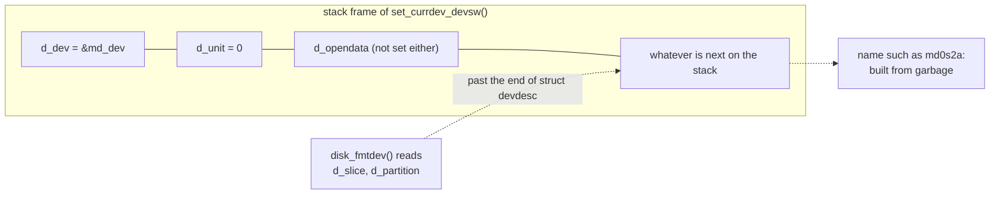

# loader set_currdev_devsw() hands a too-small struct to the disk name formatter

```
Category:  base
Component: boot
Version:   16.0-CURRENT
```

Patch: `loader_set_currdev_disk_devdesc.patch` (`stand/efi/loader/main.c`).
Patch #4 of six; the full list is in `FreeBSD/iPXE.md`, section 7(f).

**Summary.** `set_currdev_devsw()` describes the boot device with a small
structure on the stack, but for a disk the name formatter reads two fields
that only exist in a larger structure.  It reads past the end of the small
one and builds the device name from leftover stack data.  The result often
*looks* right, which makes it hard to spot.

---

## 1. Background

### 1.1 One base struct, one extended struct

The loader describes an open device with `struct devdesc`
(`stand/libsa/stand.h:191`): which driver, which unit, and a private
pointer.  Disk drivers need more (which slice and partition, and where the
partition starts), so they use `struct disk_devdesc`
(`stand/common/disk.h:91`), which begins with a `struct devdesc` and adds
three fields:

```c
struct disk_devdesc {
	struct devdesc	dd;		/* Must be first. */
	int		d_slice;
	int		d_partition;
	uint64_t	d_offset;
};
```

Because `dd` is first, a pointer to a `disk_devdesc` can be passed wherever
a `devdesc *` is expected, and the disk code casts it back.  This is the
usual C way of doing inheritance.  It only works in one direction: casting a
real `disk_devdesc` down to `devdesc` is fine; casting a plain `devdesc` up
to `disk_devdesc` makes the code read fields that are not there.

### 1.2 Where the cast happens

`devformat()` (`stand/libsa/dev.c:56`) names a device by calling its
driver's `dv_fmtdev`.  For disks that is `disk_fmtdev()`
(`stand/common/disk.c:387`), which casts its argument to
`struct disk_devdesc *` and reads `d_slice` and `d_partition` to print the
`s2a` part of `md0s2a:`.

---

## 2. The problem

`set_currdev_devsw()` in `stand/efi/loader/main.c` builds the base type on
the stack:

```c
struct devdesc currdev;

currdev.d_dev = dev;
currdev.d_unit = unit;

set_currdev_devdesc(&currdev);
```

`set_currdev_devdesc()` calls `devformat()`, which calls `disk_fmtdev()`,
which reads `d_slice` and `d_partition`.  On a plain `devdesc` those two
reads are past the end of the object:



The failure is quiet.  The garbage often formats into a name that looks
reasonable, so the loader prints a plausible device and then fails for
reasons that seem unrelated.  While debugging the md `memdisk=` path, this
produced a convincing `md0s2a:` from partly uninitialized memory across two
separate wrong diagnoses before the struct was suspected.

### How to repeat

Any `DEVT_DISK` device whose devsw sets `dv_fmtdev = disk_fmtdev` and whose
`currdev` is set through `set_currdev_devsw()`.  Not reachable in tree
today, because the disk devices that go through `set_currdev_devsw()` have
no `dv_fmtdev`.  It becomes reachable the moment one gains it, which is what
patch #2 (`loader_md_partition_probe.patch`) does for md: `probe_md_currdev()`
calls `set_currdev_devsw(&md_dev, 0)`.

---

## 3. The fix

In `probe_md_currdev()`, use a real `struct disk_devdesc`, as
`set_currdev_pdinfo()` in the same file already does for other disks:

* fill in the base fields, set `d_slice = D_SLICEWILD` and
  `d_partition = D_PARTWILD` ("pick the best one"), `d_offset = 0`;
* **open the device once before naming it**, with `disk_open()`, so the
  wildcards are replaced by the slice and partition actually found, then
  close it;
* pass it to `set_currdev_devdesc()`.

The open-first step matters because of a second sharp edge: `disk_fmtdev()`
prints a slice whenever `d_slice > D_SLICENONE` (-1), and `D_SLICEWILD` is 0,
so an unresolved wildcard would be printed as `s0`, a slice that cannot
exist.

### Alternatives

* **Fix `set_currdev_devsw()` itself:** allocate by device type, using a
  `disk_devdesc` for `DEVT_DISK`, so the bug cannot come back the next time
  a device gains `dv_fmtdev`.  This seems like the better long-term fix but
  touches a path used by every device type, and has not been tested.  The
  patch takes the local fix, following the existing `set_currdev_pdinfo()`
  precedent.

---

## 4. Tested

| Patches | Platform | Result |
|---|---|---|
| #1 to #4 | Supermicro A1SRi-2758F, md fallback | multi-user, `Setting currdev to md0s2a:` from resolved values |
| #1 to #4 | qemu and bhyve (edk2) | installer prompt; `probe_md_currdev()` not reached (VirtualDisk path) |
| fix inside `set_currdev_devsw()` | any | **untested** |

Base: main at `c14281f6bb46` (2026-09-24).
