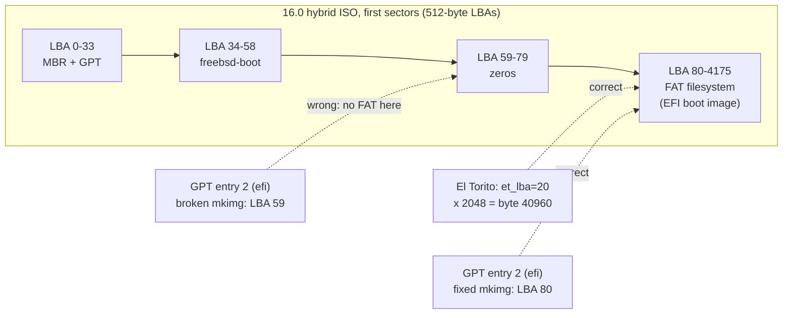
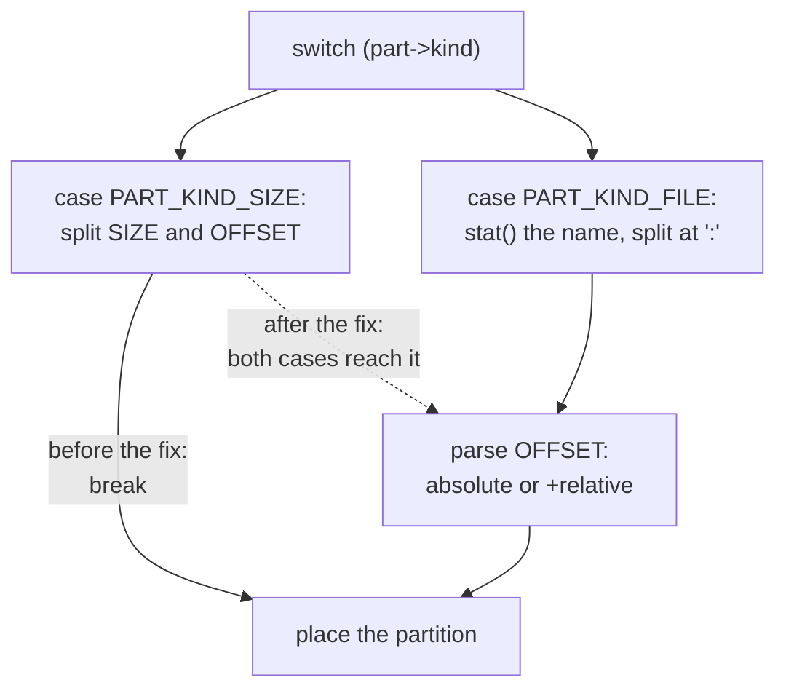

# mkimg(1) ignored the offset in the `::size` form (unbootable 16.0 ISOs)

```
Category:  bin
Component: mkimg
Version:   16.0-CURRENT
Keywords:  regression
```

**Status: fixed upstream** in `61c27edf3e00` ("mkimg: Restore offset support
for the SIZE partition form", main, 2026-09-04), with the regression test
`usr.bin/mkimg/tests/mkimg_offset_test.sh`.  This document keeps the original
report and explains it for readers new to disk images.

**Summary.** `mkimg -p efi::SIZE:OFFSET` is supposed to create a partition of
SIZE bytes starting at OFFSET.  On main between 2026-04-16 and 2026-09-04 the
OFFSET was silently ignored, so the partition was placed right after the
previous one.  The FreeBSD release scripts rely on that offset to build the
installation ISOs, so every 16.0-CURRENT amd64 ISO from that period failed to
boot under UEFI.

---

## 1. Background

### 1.1 Sectors, LBAs and partition tables

A disk is an array of fixed-size *sectors*, usually 512 bytes.  A sector's
index is its **LBA** (logical block address): LBA 80 is the sector starting
at byte 80 x 512 = 40960.

A **partition table** at the start of the disk lists the partitions, each as
a start LBA and a size.  With **GPT**, the table starts at LBA 1 and usually
ends at LBA 33, so the first partition can start at LBA 34.  The firmware
reads this table to find partitions; it does not search the disk for them.

### 1.2 UEFI boots from the EFI System Partition

A UEFI firmware boots by finding a GPT entry of type `efi` (the **ESP**),
mounting the FAT filesystem *at the LBA that entry gives*, and running
`\EFI\BOOT\BOOTX64.EFI` from it.  If the entry points at the wrong place,
the firmware finds no FAT filesystem and has nothing to boot.  In edk2,
`PartitionDxe` simply publishes no ESP.

### 1.3 A hybrid ISO is two disk formats at once

A FreeBSD installation ISO must boot when burned to a CD **and** when written
raw to a USB stick.  So the same file carries two descriptions of where the
EFI boot image lives:

* **El Torito** (the CD boot standard) points at it in 2048-byte CD sectors:
  `et_lba=20`, i.e. byte 20 x 2048 = 40960.
* **GPT** (for the USB stick case) must point at the same bytes in 512-byte
  sectors: byte 40960 is **LBA 80**.

`release/amd64/mkisoimages.sh` builds that GPT with `mkimg`, asking for an
`efi` partition of the ESP's size at exactly byte 40960:

```sh
espparam="-p efi::$espsize:$espstart"     # espstart = 40960
```

### 1.4 mkimg's two partition forms

`mkimg -p TYPE:...` has two forms (see mkimg(1)):

| form | meaning |
|---|---|
| `TYPE:=FILE[:OFFSET]` | partition filled with the contents of FILE |
| `TYPE::SIZE[:OFFSET]` | empty partition of SIZE bytes |

OFFSET is optional.  `40960` is absolute (start at byte 40960); `+10752` is
relative (start 10752 bytes after the previous partition).  Without OFFSET,
mkimg packs the partition right after the previous one.  Offsets were added
to the size form on purpose, in `459a61fd2d0a` (2018): "To create hybrid boot
media we want to specify a partition at a known location."

---

## 2. The problem

### How to repeat (on an affected main)

40960 bytes with 512-byte sectors is LBA 80:

```
$ mkimg -s gpt --capacity 588574720 -b /boot/pmbr \
    -p freebsd-boot:=/boot/isoboot -p efi::2097152:40960 -o hybrid.img
$ mdconfig -a -t vnode -f hybrid.img -u 6
$ gpart show md6
=>     34  1149493  md6  GPT  (561M)
       34       25    1  freebsd-boot  (13K)
       59     4096    2  efi  (2.0M)
     4155  1145372       - free -  (559M)
```

`efi` is at LBA 59 (34 + 25, packed after `freebsd-boot`), not the requested
LBA 80.  No warning, exit status 0.  Same command, only `::` vs `:=`
differing:

| specification | actual | expected |
|---|---|---|
| `efi::2097152:40960` | LBA 59 | LBA 80 |
| `efi::2097152:+10752` | LBA 59 | LBA 80 |
| `efi:=esp.bin:40960` | LBA 80 | LBA 80 |
| `efi:=esp.bin:+10752` | LBA 80 | LBA 80 |

### Impact: the ISO's GPT points next to the ESP



In `FreeBSD-16.0-CURRENT-amd64-20260824-74019bc3ea91-288532-bootonly.iso`
(sha256 `e262c3d12bd93098dcacf217758cb6ba6afa3ee5f84d3cd20a0d6db1a3a95b6d`)
GPT entry 2 is at LBA 59 while the FAT filesystem is at LBA 80.  LBA 59 is
zero-filled, so edk2's `PartitionDxe` publishes no ESP handle and the ISO
does not boot from USB under UEFI.

`mkisoimages.sh` is not at fault: `etdump` reports the same geometry on a
working 15.1 ISO and the broken 16.0 ISO (`et_lba=20;et_sectors=4096`,
`espstart` = 40960 = LBA 80).  Only mkimg's placement differs.  Rebuilding
just the 32 KB hybrid GPT header of that ISO with the fix, all other content
byte-identical, makes it boot to bsdinstall.

---

## 3. Cause

Introduced by `50c1240ebfaf` ("mkimg: Fix parsing of filenames containing
colons", PR 257960, 2026-04-16).  Before it, both forms shared one code path
through a `switch` *fallthrough*: in C, a `case` without `break` continues
into the next one.  That commit split them so a filename containing `:` could
be checked with `stat()` before being split at the colons.  The offset
parsing stayed inside the FILE case, and the new SIZE case ends with a bare
`break` before reaching it:

```c
case PART_KIND_SIZE:
        offset = part->contents;
        size = strsep(&offset, ":");     /* offset now points at "40960" */
        if (expand_number(size, &bytesize) == -1)
                error = errno;
        break;                           /* offset never parsed;
                                            abs_offset never set */
```

So `byteoffset` stays 0 and `abs_offset` stays false, and placement uses
`SCHEME_META_PART_BEFORE` (pack after the previous partition) instead of
`SCHEME_META_PART_ABSOLUTE`.



**Affected versions:** main only, 2026-04-16 to 2026-09-04.  Not in any
stable branch or release; stable/15 and 15.x ISOs are correct.

---

## 4. The fix (committed as `61c27edf3e00`)

Move the offset parsing out of the FILE case, after the `switch`, so both
forms reach it again, keeping the `stat()`-based filename handling.
`PART_KIND_PIPE` passes through the switch without assigning `offset`, hence
the explicit `default:`:

```diff
--- usr.bin/mkimg/mkimg.c
+++ usr.bin/mkimg/mkimg.c
@@ -492,15 +492,19 @@ mkimg(void)
 					offset = NULL;
 				}
 			}
-			if (offset != NULL) {
-				if (*offset != '+')
-					abs_offset = true;
-				else
-					offset++;
-				if (expand_number(offset, &byteoffset) == -1)
-					error = errno;
-			}
 			break;
+		default:
+			offset = NULL;
+			break;
+		}
+
+		if (offset != NULL) {
+			if (*offset != '+')
+				abs_offset = true;
+			else
+				offset++;
+			if (expand_number(offset, &byteoffset) == -1)
+				error = errno;
 		}

 		/* Work out exactly where the partition starts. */
```

All four rows of the table in section 2 then produce LBA 80, and the rebuilt
16.0 ISO boots under UEFI.

**The lesson for a student:** the 2026-04-16 commit fixed a real bug and
looked like a harmless refactor, but it broke a behaviour that only one
caller used (the release scripts), and nothing tested that behaviour.  The
fix therefore came with a test.

---

## 5. Regression test

`usr.bin/mkimg/tests/mkimg_offset_test.sh` (committed with the fix) checks
the start LBA by reading the GPT entry, rather than comparing a hexdump
baseline as `mkimg_test.sh` does, so a failure names the address produced:

```
size_absolute_offset -> failed: partition 2 starts at LBA 59, expected 80
size_relative_offset -> failed: partition 2 starts at LBA 59, expected 80
4/6 passed
```

| case | why it is there |
|---|---|
| size form, absolute offset | the bug |
| size form, relative offset | the bug, `+` path |
| file form, absolute and relative | must keep working |
| size form, no offset | catches a fix that treats a missing offset as absolute 0 |
| filename containing `:` | restoring offsets must not undo what `50c1240ebfaf` fixed |

With the fix: 6/6.  The pre-existing suite is unaffected: 140/140 pass.
