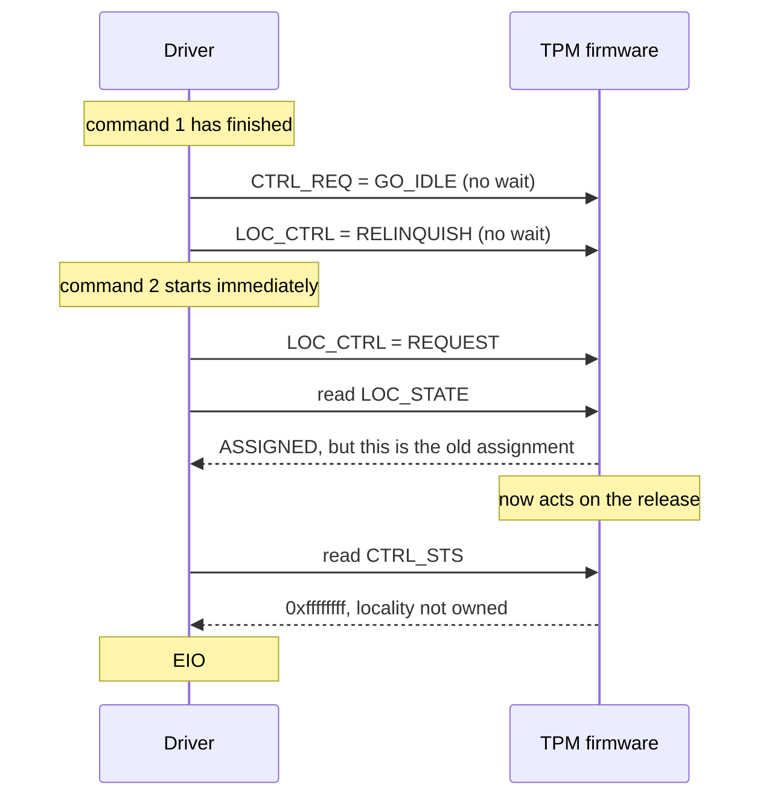

# tpm_crb: back-to-back commands fail with EIO on a Pluton TPM

```
Category:  kern
Component: kern
Version:   16.0-CURRENT
```

Patch: [`tpm_crb_settle_before_next_command.patch`](tpm_crb_settle_before_next_command.patch)
(`sys/dev/tpm/tpm_crb.c`).  Reproducer: [`tpm_crb_sweep.py`](tpm_crb_sweep.py).

**Summary.** At the end of every command, `tpmcrb_transmit()` tells the TPM to
go idle and to release its locality, then returns without waiting for either
to happen.  If the next command starts straight away, it can fail with `EIO`,
usually after a 200 ms timeout.  On the machine tested, between 0.6% and 17.6%
of commands sent with no gap failed in a run.  The patch waits for both
transitions to finish.  It removed every failure in 71000 test commands and
makes each command about 2 ms slower.

**Status.** The patch works on this one machine, but the explanation of *why*
in section 2 is an inference: no register state was captured during a failure.
Section 5 lists what is still open.

---

## 1. Background

### 1.1 What the driver talks to

A TPM is a small security processor.  The kernel sends it a command, such as
"give me 32 random bytes", and reads back a response.  It is slow compared with
the CPU and works independently of it, so the driver has to ask it to do
something and then check that it did.

The interface here is **CRB** (Command Response Buffer): a block of
memory-mapped registers plus a buffer for the command and the response.  Reading
or writing a register in this block is a message to the TPM's firmware.  These
are the registers that matter for this bug:

| Register | What it is for |
|---|---|
| `TPM_LOC_CTRL` | Request or release a locality |
| `TPM_LOC_STATE` | Whether a locality is currently assigned (`ASSIGNED` bit) |
| `CTRL_REQ` | Ask for a state change (`GO_IDLE`, `GO_READY`).  The TPM clears the bit to acknowledge |
| `CTRL_STS` | TPM status (`IDLE` bit, error bit) |
| `CTRL_START` | Start the command in the buffer.  The TPM clears it when finished |

The important habit is in the third row: **writing a request only asks.**  The
TPM has done the work when it clears the bit, some time later.

### 1.2 What a locality is

A locality is a form of ownership of the TPM interface.  Software requests one,
uses the TPM, and releases it.  FreeBSD only uses locality 0.  Like the state
changes, this is a request and an answer: the driver writes to `TPM_LOC_CTRL`,
and the TPM reports the result in `TPM_LOC_STATE`.

A comment in the driver (`tpm_crb.c:649`) records something unusual about this
hardware:

```c
/*
 * Only check for the error once we own the locality: some
 * implementations do not return meaningful values in the control area
 * before then.  An AMD Pluton fTPM using the plain CRB start method
 * reads all-ones, which looks like a permanently stuck tpmSts.
 */
```

So on this TPM, reading registers without owning the locality returns
`0xffffffff`, where every bit looks set.  Keep that in mind for section 2.

### 1.3 What one command looks like

Before the patch, `tpmcrb_transmit()` (`tpm_crb.c:623`) does this:

```
tpmcrb_request_locality()        wait up to 200 ms   "Failed to obtain locality"
read CTRL_STS: error bit set?    no wait             "Device has Error bit set"
CTRL_STS lacks the IDLE bit?
    tpmcrb_state_idle(true)      wait up to 200 ms   "Failed to transition to idle state"
tpmcrb_state_ready(true)         wait up to 200 ms   "Failed to transition to ready state"
copy the command, write CTRL_START, wait for the TPM to finish, read the response
tpmcrb_state_idle(false)         does NOT wait
tpmcrb_relinquish_locality()     does NOT wait
```

The 200 ms is `TPM_TIMEOUT_C` (200000 µs).  The last two lines are the bug: the
first command's cleanup can still be in progress when the next command begins.

Commands come from two places: programs writing to `/dev/tpm0`, and a kernel
task that fetches entropy from the TPM every 10 seconds (`RANDOM_ENABLE_TPM`).
Both hold `dev_lock` while transmitting, so they never overlap on the device,
but one can start the instant the other finishes.

---

## 2. The problem

### How to repeat

Run the reproducer as root.  It only sends `TPM2_GetRandom`, which changes no
persistent TPM state.  The first argument is the commands per run and the rest
are gaps in milliseconds.  Repeat the zeros, because the failure rate swings a
lot between runs:

```sh
python3 tpm_crb_sweep.py 2000 0 0 0 0 0 0 0 0 0.5 1 2 3 5 10 20 50
```

Tested on a Framework Desktop (AMD Ryzen AI Max+ 395, BIOS 03.05, `MSFT
Pluton.TPM.A` firmware 10.6.0.4).  The ACPI TPM2 table reports `StartMethod=7`,
plain CRB, so the driver's Pluton doorbell code does not run on this machine.

### What you see

`write(2)` on `/dev/tpm0` returns `EIO`, and the kernel logs one of:

```
tpmcrb0: Failed to transition to idle state
tpmcrb0: Failed to transition to ready state
tpmcrb0: Failed to obtain locality
tpmcrb0: Device has Error bit set
```

The TPM recovers by itself: the next command usually works, and the self-test
stays clean.  That is why this is easy to miss.  Nothing is broken for good, and
a program sending commands at a relaxed pace may never see it.

### The clue: the gap between commands

Failed commands out of 2000 per gap, unpatched kernel:

| Gap (ms) | Loaded (load average about 30) | Quiet (load average under 1) |
|---|---|---|
| **0** | **352** | **12** |
| 0.5 | 0 | 0 |
| 1 | 0 | 0 |
| 2 | 1 | 0 |
| 3 | 0 | 0 |
| 5 | 1 | 0 |
| 10 | 1 | 0 |
| 20 | 0 | 0 |
| 50 | 1 | 0 |

A gap of half a millisecond almost removes the failure.  When a bug depends on
timing like this, look for two operations that are assumed to be in order but
that nothing forces into order.

### Cause (inferred)

Here is the suspected sequence.  The two final writes return immediately, and
the driver reads `TPM_LOC_STATE` before the TPM has acted on the release:



This one race could produce all the messages above:

* **`Device has Error bit set`, failing instantly:** `CTRL_STS` reads all-ones,
  and all-ones includes the error bit.
* **`Failed to transition to idle/ready state` after 200 ms:** the request bit
  never appears to clear, because all-ones includes that bit too, or the request
  was lost.
* **`Failed to obtain locality` after 200 ms:** a late release cancels the new
  request.

It also explains why the failures end at about 0.5 ms: a gap that long gives the
TPM time to finish before the next command looks.

---

## 3. The fix

The patch makes the driver wait for each step at the end of a command.  It has
three parts.

**Wait for idle before releasing the locality:**

```diff
-		if (!tpmcrb_state_idle(crb_sc, false)) {
+		if (!tpmcrb_state_idle(crb_sc, true))
```

The boolean is `wait`.  With `true`, the function polls `CTRL_REQ` until the TPM
clears `GO_IDLE`, for up to 200 ms.  The order matters too: the driver still owns
the locality while it waits, so the register reads mean something.

**Wait for the release to take effect**, in `tpmcrb_relinquish_locality()`:

```c
mask = TPM_LOC_STATE_VALID | TPM_LOC_STATE_ASSIGNED;

bus_write_4(res, TPM_LOC_CTRL, TPM_LOC_CTRL_RELINQUISH);

for (timeout = TPM_TIMEOUT_C;; timeout -= tick) {
	if ((bus_read_4(res, TPM_LOC_STATE) & mask) ==
	    TPM_LOC_STATE_VALID)
		return;
	if (timeout <= 0)
		break;
	pause("TPM locality", 1);
}
device_printf(crb_sc->base.dev, "Failed to relinquish locality\n");
```

This has the same shape as `tpmcrb_request_locality()`, with two
differences.  First, the release only counts when the `VALID` bit is set.
PTP 1.07, Table 37 says the other bits of `TPM_LOC_STATE` mean nothing
without it, so a read of zero must not pass as "released".  Linux's
`__crb_relinquish_locality()` uses the same mask.  Second, the loop reads
the register once more after its last sleep, like `pluton_wait_reply()`.
Without that read, a release that happens during the last sleep is
reported as a failure.  Both changes came from review and only affect the
failure path.  `pause(..., 1)` sleeps
for one clock tick, so the CPU is free while waiting.  `tick` is the length of
that tick in microseconds, which makes `timeout` a count of microseconds left.
The loop always ends, so a TPM that never answers costs 200 ms and a log line,
never a hang.

**Stop reporting a late idle as a failed command:**

```diff
 			device_printf(dev,
 			    "Failed to transition to idle state post-send\n");
-			if (error == 0)
-				error = EIO;
-		}
```

This is the easy part to overlook.  The old code could not time out here,
because it never waited.  Now it can, and by that point the command has run and
its response is in the buffer.  Returning `EIO` would tell the caller a command
failed when it succeeded, which is a real problem for a command that changes
TPM state.  The next transmit requests idle again if it needs to, so logging is
enough.  The waits add a new way to fail, and this change deals with it.

### What it costs

The median command goes from about 3 ms to about 5 ms.  That fits two waits that
each sleep for one tick at `hz=1000`, though this was not measured separately.
TPM commands are rare, so this should not matter in practice.

### Without a code change

Sleeping for 1 ms between commands in userland would hide most of this, but it
would not fix it.  The driver has no way to make every caller do that, and the
kernel's entropy task can still land right after another command.

---

## 4. Tested

Same machine and scripts throughout.  Each result counts failed commands.

| Commands | System | #12: local edits, no patch | #13: local edits + patch | #14: patch only | #15: patch after review |
|---|---|---|---|---|---|
| No gap | Quiet | 1038 of 23000 | 0 of 21000 | **0 of 21000** | **0 of 16000** |
| No gap | Loaded | 753 of 7000 | 0 of 8000 | **0 of 8000** | **0 of 8000** |
| 0.5 to 50 ms gap | Quiet | 0 of 21000 | 0 of 21000 | **0 of 21000** | **0 of 16000** |
| 0.5 to 50 ms gap | Loaded | 8 of 21000 | 0 of 21000 | **0 of 21000** | **0 of 16000** |

No patched kernel logged a new TPM message during these runs, including
`Failed to relinquish locality`, and the self-test still passes.

How to read this table:

* **Why repeat the no-gap test?**  Identical quiet runs on the unpatched kernel
  gave 13, 22, 12, 138, 245, 17, 17 and 185 failures out of 2000.  One good run
  proves little, so each kernel got at least eight quiet no-gap runs.
* **#12 and #13 differ only by the patch.**  That is the comparison showing the
  patch made the difference.
* **#15 is the patch after review.**  It differs from #14 only in
  `tpmcrb_relinquish_locality()`, which now also requires the `VALID` bit.
  If this TPM cleared `VALID` after a release, every command would wait
  200 ms and log `Failed to relinquish locality`.  It did not: the median
  command took 4.9 ms quiet and 5.0 ms loaded (p99 5.0 and 5.1 ms), the
  same as #14.
* **#14 shows the patch doesn't depend on the local edits**, which cover Pluton
  mailbox handling (start method 13 only) and extra logging.
* **The load isn't the same.**  The #12 load came from about 30 unrelated
  `python3.12` processes.  The patched runs used 30 CPU-spinning shell loops at a
  load average of about 23 to 30, which may stress the machine differently.

Base: main at `584f44221f45` (2026-11-02).

### Control: a TIS machine

The same reproducer, run on a ThinkPad X1 Carbon Gen 12 (Intel Core Ultra 7
165U, BIOS N3YET80W 1.45), gave 0 failures in 32000 commands: 0 of 16000 with no
gap, and 0 of 16000 with 0.5 to 50 ms gaps.  No new TPM message was logged.

Its TPM attaches through the FIFO interface, not CRB:

```
tpmtis0: <Trusted Platform Module 2.0, FIFO mode> iomem 0xfed40000-0xfed44fff on acpi0
```

So this run exercises `tpm_tis` and the shared `tpm20` code, not `tpm_crb`.  It
shows that the shared code survives the same back-to-back load.  It does not
show whether other CRB TPMs fail, or only Pluton.  Kernel: unpatched main at
`240d81169286` (2026-08-21).

---

## 5. What is still open

* **The race has not been observed.**  The result fits section 2, but a test that
  logs `CTRL_REQ`, `CTRL_STS` and `LOC_STATE` at each failure on an unpatched
  kernel would confirm or refute it.  All-ones values would confirm it.
* **Either wait alone might be enough.**  The two were only tested together.
  Testing each separately could reduce the added latency.
* **The swings are unexplained.**  Identical quiet runs differ by a factor of 20,
  in a low group near 1% and a high group from 7% to 12%.  The race does not
  explain that.
* **The rare failures under load are unexplained.**  They are gone with the patch,
  but they were rare, the test load was synthetic, and any role for the entropy
  task is unproven.
* **A fully unmodified kernel was not tested.**  The failures were only measured
  on #12, which carries the local edits.
* **Only one CRB machine was tested.**  The TIS control in section 4 clears the
  shared code, but no non-Pluton CRB TPM was tested.  Start method 13 systems
  would now also wait for the mailbox at the end of each command.  Systems
  without the locality registers skip the release wait but still get the idle
  wait.  Both need testing.  Start method 13 did break: see section 7.
* **When it started is unknown.**  `f0ac0f73aea7` (D59786) changed these idle and
  ready waits, but older kernels were not tested, so nothing implicates it.

---

## 6. Related

[`TPM_IRQ.md`](TPM_IRQ.md) describes a similar class of bug in the other TPM
interface (TIS, `tpm_tis_core.c`): STMicro ST33 parts need the driver to leave
the chip in a clean state before releasing the locality.  In both cases, what
the driver does at the end of one command decides whether the next one works.

---

## 7. Follow-up: "Failed to relinquish locality" every 10 s on Pluton

Patch: [`tpm_crb_pluton_no_locality.patch`](tpm_crb_pluton_no_locality.patch)
(`sys/dev/tpm/tpm_crb.c`), on top of `bfe4be85a935`, the commit of the
section 3 patch.

**Summary.** After `bfe4be85a935`, a Framework 13 (AMD Ryzen 7 7840U) logs
`Failed to relinquish locality` every 10 seconds.  The likely cause: on the
Pluton start method, the locality release never shows up in `TPM_LOC_STATE`,
so the new release wait from section 3 times out on every command.  The patch
stops using the locality registers with that start method, like Linux does.
It has only been compiled.  It has not run on a Pluton laptop yet.

### 7.1 Background

**Start method.**  The ACPI TPM2 table has a `StartMethod` field.  It tells
the driver how to make the TPM notice a request.  The Framework Desktop in
section 2 reports 7, plain CRB: writing to the register is enough.  Method 13,
"command buffer with Pluton", adds a mailbox.  After each register write, the
driver rings a doorbell so that the Pluton firmware looks at the registers
(`pluton_doorbell()`, `tpm_crb.c:907`).  `4995fd4bf2c6` fixed that mailbox for
"a Framework AMD laptop", so these laptops use method 13.

**Which machines use locality.**  `tpmcrb_attach_acpi()` decides once at attach
time, in `has_locality` (`tpm_crb.c:366`).  Before this patch it looked only at
the memory layout: locality registers are used if the 64 bytes before the
control area belong to the TPM's memory resource.  The start method played no
part.  So a method 13 TPM with that layout got the full locality handshake.

**The 10 seconds.**  With `RANDOM_ENABLE_TPM`, `tpm20.c` asks the TPM for
random bytes every 10 seconds (`tpm20.c:53`).  That is one command, so one
release, every 10 seconds.

### 7.2 The problem

Reported by a user, not reproduced here:

```
On a Framework 13" AMD Ryzen 7840U I'm now seeing this message
(Failed to relinquish locality) emitted every 10s.
```

The reporter's TPM2 table (`acpidump -dt`) shows `StartMethod=d`, that is
13: the Pluton start method.  So the patch applies to this machine.

Before `bfe4be85a935`, `tpmcrb_relinquish_locality()` wrote the release
request and returned without reading anything, so a TPM that ignored the
request went unnoticed.  Section 3 added a loop that polls `TPM_LOC_STATE`
until `VALID` is set and `ASSIGNED` is clear, for up to 200 ms.  On this
laptop the loop always times out.

The commands still succeed.  The release wait returns nothing, so a timeout
only logs.  The cost is the log line plus 200 ms added to every command.

**Inferred, not measured:** what `TPM_LOC_STATE` actually reads.  It could
stay `ASSIGNED`, lack `VALID`, or read all-ones.  The old message did not
print it.

### 7.3 How Linux handles this

Linux's `drivers/char/tpm/tpm_crb.c` keeps a pointer to the locality registers,
`regs_h`.  `crb_map_io()` sets it only for start methods 6 (memory mapped), 7
(command buffer) and FF-A.  For method 13 it stays `NULL`, and the request and
release functions return at once when it is `NULL`.  So Linux has never used
the locality registers on Pluton, and Linux works on these laptops.  Section 3
followed Linux's release mask, but Linux never runs that code on this hardware.

### 7.4 The fix

```diff
-	crb_sc->has_locality = tbl->ControlAddress >= TPM_CRB_LOCALITY_SIZE &&
+	crb_sc->has_locality =
+	    tbl->StartMethod != ACPI_TPM2_COMMAND_BUFFER_WITH_PLUTON &&
+	    tbl->ControlAddress >= TPM_CRB_LOCALITY_SIZE &&
```

With `has_locality` false, `tpmcrb_request_locality()` returns true at once and
`tpmcrb_relinquish_locality()` returns at once.  The idle wait from section 3
still runs, and so does the Pluton doorbell that goes with it.

The patch also prints the last `TPM_LOC_STATE` value when a release fails:

```
tpmcrb0: Failed to relinquish locality (loc_state=0x...)
```

If another TPM shows the same message, the value tells which bit is wrong
without a debug kernel.

**Why at attach and not in the release function.**  `has_locality` is the one
place that decides whether locality registers exist.  Deciding there keeps
request and release consistent: the driver never requests a locality that it
then does not release.

**Alternatives.**

| Option | For | Against |
|---|---|---|
| Skip only the release wait on Pluton | Smallest change in behaviour | Keeps writing and reading registers that, on this hardware, do not report what the driver expects |
| Remove the release wait for every TPM | Simple | Section 5 never tested the idle wait alone.  The section 2 race could come back on method 7 |
| Ring the Pluton doorbell after the locality write | Might make the firmware act on it | Guesswork: no spec or other driver does it |

**What it does not fix.**

* Method 13 machines lose the locality request too.  Since `f0ac0f73aea7`,
  FreeBSD has requested a locality on these machines, and command transmit
  worked that way.  It should keep working without the request, as it does on
  Linux, but this is not tested.
* A non-Pluton TPM that also ignores the release still logs once per command.
  Now the log line at least carries the register value.

### 7.5 Tested

| Configuration | Result |
|---|---|
| `make` in `sys/modules/tpm`, main at `86861520613f` | Builds, no warnings |
| Framework 13, method 13, patched | **Untested** |
| Framework Desktop, method 7, patched | **Untested**: `has_locality` is unchanged for method 7, so behaviour should match #15 in section 4 |

### 7.6 Open

* **The `TPM_LOC_STATE` value is unknown.**  If the reporter runs a kernel
  that has only the new log line, without the `has_locality` change, the
  message shows it.
* **Ask the reporter to run the section 2 reproducer** on the patched kernel.
  0 failures and no TPM messages would close this.
