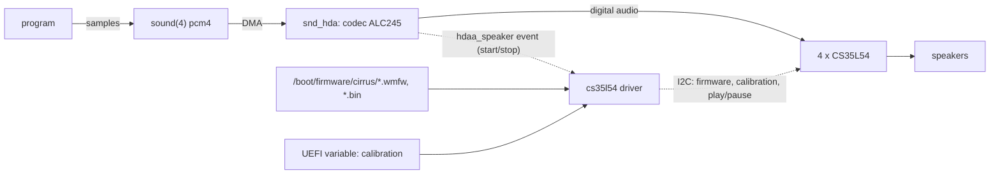

# Silent laptop speakers: a driver for the Cirrus Logic CS35L54 amplifiers

Patch: [cs35l54_speaker_amp.patch](cs35l54_speaker_amp.patch), the 10 commits of branch
[`olivier-cs35l54`](https://github.com/ocochard/freebsd-src/compare/main...olivier-cs35l54) on top of FreeBSD main 29b24020f6fa (rebased 2026-11-12).
Related fixes found on the way, one commit each:
[`olivier-amdgpio-pnp`](https://github.com/ocochard/freebsd-src/compare/main...olivier-amdgpio-pnp) (devmatch loads amdgpio),
[`olivier-acpi-prop-child`](https://github.com/ocochard/freebsd-src/compare/main...olivier-acpi-prop-child) (the `device_get_property()` hang of section 3.4),
[`olivier-ig4-amd-clock`](https://github.com/ocochard/freebsd-src/compare/main...olivier-ig4-amd-clock) (ig4 ran the AMD I2C bus at about 494 kHz instead of 400 kHz).
Machine: HP ZBook Ultra G1a 14 (AMD Ryzen AI Max+ PRO 395, Realtek ALC245 codec, subsystem 103C:8D01).
Investigation log and measurements: [cs35l54_speaker_amp_plan.md](cs35l54_speaker_amp_plan.md).
Firmware port (not committed yet): `audio/sound-firmware-cirrus-kmod`.

This document explains the work for a first-year computer science student:
someone who knows C and what an operating system does, but has never looked
at FreeBSD sound, I2C, ACPI or firmware loading.

## 1. Background

### 1.1 How sound leaves a laptop

A program writes audio samples to a sound device such as `/dev/dsp4`.
FreeBSD's sound system, `sound(4)` (`sys/dev/sound/pcm/`), mixes the streams and hands blocks of samples to a hardware driver.
On PCs that driver is `snd_hda(4)` (`sys/dev/sound/pci/hda/`), for *High Definition Audio*:
a controller on the PCI bus moves the samples by DMA to a *codec*, a chip that turns digital samples into analog signals.

Inside the codec, small blocks called *widgets* form a graph.
A *converter* widget (here node 2 or 3) turns samples into an analog signal, and a *pin* widget (node 23, "Speaker, Fixed, Internal") sends it out of the chip.
`snd_hda` groups the pins that belong together into *associations* (for example speaker and microphone) and creates one `pcm` device per group.
When a program starts playing, `sound(4)` calls the driver's trigger method, `hdaa_channel_trigger()` (`sys/dev/sound/pci/hda/hdaa.c:2251`), which starts the DMA and the converter.

On older laptops the speaker pin drives the speakers through an analog amplifier.
On this one, it does not: the codec sends the audio digitally to four *smart amplifiers*.

### 1.2 Smart amplifiers

A smart amplifier is a power amplifier with a small DSP (digital signal processor) inside.
The DSP runs a *speaker protection* program: it measures voltage and current in the speaker and limits the power,
so that small laptop speakers can play loud without burning.
It also does the filtering between woofers (low notes) and tweeters (high notes).

The Cirrus Logic CS35L54 has:

- an audio input port (*ASP*, audio serial port) that receives the samples from the codec;
- a control port on *I2C*, a slow two-wire bus where each chip has a 7-bit address;
- a DSP core (Cirrus calls it *Halo*) with its own memories: XM and YM for data, PM for program;
- a ROM firmware that boots the DSP when the chip powers up.

The chip is controlled through registers with 32-bit addresses and 32-bit values, read and written over I2C.
Commands go through a *mailbox* register (0x11020): the driver writes a command code, and the firmware clears the register when it has taken the command.
Examples: `AUDIO_PLAY` (0x0B000001), `AUDIO_PAUSE` (0x0B000002), `SYSTEM_RESET` (0x02000007).

On this laptop, four CS35L54 drive the left woofer, left tweeter, right tweeter and right woofer.

### 1.3 How the driver finds the hardware: ACPI

The firmware of a PC (UEFI) describes the devices that cannot be discovered by probing in *ACPI tables*.
The amplifiers are described by one ACPI device, `\_SB_.I2CB.SPKR`, with:

- `_HID` "CSC3554": the hardware id (CSC = Cirrus Logic);
- `_SUB` "103C8D01": the platform (subsystem) id, used to pick the right tuning files;
- `_CRS`: the resources, here five I2C addresses (0x30 to 0x33, plus an alias 0x3C), a GPIO for the shared reset line (pin 139) and a GPIO interrupt (pin 130);
- `_DSD`: extra properties, here `cirrus,dev-index` = {0x30, 0x31, 0x32, 0x33}, the list of real amplifiers.

FreeBSD's `acpi_iicbus` (`sys/dev/iicbus/acpi_iicbus.c`) creates one I2C child device per ACPI device,
but keeps only the first I2C address of `_CRS`: `acpi_iicbus_get_i2cres_cb()` stops at the first match (`acpi_iicbus.c:379`).
So the driver attaches to one child at 0x30 and talks to 0x31-0x33 itself, which `iicbus_transfer()` allows: each message carries its own address.

### 1.4 Loading firmware into the kernel: firmware(9)

A driver gets a firmware file with `firmware_get_flags()` (`sys/kern/subr_firmware.c:389`).
The image is looked up, in order: among images already registered;
by loading a kernel module named after the image;
and finally as a raw file under `/boot/firmware/` (`try_binary_file()`, `subr_firmware.c:270`).
Reading a raw file needs the root file system, so a driver that attaches early in boot must wait for it.

### 1.5 The firmware files

The DSP program and the tuning come from linux-firmware, in Cirrus formats:

- `.wmfw` (DSP program): a header, then *regions*. Each region has a type (which memory: XM, YM, PM, packed or not), an offset and data.
  Some regions carry no data for the chip but metadata: the list of algorithms and the names and offsets of their controls.
- `.bin` (tuning, one per amplifier): blocks of coefficients, each addressed by an *algorithm id* and an offset inside that algorithm's memory.
  The base address of each algorithm is not in the file: the driver reads it from a table that the running program keeps in XM.

A region offset counts in DSP words; turning it into a register address depends on the memory type
(`cs_region_to_reg()`, `cs35l54.c:363`): 4 bytes per word for unpacked memory, 3 bytes for packed XM/YM, 5 bytes for PM.

## 2. The problem

Repeat: on FreeBSD 16.0-CURRENT, play anything on the internal speaker device.

Measured on 2026-11-11 with Chromium playing a video:

```
dsp4.play.0[dsp4.virtual_play.0]: spd 44100/48000, ... pid 28573 (pulseaudio)
    interrupts 0, underruns 0, feed 8268, ready 15444
```

The audio reaches the codec (the channel runs, 0 underruns) and the speakers are silent.
The same laptop under Linux plays, through Linux's `cs35l56-hda` driver.
`devinfo -v` shows the cause: `unknown pnpinfo _HID=CSC3554 ... at addr=0x30`, no driver.

A first userland prototype ([cs35l54_tool.c](cs35l54_tool.c)) talked to the amplifiers through `/dev/iicN` and answered two questions:

| Test | Result |
|---|---|
| Wake the amplifiers, configure the audio port, send `AUDIO_PLAY` on the ROM firmware | amplifiers report "playing" (power state PS0), silence |
| Same, bypassing the DSP (DAC fed straight from the audio port) | silence |
| Download the DSP program and tuning, reset, then play | sound |

The status register said it from the start: `PROTECTION_STATUS` = 1, bit `FIRMWARE_MISSING`.
The ROM firmware only boots the chip; the real program must be downloaded at every power-up.

## 3. The fix



The audio path (solid arrows) already worked; the patch adds the control path (dotted arrows).

### 3.1 The driver, `sys/dev/sound/pci/hda/cs35l54.c`

**Attach** (`cs35l54_attach()`, `cs35l54.c:1104`):
read the amplifier list from `_DSD` (`cs_get_amps()`, `:980`), the platform id from `_SUB` (`cs_get_sub()`, `:1025`)
and the reset GPIO from `_CRS` (`cs_get_reset()`, `:1067`).
The firmware download takes seconds and sleeps on I2C, so it runs in a taskqueue thread;
if the root file system is not mounted yet, it waits for the `mountroot` event.

**Download** (`cs_fw_task()`, `:776`, then `cs_load_amp()`, `:698` for each amplifier), the same sequence as Linux:

1. Pulse the reset line (`cs_hard_reset()`, `:764`), wake the amplifier, wait for the ROM firmware to boot.
2. Ask the ROM firmware to shut down the DSP (mailbox `SHUTDOWN`).
3. Write every region of the `.wmfw` file (`cs_write_wmfw()`, `:387`).
4. Read the algorithm table back from XM (`cs_read_algs()`, `:426`) and write the `.bin` blocks at their algorithm bases (`cs_write_bin()`, `:459`).
5. Reset into the new program, write the audio port setup, apply the calibration, send `AUDIO_REINIT`.

Files are found by `cs_firmware_get()` (`:680`): first as a firmware(9) module image (`cirrus_cs35l54_b0_dsp1_misc_103c8d01_wmfw`), then as the raw file `cirrus/cs35l54-b0-dsp1-misc-103c8d01.wmfw`.

**Calibration** (`cs_read_cal()`, `:534`, `cs_apply_cal()`, `:606`):
each speaker's resistance was measured at the factory and stored in the UEFI variable `CirrusSmartAmpCalibrationData`, read with `efi_var_get()`.
Each amplifier is matched to its entry by a silicon id read from its OTP memory.
The values go into four controls of the protection algorithm (`CAL_AMBIENT`, `CAL_R`, `CAL_STATUS`, `CAL_CHECKSUM`),
whose offsets come from the `.wmfw` metadata (`cs_find_ctl()`, `:566`).

**Play and pause** (`cs_play()`, `:816`, `cs_stop()`, `:844`): mailbox `AUDIO_PLAY`, wait for power state PS0, enable the audio port inputs; and the reverse.

**Suspend and resume**: pause on suspend; on resume (`cs_resume_task()`, `:913`) download again if the amplifiers lost their program, otherwise restart a running stream.

### 3.2 Following the speaker stream: `hdaa.c` and `hdaa_speaker.h`

The amplifiers must play exactly when the codec plays to the speaker.
`hdaa_channel_trigger()` now checks whether the channel's association contains a fixed internal speaker pin (`hdaa_as_has_speaker()`, `hdaa.c:2228`)
and, after releasing the hdaa lock, fires an event (`hdaa.c:2276`):

```c
if (speaker)
	EVENTHANDLER_INVOKE(hdaa_speaker, ch->devinfo->dev,
	    hda_get_subsystem_id(ch->devinfo->dev),
	    go == PCMTRIG_START);
```

The amplifier driver registers for `hdaa_speaker`, ignores codecs whose subsystem id differs from its `_SUB`,
and queues the I2C work to a task (`cs_speaker_event()`, `cs35l54.c:942`): the handler runs in the trigger path and must not sleep.

### 3.3 Installing the firmware: `fwget(8)` and the port

`fwget(8)` installs firmware packages for the hardware it finds, but knew only PCI and USB ids.
The patch adds an `acpi` subsystem (`usr.sbin/fwget/acpi/acpi`) that reads the `_HID` of every ACPI device from `devinfo -v`,
and a Cirrus script (`acpi_cirrus`) that maps `CSC3554` to the package `sound-firmware-cirrus-kmod-cs35l54`.
The port fetches the files from linux-firmware (tag 20261019) and installs them as raw files under `/boot/firmware/cirrus/`, with the symlinks that linux-firmware declares in `WHENCE`.

### 3.4 Two traps found on the way

**Stale first word on I2C reads.** Through FreeBSD's `ig4` I2C controller driver, the first 32-bit word of every read from these chips is stale:
it is the word after the end of the previous read; the next words are correct.
Reading 0x4804, whose reset value is 0x28, returned 0x18180200, the value of 0x4808.
Linux reads the same chips correctly. The cause is not found.
The driver reads one extra word starting 4 bytes early and drops it (`cs_read()`, `cs35l54.c:205`), which is correct with or without the problem.

**`device_get_property()` on an I2C child hangs the machine.**
The first version read `cirrus,dev-index` with `device_get_property()`.
For a child of `acpi_iicbus` the request reaches `acpi_device_get_prop()` (`sys/dev/acpica/acpi.c:2000`),
which takes the child's private data (`device_get_ivars()`) as a `struct acpi_device`, but it is a `struct acpi_iicbus_ivars`:
the kernel followed garbage pointers and the laptop froze at `kldload`.
The driver now evaluates `_DSD` itself with `AcpiEvaluateObjectTyped()`.

### 3.5 Alternatives

| Choice | Taken | Alternative | Why |
|---|---|---|---|
| Driver source | native BSD driver, written from the register behaviour | port Linux `cs35l56`, `cs_dsp` and `cs-amp-lib` through LinuxKPI | the Linux code is GPL-2.0 (about 8000 lines) and needs regmap, component and gpiod layers that LinuxKPI lacks; the native driver needs only the subset this hardware uses |
| Link to the codec | `EVENTHANDLER` fired by hdaa | a kobj "side codec" interface in hdaa, like Linux `hda_component` | the event keeps hdaa changes to 35 lines and the two drivers independent; to be discussed with the sound maintainers |
| Firmware packaging | raw files from a port, module images also accepted | firmware compiled into the driver | tuning files are per platform (17 HP CS35L54 platforms in linux-firmware), so they belong in a package |
| Amplifier interrupt | not used | GpioInt on GPIO 130 | it only reports errors (short circuit, over-temperature), and FreeBSD x86 cannot deliver ACPI GpioInt interrupts to I2C devices yet ([x86_gpio_intr_mtl.md](x86_gpio_intr_mtl.md)) |

### 3.6 What the patch does not fix

- Only CS35L54 revision B0 on I2C: CS35L56/57, revision B2, speaker-id variants (`-spkidN` files), SPI and SoundWire attachment are not supported (see the plan, "Other laptops and chips").
- The cause of the stale I2C read is not found.
- The amplifiers start after the stream does, so the first milliseconds of each sound may be lost (not measured).
- `amdgpio` must be loaded for the reset line; there is no `amdgpio(4)` manual page.

## 4. Tested

On the HP ZBook Ultra G1a, FreeBSD main 6e87733f73ff plus the patch, 2026-11-11.
After the rebase onto 29b24020f6fa (2026-11-12), the modules, the style check and a kernel without modules build
(a full `buildkernel` stops in the ZFS module, in code the patch does not touch),
and the rebased driver passed the rows marked "rebased" below:

| Configuration | Result |
|---|---|
| `kldload`, firmware from raw files | `cs35l540: 4 amplifiers, firmware 3.11.18`, `dev.cs35l54.0.loaded: 1` (also rebased) |
| `sysctl dev.cs35l54.0.play=1` with a 440 Hz tone on `pcm4` | sound (heard; also rebased, on the stock kernel) |
| Test kernel with the hdaa hook, tone with no sysctl | `play` goes 0 -> 1 -> 0 with the stream; sound (heard; also rebased driver, on the old-base test kernel) |
| YouTube in Chromium through PulseAudio | sound; pause/resume restarts at once |
| Calibration | each amplifier matched its UEFI entry by silicon id; control addresses and values for AMP1 equal the Linux driver's |
| Firmware from the `audio/sound-firmware-cirrus-kmod` package (poudriere testport and bulk, then `pkg add`) | download and calibration complete |
| `devctl suspend` / `devctl resume` during playback | `play` 1 -> 0 -> 1 |
| `devctl resume` after resetting the amplifiers | firmware and calibration downloaded again |
| `fwget -n` with the acpi subsystem | prints `sound-firmware-cirrus-kmod-cs35l54` |
| Real suspend-to-idle | untested |
| Attach at boot (`kld_list`) | untested |
| Other laptops, other chips | untested |
| `fwget` installing from a package repository | untested (package not in a repository) |
