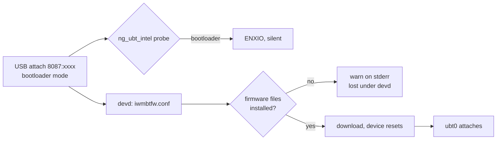

# fwget: detect Intel Bluetooth adapters

Patch: [fwget_usb_intel_bluetooth.patch](fwget_usb_intel_bluetooth.patch),
branch `olivier-fwget-intel-bt`, based on FreeBSD main 563c2f27e0ff (2026-11-16).

## Background

### Firmware packages

Many devices need a firmware image before they work.
FreeBSD does not ship most of these images in the base system: they come as packages
(for example `wifi-firmware-iwlwifi-kmod-22000`, `gpu-firmware-amd-kmod-yellow-carp`).
The user must know which package to install.

### fwget(8)

`fwget` answers that question.
It lists the hardware, matches each device against tables, and installs the packages found (`-n` only prints them).

- `usr.sbin/fwget/fwget.sh`: main script. It sources one script per subsystem (`pci`, `usb`) from `/usr/libexec/fwget`.
  `addpkg()` adds a package name to the list and skips duplicates.
- `usr.sbin/fwget/usb/usb`: runs `usbconfig -l dump_device_desc`.
  For each device, `usb_get_vendor()` turns the `idVendor` value into a name.
  If a script `usb_<name>` exists, `usb_search_packages()` sources it and calls `usb_<name> <idProduct>`.
- `usr.sbin/fwget/usb/usb_ralink`: the only vendor script before this patch (vendor 0x148f, one device).

### Intel Bluetooth and iwmbtfw(8)

Intel Wi-Fi cards with Bluetooth (7260, 8260/8265, 9260, AX200, AX201...) put the Bluetooth part on USB, vendor 0x8087.
At power-up this USB device runs a bootloader, not the Bluetooth firmware.

- `sys/netgraph/bluetooth/drivers/ubt/ng_ubt_intel.c`: in probe, it asks the device for its state.
  In bootloader mode it returns `ENXIO`: no driver attaches, and no message is printed.
  Its comment explains why: talking HCI to the bootloader locks the adapter until power-off.
- `usr.sbin/bluetooth/iwmbtfw/iwmbtfw.conf`: a devd rule.
  On USB attach of vendor 0x8087 and one of 12 product IDs, devd runs
  `iwmbtfw -d $cdev -f /usr/local/share/iwmbt-firmware`.
- `iwmbtfw` downloads the firmware. The device resets, comes back in operational mode, and `ubt0` attaches.
- The files in `/usr/local/share/iwmbt-firmware` come from the `comms/iwmbt-firmware` port.



## The problem

On a Beelink SER6 (Intel AX200, Bluetooth 8087:0029), FreeBSD main of 2026-11-05, without `iwmbt-firmware`:

```
$ usbconfig
ugen1.3: <AX200 Bluetooth Intel Corp.> at usbus1, cfg=0 md=HOST spd=FULL (12Mbps) pwr=ON (100mA)
$ ls /usr/local/share/iwmbt-firmware
ls: /usr/local/share/iwmbt-firmware: No such file or directory
$ grep -c iwmbtfw /var/log/messages
0
$ fwget -n -v usb
No firmware packages to install.
```

Every layer fails without a message:

- the kernel rejects the device silently (`ENXIO`);
- `iwmbtfw` reports the missing file with `warn()` in `iwmbt_fw_read()` (`usr.sbin/bluetooth/iwmbtfw/iwmbt_fw.c`),
  which writes to stderr, and devd does not keep it;
- `fwget` knows no USB vendor except Ralink.

The only trace is a `ugen` device with no driver.
The package name appears only in `iwmbtfw(8)`.

## The fix

Two changes in `usr.sbin/fwget/usb`:

1. `usb`: `usb_get_vendor()` maps 0x8087 to `intel`.
2. New `usb_intel`: the 12 product IDs of `iwmbtfw.conf` call `addpkg "iwmbt-firmware"`.
   The list is the same as the `ng_ubt_intel` ID table (7260, 8260 and 9260 families).
   One line per ID, like `usb_ralink` and the PCI tables, so a new ID is a one-line diff.

`usb_intel` is installed by the `SCRIPTS` list in `usb/Makefile`.

Why here: `fwget` is the documented tool for "which firmware package does this machine need".
The installer (bsdinstall `firmware` step) calls it, so new installs get the package too.

Alternatives:

- Make `iwmbtfw` log to syslog. Useful, but the user still learns the problem only after reading logs,
  and only if the devd rule runs. A separate, smaller fix.
- Make `ng_ubt_intel` print a message in bootloader mode.
  Probe runs often; a message there is noisy, and it cannot name a package.
- Generate `usb_intel` from `iwmbtfw.conf` at build time. Saves the "keep in sync" comment,
  but adds build logic for 12 lines.

What the patch does NOT fix:

- The ID list is duplicated: a new ID in `iwmbtfw.conf` must also go into `usb_intel`.
- Intel Bluetooth that is not in `iwmbtfw.conf` stays undetected.
  Such chips also need `iwmbtfw` support first.
- `iwmbtfw` errors under devd remain invisible.
- After the package is installed, the firmware loads only on the next USB attach: reboot,
  or run `iwmbtfw -d ugenX.Y -f /usr/local/share/iwmbt-firmware` by hand.

## Tested

Beelink SER6, FreeBSD 16.0-CURRENT main-n290674, 2026-11-16.
The patched scripts were run from a temporary directory with `LIBEXEC_PATH` set; `fwget.sh` honors that variable.

| Test | Result |
|---|---|
| stock `fwget -n -v usb` | `No firmware packages to install.` |
| patched `fwget.sh -n -v usb` | `Trying to match device 0x0029 and vendor intel with usb_intel`, then `Needed firmware packages: 'iwmbt-firmware'` |
| patched `fwget.sh -n`, all subsystems | `wifi-firmware-iwlwifi-kmod-22000 gpu-firmware-amd-kmod-yellow-carp iwmbt-firmware` |
| `usb_intel` alone, IDs 0x0029, 0x0036, 0x07dc, 0x0a2b | package added, return 1 |
| `usb_intel` alone, IDs 0x0aa8, 0x1234 | nothing added, return 0 |
| `pkg install iwmbt-firmware`, then `iwmbtfw -I -d ugen1.3` | `Firmware download is successful!`, then `ubt0: <vendor 0x8087 product 0x0029 ...> on usbus1` |
| `hccontrol -n ubt0hci read_bd_addr` after `service bluetooth onestart ubt0` | `BD_ADDR:` returned |

Not tested:

- `fwget` without `-n` (the real `pkg install` path); it is the same `addpkg` list as the PCI scripts.
- bsdinstall firmware step.
- Other Intel adapters (7260, 8260, 9260 families): no hardware.
- A real `make installworld`. `make -n install` in `usr.sbin/fwget/usb` lists `usb_intel` next to `usb_ralink`.
