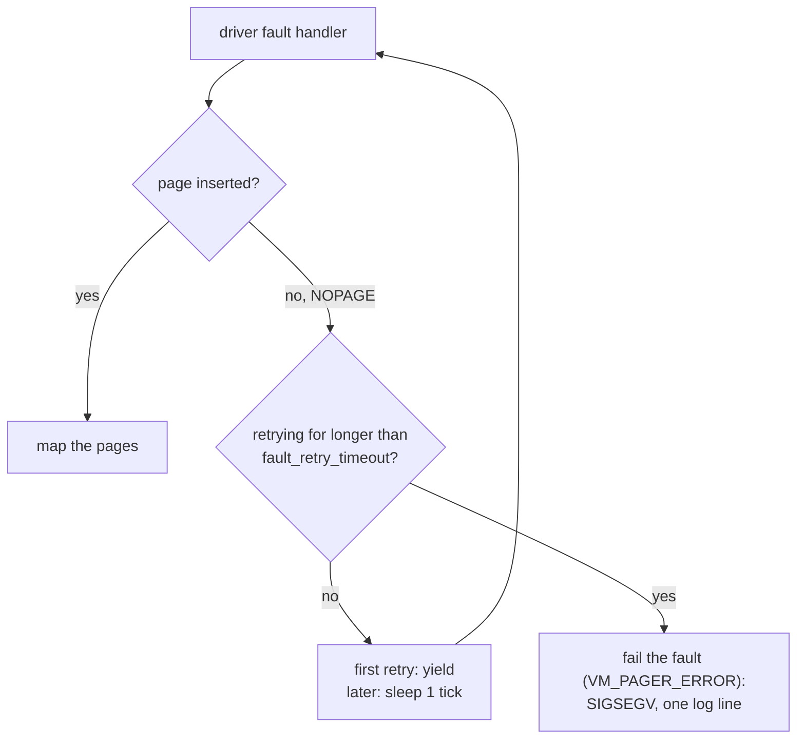

# LinuxKPI: bounding the retries of a GPU page fault

Patch: [linuxkpi_fault_killable.patch](linuxkpi_fault_killable.patch), branch `olivier-lkpi-fault-killable`
(commit 70e3488d070b on FreeBSD main 0df9a2d94988), one file, +32/-3.
Pull request: [ron-dev #131](https://ron-dev.freebsd.org/FreeBSD/src/pulls/131); review notes:
[reviews/lkpi-fault-killable.md](reviews/lkpi-fault-killable.md).
Found on: Intel NUC 13 Pro, Core i7-1360P (Raptor Lake-P), Iris Xe 8086:a7a0, `drm-612-kmod` 6.12.110,
`libva-intel-media-driver` 26.3.5. Investigation: [../Intel.NUC13.Pro.md](../Intel.NUC13.Pro.md#tracing-the-hang-2026-11-23).

This document is for a first-year computer science student: someone who knows C and what an
operating system does, but has not looked inside the FreeBSD virtual memory (VM) system.

Result in one line: a GPU page fault that the driver can never serve used to loop in the kernel
forever, burning a CPU, and the process survived `kill -9` until a reboot; with the patch the retries
sleep, and after `compat.linuxkpi.fault_retry_timeout` seconds (30 by default) the fault fails and
the thread gets SIGSEGV.

## 1. Background

### 1.1 Pages, VM objects and page faults

Physical memory is cut into 4 KB *pages*, each described by a `struct vm_page` (`sys/vm/vm_page.h`).
A *VM object* (`struct vm_object`, `sys/vm/vm_object.h`) is a container of pages: a file, anonymous
memory, or a device's memory. **A FreeBSD page belongs to at most one object** (`m->object`).

When a process maps an object (`mmap(2)`), the page tables stay empty. The first access to each
address traps (a *page fault*); `vm_fault()` (`sys/vm/vm_fault.c`) finds or creates the page and
enters it in the page table.

### 1.2 Device pagers and "populate"

A GPU buffer is mapped through a *device pager*, a VM object of type `OBJT_MGTDEVICE` whose pages the
driver provides (`sys/vm/device_pager.c`). On a fault, `vm_fault_populate()` calls the pager's
*populate* method, which asks the driver to insert pages and returns the range it filled.

### 1.3 LinuxKPI and the retry loop

Linux graphics drivers (i915, amdgpu) run on FreeBSD through LinuxKPI (`sys/compat/linuxkpi/`).
Its populate method, `linux_cdev_pager_populate()` (`src/linux_compat.c`), calls the Linux driver's
`fault` handler. A handler returns `VM_FAULT_NOPAGE` both when it inserted pages and when it wants to be
called again (it could not take a lock, or a wait was interrupted). LinuxKPI tells the two apart by
counting inserted pages:

```c
err = vmap->vm_ops->fault(&vmf);

while (vmap->vm_pfn_count == 0 && err == VM_FAULT_NOPAGE) {
        kern_yield(PRI_USER);
        err = vmap->vm_ops->fault(&vmf);
}
```

On Linux the "call me again" case returns to user space: the instruction faults again, and any
pending signal is delivered in between. A FreeBSD pager cannot return without either supplying the
page or failing the fault, so LinuxKPI retries inside the kernel instead.

### 1.4 How a process dies

`kill -9` queues SIGKILL on the process (`tdsendsignal()`, `sys/kern/kern_sig.c`) and wakes one of its
threads. That thread acts on the signal on its way back to user space and calls `exit1()`
(`sys/kern/kern_exit.c`), which:

1. sets `P2_WEXIT` in `p_flag2` ("exit just started", `proc_set_p2_wexit()`);
2. calls `thread_single(p, SINGLE_EXIT)` and waits until every other thread has left the kernel and exited;
3. only then sets `P_WEXIT` and frees the process.

A thread spinning in a kernel loop never reaches the user boundary, so step 2 waits forever.

## 2. The problem

### 2.1 Repeating it

On the NUC (stock kernel main-n291498-6dc19a71f70c), with i915 and the Intel media driver:

```
ffmpeg -vaapi_device /dev/dri/renderD128 -i in.mp4 -vf format=nv12,hwupload \
    -c:v h264_vaapi -rc_mode CQP out.mp4
```

The output stays at 48 bytes, one CPU stays busy, `kill -9` does nothing, and the console prints
without end:

```
lkpi_vmf_insert_pfn_prot_locked: page rename failed: page is mapped
```

`procstat -kk` shows both halves of section 1.4:

```
ffmpeg   -               ... thread_single exit1 proc_set_p2_wexit sigexit postsig ast ...
ffmpeg   enc0:0:h264_vaa ... printf lkpi_vmf_insert_pfn_prot_locked remap_io_sg vm_fault_cpu
                             linux_cdev_pager_populate vm_fault_allocate vm_fault ...
```

The main thread took SIGKILL and waits in `exit1()`; the encoder thread spins in the retry loop.
Only a reboot recovers. Reproduced five times.

### 2.2 Why the handler never succeeds

The media driver maps one buffer object twice, write-back and write-combined (shown with kgdb:
both `i915_mmap_offset` structures point to the same GEM object, `mmap_type` 2 and 1).
The first fault moves the buffer's page into the write-back mapping's device pager object. The second
fault cannot take that page while the first mapping maps it, since a page has one owner
(section 1.1): `lkpi_vmf_insert_pfn_prot_locked()` (`src/linux_page.c`) prints the message and returns
`VM_FAULT_NOPAGE` with nothing inserted, and the loop of section 1.3 calls it again, forever.
Measured with DTrace on the NUC: 4,497,541 handler calls in 10 s on one thread (about 450,000 per
second, each about 1 us), no return from populate, 85% of a CPU.

Xorg prints the same message at startup in [drm-kmod#481](https://github.com/freebsd/drm-kmod/issues/481).
A different hang in the same function is not this loop and is not touched by this patch: an uninterruptible
sleep on a busy page in `vm_page_busy_acquire()`, reported in
[PR 296195](https://bugs.freebsd.org/bugzilla/show_bug.cgi?id=296195),
[nextbsd #71](https://github.com/nextbsd/nextbsd-kernel/issues/71) and
[nextbsd #188](https://github.com/nextbsd/nextbsd-kernel/issues/188).

## 3. The fix

```c
static int lkpi_fault_retry_timeout = 30;
SYSCTL_INT(_compat_linuxkpi, OID_AUTO, fault_retry_timeout, CTLFLAG_RWTUN,
    &lkpi_fault_retry_timeout, 0,
    "Seconds a page fault retries a driver fault handler that inserts no page "
    "before failing (0: fail at once, -1: retry forever)");
...
		err = vmap->vm_ops->fault(&vmf);

		/*
		 * The handler asks to be called again.  It may never insert
		 * the page, e.g. when another mapping holds it, so bound the
		 * retries in time, as vm_fault does for page allocation.
		 */
		start = ticks;
		for (retries = 0; vmap->vm_pfn_count == 0 &&
		    err == VM_FAULT_NOPAGE; retries++) {
			timeout = lkpi_fault_retry_timeout;
			if (timeout >= 0 && (ticks - start) / hz >= timeout) {
				if (ppsratecheck(&lkpi_fault_lastlog,
				    &lkpi_fault_curpps, 1))
					printf("linuxkpi: pid %d (%s): fault not "
					    "served after %d s, failing it\n", ...);
				err = VM_FAULT_SIGSEGV;
				break;
			}
			if (retries == 0)
				kern_yield(PRI_USER);
			else
				pause("lkpiflt", 1);
			err = vmap->vm_ops->fault(&vmf);
		}
```



How it works:

- The loop measures how long it has been retrying, in ticks. Once that exceeds the tunable, it stops
  and fails the fault: `VM_FAULT_SIGSEGV` falls to the `default:` case of the translation, so populate
  returns `VM_PAGER_ERROR`, `vm_fault()` fails, and the thread gets SIGSEGV (`SEGV_MAPERR`). Nothing is
  left busy: the loop only runs while `vm_pfn_count` is 0.
- The first retry yields, as before, for the common case of a handler that only lost a race. Later
  retries sleep one tick, so a waiting fault uses no CPU.
- It is the same idea as `vm_fault()` itself uses when it cannot allocate a page: retry, sleep, and
  after `vm.pfault_oom_attempts` times `vm.pfault_oom_wait` seconds (3 x 10 s) take the drastic action
  (`vm_fault_allocate_oom()`, `sys/vm/vm_fault.c`).
- `0` fails at once; `-1` keeps the old behaviour (retry forever). `(ticks - start) / hz` cannot
  overflow for large values of the tunable.
- No signal or process state is examined, so a dying process is not a special case: the fault fails at
  the deadline, the thread reaches the user boundary, and the pending SIGKILL ends the process there.

Locking: the loop holds the LinuxKPI `mmap_sem`, a sleepable sx lock, while it sleeps in `pause()`;
sleeping with an sx lock is allowed (only mutexes forbid it), and other faults of the same process
already waited on that lock while the old loop spun. The VM map lock is not held (populate is called
after `vm_fault_unlock_map()`).

### 3.1 Why 30 seconds

- How often legitimate retries happen: DTrace on `linux_cdev_pager_populate()`, counting handler calls
  per fault, under VA-API decode and encode, vkmark and a llama.cpp Vulkan load, alone and concurrently:

  | Machine | Faults | Faults that retried | Longest fault |
  |---|---|---|---|
  | NUC 13, Raptor Lake, i915 | 1,431 | 0 | 1.1 ms |
  | X1 Carbon Gen 12, Meteor Lake, i915 | 1,773 | 0 | 5.8 ms |
  | ZBook Ultra G1a, Strix Halo, amdgpu | 386,564 | 0 | 268 ms |

  No retry in 389,768 faults: the deadline does not affect normal operation, so the default only
  matters in exceptional cases.
- The longest a legitimate retry can wait, from the code: TTM's fault handler waits for the buffer's
  kernel fences (buffer moves) interruptibly (`ttm_bo_vm_fault_idle()`); with a signal pending, the wait
  fails at once and the handler returns `VM_FAULT_NOPAGE`, and it keeps doing so until the move
  completes. A hung move ends when amdgpu declares the kernel (SDMA) job hung, after 10 s
  (`amdgpu_device.c`; the 60 s compute timeout does not apply to these fences), followed by a reset.
  i915's timeouts are shorter (640 ms preemption, 7.5 s for compute, 2.5 s heartbeat).
- The reset time is not measured: logs of earlier amdgpu ring timeouts on a Framework Desktop show no
  completed reset. So the default is three times the 10 s timeout, the same total as the page fault's
  own give-up time for allocation (3 x 10 s).
- In the one permanent case measured (section 2), the process sleeps 30 s without using CPU, then fails.

## 4. Alternatives, and what the patch does not fix

| Option | Effect | Problem |
|---|---|---|
| Leave the loop when SIGKILL is pending or `P2_WEXIT` is set | `kill -9` works at once | reads the signal queue outside `kern_sig.c`: delivery decides whether a signal kills (it can ignore, block, or hand it to a debugger) |
| Test only process flags, `P_KILLED()` or `P2_WEXIT` | `kill -9` works for a multithreaded process whose spinning thread is not the signalled one | measured: a single-threaded process, or one whose main thread spins, stays unkillable, since a plain `kill -9` sets no flag |
| Fail at once when the insert is refused | no spin at all | the refusal can clear by itself (the other mapping is unmapped or revoked), so a fault that succeeds today would fail; needs a channel beside the return code, since TTM turns an insert error on the first page into `VM_FAULT_NOPAGE` |
| Bound the retries in time (this patch) | covers every cause of an endless retry, no CPU while waiting, short conflicts still succeed | a stuck process waits up to the deadline before it fails or dies |

Not fixed:

- The cause on the NUC: LinuxKPI cannot map one page through two mappings (the media driver maps one
  buffer write-back and write-combined), so the default H.264 encoder there now fails after 30 s
  instead of hanging. Use `-low_power 1`, which works.
- `kill -9` of a stuck process takes effect at the deadline, not at once.
- The SIGSEGV, not SIGBUS: a failed populate becomes `KERN_FAILURE`, which `vm_fault_trap()` reports as
  SIGSEGV.
- A handler that returns `VM_FAULT_SIGBUS` still gets a zero-filled page, and pages inserted before a
  failure stay busy: [linuxkpi_fault_sigbus.md](linuxkpi_fault_sigbus.md).

## 5. Tested

2026-11-26. Each test kernel is the machine's running source plus this patch, booted once with
nextboot, then the machine was booted back into its original kernel.

### 5.1 Reproducer (bhyve guest, `lkpi_fault.ko`)

Test module in [linuxkpi_fault_repro/](linuxkpi_fault_repro/): mode 3 returns `VM_FAULT_NOPAGE` forever,
mode 4 refuses 50 times then inserts. Deadline lowered to 5 s for the test.

| Scenario | Stock 6dc19a71f70c | Patched (GENERIC-NODEBUG and GENERIC with INVARIANTS, WITNESS) |
|---|---|---|
| `kill -9`, single-threaded | survives | gone at the deadline (2 s after the kill) |
| `kill -9`, 2 threads, worker retrying | survives | gone at the deadline (2 s) |
| `kill -9`, 2 threads, main thread retrying | survives | gone at the deadline (3 s) |
| CPU while retrying | about 25% (one of 4 vCPUs) | 0% |
| Never served, no kill | retries forever | SIGSEGV after 5 s, one log line |
| Refused 50 times, then served | (not run) | succeeds |
| Deadline 0, refused once | (not run) | SIGSEGV at once |
| Panic, assertion, lock order reversal | none | none |

### 5.2 Hardware

| Machine | Test | Original kernel | Patched kernel |
|---|---|---|---|
| NUC 13 (Raptor Lake, i915), patched kernel with INVARIANTS and WITNESS | default H.264 encode | loops forever, 85% CPU | SIGSEGV after 31 s; 0% CPU at 20 s; `linuxkpi: pid 4523 (ffmpeg): fault not served after 30 s, failing it` |
| NUC 13 | same, `kill -9` after 5 s | survives, reboot needed | gone 26 s later, at the deadline |
| NUC 13 | VA-API decode H.264, HEVC; other encodes | bit-exact; work | bit-exact; work; 0 lock order reversals |
| X1 Carbon Gen 12 (Meteor Lake, i915) | VA-API decode, encode `low_power 0` (`low_power 1` is unsupported there) | bit-exact; 300 frames each | same |
| X1 Carbon | vkmark | 12105-13242 (4 runs on unpatched kernels, 2026-11-23) | 11846, 12163, 12185, 12457 |
| ZBook Ultra G1a (Strix Halo, amdgpu) | VA-API decode, encode `low_power 0` | bit-exact; 300 frames each | same |
| ZBook | vkmark | 58895-70343 (7 runs on unpatched kernels, 2026-11-23 and 24) | 68468, 63633, 61734, 60892 |
| ZBook | `MODEL=qwen38-q8 CTX=32768 LLM/llmsrv.sh`, 6 requests of 1925 + 256 tokens, then `kill -9` | prompt 273-292 t/s, generation 7.2 t/s, gone in 1 s | prompt 282-294 t/s, generation 7.2 t/s, gone in 1 s |

The first Carbon vkmark run is 2% below the lowest earlier one; the other three are within the earlier
range, which spans 9%. The patched loop does not run during vkmark (no retry measured on that machine).

Not tested: a desktop session (Xorg or Wayland), a legitimate retry that lasts (none occurred), an amdgpu
reset, and other LinuxKPI drivers (nvidia-drm).
