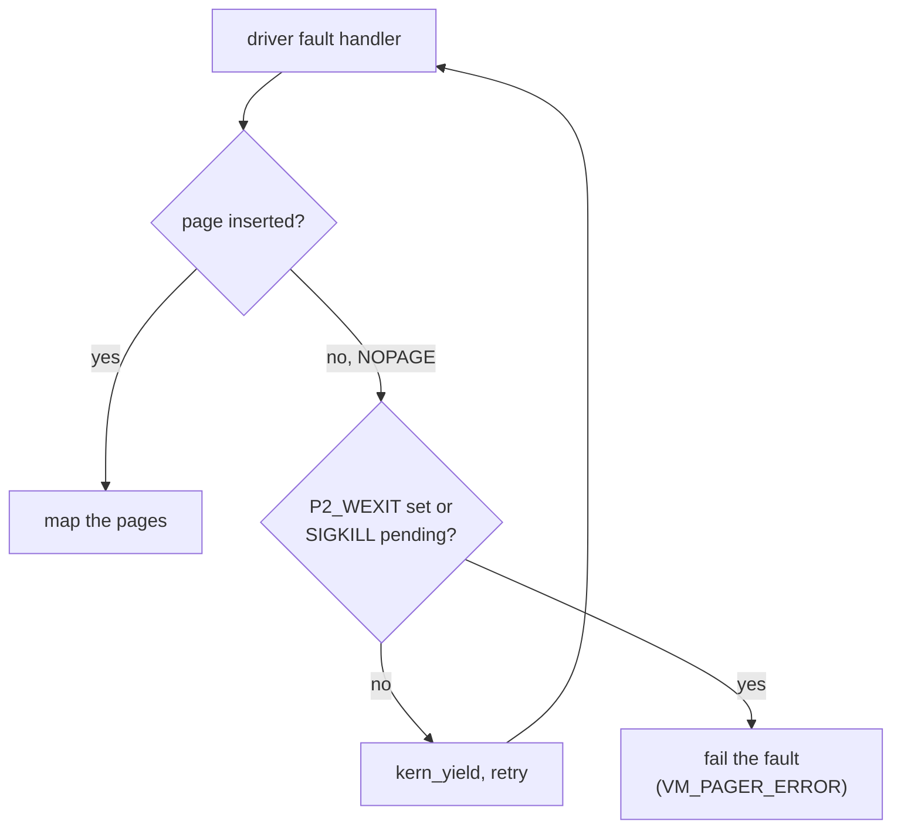

# LinuxKPI: letting a killed process leave a GPU page fault

Patch: [linuxkpi_fault_killable.patch](linuxkpi_fault_killable.patch), branch `olivier-lkpi-fault-killable`
(commit 9b172375d435 on FreeBSD main d34baf1b5ca0), one file, +10 lines.
Found on: Intel NUC 13 Pro, Core i7-1360P (Raptor Lake-P), Iris Xe 8086:a7a0, `drm-612-kmod` 6.12.110,
`libva-intel-media-driver` 26.3.5. Investigation: [../Intel.NUC13.Pro.md](../Intel.NUC13.Pro.md#tracing-the-hang-2026-11-23).

This document is for a first-year computer science student: someone who knows C and what an
operating system does, but has not looked inside the FreeBSD virtual memory (VM) system.

Result in one line: a process stuck in a GPU page fault used to survive `kill -9` until a reboot;
with the patch, `kill -9` ends it within a second. Nothing else changes.

## 1. Background

### 1.1 Pages, VM objects and page faults

Physical memory is cut into 4 KB *pages*, each described by a `struct vm_page` (`sys/vm/vm_page.h`).
A *VM object* (`struct vm_object`, `sys/vm/vm_object.h`) is a container of pages: a file, anonymous
memory, or a device's memory. **A FreeBSD page belongs to at most one object** (`m->object`).

When a process maps an object (`mmap(2)`), the page tables stay empty. The first access to each
address traps (a *page fault*); `vm_fault()` (`sys/vm/vm_fault.c`) finds or creates the page and
enters it in the page table.

### 1.2 Device pagers and "populate"

A GPU buffer is mapped through a *device pager*, a VM object of type `OBJT_MGTDEVICE` whose pages the
driver provides (`sys/vm/device_pager.c`). On a fault, `vm_fault_populate()` calls the pager's
*populate* method, which asks the driver to insert pages and returns the range it filled.

### 1.3 LinuxKPI and the retry loop

Linux graphics drivers (i915, amdgpu) run on FreeBSD through LinuxKPI (`sys/compat/linuxkpi/`).
Its populate method, `linux_cdev_pager_populate()` (`src/linux_compat.c`), calls the Linux driver's
`fault` handler. A handler returns `VM_FAULT_NOPAGE` both when it inserted pages and when it wants to be
called again (it could not take a lock, or a wait was interrupted). LinuxKPI tells the two apart by
counting inserted pages:

```c
err = vmap->vm_ops->fault(&vmf);

while (vmap->vm_pfn_count == 0 && err == VM_FAULT_NOPAGE) {
        kern_yield(PRI_USER);
        err = vmap->vm_ops->fault(&vmf);
}
```

On Linux the "call me again" case returns to user space: the instruction faults again, and any
pending signal is delivered in between. A FreeBSD pager cannot return without either supplying the
page or failing the fault, so LinuxKPI retries inside the kernel instead.

### 1.4 How a process dies

`kill -9` queues SIGKILL on the process (`tdsendsignal()`, `sys/kern/kern_sig.c`) and wakes one of its
threads. That thread acts on the signal on its way back to user space and calls `exit1()`
(`sys/kern/kern_exit.c`), which:

1. sets `P2_WEXIT` in `p_flag2` ("exit just started", `proc_set_p2_wexit()`);
2. calls `thread_single(p, SINGLE_EXIT)` and waits until every other thread has left the kernel and exited;
3. only then sets `P_WEXIT` and frees the process.

A thread spinning in a kernel loop never reaches the user boundary, so step 2 waits forever.

## 2. The problem

### 2.1 Repeating it

On the NUC (stock kernel main-n291498-6dc19a71f70c), with i915 and the Intel media driver:

```
ffmpeg -vaapi_device /dev/dri/renderD128 -i in.mp4 -vf format=nv12,hwupload \
    -c:v h264_vaapi -rc_mode CQP out.mp4
```

The output stays at 48 bytes, one CPU stays busy, `kill -9` does nothing, and the console prints
without end:

```
lkpi_vmf_insert_pfn_prot_locked: page rename failed: page is mapped
```

`procstat -kk` shows both halves of section 1.4:

```
ffmpeg   -               ... thread_single exit1 proc_set_p2_wexit sigexit postsig ast ...
ffmpeg   enc0:0:h264_vaa ... printf lkpi_vmf_insert_pfn_prot_locked remap_io_sg vm_fault_cpu
                             linux_cdev_pager_populate vm_fault_allocate vm_fault ...
```

The main thread took SIGKILL and waits in `exit1()`; the encoder thread spins in the retry loop.
Only a reboot recovers. Reproduced five times.

### 2.2 Why the handler never succeeds

The media driver maps one buffer object twice, write-back and write-combined (shown with kgdb:
both `i915_mmap_offset` structures point to the same GEM object, `mmap_type` 2 and 1).
The first fault moves the buffer's page into the write-back mapping's device pager object. The second
fault cannot take that page while the first mapping maps it, since a page has one owner
(section 1.1): `lkpi_vmf_insert_pfn_prot_locked()` (`src/linux_page.c`) prints the message and returns
`VM_FAULT_NOPAGE` with nothing inserted, and the loop of section 1.3 calls it again, forever.

The same LinuxKPI limit stops Xorg in [drm-kmod#481](https://github.com/freebsd/drm-kmod/issues/481)
and [PR 296195](https://bugs.freebsd.org/bugzilla/show_bug.cgi?id=296195), and other processes in
[nextbsd #71](https://github.com/nextbsd/nextbsd-kernel/issues/71) and
[nextbsd #188](https://github.com/nextbsd/nextbsd-kernel/issues/188).

## 3. The fix

```c
while (vmap->vm_pfn_count == 0 && err == VM_FAULT_NOPAGE) {
        /*
         * The handler may never insert the page, e.g. when
         * another mapping holds it.  Give up once the process
         * is killed or exiting, else it can never exit.
         */
        if ((curproc->p_flag2 & P2_WEXIT) != 0 ||
            fatal_signal_pending(current)) {
                err = VM_FAULT_SIGSEGV;
                break;
        }
        kern_yield(PRI_USER);
        err = vmap->vm_ops->fault(&vmf);
}
```



The two tests cover the two ways the process can be dying:

- `fatal_signal_pending(current)` (`src/linux_schedule.c`): SIGKILL is queued on this thread or on the
  process. It reads the process queue itself, so it works even when the signal woke another thread.
  `curproc_sigkilled()` would not: it only looks when *this* thread has a signal AST pending, and
  `tdsendsignal()` sets that on one thread only.
- `P2_WEXIT`: another thread already took the signal (or called `exit()`) and is in `exit1()`.
  SIGKILL is then no longer queued, which is the case measured in 2.1. `P_WEXIT` would be too late: it
  is set only after the other threads have gone. The flag is read without the process lock, as
  `vm_fault()` reads `P_KILLED()`; a stale read only costs one more retry.

Locking: `fatal_signal_pending()` takes the process mutex (`PROC_LOCK`), which never sleeps, while
the loop holds the LinuxKPI `mmap_sem`, a sleepable sx lock; no code can take them in the other order,
since nothing sleeps on an sx while holding a mutex. The VM object lock is not held in the loop.

Who sees the new failure: only a fault that is being retried, in a process that is dying. A fault from
kernel mode (`copyin()` in a system call of that process) returns `EFAULT` instead of hanging. A fault on
another process's memory (a debugger through `proc_rwmem()`) checks the debugger, which is `curproc`,
not the target.

`VM_FAULT_SIGSEGV` falls to the `default:` case of the return code translation, so populate returns
`VM_PAGER_ERROR` and `vm_fault()` fails the fault. No page needs releasing: the loop only runs while
`vm_pfn_count` is 0. The SIGSEGV that `trapsignal()` then posts does no harm: once `P2_WEXIT` is set,
signals are ignored (`kern_sig.c`: "there is no sense in delivering any signal to usermode"), and before
that SIGKILL (9) is delivered ahead of SIGSEGV (11).

Why only fatal signals: a fault cannot be retried after a signal handler runs on FreeBSD, so failing
it on any signal would turn a harmless SIGALRM or SIGPROF into SIGSEGV. The old in-tree drm2 TTM code
says so for Xorg, which uses SIGALRM (`sys/dev/drm2/ttm/ttm_bo_vm.c`, removed in d157fbd5b4b5).
Linux does not need to fail the fault: on a retried fault (`VM_FAULT_RETRY`) with SIGKILL pending,
or any signal for a user-mode fault, `fault_signal_pending()` (`include/linux/sched/signal.h`) makes
`do_user_addr_fault()` (`arch/x86/mm/fault.c`) return to user space, where the signal is handled and
the instruction faults again ([LWN](https://lwn.net/Articles/800683/) on the 2019 series that added the
non-fatal case). A FreeBSD pager can only supply the page or fail, so the patch fails the fault, and
only when the process is dying. Linux also queues SIGKILL on every thread of a dying process; the
`P2_WEXIT` test stands in for that, since FreeBSD queues it once.
Kernel precedent: the core dump loop in `kern_exec.c` stops its `vm_fault()` calls on
`curproc_sigkilled()`.

## 4. Alternatives, and what the patch does not fix

| Option | Effect on processes not being killed | Problem |
|---|---|---|
| Fail the fault at once when the page is mapped elsewhere | a transient conflict now kills the process; every driver `VM_FAULT_SIGBUS` stops falling back to the normal fault path | real behaviour change; TTM turns an insert error on the first page back into `VM_FAULT_NOPAGE`, so amdgpu would still loop |
| Fail on any pending signal (`sig_intr()`) | SIGALRM, SIGPROF, SIGCHLD now give SIGSEGV | breaks Xorg and profilers |
| Bound the retries | a slow but legitimate retry now fails | arbitrary limit |
| This patch | none | the stuck program still needs `kill -9` |

Not fixed:

- The process still spins at 100% of one CPU until killed. SIGTERM and SIGINT do not end it when the
  program catches them, as ffmpeg does: they are not fatal, so the loop keeps going.
- A stop request (SIGSTOP, a debugger attach) or a core dump started from another thread still waits
  on the spinning thread, as before.
- A debugger reading the memory of a process stuck this way spins in the same loop until the debugger
  itself is killed.
- The cause: LinuxKPI cannot map one page through two mappings. That needs a second mapping built from
  fictitious pages (`vm_page_getfake()`), as the `OBJT_DEVICE` pager does, plus a policy for a page
  mapped both WB and WC.

## 5. Tested

2026-11-23. Each test kernel is the source the machine was running plus this patch, built
GENERIC-NODEBUG, booted once with `nextboot -k kernel.lkpikill`, then the machine was booted back into
its original kernel. 1920x1080 300-frame clips; VA-API through ffmpeg 9.0.2; each run under a watchdog.

| Machine | Test | Original kernel | Patched kernel |
|---|---|---|---|
| NUC 13 (Raptor Lake, i915) | `h264_vaapi` default encode, then `kill -9` | survives `kill -9`, reboot needed (5 times) | gone 1 s after `kill -9`, exit status 137 (3 times) |
| NUC 13 | same, SIGTERM or SIGINT | not run | still spinning after 20 s (ffmpeg catches them), then gone 1 s after `kill -9` |
| NUC 13 | console after the kill | message without end | no message in the next 3 s |
| ThinkPad X1 Carbon Gen 12 (Meteor Lake, i915) | decode H.264, HEVC | bit-exact | bit-exact |
| X1 Carbon | encode H.264, HEVC, `low_power 0`, CQP and VBR | 300 frames each | 300 frames each |
| X1 Carbon | encode `low_power 1` | fails cleanly, exit 178 (not supported) | same |
| X1 Carbon | vkmark (3 s per scene, vertex, texture, shading) | 12105, 13242, 12265, 13073 | 12690, 13031, 12446, 12271 |
| HP ZBook Ultra G1a (Strix Halo, amdgpu) | decode H.264, HEVC | bit-exact | bit-exact |
| ZBook | encode H.264, HEVC, `low_power 0`, CQP and VBR | 300 frames each | 300 frames each |
| ZBook | encode `low_power 1` | fails cleanly, exit 178 | same |
| ZBook | vkmark | 70343, 67099, 58895 | 67610, 71302, 66017, 60408 |
| X1 Carbon, ZBook | `page rename failed` messages, stuck processes during the regression runs | none | none |

The vkmark spread between runs (about 10%) is larger than any difference between the kernels.

Not tested: a desktop session (Xorg or Wayland) on the patched kernels, OpenGL, amdgpu under memory
pressure, other LinuxKPI drivers (nvidia-drm), and the Xorg hang of drm-kmod#481.
