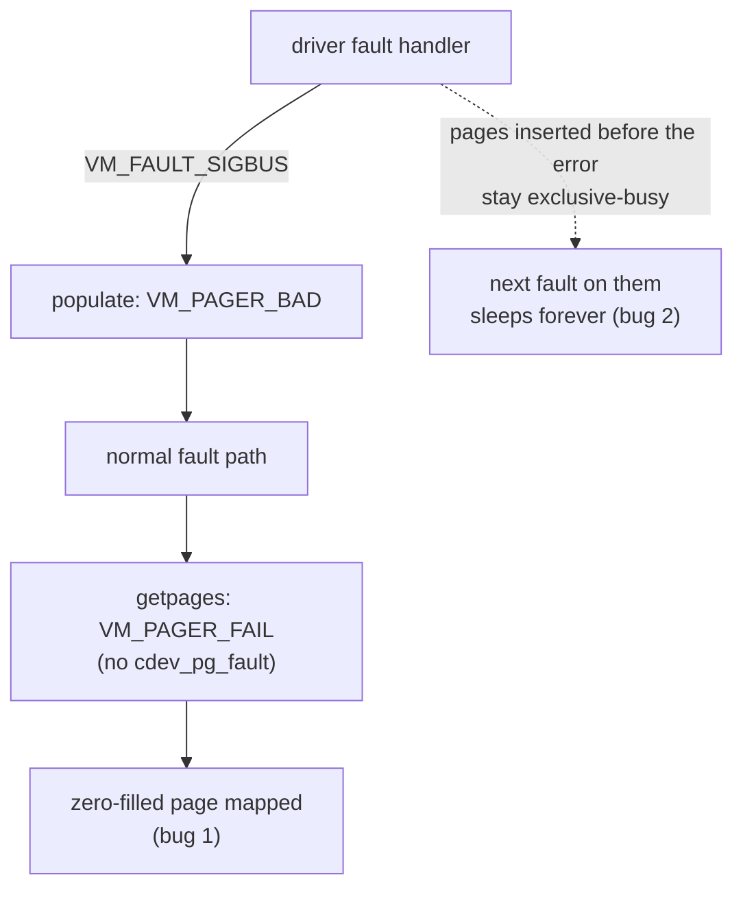

# LinuxKPI: a driver's SIGBUS gives a zero page, or an unkillable process

Patch: [linuxkpi_fault_sigbus.patch](linuxkpi_fault_sigbus.patch), branch `olivier-lkpi-fault-sigbus`
(commit c6edd0febc4d on FreeBSD main d34baf1b5ca0), one file, +24/-1.
Reproducer: [linuxkpi_fault_repro/](linuxkpi_fault_repro/), a LinuxKPI test module and a test program.
Related: [linuxkpi_fault_killable.md](linuxkpi_fault_killable.md) changes the same function; the two
patches apply in either order.

This document is for a first-year computer science student: someone who knows C and what an
operating system does, but has not looked inside the FreeBSD virtual memory (VM) system.
Section 1 of [linuxkpi_fault_killable.md](linuxkpi_fault_killable.md) explains pages, VM objects,
device pagers and LinuxKPI's populate method; read it first.

Result in one line: when a Linux GPU driver refuses a page fault with `VM_FAULT_SIGBUS`, FreeBSD maps
a page of zeros instead of signalling the process; if the driver had inserted some pages first, the
next access to one of them hangs the process for good, `kill -9` included. With the patch, the access
fails with a signal and the next fault asks the driver again.

## 1. Background

### 1.1 Three answers a pager can give populate

`vm_fault_populate()` (`sys/vm/vm_fault.c`) calls the pager's populate method and reads its answer:

- `VM_PAGER_OK`: the pager inserted pages `first` to `last` and left each one *exclusive-busy*
  (locked for this fault); `vm_fault_populate()` maps them, then releases the busy state.
- `VM_PAGER_BAD`: "the backdoor for a pager to request normal fault handling" (comment at
  `vm_fault.c:553`). The fault continues as if the object had no populate method.
- anything else: the fault fails at once (`FAULT_FAILURE`), and the process gets SIGSEGV.

### 1.2 The normal path, for a LinuxKPI object

On the normal path, `vm_fault()` allocates a page in the object and asks the pager to fill it
(`dev_pager_getpages()`, `sys/vm/device_pager.c`). LinuxKPI's pager has no `cdev_pg_fault` method,
so the pager answers `VM_PAGER_FAIL` ("I do not have this page", `device_pager.c:388`), and
`vm_fault()` falls through to its last resort: it fills the page with zeros and maps it.

### 1.3 How LinuxKPI translates a driver's answer

`linux_cdev_pager_populate()` (`sys/compat/linuxkpi/common/src/linux_compat.c`) calls the Linux
driver's `fault` handler and translates its return code:

| Driver returns | populate returns | Effect |
|---|---|---|
| `VM_FAULT_NOPAGE` with pages inserted | `VM_PAGER_OK` | pages mapped |
| `VM_FAULT_OOM` | `VM_PAGER_AGAIN` | fault fails |
| `VM_FAULT_SIGBUS` | `VM_PAGER_BAD` | normal path: zero page (1.2) |
| anything else | `VM_PAGER_ERROR` | fault fails |

On Linux, `VM_FAULT_SIGBUS` means "send SIGBUS": i915 returns it for a purged buffer or a backing
store error (`i915_error_to_vmf_fault()`), TTM and amdgpu when a buffer cannot be placed where the CPU
can reach it.

A handler inserts pages with `lkpi_vmf_insert_pfn_prot_locked()` (`src/linux_page.c`), which leaves
each one exclusive-busy in the object and counts it in `vma->vm_pfn_count`. Several handlers insert
more than one page per fault (TTM prefaults up to 16, i915 maps a whole range) and can fail after some
inserts.

## 2. The problem

### 2.1 The reproducer

The test module `lkpi_fault.ko` creates `/dev/lkpi_fault` with LinuxKPI (`cdev_add()`); its `mmap`
handler gives each mapping its own device pager object, and its `fault` handler does what the sysctl
`debug.lkpi_fault.mode` says: insert the page (mode 0), return `VM_FAULT_SIGBUS` (mode 1), or insert
pages 0 and 1 and then return `VM_FAULT_SIGBUS` (mode 2). It logs each call. Inserted pages are filled
with `0xa5`, so a page of zeros is visible. `fault_test` maps 4 pages per scenario in a child process,
sets the mode before each read, and reports the byte read, a signal, or a hang (10 s watchdog, then
SIGKILL).

It runs in a bhyve guest built with [../kern-test-vm](../kern-test-vm/) from the host's userland:

```
cd linuxkpi_fault_repro
make SYSDIR=/usr/src/sys          # builds lkpi_fault.ko against the guest kernel's source
cc -O2 -o fault_test fault_test.c
# put lkpi_fault.ko, fault_test and run.sh in a directory, then:
sudo ../../kern-test-vm/mkvm.sh -k /path/to/kernel:kernel.stock -t /that/directory -o /zroot/vm/lkpi-fault.img
```

### 2.2 What happens (stock kernel main-n291498-6dc19a71f70c)

```
== #3: handler returns VM_FAULT_SIGBUS
  [mode 1]  read page 0 ...
    -> 0x00 (ZERO page, not from the driver)
== #4: handler inserts pages 0-1, then SIGBUS on page 3; then read page 0, handler still failing
  [mode 2]  read page 3 ...
    -> 0x00 (ZERO page, not from the driver)
  [mode 2]  read page 0 ...
  child HUNG after 10 s; kernel stack:
  mi_switch _vm_page_busy_sleep vm_fault_busy_sleep vm_fault vm_fault_trap trap_pfault trap calltrap
  child still alive 5 s after SIGKILL
```

Two bugs:

1. **SIGBUS becomes a page of zeros.** The driver refused the access, but the process reads zeros and
   carries on, through the normal path of 1.2. The zero page is now part of the device pager object,
   which every process mapping the same buffer shares (not tested with a second process).
2. **Inserted pages stay busy.** In mode 2 the handler inserted pages 0 and 1 and then failed.
   `vm_fault_populate()` returns at once on failure, so nobody releases them. The next fault on page 0
   finds it busy and sleeps until it is released, which never happens. The sleep does not wake for
   signals, so `kill -9` waits forever.



## 3. The fix

```c
	case VM_FAULT_SIGBUS:
-		err = VM_PAGER_BAD;
+		err = VM_PAGER_ERROR;
		break;
...
	up_write(&vmap->vm_mm->mmap_sem);
	VM_OBJECT_WLOCK(vm_obj);
+
+	/*
+	 * On failure, take back the pages the handler inserted and busied,
+	 * so that the next fault asks the driver again.
+	 */
+	if (err != VM_PAGER_OK) {
+		for (i = pfn_first; i < pfn_first + pfn_count; i++) {
+			m = vm_page_lookup(vm_obj, i);
+			if (m == NULL || !vm_page_xbusied(m))
+				continue;
+			if ((m->oflags & VPO_UNMANAGED) == 0)
+				pmap_remove_all(m);
+			vm_page_remove(m);
+		}
+	}
	return (err);
```

- `VM_PAGER_ERROR` makes the fault fail, as the driver asked.
- On any failure (`VM_FAULT_SIGBUS`, `VM_FAULT_OOM`, an unknown code), the pages the handler inserted
  in this fault leave the object, as LinuxKPI's own `unmap_mapping_range()` does for a whole object
  (`cdev_mgtdev_pager_free_page()`: `pmap_remove_all()`, then removal). `vm_page_remove()` needs the
  object lock and the page exclusive-busy, and releases the busy state itself. The page goes back to
  the driver, which still holds its own reference (wired shmem pages, TTM pages, aperture pages).
- Removing rather than keeping matters: a page left in the object would be mapped by the next fault
  without asking the driver. For i915's GTT mappings, a failed `remap_io_mapping()` is followed by
  i915 releasing the aperture slot (`vm_fault_gtt()`), so a kept page could later map an aperture slot
  that another buffer, perhaps another process's, uses.
- `pmap_remove_all()` only handles managed pages; fictitious pages (aperture) are unmanaged
  (`vm_page_initfake()`). A page inserted in this fault was not mapped yet, since populate failed
  before mapping, so there is nothing to unmap for it. The call matters for a page the handler found
  already in the object and may have been mapped by another process: that mapping goes, and the next
  access asks the driver again.
- `vm_page_xbusied()` skips a page this fault did not busy, should the range contain one.
- `pfn_first` and `pfn_count` are copied from the vma right after the handler runs, under `mmap_sem`;
  they stay 0 when no handler runs (`vm_ops == NULL`), so stale values from an earlier fault are never
  used. The range assumes ascending inserts with no gap, as populate's success path already does
  (`*last = *first + vm_pfn_count - 1`).

The process gets **SIGSEGV** (`SEGV_MAPERR`), not the SIGBUS Linux sends: a failed populate becomes
`KERN_FAILURE` in `vm_fault()`, which `vm_fault_trap()` reports as SIGSEGV. A real SIGBUS needs
`vm_fault_populate()` to return `FAULT_OUT_OF_BOUNDS` for some pager answer, a VM change. A copyin()
from such a mapping gets `EFAULT`, as it should.

Alternatives:

| Option | Problem |
|---|---|
| Release the busy state but keep the pages in the object | the next fault maps them without asking the driver: stale aperture slots for i915 GTT mappings |
| Keep `VM_PAGER_BAD` and add a `cdev_pg_fault` method that fails | two code paths for one answer; the populate path already has the information |
| Map `VM_FAULT_SIGBUS` to `VM_PAGER_ERROR` without the cleanup | fixes bug 1 only; bug 2 hangs the same way |
| Return a new pager code that becomes SIGBUS | right signal, but changes `vm_fault_populate()` for every pager |

What changes for drivers: a driver that returns `VM_FAULT_SIGBUS` now makes the faulting access fail,
as on Linux, instead of giving a page of zeros. A program that ran on silently over such zero pages
(for example after i915 purged a buffer it had marked as not needed) now stops with SIGSEGV. After any
failed fault, the pages the driver had inserted are asked from the driver again on the next access.

Not fixed:

- A handler that inserts out of order, or leaves a gap (an insert that fails with "page rename failed:
  page is mapped" does not count the page, and TTM goes on to the next one), can leave a page above the
  counted range busy. No in-tree handler inserts out of order; the gap case also affects the success
  path today.
- The process gets SIGSEGV, not SIGBUS (above).

## 4. Tested

2026-11-23. An independent review of the code found the stale-mapping risk of keeping the pages,
which the removal above addresses, and the gap case listed under "Not fixed"; nothing else.

### 4.1 Reproducer, bhyve guest (4 CPUs, 4 GB, host userland)

| Scenario | Stock 6dc19a71f70c | Stock + patch (GENERIC-NODEBUG) | Stock + patch (GENERIC, INVARIANTS and WITNESS) |
|---|---|---|---|
| Control: handler inserts the page | `0xa5` | `0xa5` | `0xa5` |
| #3: handler returns `VM_FAULT_SIGBUS` | `0x00`, no signal | SIGSEGV | SIGSEGV |
| #4: handler inserts pages 0-1, SIGBUS on page 3 | page 3: `0x00` | SIGSEGV | SIGSEGV |
| #4: then read page 0, handler still failing | hangs in `_vm_page_busy_sleep`, survives SIGKILL | driver called again, SIGSEGV | same |
| #4b: same failure, then read page 0 with the handler inserting | hangs, survives SIGKILL | driver called again, `0xa5` | same |
| Panic, assertion, lock order reversal | none | none | none |

### 4.2 Regression on hardware

Each test kernel is the machine's running source plus this patch, booted once with nextboot, then the
machine was booted back into its original kernel.

| Machine | Test | Original kernel | Patched kernel |
|---|---|---|---|
| NUC 13 (Raptor Lake, i915), patched kernel built with INVARIANTS and WITNESS | VA-API decode H.264, HEVC; encode H.264 `low_power 1`, HEVC both modes | bit-exact; all encode | bit-exact; all encode; 0 lock order reversals |
| X1 Carbon Gen 12 (Meteor Lake, i915) | same VA-API set (`low_power 0`; `low_power 1` is unsupported there) | bit-exact; 300 frames each | same |
| X1 Carbon | vkmark | 12105-13242 (4 runs, earlier today) | 12328-12466 (4 runs) |
| ZBook Ultra G1a (Strix Halo, amdgpu) | same VA-API set | bit-exact; 300 frames each | same |
| ZBook | vkmark | 59955-69093 (4 runs) | 60154-70455 (4 runs) |
| ZBook | `MODEL=qwen38-q8 CTX=32768 LLM/llmsrv.sh`, 6 requests of 1925 + 256 tokens, then `kill -9` | prompt 273-292 t/s, generation 7.2 t/s, gone in 1 s | prompt 281-295 t/s, generation 7.2 t/s, gone in 1 s |

The default H.264 encoder on the NUC was skipped: it hangs in the retry loop of
[linuxkpi_fault_killable.md](linuxkpi_fault_killable.md) on any kernel without that patch.

Not tested: a real driver returning `VM_FAULT_SIGBUS` (i915 purged buffer, amdgpu placement failure),
an i915 GTT mapping failing part way, a second process mapping the same buffer, and a desktop session.
