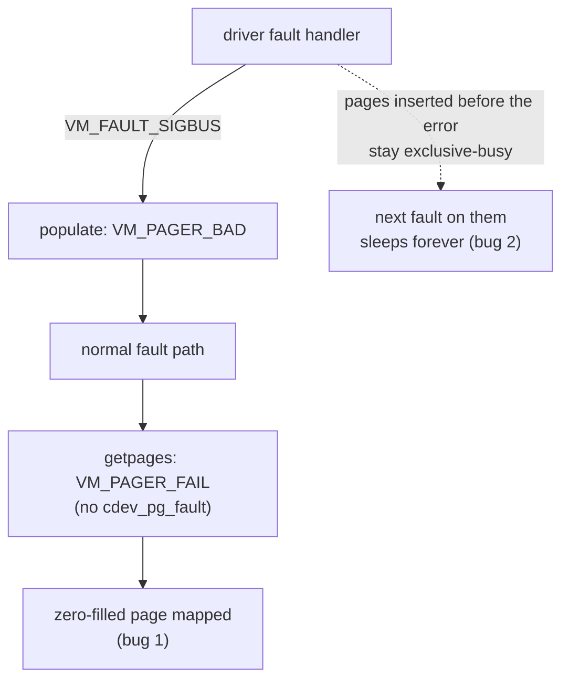

# LinuxKPI: a driver's SIGBUS gives a zero page, or an unkillable process

Patch: [linuxkpi_fault_sigbus.patch](linuxkpi_fault_sigbus.patch), branch `olivier-lkpi-fault-sigbus`
(commit b2936ef4dc75 on FreeBSD main d34baf1b5ca0), one file, +20/-1.
Reproducer: [linuxkpi_fault_repro/](linuxkpi_fault_repro/), a LinuxKPI test module and a test program.
Related: [linuxkpi_fault_killable.md](linuxkpi_fault_killable.md) changes the same function; the two
patches apply in either order.

This document is for a first-year computer science student: someone who knows C and what an
operating system does, but has not looked inside the FreeBSD virtual memory (VM) system.
Section 1 of [linuxkpi_fault_killable.md](linuxkpi_fault_killable.md) explains pages, VM objects,
device pagers and LinuxKPI's populate method; read it first.

Result in one line: when a Linux GPU driver refuses a page fault with `VM_FAULT_SIGBUS`, FreeBSD maps
a page of zeros instead of signalling the process; if the driver had inserted some pages first, the
next access to one of them hangs the process for good, `kill -9` included. With the patch, the
process gets a signal and the inserted pages stay usable.

## 1. Background

### 1.1 Two answers a pager can give populate

`vm_fault_populate()` (`sys/vm/vm_fault.c`) calls the pager's populate method and reads its answer:

- `VM_PAGER_OK`: the pager inserted pages `first` to `last` and left each one *exclusive-busy*
  (locked for this fault); `vm_fault_populate()` maps them, then releases the busy state.
- `VM_PAGER_BAD`: "the backdoor for a pager to request normal fault handling" (comment at
  `vm_fault.c:553`). The fault continues as if the object had no populate method.
- anything else: the fault fails, and the process gets SIGSEGV.

### 1.2 The normal path, for a LinuxKPI object

On the normal path, `vm_fault()` allocates a page in the object and asks the pager to fill it
(`dev_pager_getpages()`, `sys/vm/device_pager.c`). LinuxKPI's pager has no `cdev_pg_fault` method,
so the pager answers `VM_PAGER_FAIL` ("I do not have this page", `device_pager.c:388`), and
`vm_fault()` falls through to its last resort: it fills the page with zeros and maps it.

### 1.3 How LinuxKPI translates a driver's answer

`linux_cdev_pager_populate()` (`sys/compat/linuxkpi/common/src/linux_compat.c`) calls the Linux
driver's `fault` handler and translates its return code. Before the patch:

| Driver returns | populate returns | Effect |
|---|---|---|
| `VM_FAULT_NOPAGE` with pages inserted | `VM_PAGER_OK` | pages mapped |
| `VM_FAULT_OOM` | `VM_PAGER_AGAIN` | fault fails |
| `VM_FAULT_SIGBUS` | `VM_PAGER_BAD` | normal path: zero page (1.2) |
| anything else | `VM_PAGER_ERROR` | fault fails |

On Linux, `VM_FAULT_SIGBUS` means "send SIGBUS": i915 returns it for a purged buffer or a backing
store error (`i915_error_to_vmf_fault()`), TTM and amdgpu when a buffer cannot be placed where the CPU
can reach it.

## 2. The problem

### 2.1 The reproducer

The test module `lkpi_fault.ko` creates `/dev/lkpi_fault` with LinuxKPI (`cdev_add()`); its `mmap`
handler gives each mapping its own device pager object, and its `fault` handler does what the sysctl
`debug.lkpi_fault.mode` says: insert the page (mode 0), return `VM_FAULT_SIGBUS` (mode 1), or insert
pages 0 and 1 and then return `VM_FAULT_SIGBUS` (mode 2). Inserted pages are filled with `0xa5`, so a
page of zeros is visible. `fault_test` maps 4 pages per scenario in a child process, reads them, and
reports the byte read, a signal, or a hang (10 s watchdog, then SIGKILL).

It runs in a bhyve guest built with [../kern-test-vm](../kern-test-vm/) from the host's userland:

```
cd linuxkpi_fault_repro
make SYSDIR=/usr/src/sys          # builds lkpi_fault.ko against the guest kernel's source
cc -O2 -o fault_test fault_test.c
# put lkpi_fault.ko, fault_test and run.sh in a directory, then:
sudo ../../kern-test-vm/mkvm.sh -k /path/to/kernel:kernel.stock -t /that/directory -o /zroot/vm/lkpi-fault.img
```

### 2.2 What happens (stock kernel main-n291498-6dc19a71f70c)

```
== #3: handler returns VM_FAULT_SIGBUS (mode 1)
  read page 0 ...
    -> 0x00 (ZERO page, not from the driver)
== #4: handler inserts pages 0-1, then SIGBUS on page 3; then read page 0 (mode 2)
  read page 3 ...
    -> 0x00 (ZERO page, not from the driver)
  read page 0 ...
  child HUNG after 10 s; kernel stack:
  mi_switch _vm_page_busy_sleep vm_fault_busy_sleep vm_fault vm_fault_trap trap_pfault trap calltrap
  child still alive 5 s after SIGKILL
```

Two bugs:

1. **SIGBUS becomes a page of zeros.** The driver refused the access, but the process reads zeros and
   carries on, through the normal path of 1.2. The zero page is now part of the device pager object,
   which every process mapping the same buffer shares (not tested with a second process).
2. **Inserted pages stay busy.** In mode 2 the handler inserted pages 0 and 1 (exclusive-busy, waiting
   for `vm_fault_populate()` to map them) and then failed. `vm_fault_populate()` returned at once,
   so nobody releases them. The next fault on page 0 finds it busy and sleeps until it is released,
   which never happens. The sleep does not wake for signals, so `kill -9` waits forever.



## 3. The fix

```c
	case VM_FAULT_SIGBUS:
-		err = VM_PAGER_BAD;
+		err = VM_PAGER_ERROR;
		break;
...
	up_write(&vmap->vm_mm->mmap_sem);
	VM_OBJECT_WLOCK(vm_obj);
+
+	/* On failure, release the pages the fault handler busied. */
+	if (err != VM_PAGER_OK) {
+		for (i = pfn_first; i < pfn_first + pfn_count; i++) {
+			m = vm_page_lookup(vm_obj, i);
+			if (m != NULL) {
+				vm_page_deactivate(m);
+				vm_page_xunbusy(m);
+			}
+		}
+	}
	return (err);
```

- `VM_PAGER_ERROR` makes the fault fail, as the driver asked.
- The cleanup mirrors `vm_fault_populate_cleanup()`, which does the same for pages the VM will not map:
  deactivate (a no-op for wired pages, which driver pages usually are), then release the busy state.
  The pages stay in the object, valid, so the next fault on them maps them without asking the driver.
- `pfn_first` and `pfn_count` are copied from the vma right after the handler runs, under `mmap_sem`.
  They stay 0 when the handler is not called (`vm_ops == NULL`), so stale values from an earlier
  fault are never used. The range is contiguous: populate's success path already relies on that
  (`*last = *first + vm_pfn_count - 1`).

The process gets **SIGSEGV** (`SEGV_MAPERR`), not the SIGBUS Linux sends: a failed populate becomes
`KERN_FAILURE` in `vm_fault()`, which `vm_fault_trap()` reports as SIGSEGV. A real SIGBUS needs
`vm_fault_populate()` to return `FAULT_OUT_OF_BOUNDS` for some pager answer, a VM change.

Alternatives:

| Option | Problem |
|---|---|
| Keep `VM_PAGER_BAD` and add a `cdev_pg_fault` method that fails | two code paths for one answer; the populate path already has the information |
| Map `VM_FAULT_SIGBUS` to `VM_PAGER_ERROR` without the cleanup | fixes bug 1 only; bug 2 hangs the same way |
| Return a new pager code that becomes SIGBUS | right signal, but changes `vm_fault_populate()` for every pager |

What changes for drivers: a driver that returns `VM_FAULT_SIGBUS` now makes the faulting process get a
signal, as on Linux, instead of a page of zeros. A program that ran on silently over such zero pages
(for example after i915 purged a buffer it had marked as not needed) now stops with SIGSEGV.

## 4. Tested

2026-11-23, bhyve guest (4 CPUs, 4 GB) from kern-test-vm, host userland, `lkpi_fault.ko` built against
the stock source.

| Scenario | Stock 6dc19a71f70c (GENERIC-NODEBUG) | Debug: GENERIC with INVARIANTS and WITNESS (6dc19a71f70c + the fault-killable patch) | Stock + this patch |
|---|---|---|---|
| Control: handler inserts the page | `0xa5` | `0xa5` | `0xa5` |
| Handler returns `VM_FAULT_SIGBUS` | `0x00`, no signal | `0x00`, no signal | SIGSEGV |
| Handler inserts pages 0-1, SIGBUS on page 3 | page 3: `0x00` | page 3: `0x00` | page 3: SIGSEGV |
| Then read page 0 | hangs in `_vm_page_busy_sleep`, survives SIGKILL | same; no assertion, no lock order reversal | `0xa5` |

Not tested: a real driver returning `VM_FAULT_SIGBUS` (i915 purged buffer, amdgpu placement failure),
a second process mapping the same buffer, and the patch on real hardware.
