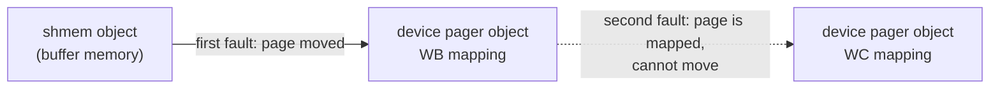

# LinuxKPI: a GPU mapping fault that never ends

Patch: [linuxkpi_rename_sigbus.patch](linuxkpi_rename_sigbus.patch), branch `olivier-lkpi-sigbus`
(commit d0b177bd0905 on FreeBSD main a343fc0ad029).
Machine where it shows: Intel NUC 13 Pro, Core i7-1360P (Raptor Lake-P), Iris Xe 8086:a7a0,
FreeBSD 16.0-CURRENT main-n291498-6dc19a71f70c, `drm-612-kmod` 6.12.110, `libva-intel-media-driver` 26.3.5.
Investigation: [../Intel.NUC13.Pro.md](../Intel.NUC13.Pro.md#tracing-the-hang-2026-11-23).

This document is for a first-year computer science student: someone who knows C and what an
operating system does, but has not looked inside the FreeBSD virtual memory (VM) system.

Result in one line: H.264 hardware encoding on this machine used to leave a process that
`kill -9` cannot end, spinning at 100% of one CPU until a reboot; with the patch, the
process gets SIGSEGV within a second and exits.
The patch contains the damage; it does not make encoding work (see [What the patch does not fix](#4-what-the-patch-does-not-fix)).

## 1. Background

### 1.1 Pages and VM objects

Physical memory is cut into 4 KB *pages*. The kernel describes each one with a
`struct vm_page` (`sys/vm/vm_page.h`).
A *VM object* (`struct vm_object`, `sys/vm/vm_object.h`) is a container of pages: the
contents of a file, a block of anonymous memory, or a device's memory.
A page records the one object it belongs to and its index in it
(`m->object`, `m->pindex`). **A FreeBSD page belongs to at most one object.**

When a process maps an object (`mmap(2)`), the kernel does not fill the page tables at once.
The first access to each address traps (a *page fault*), and `vm_fault()`
(`sys/vm/vm_fault.c`) finds or creates the page and enters it in the page table.

### 1.2 Device pagers and "populate"

A GPU driver's buffer is mapped through a *device pager*: a VM object of type
`OBJT_MGTDEVICE` whose pages the driver supplies itself (`sys/vm/device_pager.c`).
On a fault in such an object, `vm_fault_populate()` calls the pager's *populate*
method, which asks the driver to insert one or more pages and returns the range it filled.

### 1.3 LinuxKPI

Linux graphics drivers (i915, amdgpu) run on FreeBSD through LinuxKPI
(`sys/compat/linuxkpi/`), which implements Linux kernel functions on top of FreeBSD ones.
Two of them matter here:

- `linux_cdev_pager_populate()` (`src/linux_compat.c`): the populate method. It calls the
  Linux driver's `fault` handler and translates the Linux return code
  (`VM_FAULT_NOPAGE`, `VM_FAULT_SIGBUS`, `VM_FAULT_OOM`) into a FreeBSD pager code
  (`VM_PAGER_OK`, `VM_PAGER_ERROR`, ...).
- `lkpi_vmf_insert_pfn_prot_locked()` (`src/linux_page.c`): the driver calls it to put one
  physical page into the faulting mapping.

On Linux, a page can appear in any number of mappings.
On FreeBSD, `lkpi_vmf_insert_pfn_prot_locked()` must *move* the page into the mapping's
object: it removes it from its current object (for a GPU buffer, the shmem object that
holds the buffer's memory) and inserts it into the device pager object.
It refuses when the page is still mapped through its current object, since moving it would
leave those mappings pointing at a page their object no longer owns.



## 2. The problem

### 2.1 Repeating it

On the NUC, with i915 loaded and the Intel media driver installed:

```
ffmpeg -vaapi_device /dev/dri/renderD128 -i in.mp4 -vf format=nv12,hwupload \
    -c:v h264_vaapi -rc_mode CQP out.mp4
```

The output stays at 48 bytes, `kill -9` does nothing, one CPU stays at 100%, and the
console prints without end:

```
lkpi_vmf_insert_pfn_prot_locked: page rename failed: page is mapped
```

`procstat -kk` on the encoder thread:

```
printf lkpi_vmf_insert_pfn_prot_locked remap_io_sg vm_fault_cpu linux_cdev_pager_populate
vm_fault_allocate vm_fault vm_fault_trap trap_pfault
```

Reproduced five times, with GuC on and off and with superpages off, always with the default (not low-power) `h264_vaapi` encoder.

### 2.2 Why

DTrace and kgdb on the live kernel showed that the media driver maps one buffer object
twice: once write-back (WB) and once write-combined (WC). The two `i915_mmap_offset`
structures point to the same GEM object and differ only in `mmap_type` (2 against 1).

1. The first fault, through the WB mapping, moves the buffer's pages into the WB device pager object.
2. The fault through the WC mapping reaches the same physical page. It now belongs to the WB
   object and is mapped there, so `lkpi_vmf_insert_pfn_prot_locked()` prints the message
   and returns `VM_FAULT_NOPAGE` without inserting anything.
3. `linux_cdev_pager_populate()` treats "NOPAGE with no page inserted" as "try again":

   ```c
   while (vmap->vm_pfn_count == 0 && err == VM_FAULT_NOPAGE) {
           kern_yield(PRI_USER);
           err = vmap->vm_ops->fault(&vmf);
   }
   ```

   The WB mapping never goes away, so the loop never ends. It runs inside the kernel and
   never looks at signals, so `kill -9` waits forever for the thread to return to user space.

The retry loop exists for real transient cases: a driver that could not take a lock returns
`VM_FAULT_NOPAGE` and expects to be called again. A mapped page is not transient.

The same LinuxKPI limit hits Xorg in [drm-kmod#481](https://github.com/freebsd/drm-kmod/issues/481)
and [PR 296195](https://bugs.freebsd.org/bugzilla/show_bug.cgi?id=296195).

## 3. The fix

Three changes, all needed:

1. `lkpi_vmf_insert_pfn_prot_locked()` returns `VM_FAULT_SIGBUS` instead of
   `VM_FAULT_NOPAGE` when the page is mapped elsewhere. The retry loop then stops.
2. `linux_cdev_pager_populate()` translates `VM_FAULT_SIGBUS` to `VM_PAGER_ERROR` instead of
   `VM_PAGER_BAD`. For populate, `VM_PAGER_BAD` means "fall back to the normal fault path"
   (`vm_fault_populate()`); the LinuxKPI pager has no `cdev_pg_fault` method, so
   `dev_pager_getpages()` returns `VM_PAGER_FAIL` and the normal path continues towards a
   zero-filled page (read from the code, not measured). `VM_PAGER_ERROR` makes the fault fail.
3. On failure, `linux_cdev_pager_populate()` releases the pages the driver already inserted
   in this fault. `lkpi_vmf_insert_pfn_prot_locked()` leaves each inserted page exclusive-busy for
   `vm_fault_populate()` to map and release, but `vm_fault_populate()` returns at once when
   populate fails, so those pages would stay busy and the next fault on them would sleep forever.
   The cleanup mirrors `vm_fault_populate_cleanup()`: deactivate (a no-op for wired pages), then unbusy.

The process then gets **SIGSEGV** (`SEGV_MAPERR`), not SIGBUS: a failed populate becomes
`KERN_FAILURE` in `vm_fault()`, which `vm_fault_trap()` reports as SIGSEGV.
Getting a real SIGBUS would need `vm_fault_populate()` to return `FAULT_OUT_OF_BOUNDS`
for a pager error, a VM change outside LinuxKPI.

Alternatives considered:

| Option | For | Against |
|---|---|---|
| Check for signals in the retry loop | small | the loop still spins until a signal comes; a process that is not killed hangs forever |
| Bound the retries | small | arbitrary limit; still fails, only later |
| Map the second mapping with a fictitious page (`vm_page_getfake()`), as `OBJT_DEVICE` does | makes encoding work | needs a policy for WB and WC aliases of one page; much larger change |
| This patch | stops the hang, no new state | the program still fails |

## 4. What the patch does not fix

- The default H.264 encoder still fails: it gets SIGSEGV instead of hanging. Making it work needs
  LinuxKPI to allow two mappings of one page (last row of the table above).
- Every LinuxKPI fault handler that returns `VM_FAULT_SIGBUS` now fails the fault instead of
  falling back to the normal fault path. i915 returns it for purged objects and unusable
  backing store (`i915_error_to_vmf_fault()`); before, those faults went to the normal path.

## 5. Tested

2026-11-23 on the NUC: kernel `n291499-9a14afb1e64c` (main 6dc19a71f70c, the source the machine runs, plus this patch),
booted once with `nextboot -k kernel.lkpi`; `hw.i915kms.enable_guc=3`; 300-frame 1920x1080 H.264 input;
`ffmpeg -vaapi_device /dev/dri/renderD128 -vf format=nv12,hwupload -c:v ENCODER -low_power LP -rc_mode RC`.

| Test | Stock kernel | Patched kernel |
|---|---|---|
| `h264_vaapi`, `low_power 0`, CQP | hang: unkillable, 100% of one CPU, endless console message, reboot needed (5 times) | SIGSEGV after 1 s, one console message, process gone |
| same, run again at once | (not possible: the first one never ends) | SIGSEGV after 0 s, one console message |
| `h264_vaapi`, `low_power 0`, VBR | not run | SIGSEGV |
| `h264_vaapi`, `low_power 1`, CQP and VBR | not run | works: 300 frames |
| `hevc_vaapi`, `low_power 0` and `1`, CQP and VBR | not run | works: 300 frames each |
| VA-API H.264 decode | works | works, output identical to the software decoder (`framemd5`, same pixel format) |
| Vulkan (`vulkaninfo`) | works | works |
| i915 GuC/HuC, Wi-Fi at boot | works | works |

Only the default H.264 encoder (`EncSlice`, not low power) maps a buffer twice on this machine;
`-low_power 1` avoids the bug for H.264.

Not tested:

- The page release on failure (change 3) is not observed directly: each failing run is a new process with new buffers,
  so nothing faults on the released pages again. Without it, a later fault on those pages in the same process would
  sleep forever on the busy page.
- Other LinuxKPI drivers (amdgpu, TTM-based drivers) on the patched kernel.
- The Xorg case of drm-kmod#481.
