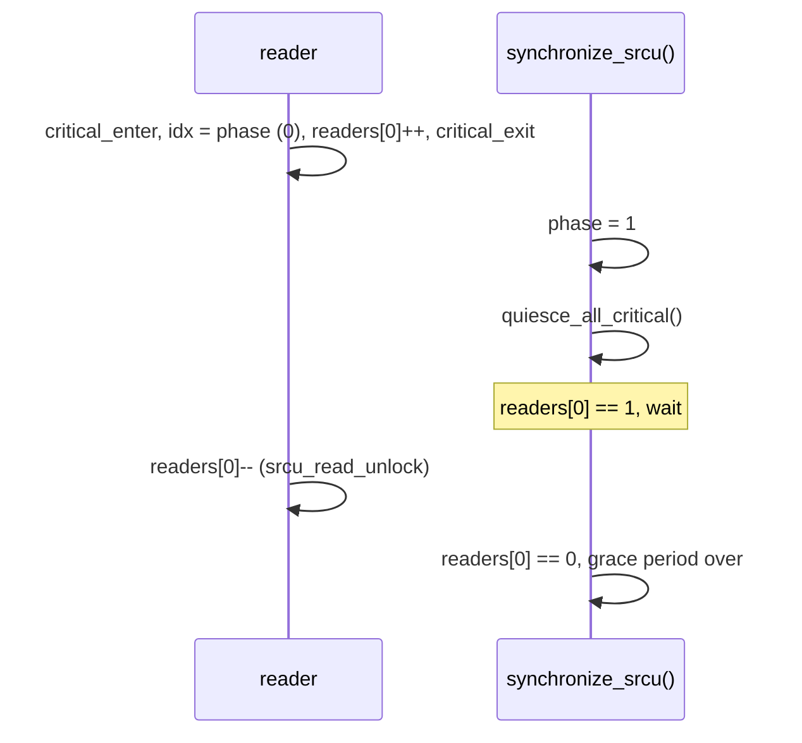

# LinuxKPI: one grace period per `srcu_struct`

Patch: [linuxkpi_srcu_per_struct.patch](linuxkpi_srcu_per_struct.patch),
branch [`olivier-lkpi-srcu`](https://github.com/ocochard/freebsd-src/compare/main...olivier-lkpi-srcu)
of the FreeBSD fork (one commit on main 46ce9acd6d15).
Found while porting the AMD XDNA NPU driver
([amdxdna_npu.md](amdxdna_npu.md)).

## 1. Background

### Read-copy-update in one paragraph

Some kernel data is read very often and changed rarely. Locking every read
is expensive, so Linux offers RCU: a reader marks the start and end of its
*read section* and just reads; a writer publishes a new version of the data,
then waits for a *grace period*, meaning until every reader that might still
see the old version has left its read section, and only then frees the old
version. The writer's wait is `synchronize_rcu()`.

### SRCU: sleepable, and per domain

Plain RCU readers may not sleep. SRCU ("sleepable RCU") readers may. SRCU
has a second property that matters here: each `struct srcu_struct` is its
own *domain*. `synchronize_srcu(&x)` waits only for readers of `x`, never
for readers of another `srcu_struct`:

```c
idx = srcu_read_lock(&x);      /* start of a read section of x */
... read data protected by x, may sleep ...
srcu_read_unlock(&x, idx);     /* end of the read section */

synchronize_srcu(&x);          /* wait for the readers of x only */
```

### LinuxKPI

LinuxKPI is the FreeBSD layer that lets Linux driver source (drm-kmod GPU
drivers, Wi-Fi drivers, InfiniBand) build on FreeBSD. Its SRCU lives in
`sys/compat/linuxkpi/common/src/linux_rcu.c` and
`sys/compat/linuxkpi/common/include/linux/srcu.h`. LinuxKPI is compiled into
the GENERIC kernel (`options COMPAT_LINUXKPI`), not only in `linuxkpi.ko`.

Before this patch:

```c
struct srcu_struct {
};                               /* empty: no per-domain state */

int
srcu_read_lock(struct srcu_struct *srcu)
{
	linux_rcu_read_lock(RCU_TYPE_SLEEPABLE);   /* srcu ignored */
	return (0);
}

void
synchronize_srcu(struct srcu_struct *srcu)
{
	linux_synchronize_rcu(RCU_TYPE_SLEEPABLE); /* srcu ignored */
}
```

Every `srcu_struct` in the system shares one global sleepable epoch. So
`synchronize_srcu(&x)` waits for the readers of **every** domain, including
a read section that the calling thread itself holds on some other domain.

### Where drm uses SRCU

drm-kmod brackets device access with `drm_dev_enter()` / `drm_dev_exit()`
(`drivers/gpu/drm/drm_drv.c`), so that a device being unplugged is not used:

```c
DEFINE_STATIC_SRCU(drm_unplug_srcu);

bool drm_dev_enter(struct drm_device *dev, int *idx)
{
	*idx = srcu_read_lock(&drm_unplug_srcu);
	...
}
```

Drivers call `drm_dev_enter()` at the start of their ioctls.

## 2. The problem

amdxdna destroys a hardware context in `amdxdna_drm_destroy_hwctx_ioctl()`
(`drivers/accel/amdxdna/amdxdna_ctx.c`):

```c
if (!drm_dev_enter(dev, &idx))            /* read section of drm_unplug_srcu */
	return -ENODEV;
...
amdxdna_hwctx_destroy_rcu(hwctx, &client->hwctx_srcu);
	/* -> synchronize_srcu(&client->hwctx_srcu) */
```

On Linux the two domains are independent and this returns at once. On
FreeBSD `synchronize_srcu()` waits for the global epoch, which contains the
caller's own `drm_dev_enter()` read section: the thread waits for itself.

### Repeating it

On frwk-bsd (Strix Halo, kernel main-n291187-6871285f194d), with the
amdxdna driver loaded and `FreeBSD/docs/amdxdna_hwctx.c`, which creates a
hardware context and destroys it:

```
$ sudo ./amdxdna_hwctx
heap: handle 1
...
hwctx: handle 1 syncobj 1
(never returns)
```

The process runs at 100% CPU in the kernel and cannot be killed:

```
$ procstat -kk <pid>
amdxdna_hwctx  linux_synchronize_rcu_cb+0xb8 ck_epoch_synchronize_wait+0x1a5
               linux_synchronize_rcu+0xb7 amdxdna_drm_destroy_hwctx_ioctl+0x132
               drm_ioctl_kernel+0xb1 drm_ioctl+0x2e8 linux_file_ioctl+0x34f ...
```

`shutdown -r` then hangs as well; only a power cycle recovers (it happened
twice during the port). Any LinuxKPI driver that calls `synchronize_srcu()`
inside `drm_dev_enter()`, or inside a read section of any other domain, can
hit the same self-deadlock.

## 3. The fix

Give each `srcu_struct` its own state, with the classic two-phase reader
count:

```c
struct srcu_struct {
	volatile u_int	ss_phase;	/* low bit selects ss_readers[] */
	volatile u_int	ss_readers[2];
	volatile u_int	ss_writer;	/* serializes synchronize_srcu() */
};
```

- `srcu_read_lock()` reads the current phase (0 or 1), adds one to that
  phase's reader counter and returns the phase. It does both steps inside
  `critical_enter()` / `critical_exit()`, so it cannot be preempted between
  them.
- `srcu_read_unlock(idx)` subtracts one from the counter of phase `idx`.
- `synchronize_srcu()`:
  1. flips the phase: readers that start from now on count in the other
     counter, so they cannot keep the writer waiting forever;
  2. calls `quiesce_all_critical()` (`sys/kern/subr_smp.c`), which returns
     once every CPU has left the critical section it was in. A reader that
     read the old phase but had not incremented yet was in such a section, so
     after this its increment is visible;
  3. waits (sleeping one tick at a time) until the old counter is zero.



A zeroed `srcu_struct` is a valid one (phase 0, no reader, no writer), so
`DEFINE_STATIC_SRCU()` needs no initializer and `init_srcu_struct()` is a
`memset()`. Writers of the same domain take turns on `ss_writer`. The
reader's phase load is an acquire load and the writer flips after a full
fence, so a reader that sees the new phase also sees what the writer
published before calling `synchronize_srcu()`.

### Why here, and the alternatives

- **Fix in LinuxKPI (this patch).** It is the layer that broke the Linux
  contract; every consumer benefits (drm-kmod's `drm_unplug_srcu`, i915's
  reset backoff, mlx5ib, ibcore).
- **Work around in each driver.** amdxdna carried a private per-struct SRCU
  for a while; it works, but every driver that meets the pattern would need
  the same copy.
- **One ck_epoch per `srcu_struct`.** Closer to the current code, but
  ck_epoch needs per-thread records per epoch, which is a lot of state for
  a zeroed static structure.
- **A reader counter without phases.** Simpler, but a steady stream of new
  readers can delay `synchronize_srcu()` forever.

### What the patch does not do

- `srcu_barrier()` still waits for the global sleepable epoch's callbacks.
  LinuxKPI has no `call_srcu()`, so there are none; it is left alone.
- `struct srcu_struct` grows from 0 to 12 bytes. Modules that embed one or
  declare one with `DEFINE_STATIC_SRCU()` (drm-kmod's `drm.ko`, i915,
  mlx5ib, ibcore) must be rebuilt against the new header; an old `drm.ko`
  would overrun its zero-sized static. A `__FreeBSD_version` bump should go
  with the commit.
- `synchronize_srcu()` polls with `pause()` every tick instead of being
  woken by the last reader. Grace periods last a few milliseconds more
  than needed; nothing in LinuxKPI calls it on a fast path.

## 4. Tested

Test module: [lkpi_srcu_test/](lkpi_srcu_test/) (`kldload` runs the checks
and prints PASS/FAIL). Kernel: main-n291187-6871285f194d plus the patch,
GENERIC-NODEBUG, on frwk-bsd (32 CPUs).

| Test | Without patch | With patch |
|---|---|---|
| 1. `synchronize_srcu(&b)` inside a read section of `&a` | not run (would spin like the hwctx destroy below) | PASS, returns in 0 us |
| 2. `synchronize_srcu(&a)` with a reader holding `&a` for 500 ms | not run | PASS, waits 530 ms |
| 3. Stress: 8 readers, writer replaces, synchronizes, poisons, 5 s | not run | PASS: 31821 grace periods, 80289110 reads, 0 bad |
| 3, mutant without `synchronize_srcu()` (proves the check works) | | FAIL as expected: 3378051 bad reads |
| amdxdna hardware context create + destroy, 5 runs, then module unload | destroy spins forever (procstat above) | PASS |
| amdgpu (uses `drm_dev_enter()` on every ioctl): `vulkaninfo --summary` | works | works (RADV STRIX_HALO) |

Untested: i386 and the weakly ordered architectures (arm64, riscv, powerpc)
on real hardware; mlx5ib and ibcore; a kernel with INVARIANTS and WITNESS.
