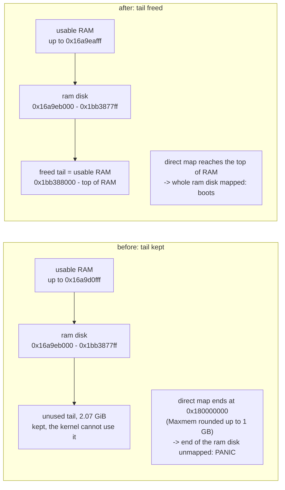

# loader.efi: give back the unused tail of the ram disk buffer

Patch: `loader_memdisk_trim.patch` (`stand/efi/loader/decompress.c`).
Companions: `loader_memdisk_memtype.patch` (loader) and
`md_preload_mapdev.patch` (kernel).  The full story of the bug these three
patches fix is in `bugreport_loader_memdisk_memtype.md`; this document only
needs its first section.

**In one sentence:** the loader reserves memory for a ram disk before it
knows how big the disk will be, guesses four times too much for most images,
and never gives the extra back.  This patch gives it back as soon as the
image is complete.

---

## 1. Background

### 1.1 Booting from an image in RAM

With `memdisk=URL` on its command line, `loader.efi` downloads a disk image
(for example a FreeBSD installer ISO), decompresses it into a block of RAM,
and boots from that block as if it were a disk.  The block stays in use for
as long as the system runs, because it is the root filesystem (`/dev/md0`).

### 1.2 Why the loader has to guess the size

Images are published compressed (`.iso.xz`, `.img.xz`).  The loader
decompresses **while** downloading, so it must reserve the output buffer
before the first byte is decompressed.  It knows the compressed size (from
the HTTP download) but, for most formats, not the decompressed size.  So it
guesses, in `xz_init()`, `zlib_init()` and `bzip2_init()` in
`stand/efi/loader/decompress.c`:

```c
	dctx->size = max(size_hint * 4, M(64));   /* 4x the compressed size */
	EFI_STATUS status = alloc_buffer(dctx, dctx->size);
```

If the guess is too small, `grow_buffer()` allocates a 1.5x bigger block and
copies everything over.  If the guess is too large, nothing happens: the
extra stays reserved.  Only zstd with a size in its frame header, and
uncompressed images, are allocated at their exact size.

### 1.3 Who can use that memory afterwards

The buffer is allocated from the UEFI firmware with `AllocatePages()`.  When
the kernel starts, it reads the firmware's memory map and decides which
ranges it may use.  With the memory-type fix (`loader_memdisk_memtype.patch`)
the buffer is marked `EfiRuntimeServicesData`, which the kernel never takes,
so that the root filesystem cannot be overwritten.  The flip side is that
**every page of the buffer is lost to the kernel, including the unused
tail**.

That has two costs:

1. **Wasted RAM:** for the 15.1 disc1 ISO the tail is 2.07 GiB, more than
   the image itself.
2. **A panic:** the kernel's *direct map*, the window through which it reads
   physical memory, only reaches as far as the highest memory it owns
   (`Maxmem`, rounded up to 1 GB; `sys/amd64/amd64/pmap.c:1805`).  If the
   buffer sits at the top of RAM, everything above the ram disk is the
   unused tail, the kernel owns none of it, and the direct map ends before
   the ram disk does.  md(4) then faults on its first read of the end of the
   disk.  This is bug 2 in the bug report.

---

## 2. The problem, measured

bhyve guest, 8 GB, UEFI HTTP boot, `FreeBSD-15.1-RELEASE-amd64-disc1.iso.xz`
(894980880 bytes compressed, 1352255488 uncompressed), stock 15.1 kernel,
`boot_verbose=YES`, loader with `loader_memdisk_memtype.patch` only:

```
Downloaded 894980880 bytes, actual size 1352255488 -- registering ramdisk
Installed RAM disk as VirtualDisk(0x16A9EB000,0x1BB3877FF,0)
...
0x0000000100000000 - 0x000000016a9d0fff, 1788678144 bytes (436689 pages)   <- last usable chunk: ends at the ram disk
avail memory = 4810575872 (4587 MB)
md0: Preloaded image <preload0 0x000000016a9eb000> 1352255488 bytes at 0xfffff8016a9eb000
Fatal trap 12: page fault while in kernel mode
fault virtual address   = 0xfffff801bb387600
panic: page fault
#5 0xffffffff806e5819 at mdstart_preload+0x49
```

The kernel owns nothing above `0x16a9d0fff`, so the direct map stops at the
next 1 GB boundary, `0x180000000`.  The ram disk runs to `0x1bb3877ff`, and
the read of its last sector faults.

---

## 3. The fix

Once the download has finished, free the pages between the end of the image
and the end of the buffer:

```c
static void
trim_buffer(decomp_state *dctx)
{
	size_t used = roundup2((uintptr_t)dctx->buf_cur - (uintptr_t)dctx->buf,
	    EFI_PAGE_SIZE);
	size_t pages = used / EFI_PAGE_SIZE;

	if (dctx->buf == 0 || pages == 0 || pages >= dctx->pages)
		return;
	if (EFI_ERROR(BS->FreePages(dctx->buf + used, dctx->pages - pages)))
		return;
	printf("Freed %llu unused bytes of the decompression buffer\n",
	    ULL(dctx->alloc_size - used));
	dctx->pages = pages;
	dctx->alloc_size = used;
	dctx->buf_end = (uint8_t *)(uintptr_t)dctx->buf + used;
}
```

called from `decomp_fini()` when it finishes a successful download
(`flush == false`).

* **Why there:** both success paths in `memdisk.c` (the iPXE download
  callback and the file-based fallback) call `decomp_fini(dctx, false)`
  before the buffer is registered as a disk, and every format's own `fini`
  does nothing to the buffer in that case.  One call site covers all formats
  and both paths, and the trim happens before anything holds a pointer to
  the tail.
* **Why the bookkeeping update:** `pages` and `alloc_size` are what the error
  path later passes to `FreePages()` for the whole buffer.  Leaving the old
  values would free the tail twice.
* **If the firmware refuses:** the UEFI specification does not spell out
  whether part of an allocation may be freed (edk2 allows it).  On error the
  patch keeps the whole buffer and behaves exactly as before.

What changes in memory:



The ram disk itself does not move and stays reserved; only the memory after
it changes hands.

### Alternatives, and what this patch does not fix

* **It does not guarantee the panic is gone.**  It removes the tail, but if
  the firmware places the *ram disk itself* at the top of RAM (an
  uncompressed image, or zstd with a known size, is allocated at its exact
  size and has no tail at all), the kernel still owns nothing above it and
  md(4) still faults.  The real fix for the panic is the kernel patch
  `md_preload_mapdev.patch`.  This patch is still worth having on its own:
  it returns 2 GiB here, and it makes the bad placement much less likely
  for compressed images.
* **Allocate the exact size:** xz and gzip streams do not reliably carry the
  decompressed size at the start, which is the whole reason for the guess.
* **Copy into a right-sized block at the end:** needs both blocks at once
  (4.9 GiB at peak here) and a 1.3 GB copy, for the same result as freeing
  in place.
* **Allocate below a fixed address (`AllocateMaxAddress`):** the loader
  cannot know where the kernel's `Maxmem` will end up, so any limit is a
  guess.

---

## 4. Tested

Same VM and image as section 2, **stock** 15.1 kernel (no md.c patch), loader
built from main `bdcfeac3e1cb` plus the four `loader_*.patch` files and this
patch:

```
Freed 2227666944 unused bytes of the decompression buffer
Downloaded 894980880 bytes, actual size 1352255488 -- registering ramdisk
Installed RAM disk as VirtualDisk(0x16A9EB000,0x1BB3877FF,0)
FreeBSD 15.1-RELEASE releng/15.1-n283562-96841ea08dcf GENERIC amd64
0x0000000100000000 - 0x000000016a9eafff, 1788784640 bytes (436715 pages)   <- was 0x16a9d0fff
0x00000001bb388000 - 0x000000023ffe5fff, 2227560448 bytes (543838 pages)   <- new: the freed tail, now usable RAM
avail memory = 6955864064 (6633 MB)                                         <- was 4587 MB
md0: Preloaded image <preload0 0x000000016a9eb000> 1352255488 bytes at 0xfffff8016a9eb000
Trying to mount root from cd9660:/dev/iso9660/15_1_RELEASE_AMD64_CD [ro]...
Welcome to FreeBSD!
```

The ram disk is at the same address as in the panic run; it is still reached
through the plain direct-map address (`0xfffff8016a9eb000`), which is now
valid because the direct map extends to the top of RAM.  The freed amount
checks the 4x rule exactly: 1352257536 bytes used (image size rounded up to
a page) + 2227666944 freed = 3579924480 = 4 x 894980880, rounded up to a
page.

Integrity, from the installer shell in that guest:

```
whole device, read twice:            d97749258ecb12c5ad6a58e9bbaa753a  (both reads)
sectors 0 - 2641090,     guest/host: 0ec322dca3238eed386fb0a483fc22fe / same
sectors 2641092 - 2641122, guest/host: 51596dda30fc38f0df3556d6f115256d / same
```

Every sector matches the published ISO except LBA 2641091 and 2641123, the
backup GPT that the edk2 firmware writes into the ram disk before the kernel
starts (see the bug report, section 4).

| Loader | Kernel | Image | Result |
|---|---|---|---|
| memtype patch | stock 15.1 | disc1.iso.xz | panic in `mdstart_preload` |
| memtype + trim patches | stock 15.1 | disc1.iso.xz | **installer, no panic, image intact, +2046 MB usable** |
| memtype patch | 15.1 + md.c patch | disc1.iso.xz | installer, no panic (bug report, section 4) |
| memtype + trim patches | any | uncompressed image placed at top of RAM | **untested**; expected to panic without the md.c patch (no tail to free) |
| trim patch | any | any | **untested** on firmware other than edk2 (partial `FreePages()`) |
