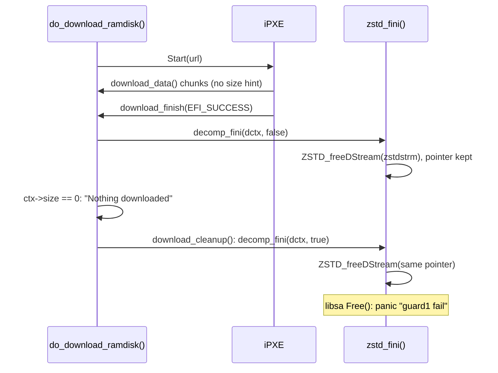

# loader.efi memdisk=: zstd stream freed twice on a failed download

Patch: [`loader_memdisk_zstd_fini.patch`](loader_memdisk_zstd_fini.patch),
against `main` at `29b24020f6fa` (2026-11-12).
Test: [`loader_memdisk_zstd_fini_test.sh`](loader_memdisk_zstd_fini_test.sh).
Reported by: llm-postcr, finding
`POSTCR-a2adf568cdfe83d8aca49f9eb9ba7891e88ff3cd-1` in its review of
`a2adf568cdfe` ("loader.efi: Free the unused tail of the memdisk buffer").
The bug is older: `zstd_fini()` came with `afee781523e4` ("loader.efi:
Recognize new memdisk=<url> and memcd=<url> options", 2026-06-26).

## 1. Background

**memdisk= download.** With `loader.efi memdisk=<url>`, the loader asks
iPXE to download the image (`do_download_ramdisk()`,
`stand/efi/loader/memdisk.c:258`). iPXE calls back:
- `download_data()` for each chunk. A chunk of length 0 is a *size hint*:
  iPXE sends it when the HTTP reply has a `Content-Length`, and the loader
  stores it in `ctx->size` (line 78).
- `download_finish()` once at the end (line 126).

**The decompressor.** The first data chunk creates a decompression state
with `decomp_init()` (line 87). `stand/efi/loader/decompress.c` has one
backend per format (zlib, bzip2, xz, zstd, none). Each backend has a
`*_fini(dctx, flush)` function that releases the backend's stream:
- `flush == false`: the download worked. Free the stream, keep the output
  buffer, which becomes the ram disk.
- `flush == true`: the download is thrown away. Free the stream and the
  output buffer (`free_buffer()`, line 125).

`decomp_fini()` (line 527) calls the backend's function, then trims the
buffer when `flush` is false.

**Two calls on some paths.** On success, `download_finish()` calls
`decomp_fini(dctx, false)` (line 133). If `do_download_ramdisk()` later
decides to give up, it calls `download_cleanup()` (line 55). That calls
`decomp_fini(dctx, true)` to free the output buffer. So each backend's
`*_fini()` must accept a second call. Most do:

| backend | first call | second call |
|---|---|---|
| zlib | `inflateEnd()` sets `zstrm.state` to NULL | `inflateEnd()` sees NULL, returns |
| bzip2 | `BZ2_bzDecompressEnd()` sets `bzstrm.state` to NULL | sees NULL, returns |
| xz | `xz_dec_end()`, then `dctx->xzstrm = NULL` (line 360) | `xz_dec_end(NULL)` returns |
| **zstd** | `ZSTD_freeDStream()`, pointer **kept** (line 428) | frees the same memory again |

`ZSTD_freeDCtx(NULL)` is safe (`sys/contrib/zstd/lib/decompress/zstd_decompress.c:326`).
The bug is only the stale pointer.

**libsa's free().** The loader's allocator (`stand/libsa/zalloc_malloc.c`)
writes a magic number in a header just before each block. `Free()` checks
it (line 118):
- the magic says "already freed": prints `free: duplicate free` and returns;
- the magic is something else: panics with `free: guard1 fail` (line 128).

After the first free, the allocator can reuse those header bytes for its
own free-list records, so the second free can find neither value and panic.



## 2. The problem

Two paths in `do_download_ramdisk()` run the second call after a successful
download:
- `ctx->size == 0` (line 302): iPXE never sent a size hint, because the
  server sent no `Content-Length`.
- `fallback_to_md()` fails (lines 318 and 330): there is no RamDisk
  protocol and either the loader has no `LOADER_MD_SUPPORT`, or the image
  size is not a multiple of 512.

The `initmd` path (`download_md_image()`) is not affected: after its
`decomp_fini(..., false)` it skips the second call.

### How to repeat it

The test script boots qemu + edk2 + the packaged iPXE. iPXE chains the
loader under test with `memdisk=` pointing at a small HTTP server. The
server answers `/nolen/<file>` without `Content-Length` and `/<file>` with
it. The images are 4 MiB of zeros, compressed with zstd and xz. The no-size
path runs before the RamDisk protocol check, so a VM reaches it.

    $ ./loader_memdisk_zstd_fini_test.sh loader_lua.efi

Measured on 2026-11-12, `loader_lua.efi` built from `29b24020f6fa`:

    == nolen/img.zst
    Downloading http://10.0.2.2:18089/nolen/img.zst as a disk
    Nothing downloaded
    panic: free: guard1 fail @ 0x77d6d7c0 from unknown:0
    == nolen/img.xz
    Downloading http://10.0.2.2:18089/nolen/img.xz as a disk
    Nothing downloaded
    FreeBSD/amd64 EFI loader, Revision 3.1
    == img.zst
    We know we will download 146 bytes
    Downloaded 146 bytes, actual size 4194304 -- registering ramdisk
    FreeBSD/amd64 EFI loader, Revision 3.1

Only zstd without a size hint panics. The same download in xz takes the
same path and survives.

## 3. The fix

```diff
 	ZSTD_freeDStream(dctx->zstdstrm);
+	dctx->zstdstrm = NULL;
```

This is what `xz_fini()` already does. The second call then passes NULL to
`ZSTD_freeDStream()`, which returns at once, and goes on to free the output
buffer.

Alternatives:

| option | tradeoff |
|---|---|
| **clear the pointer in `zstd_fini()`** (this patch) | one line; same pattern as xz |
| make `decomp_fini()` run only once, as the review also suggests | wrong: the second call is the one with `flush == true` that frees the output buffer, at least 64 MiB; skipping it leaks that buffer on every error path |
| stop `do_download_ramdisk()` from calling `download_cleanup()` after `download_finish()` | then nothing frees the output buffer either; the paths would each need their own `free_buffer()` |

What the patch does NOT fix:
- **The download is still thrown away.** Without `Content-Length`, the image
  arrives whole but `ctx->size == 0` makes the loader print "Nothing
  downloaded" and drop it. `ctx->size` is the size hint, not a count of
  bytes received. That is a separate bug and a separate patch.
- **The other `fallback_to_md()` failures**: they now fail cleanly and the
  loader goes on without a ram disk, as intended.

## 4. Tested

| configuration | result |
|---|---|
| qemu + edk2, iPXE, `loader_lua.efi` from `29b24020f6fa`, zstd without `Content-Length` | `panic: free: guard1 fail @ 0x77d6d7c0` (two runs, same panic) |
| same, xz without `Content-Length` | "Nothing downloaded", loader goes on |
| same, zstd and xz with `Content-Length` | "registering ramdisk", loader goes on |
| loader with the patch, the same four downloads | no panic: "Nothing downloaded" for both no-length cases, "registering ramdisk" for the others |
| `fallback_to_md()` failure path | untested: qemu and bhyve firmware have the RamDisk protocol, so they never take the md fallback |

The two loaders have different checksums (`40853f7a...` without,
`7b00aad6...` with the patch). The `decompress.o` objects and `.efi` files
were removed before the second build, because META_MODE can otherwise keep
a stale object.

## 5. Commit message

```
loader.efi: Clear the zstd stream pointer in zstd_fini()

do_download_ramdisk() calls decomp_fini() a second time to free the
buffer when it gives up after a finished download, so zstd freed its
stream twice and libsa panicked.  Clear the pointer like xz_fini().

Reported by:	llm-postcr
Fixes:		afee781523e4 ("loader.efi: Recognize new memdisk=<url> and memcd=<url> options")
```
