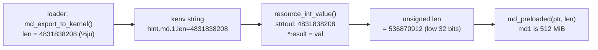

# md(4): ram disks of 4 GiB or more are truncated at boot

Patch: [`md_preload_len.patch`](md_preload_len.patch), against `main` at
`75734a4b6d0b` (2026-11-08).
Reported by: llm-postcr, finding
`POSTCR-46c2d93c572865f6441788ad8416ff7ff971829a-2` in its review of
`46c2d93c5728` ("loader.efi: Allocate ram disks as EfiReservedMemoryType").
The bug itself is older: it came in with `15925062e1ba` ("biosboot: Detect
memory disks from PXE", 2025-07-22).

## 1. Background

**Ram disk (md).** `md(4)` turns a block of memory into a disk device,
`/dev/mdN`. When the loader has already put a disk image in RAM, for
example with `loader.efi memdisk=<url>`, the kernel only has to wrap that
memory in an md device. That memory can then be the root filesystem.

**How the loader tells the kernel where the image is.** The loader and the
kernel share an environment of `name=value` strings, the *kenv*. The loader
writes two strings per ram disk in `md_export_to_kernel()`
(`stand/common/md.c:74`):

    hint.md.0.physaddr=0x0000000100000000    printed with %016jx
    hint.md.0.len=4831838208                 printed with %ju (64-bit)

Three loader paths end in that function:
- `memdisk=` with no RamDisk protocol in the firmware: `md_register(...,
  MD_FLAG_KERNEL)` in `stand/efi/loader/memdisk.c:142`.
- Disks registered with the UEFI RamDisk protocol:
  `efiblk_memdisk_preload()` in `stand/efi/libefi/efipart.c:1291`.
- The BIOS loader booted from a PXE MEMDISK:
  `stand/i386/libi386/biosmemdisk.c:127`.

**Hints.** A "hint" is a kenv string named `hint.<driver>.<unit>.<name>`.
Drivers read hints with helpers from `sys/kern/subr_hints.c`. Two of them
matter here:

| helper | line | parses with | stores into |
|---|---|---|---|
| `resource_int_value()` | 338 | `strtoul()`, 64-bit on amd64 | `int *`, 32 bits |
| `resource_long_value()` | 361 | `strtoul()` | `long *`, 64 bits on amd64 |

Both parse the full 64-bit value. `resource_int_value()` then does
`*result = val;` (line 356), and C converts the value to `int` by keeping
the low 32 bits. No error is returned.

**Where md(4) reads the hints.** `g_md_init()` in `sys/dev/md/md.c` runs
once when GEOM starts. It loops over `hint.md.0`, `hint.md.1`, ... (line
2129), maps each range with `pmap_mapdev_attr()` and calls
`md_preloaded()` (line 2041), which takes the length as a `size_t`.



## 2. The problem

`g_md_init()` declares `unsigned len` (32 bits) and reads it with
`resource_int_value()`. A length of 4 GiB or more loses its high bits:

| hint length | low 32 bits | what md(4) does |
|---|---|---|
| 1 GiB | 1 GiB | correct |
| 4.5 GiB (4831838208) | 512 MiB (536870912) | attaches a 512 MiB disk; the end of the filesystem is missing |
| exactly 4 GiB (4294967296) | 0 | `len != 0` fails, the disk is silently skipped |

Before `memdisk=` this was hard to hit: the BIOS loader is a 32-bit
program, so its PXE MEMDISK images stay well below 4 GiB. With `memdisk=`, the loader decompresses the
image in RAM, so an image of 4 GiB or more (a full memstick, a big custom
root) only needs a machine with enough memory.

### How to repeat it

No 4 GiB download is needed. Hints set in `/boot/loader.conf` reach the
kernel the same way as the loader's own hints, so a bhyve guest with 8 GiB
of RAM can declare ram disks over its own memory at 4 GiB:

    hint.md.0.physaddr="0x100000000"
    hint.md.0.len="1073741824"       # 1 GiB, control
    hint.md.1.physaddr="0x100000000"
    hint.md.1.len="4831838208"       # 4.5 GiB
    hint.md.2.physaddr="0x100000000"
    hint.md.2.len="4294967296"       # exactly 4 GiB

That memory is ordinary RAM which the kernel also uses, so the disks hold
garbage. The test only reads their size. It does not write to them.
The guest image comes from `FreeBSD/kern-test-vm/mkvm.sh`, with both kernels
installed side by side. The test script runs `mdconfig -lv` and
`diskinfo md0 md1 md2`.

Measured on 2026-11-12, kernel built from `75734a4b6d0b` without the patch:

    md0: Preloaded image <preload0 0x0000000100000000> 1073741824 bytes at 0xfffff80100000000
    md1: Preloaded image <preload1 0x0000000100000000> 536870912 bytes at 0xfffff80100000000
    md0	preload	 1024M	preload0 0x0000000100000000	-
    md1	preload	  512M	preload1 0x0000000100000000	-
    md2: absent

The 4.5 GiB disk is 512 MiB and the 4 GiB disk does not exist. No message
says so.

Side effect of this test setup: the loader also sees the hints in
`loader.conf` and tries `md0:` as its current device (`Setting currdev to
md0:` / `MD not present`). Then it goes on from the boot disk. A real
`memdisk=` boot does not print this.

## 3. The fix

```diff
-	unsigned len;
+	size_t len;
 ...
-		    resource_int_value("md", i, "len", &len) != 0)
+		    resource_long_value("md", i, "len", (long *)&len) != 0)
```

`len` becomes a `size_t`, the type `md_preloaded()` already takes, and it is
read with the 64-bit helper. The `(long *)` cast follows the `physaddr` read
two lines above. `size_t` and `long` have the same size on every FreeBSD
platform (ILP32 and LP64), and the kernel builds with
`-fno-strict-aliasing`.

The same `len` variable also holds `preload_fetch_size()` for `md_image`
modules in the loop above (line 2118). That function returns a `size_t`.
The patch also stops that value from being cut to 32 bits.

Why here, and not somewhere else:

| option | tradeoff |
|---|---|
| **read len as 64 bits in `g_md_init()`** (this patch) | two lines, no change to the loader/kernel interface, old loaders keep working |
| make `resource_int_value()` reject values that do not fit an `int` | right in general, but it changes behaviour for every driver that reads hints; the md disk would then be skipped instead of truncated, which is still wrong |
| add a `resource_size_value()` helper | new KPI for one caller |
| have the loader pass the length in sectors | changes the loader/kernel interface; an old kernel with a new loader would misread it |

What the patch does NOT fix:
- **Kernels without the patch** still truncate, whatever the loader. With
  `memdisk=` and an image of 4 GiB or more, the kernel must have this fix.
- **32-bit platforms**: `size_t` and `vm_offset_t` are 32 bits there, so a
  ram disk of 4 GiB or more cannot be described at all. This is unchanged
  and is not a practical limit.
- **`len=0`**: a zero length still reaches `pmap_mapdev_attr()` before the
  `len != 0` test. Only a malformed hint can do that now. On amd64 it
  returns a direct map address and the disk is skipped, as before.
- **Overflow in the helper**: `resource_long_value()` stores a
  `strtoul()` result into a `long` without a range check. That cannot
  overflow on LP64, and the loader never writes a negative length.

## 4. Tested

| configuration | result |
|---|---|
| bhyve, 8 GiB guest, amd64 `GENERIC-NODEBUG` from `75734a4b6d0b`, hints of 1 GiB / 4.5 GiB / 4 GiB | md0 1073741824, md1 536870912 (truncated), md2 absent |
| same guest and hints, kernel with the patch | md0 1073741824, md1 4831838208, md2 4294967296 |
| real `memdisk=` boot of an image of 4 GiB or more | untested |
| `md_image` module of 4 GiB or more loaded by the loader | untested |
| arm64, riscv, i386 | untested (built for amd64 only) |

Fixed kernel, same guest:

    md0: Preloaded image <preload0 0x0000000100000000> 1073741824 bytes at 0xfffff80100000000
    md1: Preloaded image <preload1 0x0000000100000000> 4831838208 bytes at 0xfffff80100000000
    md2: Preloaded image <preload2 0x0000000100000000> 4294967296 bytes at 0xfffff80100000000
    md1	512	4831838208	9437184	0	0
    md2	512	4294967296	8388608	0	0

## 5. Commit message

```
md: Read the preloaded image length as 64 bits

g_md_init() read hint.md.N.len with resource_int_value() into an
unsigned int, so a ram disk of 4 GiB or more attached truncated to its
size modulo 4 GiB, or not at all when the size is a multiple of 4 GiB.
memdisk= now makes such images reachable.

Reported by:	llm-postcr
Fixes:		15925062e1ba ("biosboot: Detect memory disks from PXE")
```
