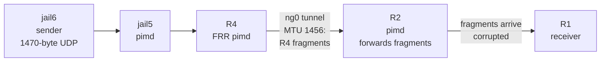
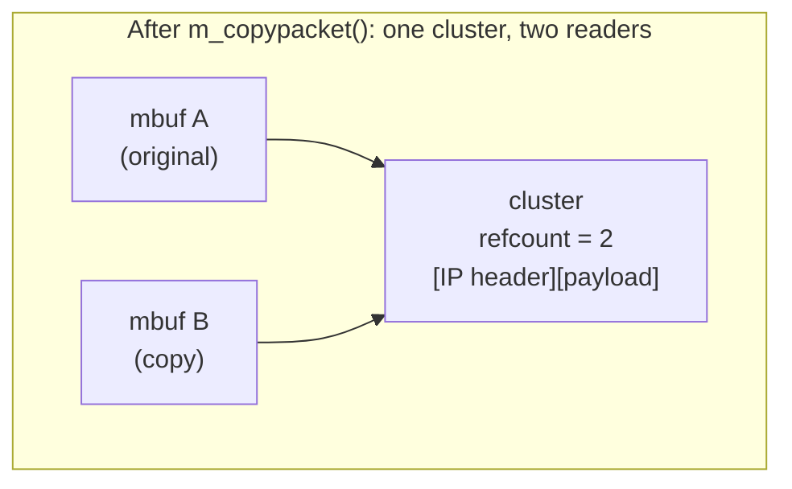
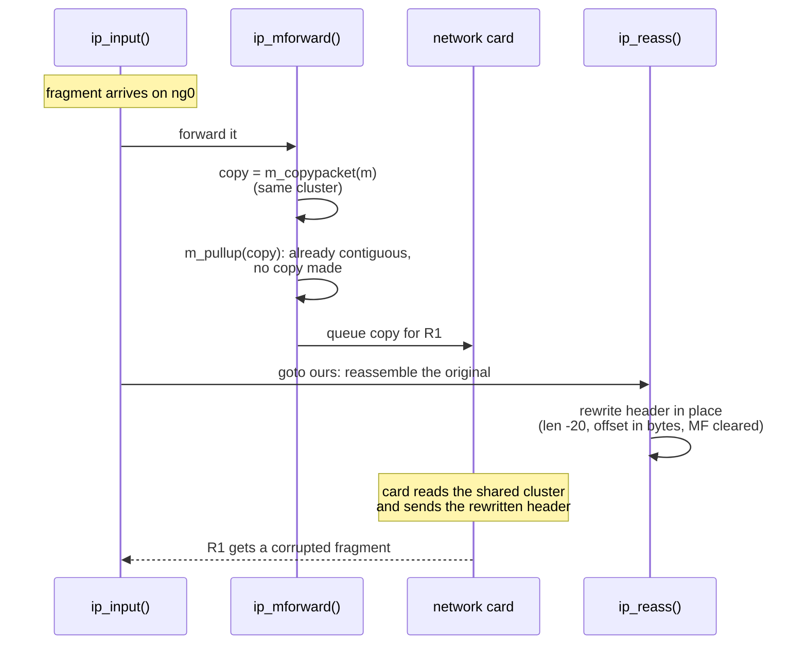
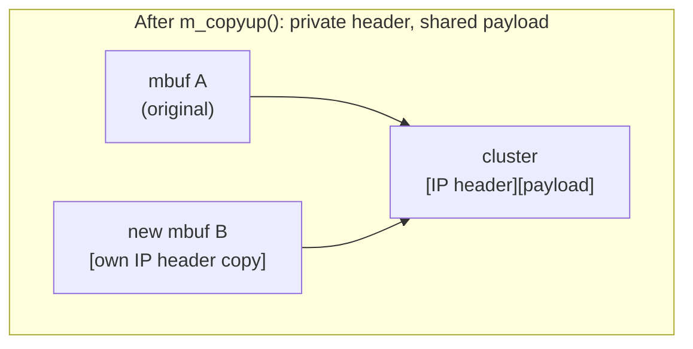

# Multicast fragments corrupted by a shared mbuf header

Patch: [mroute_m_pullup_shared_header.patch](mroute_m_pullup_shared_header.patch),
against FreeBSD main (n315764). Carried in BSDRP as
`BSDRP/patches/freebsd.m_pullup-writable-header.patch`; reported upstream.
IPv6 reproducer: [mroute6_wrongmif_tclass.c](mroute6_wrongmif_tclass.c).

This document explains the bug for a first-year computer science student:
someone who knows C and what a network packet is, but has never looked inside
the FreeBSD network stack.

## 1. What went wrong

The BSDRP "full" lab is a set of virtual routers. One of its regression tests
sends a multicast UDP stream (one sender, many possible receivers) from a
jail on router R5 to router R1, through routers R4 and R2.

With 1000-byte datagrams, R1 received everything. With 1470-byte datagrams it
received nothing, and its counters showed thousands of IP packets with a bad
header checksum.



A 1470-byte datagram plus its 28 bytes of IP and UDP headers does not fit the
1456-byte tunnel, so R4 splits each one into two IP fragments. R2 only has to
forward those fragments unchanged, apart from decrementing the TTL. Capturing
on each side of R2 showed the problem:

| Where | A second fragment looks like |
|---|---|
| R2, leaving (`tcpdump` on R2) | `offset 1432, flags [none], length 66`: correct |
| R1, arriving | `offset 11456, flags [none], length 46, bad cksum`: wrong |

The same packet changed after R2 had already handed it to its network card.
The changes are not random:

- the length shrank by exactly 20 bytes, the size of an IP header;
- the offset field now holds 1432, a count of bytes, instead of 179, a count
  of 8-byte units (tcpdump multiplies by 8: 1432 x 8 = 11456);
- the first fragments lost their "More Fragments" flag.

Those are exactly the edits `ip_reass()`, the kernel function that reassembles
fragments, makes to a fragment header while it works. So something on R2 was
reassembling the very bytes the card was about to send.

## 2. Background

### 2.1 mbufs and clusters

The FreeBSD kernel stores a packet in a chain of **mbufs**. A small mbuf holds
a few hundred bytes. A bigger packet keeps its data in a separate 2 KB buffer
called a **cluster**, and the mbuf only points to it.

To copy a packet cheaply, the kernel does not copy the cluster: it creates a
new mbuf that points to the same cluster and increments a reference count.
`m_copypacket()` works this way. Both copies now read the same bytes, so
neither may modify them. The macro `M_WRITABLE(m)` tells whether an mbuf may
be modified: false when its cluster is shared.



A code path that wants to modify the header of a shared packet must first
give it a private copy of that header.

### 2.2 m_pullup()

`m_pullup(m, len)` guarantees that the first `len` bytes of a packet are
contiguous in the first mbuf, so the code can cast them to a `struct ip`.

Before October 2026, when the first mbuf held its data in a cluster,
`m_pullup()` always allocated a new small mbuf and copied the first bytes into
it, even if they were already contiguous. Callers relied on that side effect
to unshare a header:

```c
if (!M_WRITABLE(m) || m->m_len < hlen)
	m = m_pullup(m, hlen);	/* the header is now private */
```

### 2.3 What a multicast router does with a packet

When R2 receives a multicast packet, `ip_input()`:

1. calls `ip_mforward()`, which makes a copy with `m_copypacket()` for each
   outgoing interface and queues it for transmission;
2. then hands the original to the local stack anyway (`goto ours`), in case a
   local program listens to that group. For a fragment, the local stack first
   calls `ip_reass()`, which rewrites the fragment header in place.

## 3. The bug

Commit 671babc7949 ("mbuf: make m_pullup() an inline over most expected
case", 2026-10-19) made the common case faster:

```c
static __inline struct mbuf *
m_pullup(struct mbuf *m, int len)
{
	if (__predict_false(m->m_len < len))
		return (__m_pullup(m, len));	/* the old function */
	else
		return (m);			/* already contiguous */
}
```

That is correct for code that only needs contiguous bytes. But in the idiom of
section 2.2 the header is already contiguous, so `m_pullup()` now returns the
mbuf unchanged: the header stays in the shared cluster, still not writable.

In `ip_mroute.c`, `phyint_send()` uses that idiom on the copy it queues. Its
comment even says why: *"make sure that the IP header is actually copied, not
just referenced"*. Since the change it is only referenced:



Whether the card or the reassembly gets there first is a race. In the lab
`ip_reass()` won almost every time, so no fragment arrived intact.

Only fragments trigger it: a whole packet is not reassembled, so nothing
rewrites the shared header. That is why 1000-byte datagrams worked.

The same idiom appears at ten places:

| File | Sites | What writes to the header | Evidence |
|---|---|---|---|
| `sys/netinet/ip_mroute.c` | 3 | forwarded copies, upcalls to the routing daemon | observed: the corrupted fragments above |
| `sys/netinet6/ip6_mroute.c` | 3 | the "wrong MIF" upcall lays its message over the header | observed: see section 5 |
| `sys/netinet/igmp.c` | 2 | IGMPv1/v2 report handling rewrites the source address | code reading |
| `sys/netinet6/ip6_output.c` | 1 | `ip6_mloopback()` clears the scope of the addresses | code reading |
| `sys/netgraph/ng_ether.c` | 1 | writes the source MAC address (`autosrc`) | code reading |

The IPv6 "wrong MIF" case is the worst: when a multicast packet arrives on the
wrong interface, `ip6_mdq()` copies its header to tell the routing daemon,
then writes the message type and interface number over bytes 0 to 3 of that
copy. Since the copy shares the cluster, those bytes of the original packet
change too: its version, traffic class and flow label. The kernel then
delivers that original to the programs on the router that listen to the
group.

## 4. The fix

The ten callers need a private, writable copy of the header. Three kernel
functions could provide contiguous header bytes. All three return a chain
whose first `len` bytes are contiguous; they differ in when they copy the
header into a new mbuf:

| Function | Copies the header into a new mbuf | Gives a writable header? |
|---|---|---|
| `m_pullup(m, len)`, inline since 671babc7949 | only when `m_len < len`; already contiguous means it returns the mbuf unchanged, even in a shared cluster | no: that is the regression |
| `__m_pullup(m, len)`, the old `m_pullup()` body | always for a cluster mbuf, as a side effect of how it is written | yes, but only by accident of its implementation |
| `m_copyup(m, len, dstoff)` | always: allocates a new mbuf, copies `len` bytes, leaves `dstoff` bytes of space in front | yes, by definition |

The patch uses `m_copyup()`:

- `m_pullup()` is the function that no longer does the job.
- `__m_pullup()` would restore the old behavior, but it is an internal helper
  (the double underscore says so) whose purpose is to make bytes contiguous.
  Relying on it to copy is the same mistake as before: the next optimization
  of that helper would bring the bug back.
- `m_copyup()` is documented to always copy: "Like m_pullup(), except a new
  mbuf is always allocated". Writable header is its contract, not a side
  effect, and other network code already uses it for that (`if_bridge.c`).

```c
struct mbuf *m_copyup(struct mbuf *n, int len, int dstoff);
```

`dstoff` leaves empty space before the copied bytes, for a header a later
step would prepend. The patch passes 0 everywhere: half of the copies go to
the routing daemon or are only read, and on the output paths reserving room
for the Ethernet header would only save one small allocation. Every site
changes the same way:

```c
	mb_copy = m_copypacket(m, M_NOWAIT);
	if (mb_copy && (!M_WRITABLE(mb_copy) || mb_copy->m_len < hlen))
-		mb_copy = m_pullup(mb_copy, hlen);
+		mb_copy = m_copyup(mb_copy, hlen, 0);
```



Only the header is copied (at most 60 bytes for IPv4, 40 for IPv6); the
payload stays shared. `ip_reass()` can now rewrite the original header without
touching the copy waiting in the card's queue. The copy is still made only
when the `!M_WRITABLE || m_len < hlen` test says it is needed, so the cost is
the same as before the regression.

`m_copyup()` fails, freeing the chain and returning `NULL`, if `len` plus
`dstoff` does not fit a small mbuf (`MHLEN` bytes). The headers here are far
below that, and the callers already handle `NULL` as they did for
`m_pullup()`.

## 5. Testing

The BSDRP full lab regression test (`tools/regression-test.sh`) sends the
stream twice, with 1000-byte and then 1470-byte datagrams, and checks that R1
receives at least 100 datagrams with less than 5% loss:

| Image | 1000-byte | 1470-byte (fragmented) |
|---|---|---|
| main n315764, unpatched | pass | fail: 0 reassembled, 2154 bad header checksums |
| with the `m_copyup()` patch | pass | pass |

The IPv6 "wrong MIF" case has its own reproducer,
[mroute6_wrongmif_tclass.c](mroute6_wrongmif_tclass.c). On the router it
becomes the IPv6 multicast routing daemon, declares that a (source, group)
stream must arrive on one interface, and listens to that group on another
interface, asking the kernel for each datagram's traffic class. The sender
sends that stream to the wrong interface with traffic class 0xb8:

```
router# mroute6_wrongmif_tclass router vtnet1.23 vtnet2 2001:db8:34::4 ff0e::1:2
sender# mroute6_wrongmif_tclass send vtnet2 ff0e::1:2 10
```

| Image | Received traffic class |
|---|---|
| main n315764, unpatched | `0x02` (corrupted), every datagram, one wrong-MIF upcall each |
| with the `m_copyup()` patch | `0xb8` (intact), every datagram, one wrong-MIF upcall each |

Unlike the fragment case, this is not a race: the write happens before the
kernel delivers the packet locally, so every datagram is hit. It needs real
network cards (here `vtnet` in bhyve): with `epair(4)` the received header
sits in a small private mbuf, `m_copym()` copies it, and the bug hides.

## 6. Lessons

- A function that "happens to" do something useful is not a contract. The
  callers needed "give me a writable header" and used "make it contiguous".
  When the second became cheaper, the first silently disappeared.
- Corruption after the packet left the router is a sign of shared memory being
  modified late. Comparing the corrupted fields with what each kernel function
  writes pointed straight at `ip_reass()`.
- A regression test that only checks the control plane (here, PIM neighbors
  and routes) would not have seen this. Sending real traffic, including large
  packets, did.
