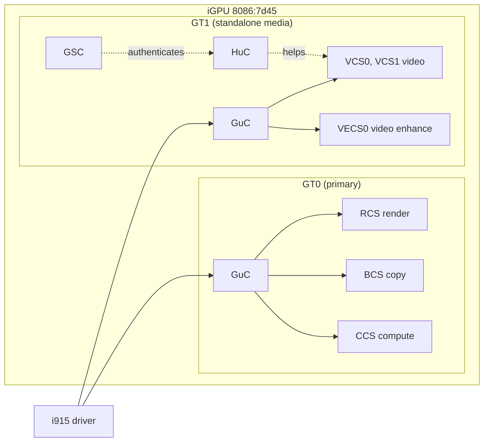
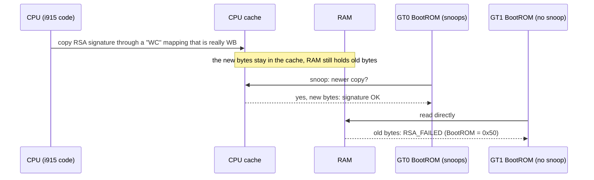
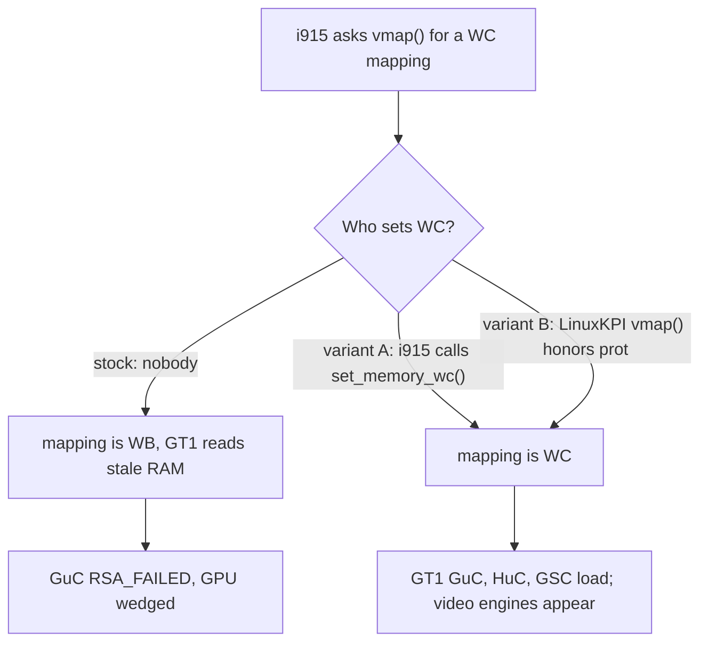

# Hardware video on Meteor Lake: waking up the media GT

Patch: [mtl_media_gt.patch](mtl_media_gt.patch), against `graphics/drm-latest-kmod`
6.12.85 (distfile `freebsd-drm-kmod-6.12.85-drm_v6.12.85_3_GH0.tar.gz`), two files.
Machine: Lenovo ThinkPad X1 Carbon Gen 12 ("carbon"), Intel Core Ultra 7 165U
(Meteor Lake), iGPU 8086:7d45. FreeBSD 16.0-CURRENT main-n291498-6dc19a71f70c.
Date: 2026-11-21.

This document explains the work for a first-year computer science student:
someone who knows C and what an operating system does, but has never looked
inside a GPU driver.

Result in one line: with the patch, the laptop decodes and encodes
H.264, HEVC, VP9 and AV1 video in hardware through VA-API, and Vulkan Video
is available. Before the patch, only 3D and compute were accelerated.

## 1. Background

### 1.1 A GPU is several engines, not one

A modern Intel GPU is a set of independent *engines*. Each one executes its
own queue of commands:

| Engine class | Short name | Job |
|---|---|---|
| 0 | RCS (render) | 3D, OpenGL, Vulkan graphics |
| 1 | BCS (blitter, copy) | copy memory around |
| 2 | VCS (video) | decode and encode video (H.264, HEVC, VP9, AV1) |
| 3 | VECS (video enhance) | scale, convert colors, deinterlace |
| 4 | CCS (compute) | compute shaders, OpenCL-like work |

Programs never talk to the engines directly. They ask the kernel driver
(`i915`) which engines exist (the `DRM_I915_QUERY_ENGINE_INFO` query), then
submit command buffers to one of them.

Why have a video engine at all, when the CPU can decode video in software?
Because fixed-function hardware is far cheaper in energy. On this laptop,
decoding 1500 frames of 1080p H.264 (section 4):

| Method | Wall time | CPU time |
|---|---|---|
| software, 1 thread | 4.37 s | 4.44 s |
| software, all 14 threads | 0.93 s | 8.19 s |
| hardware (VCS) | 1.87 s | 0.42 s |

Software with every core is a bit faster here, but it burns 20 times more
CPU time. On battery, the hardware path is what you want.

### 1.2 Meteor Lake splits the GPU into two "GTs"

A *GT* ("graphics technology") is a group of engines with its own power
management and its own firmware. Older Intel chips had one GT. Meteor Lake
has two, on separate pieces of silicon:



Everything about video lives on GT1. If the driver skips GT1, the video
engines simply do not exist for the rest of the system.

### 1.3 Firmware: GuC, HuC, GSC

Each GT runs small microcontrollers with their own firmware, loaded by the
driver at start-up (the files come from `gpu-firmware-intel-kmod-meteorlake`):

- **GuC** ("Graphics micro-Controller", `mtl_guc_70.bin`): a small processor
  inside the GPU that schedules work on the engines. The driver hands it
  command buffers; the GuC decides which engine runs what, and when. It
  also manages power (SLPC: frequency, RC6 sleep states). Each GT has its
  own GuC, so Meteor Lake runs two: GT0's GuC schedules render, copy and
  compute; GT1's GuC schedules the video engines. "Both GuCs" in this
  document means these two copies of the same firmware file.
- **HuC** ("HEVC micro-Controller", `mtl_huc_gsc.bin`, only on GT1): helps
  the video engine (bitrate control for encoding, some decode steps).
- **GSC** ("Graphics Security Controller", `mtl_gsc_1.bin`, only on GT1):
  used to authenticate the HuC and for content protection.

The tunable `hw.i915kms.enable_guc` in `/boot/loader.conf` controls the
first two. It is a bitmask: 1 = let the GuC schedule work ("GuC
submission"), 2 = load the HuC, 3 = both. Linux picks 3 automatically on
Meteor Lake. drm-kmod on FreeBSD defaults to 0 (`i915_params.h`: with GuC,
some machines froze at reboot), but Meteor Lake cannot schedule work
without its GuC, so this laptop needs `hw.i915kms.enable_guc=3`
([i915kms_panic.md](i915kms_panic.md) shows what 0 and 2 do).

Before running a firmware, a small ROM inside the microcontroller (the
*BootROM*) checks its RSA signature. If the bytes it reads do not match the
signature, it refuses to start. Keep that in mind: it is the key to this bug.

### 1.4 MEI, the piece FreeBSD does not have

MEI (Management Engine Interface) is the PCI device that talks to the
Intel CSME, a separate security processor in the chipset. On Linux, i915
uses MEI for three things on Meteor Lake: HDCP (copy protection on
external displays), PXP (protected video playback, for DRM streaming), and
the "GSC proxy" that relays messages between the GSC and the CSME.
FreeBSD has no MEI driver.

### 1.5 Caches, snooping and write-combining

When the CPU writes to memory, the data first lands in the CPU cache.
Another device that reads the same memory with DMA must either:

- *snoop*: ask the CPU cache "do you have a newer copy?", or
- read RAM directly, and then it only sees the data once the CPU has
  written it back from its cache.

GT0 snoops. GT1 on Meteor Lake does **not** (Intel workaround
Wa_22016122933). So, for every buffer shared with GT1, i915 asks for a
**write-combining (WC)** CPU mapping. WC memory bypasses the cache: writes
go (almost) straight to RAM, so a non-snooping device always sees them.

The page attribute (write-back WB, write-combining WC, uncached UC) is a
property of the CPU page table entry, chosen when the kernel maps the page.

### 1.6 LinuxKPI

FreeBSD runs the Linux i915 driver almost unchanged, through **LinuxKPI**:
a layer in the FreeBSD kernel that implements Linux kernel functions
(`kmalloc`, `vmap`, `request_firmware`, ...) on top of FreeBSD ones.
`drm-kmod` contains the Linux DRM code plus `#ifdef __FreeBSD__` changes.

## 2. The problem

### 2.1 Symptom

With the stock module, `vainfo` happily lists decode profiles, but any real
decode fails:

```
% ffmpeg -hwaccel vaapi -hwaccel_device /dev/dri/renderD128 -i t264.mp4 -f null -
[h264] Failed to create decode context: 2 (resource allocation failed).
```

Asking the kernel which engines exist (a 20-line C program,
`DRM_I915_QUERY_ENGINE_INFO`) shows only classes 0, 1 and 4: render, copy,
compute. No VCS, no VECS. `I915_PARAM_HUC_STATUS` returns an error.

The boot log says why:

```
drmn0: [drm] Skipping GT1 (Standalone Media GT) - MEI driver not available on FreeBSD
```

### 2.2 First layer: GT1 is skipped on purpose

That message comes from a FreeBSD-only block in
`drivers/gpu/drm/i915/gt/intel_gt.c`, added by drm-kmod commit `5c341599a7a2`
("intel: disable GT1 (Media chip) on FreeBSD", February 2026), the change
that first made Meteor Lake graphics work at all:

```c
case GT_MEDIA:
#ifdef __FreeBSD__
        if (!IS_ENABLED(CONFIG_INTEL_MEI_HDCP)) {
                drm_info(&i915->drm, "Skipping GT1 ... MEI driver not available\n");
                ret = 0;
                continue;
        }
#endif
```

The commit message says GT1 needs MEI. Reading the Linux code shows that
this is only partly true:

- HDCP: already disabled separately on FreeBSD (`is_hdcp2_supported()`).
- GSC proxy: `intel_gsc_proxy_init()` already checks for MEI and gives up
  cleanly ("can't init GSC proxy due to missing mei component").
- HuC: on Meteor Lake the HuC is loaded by DMA and authenticated through the
  GSC *engine* (GSCCS), not through MEI.
- GuC and the video engines: no MEI involved at all.

So the plan was: remove the skip, and see what breaks.

### 2.3 Second layer: GT1's GuC fails its signature check

Without the skip, GT1 starts, then:

```
GT1: GUC: load failed: status: Reset = 0, BootROM = 0x50, UKernel = 0x00, MIA = 0x00, Auth = 0x01
GT1: GUC: firmware signature verification failed
GT1: Failed to initialize GPU, declaring it wedged!
```

`BootROM = 0x50` is `INTEL_BOOTROM_STATUS_RSA_FAILED` (see
`gt/uc/abi/guc_errors_abi.h`). This explains the "GuC authentication fails
on GT1" comment in the original skip.

The detective question: **the same file `mtl_guc_70.bin` passes on GT0.
Why would the signature be wrong on GT1?**

A signature check fails when the bytes read are not the bytes written.
The firmware's RSA signature is copied by the CPU into a small buffer, and
the BootROM reads it with DMA. In `uc_fw_rsa_data_create()`:

```c
vaddr = i915_gem_object_pin_map_unlocked(vma->obj,
                intel_gt_coherent_map_type(gt, vma->obj, true));
copied = intel_uc_fw_copy_rsa(uc_fw, vaddr, vma->size);
```

`intel_gt_coherent_map_type()` returns WB for GT0 and **WC** for GT1
(section 1.5). For GT0 a cached write is fine, it snoops. For GT1 the
mapping must really be WC. Is it?

### 2.4 Root cause: LinuxKPI `vmap()` ignores the page attribute

i915 builds the WC mapping with `vmap(pages, n, 0, pgprot_writecombine(...))`.
Here is LinuxKPI's `vmap()` (`sys/compat/linuxkpi/common/src/linux_page.c`):

```c
void *
vmap(struct page **pages, unsigned int count, unsigned long flags, int prot)
{
        ...
        off = kva_alloc(size);
        vmmap_add(off, size);
        pmap_qenter(off, pages, count);   /* prot is never used */
        return (off);
}
```

`prot` is accepted and silently dropped. `pmap_qenter()` maps the pages with
their default attribute, write-back. So on FreeBSD every "WC" mapping i915
asks for is in fact cached. GT0 never notices, because it snoops. GT1 reads
RAM, gets stale bytes, and the BootROM rejects the signature.

The same write, seen by the two GTs:



With a real WC mapping, the write skips the cache and lands in RAM, so
both reads see the new bytes.

### 2.5 Proving it, one step at a time

A good hypothesis predicts what changes when you poke it. The cheapest poke:
flush the CPU cache for the RSA buffer only (`drm_clflush_virt_range()`)
right after the copy. Prediction: the signature check passes, and the
failure moves further along. Result, next boot:

```
GT1: GUC: load failed: status: Reset = 0, BootROM = 0x1A, UKernel = 0x71, MIA = 0x00, Auth = 0x02
```

`Auth = 0x02`: signature accepted. The GuC now starts, and fails on
`UKernel = 0x71` = `INTEL_GUC_LOAD_STATUS_INIT_DATA_INVALID`: its
configuration data (the "ADS"), another buffer written through a "WC"
mapping, is stale too. The same bug, one buffer later. Flushing buffers one
by one is a dead end (some, like the command queues, are written all the
time); the mapping itself has to be WC.

## 3. The fix

### 3.1 The pieces

Two things must change: GT1 must not be skipped, and WC mappings must
really be WC. The second one can be fixed in two places, so there are two
tested variants:

| Variant | GT1 un-skip (drm-kmod) | WC fix | Needs |
|---|---|---|---|
| A, module only | [mtl_media_gt.patch](mtl_media_gt.patch) | in i915, same patch | an i915 module rebuild |
| B, kernel + module | [mtl_media_gt_unskip.patch](mtl_media_gt_unskip.patch) | in LinuxKPI `vmap()`: [linuxkpi_vmap_prot.patch](linuxkpi_vmap_prot.patch) | a kernel rebuild and an i915 module rebuild |



Both variants remove the GT1 skip:

1. `gt/intel_gt.c`: remove the FreeBSD block that skips GT1. In
   [mtl_media_gt_unskip.patch](mtl_media_gt_unskip.patch) (variant B, the
   one for upstream), the skip stays for kernels older than
   `__FreeBSD_version` 1600032, the version bumped with the LinuxKPI fix:
   on those, GT1 would wedge the whole GPU.

Variant A then fixes WC in i915:

2. `gem/i915_gem_pages.c`, FreeBSD only:
   - in `i915_gem_object_map_page()`, after `vmap()`, when the caller asked
     for `I915_MAP_WC`, call `set_memory_wc()` on the new mapping. This is
     LinuxKPI's wrapper around FreeBSD's `pmap_change_attr()`, which
     rewrites the page table entries of that range, and of the kernel's
     direct map alias of the same pages, to write-combining.
   - in `unmap_object()`, call `set_memory_wb()` before `vunmap()`, so the
     pages go back to write-back before they are freed and reused. Only for
     objects backed by normal RAM pages (`i915_gem_object_has_struct_page()`),
     not for device memory.

### 3.2 The boot, step by step, after the fix

```
GT1: can't init GSC proxy due to missing mei component     <- expected, no MEI
GT1: GuC firmware i915/mtl_guc_70.bin version 70.53.0
GT1: HuC firmware i915/mtl_huc_gsc.bin version 8.5.4
GT1: HuC: authenticated for clear media                     <- step 1, by the GuC
GT1: GUC: submission enabled
GT1: GUC: SLPC enabled
GT1: GUC: RC enabled
Initialized i915 1.6.0 for drmn0 on minor 0
GT1: Loaded GSC firmware i915/mtl_gsc_1.bin (cv1.0, r102.1.15.1926, svn 1)
GT1: HuC: authenticated for all workloads                   <- step 2, by the GSC
*ERROR* GT1: GSC proxy handler failed to init               <- expected, no MEI
```

A nice surprise: the HuC reaches "all workloads" even without the proxy.

Variant B fixes WC in LinuxKPI instead
(`sys/compat/linuxkpi/common/src/linux_page.c`):

3. `vmap()`: after `pmap_qenter()`, read the wanted attribute from `prot`
   (`pgprot2cachemode()`); if it is not the default, call
   `pmap_change_attr()` on the new range and remember the attribute in the
   `struct vmmap` entry that LinuxKPI already keeps for every mapping.
4. `vunmap()`: if `vmap()` changed the attribute, give each page back its
   *own* attribute (`pmap_page_get_memattr()`), page by page, before
   removing the mapping. Restoring the page's attribute, and not blindly
   write-back, matters: TTM (the memory manager of amdgpu and radeon) sets
   some pages to WC on purpose, and they must stay WC.

### 3.3 Which variant to keep

The real bug is in LinuxKPI: `vmap()` should honor `prot`, like Linux does.
Variant B fixes it for every LinuxKPI driver that asks `vmap()` for WC or
uncached, and leaves i915 with a one-hunk change (the GT1 un-skip). It is
the one to propose upstream. Variant A is useful today: it works on a stock
kernel, with only a module rebuild.

Both variants were tested on this laptop with the same checks (section 4).

### 3.4 What these patches do NOT do, and their costs

- No HDCP, no PXP (protected playback, e.g. DRM streaming sites). Both
  need a FreeBSD MEI driver.
- Variant A: `set_memory_wb()` runs on every unmap of a page-backed
  mapping, even one that was WB already. Each call changes page tables and
  flushes TLBs. Maps and unmaps are not on a hot path in i915, but this is
  not measured. Variant B only does work for mappings that asked for a
  non-default attribute, but restores them one page at a time.
- `pmap_change_attr()` also changes the direct-map alias, so the pages are
  WC everywhere in the kernel while mapped. Linux keeps the direct map WB
  and only the `vmap` alias WC. Both work on x86; they are not identical.
- Variant B, found in code review: `pmap_change_attr()` changes the direct
  map alias of the pages for as long as the mapping lives. If two `vmap()`
  calls cover the same pages, the first `vunmap()` restores the alias
  while the second mapping still exists. i915 keeps one mapping per
  object, so it does not hit this. The 2 MB direct map pages split by the
  change are not merged back, as with any `set_memory_*()` user. On 32-bit
  arm, which has no `pmap_change_attr()`, `vmap()` keeps ignoring `prot`.
- Not tested: module unload, hours-long use. Suspend and resume: see section 4.1.

## 4. Tested

On carbon, 2026-11-21, module loaded by hand (package module left in
place). The table shows variant A (`/boot/modules.gt1/i915kms.ko` on the
stock kernel); variant B is in section 4.2.

| Check | Command | Result |
|---|---|---|
| Engines | `DRM_I915_QUERY_ENGINE_INFO` probe | classes 0, 1, **2, 2, 3**, 4 (was 0, 1, 4) |
| HuC | `I915_PARAM_HUC_STATUS` | 1 (was error) |
| VA-API driver | `vainfo --display drm` (iHD 26.1.5) | decode and `EncSlice` for H.264, HEVC (8/10-bit, 4:4:4), VP9, AV1; JPEG |
| H.264 decode | `ffmpeg -hwaccel vaapi ... -f framemd5` vs software | 150/150 frames bit-exact |
| H.264 encode | `h264_vaapi -b:v 5M` | PSNR 43.6 dB vs source |
| HEVC encode | `hevc_vaapi` (default quality) | PSNR 49.3 dB |
| AV1 encode | `av1_vaapi` (default quality) | PSNR 49.2 dB (mp4 output) |
| Vulkan | `vulkaninfo` | `Intel(R) Graphics (MTL)`, ANV |
| Vulkan Video | `ANV_DEBUG=video-decode,video-encode vulkaninfo` | extra queue family `VIDEO_DECODE \| VIDEO_ENCODE` |
| 3D still works | `vkmark --winsys headless` | score 14178, no GPU hang in `dmesg` |

A trap when measuring: written to `.mkv`, both HEVC and AV1 score about
29 dB, written to `.mp4` they score 49 dB. The encoded pictures are the
same; the mkv file starts its timeline at a different time, so ffmpeg's
`psnr` filter compares frames that do not match. Compare like with like.

Mesa hides Vulkan Video behind `ANV_DEBUG` by default, on Linux too.

### 4.1 Suspend and resume

Meteor Lake has no S3 (`hw.acpi.supported_sleep_state` is `S4 S5`), so
`zzz` does suspend-to-idle (`kern.power.suspend: suspend_to_idle`). The
same checks ran after each resume: engine list, `HUC_STATUS`, hardware
decode compared frame by frame with software, HEVC encode, `vkmark`.

| Cycle | How | Result |
|---|---|---|
| bounce | `sysctl debug.acpi.suspend_bounce=1; zzz`: every driver suspends and resumes, the CPU does not idle | both GuCs reloaded; 6 engines; `HUC_STATUS` 1; decode bit-exact; HEVC 150 frames; vkmark 11438; Wi-Fi back |
| real suspend-to-idle | `zzz`, about 5 minutes asleep, woken by the power button | same: both GuCs reloaded; 6 engines; `HUC_STATUS` 1; decode bit-exact; HEVC 150 frames; vkmark 11516; Wi-Fi back |

Two things to know:

- On AC with a full battery, nothing woke the laptop on its own: it needs
  the power button (or the lid).
- FreeBSD prints `Resumed from suspend-to-idle on a processor FreeBSD does
  not yet support for this. It is unlikely the system entered a deep sleep
  state.` FreeBSD does not drive Intel S0ix yet, so this was a shallow
  sleep. The GPU went through its own suspend and resume (GuC reload), but
  a deep S0ix sleep, where the GPU loses more state, is still untested.

The GSC firmware is not reloaded after resume (no "Loaded GSC firmware"
line), and `HUC_STATUS` stays 1 (fully authenticated): the GSC kept its
state through this shallow sleep.

### 4.2 Variant B: LinuxKPI fix in the kernel

Kernel built from main 6dc19a71f70c plus
[linuxkpi_vmap_prot.patch](linuxkpi_vmap_prot.patch) (branch
`linuxkpi-vmap-prot` in `~/freebsd-src-vmap` on ser6), installed as
`/boot/kernel.vmap` and booted once with `nextboot -k kernel.vmap`. i915
module with only [mtl_media_gt_unskip.patch](mtl_media_gt_unskip.patch),
from `/boot/modules.gt1only`.

| Check | Result |
|---|---|
| boot log | same as section 3.2: GT1 GuC submission enabled, HuC authenticated for all workloads |
| engines, HuC | classes 0, 1, 2, 2, 3, 4; `HUC_STATUS` 1 |
| H.264 decode | 150/150 frames bit-exact with software |
| encode | H.264, HEVC, AV1: 150 frames each; HEVC 49.3 dB, AV1 49.2 dB (mp4) |
| 3D | vkmark 11468 |
| suspend bounce | `HUC_STATUS` 1, decode bit-exact, HEVC 150 frames, vkmark 11548, Wi-Fi back |

So the i915 workaround is not needed once LinuxKPI is fixed.

### 4.3 Variant B on an AMD GPU (no regression)

The LinuxKPI change touches every driver that calls `vmap()`, so it was
also run on "framework": AMD Radeon 8060S (Strix Halo, GC 11.5.1),
`amdgpu` from a local `drm-latest-kmod-6.12.85` package build, loaded by
hand. The kernel was framework's own tree (main 854a0944970d plus local
work) with [linuxkpi_vmap_prot.patch](linuxkpi_vmap_prot.patch), booted
once with `nextboot -k kernel.vmap`. The amdgpu module is not rebuilt: the
patch changes what `vmap()` does, not its interface.

| Check | Stock kernel, fresh boot | Patched kernel |
|---|---|---|
| amdgpu load | `Initialized amdgpu 3.61.0` | same, same two known messages (`Unable to set WC memtype for the aperture base`, `REG_WAIT timeout ... optc35_disable_crtc`, present on every boot since Nov 16) |
| H.264 decode (VA-API, VCN) | 150/150 frames bit-exact | 150/150 frames bit-exact |
| encode H.264 / HEVC / AV1 | 49.80 / 48.84 / 56.27 dB | 49.80 / 48.84 / 56.27 dB |
| vkmark (headless) | 89522 | 89952 |
| suspend bounce | not run | SMU resumed, all checks identical after |

After the code review rework (v2, commit `3c06c80e59c3` in
`~/freebsd-src-vmap`), the same run on framework gave identical decode and
encode results, vkmark 90204, and 89008 after a suspend bounce, with no
`linuxkpi: vunmap` restore error.

A first baseline, taken after 1.7 days of uptime, gave vkmark 2566: that
GPU had already logged `ring gfx_0.0.0 timeout, but soft recovered`. Only
fresh boots are compared above.

Does amdgpu even reach the new code? DTrace over `kldload amdgpu` and the
tests (`fbt::vmap:entry`, `fbt::linuxkpi_vmap_pfn:entry`,
`fbt::ttm_bo_vmap:entry`):

```
VMAP prot=0x0  from ttm_bo_kmap   count=23
TTM_BO_VMAP                       count=390   (none of them reach vmap())
VMAP_PFN                          count=0
```

Every `vmap()` call from amdgpu asks for the default attribute (`prot` 0,
cached BOs), so the new branch is never taken on this machine: the patch
cannot change amdgpu's behavior here, and the tests confirm it. An AMD
setup that maps write-combined TTM BOs through `ttm_bo_kmap()` would take
the new path; none was found to test it.

## 5. Reproduce

Variant A (module only):

```sh
# Build host, same /usr/src revision as the laptop kernel
tar xzf /usr/ports/distfiles/freebsd-drm-kmod-6.12.85-drm_v6.12.85_3_GH0.tar.gz
cd drm-kmod-drm_v6.12.85_3
patch -p0 < ~/myscripts/FreeBSD/docs/mtl_media_gt.patch
mkdir obj && export MAKEOBJDIRPREFIX=$PWD/obj && make obj
cd i915 && make -j16 CCACHE_DISABLE=1      # ccache: stale objects or permission errors

# Laptop: keep the package module, put the test one aside
sudo install -d /boot/modules.gt1
sudo install -m 555 i915kms.ko /boot/modules.gt1/
sudo shutdown -r now
sudo kldload /boot/modules.gt1/i915kms.ko   # i915kms is not in kld_list
dmesg | grep -E 'GT1|HuC|GSC'
sudo pkg install libva-intel-media-driver libva-utils
vainfo --display drm --device /dev/dri/renderD128
ffmpeg -hwaccel vaapi -hwaccel_device /dev/dri/renderD128 \
    -hwaccel_output_format vaapi -i video.mp4 -f null -
```

If the module misbehaves, a reboot comes back on the package module.

Variant B (kernel and module):

```sh
# Build host: kernel with the LinuxKPI fix, in a clean worktree
git -C /usr/src worktree add --detach ~/freebsd-src-vmap 6dc19a71f70c
cd ~/freebsd-src-vmap && patch -p0 < ~/myscripts/FreeBSD/docs/linuxkpi_vmap_prot.patch
make -j16 buildkernel KERNCONF=GENERIC-NODEBUG
make installkernel KERNCONF=GENERIC-NODEBUG DESTDIR=/tmp/kstage \
    KODIR=/boot/kernel.vmap NO_ROOT=1 METALOG=/tmp/kstage/METALOG
# i915 with the GT1 un-skip only: as variant A, with mtl_media_gt_unskip.patch

# Laptop: boot the test kernel once; the next reboot is back on /boot/kernel
sudo cp -R kernel.vmap /boot/ && sudo kldxref /boot/kernel.vmap
sudo nextboot -k kernel.vmap && sudo shutdown -r now
sudo kldload /boot/modules.gt1only/i915kms.ko
```

## 6. Next steps

1. LinuxKPI: propose [linuxkpi_vmap_prot.patch](linuxkpi_vmap_prot.patch)
   on reviews.freebsd.org. AMD (Strix Halo) shows no regression and never
   takes the new path (section 4.3); TTM can still pass a WC `prot` to
   `vmap()` (`drivers/gpu/drm/ttm/ttm_bo_util.c`) on other setups.
2. drm-kmod: once the LinuxKPI fix is in, send
   [mtl_media_gt_unskip.patch](mtl_media_gt_unskip.patch) as a pull request
   to `freebsd/drm-kmod`, referencing commit `5c341599a7a2` and PR #418.
   Until then, variant A is the drm-kmod-only alternative.
3. Test resume from a deep S0ix sleep, once FreeBSD supports S0ix on Intel.
4. Long-run test: video playback for an hour (mpv `--hwdec=vaapi`).
