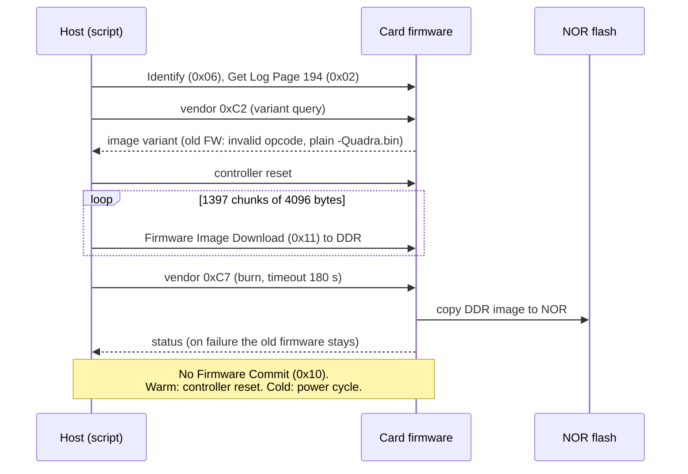

# NETINT Quadra VPU: how it works on Linux, and how to port it to FreeBSD

Audience: first-year students. Goal: understand what a "driver" is for this card, what we must record on Ubuntu, and how the FreeBSD port will look.

Test machine: HP EliteDesk, Ubuntu 26.04 (kernel 7.0), card `QuadraT1U-EP3` (PCI `0a:00.0`, ID `1d82:0401`).

**Local-only data:** the raw captures (`netint_quadra_captures/`: traces, identify dumps, results logs, golden hashes) and the helper tools (`netint_quadra_tools/`) are not in git; they stay on the author's Mac. Paths to them below refer to that local tree. The libxcoder port and the firmware upgrade tool are in the `freebsd` branch of https://github.com/ocochard/netint_libxcoder.

Facts marked **(verified)** were read from the machine or from the source code. Facts marked **(to verify)** are my expectation and must be checked before relying on them.

## 1. Vocabulary

| Term | Meaning |
|---|---|
| VPU | Video Processing Unit: a chip that encodes/decodes/scales video in hardware |
| PCIe | The bus the card is plugged into. The OS sees it as a PCI device (`lspci`) |
| NVMe | A standard protocol to talk to PCIe storage devices (SSDs) |
| Kernel driver | Code inside the OS kernel that talks to hardware |
| User-space library | Code in a normal program (no special privilege code in the kernel) |
| ioctl | A system call that sends a custom command to a device file such as `/dev/nvme1` |
| Firmware (FW) | Software that runs inside the card itself |
| libxcoder | NETINT's user-space library: it is the "driver" most people mean |

## 2. The big surprise: the card pretends to be an SSD

**(verified)** `lspci` shows the card as `Non-Volatile memory controller`, class `0108`, and the kernel binds the standard `nvme` driver to it. Linux creates `/dev/nvme1` (controller) and `/dev/nvme1n1` (namespace, a fake 8.59 TB disk). `nvme list` shows it next to the real boot SSD.

NETINT did not write a Linux kernel driver for video. The card speaks NVMe, so the existing kernel NVMe driver already handles: PCIe enumeration, memory mapping of registers (BARs), interrupts, queues, DMA. Video work is smuggled through NVMe commands.

```
 ffmpeg (NETINT fork)         <- user program, calls h264_ni_quadra_enc etc.
    |
 libxcoder  (ni_device_api.c) <- NETINT library: sessions, frames, packets
    |
 ni_nvme.c                    <- the ONLY layer that touches the OS
    |  ioctl() / pread() / pwrite() on /dev/nvme1 and /dev/nvme1n1
 Linux nvme driver (kernel)   <- generic, shipped with the OS
    |
 PCIe  ->  Quadra card (firmware runs encoders/decoders)
```

## 3. How libxcoder talks to the card

All **(verified)** in `netint_libxcoder/source/ni_nvme.c` and `ni_nvme.h`.

### 3.1 Admin commands (control path)

Linux ioctl `NVME_IOCTL_ADMIN_CMD` (`_IOWR('N', 0x41, ...)`) sends a raw NVMe admin command. Standard opcodes are used for identify (0x06), get log page (0x02), firmware download (0x11), firmware activate (0x10). NETINT also defines **vendor-specific opcodes 0xD0 to 0xDD**, named `nvme_admin_cmd_xcoder_open`, `_close`, `_query`, `_read`, `_write`, `_config`, `_identity`, `_load`, `_p2p_send`, and so on. NVMe reserves the 0xC0-0xFF range for vendors, so this is legal.

### 3.2 Data path: commands hidden in file offsets

Frames and bitstreams move with plain `pread()` / `pwrite()` on `/dev/nvme1n1`, buffers aligned to 4096 bytes. The trick: the **file offset** (the LBA) is not a disk position. It encodes what you want, see the macros in `ni_nvme.h`:

```
offset = HIGH_OFFSET_IN_4K(session_id, instance_type) + <function offset>
```

Examples: `WRITE_INSTANCE_W(sid, instance)` = "send a frame to session sid", `READ_INSTANCE_R` = "get the encoded packet", `QUERY_SESSION_R` = "ask status", `IDENTIFY_DEVICE_R` = "who are you". The card firmware decodes the address and acts. So a normal NVMe read is a function call.

Other paths:
- `NVME_IOCTL_IO_CMD`: raw NVMe I/O command (`ni_nvme_send_io_cmd_thru_admin_queue` for the admin-queue variant).
- Linux AIO (`io_submit`) for asynchronous transfers (`ni_aio_submit`).
- Optional: mmap of PCI BAR4 through `/sys/bus/pci/devices/<bdf>/resource4` (used in the upload code, `ni_device_api.c`).
- Optional: `/dev/netint`, a NETINT kernel module used only for peer-to-peer DMA with a GPU (`ni_p2p_*`). Not needed for basic encoding.

### 3.3 Resource manager (not hardware at all)

`init_rsrc`, `ni_rsrc_list`, `ni_rsrc_mon` keep a table of cards and load in POSIX shared memory (`/dev/shm/NI_SHM_CODERS`, `NI_LCK_*`). Several ffmpeg processes share the card through it. On FreeBSD this needs `shm_open()` equivalents; it is pure software and easy to port.

### 3.4 Version coupling

**(verified)** libxcoder refuses to use a card whose firmware has a different "FW API major version" (`ni_rsrc_priv.cpp`, `NI_XCODER_REVISION`). The library string `5406sJr2` means: SW 5.4.0, FW API `6sJ`, build r2. This is why firmware matters (section 6).

## 4. What is installed on Ubuntu now

Directory `~/netint/` on `elitedesk-ubuntu`:
- `netint_libxcoder` (public repo, tag `v5.4.0`, obsolete) and `Quadra_SW_V5.9.0_RC1/libxcoder` (from the NETINT download package, **the one installed in `/usr/local`**)
- `netint_ffmpeg` (tag `v5.9.0`, FFmpeg 7.1 base, built with `--enable-gpl --enable-ni_quadra`)
- `Quadra_FW_V5.9.0_RC1` (firmware images and upgrade script, from the download package)
- `captures/fw_31054rc6` (data recorded BEFORE the upgrade) and `captures/fw_5906tFr1` (after)

Status **(verified, 2026-11-06)**: working.
- The card shipped with firmware `31054rc6` (FW API major 5). Every public libxcoder tag needs API major 6, so `init_rsrc` refused it.
- Firmware upgraded to `5906tFr1` (loader 4.10.06) with `quadra_auto_upgrade.sh` (section 6), then one host reboot.
- `ni_rsrc_list` reports `F/W & S/W compatibility: yes`; decoders H.264/H.265/JPEG/VP9, encoders H.264/H.265/JPEG/AV1.
- `ffmpeg -c:v h264_ni_quadra_enc` encoded 501 frames of `1280x720p_Basketball.264` at about 17x real time, 0 errors. `h265_ni_quadra_enc` encoded 300 frames, 0 errors.
- Needs root: `/dev/nvme1` is `root:root` and `/dev/nvme1n1` is `root:disk`. Run with `sudo`, or add a udev rule / group.
- PCIe link runs at 8 GT/s although the card supports 16 GT/s (slot or board limit).

## 5. What the FreeBSD port is built from

Principle: **the libxcoder source is the specification** (every opcode, offset macro and struct layout is in `ni_nvme.h`, `ni_device_api.c`, `ni_device_api_priv.c`). Captures from Ubuntu are only there to check the port against, because the card firmware is closed and its behavior (timing, errors, retries) is not in the source.

### 5.1 Source: what to read, not record

- Opcodes and offset macros: `ni_nvme.h` ("read/write command macro", "control command macro"). The vendor opcodes 0xD0 to 0xDD are used to compute the LBA (`GAP(opcode)`), not sent as admin commands on the data path.
- Struct layouts sent in commands (little-endian, packed): `ni_session_context_t`, config structs, `ni_device_capability_t`.
- Alignment 4096 bytes, maximum transfer size from `mdts`.
- Every Linux-only API and its FreeBSD replacement: table in section 7.2.

### 5.2 Minimal Ubuntu captures (the golden set, done)

All under `netint_quadra_captures/` (local only, not in git), firmware 5906tFr1 unless noted. Keep these, do not add more unless the port needs a specific case.

| Capture | Path | Use |
|---|---|---|
| Old firmware identity, logs, features | `fw_31054rc6/` | Reference for what a pre-5.x card reports; `id-ctrl.bin`, `id-ns.bin` raw |
| Firmware upgrade sequence | `fw_5906tFr1/reflash/` | Exact commands for the FreeBSD upgrade tool (section 6.4) |
| 1-frame H.264 encode (open, frame, close) | `fw_5906tFr1/scenarios/02-enc-open-close-1frame/` | Smallest replay test, 142 card commands |
| 100-frame H.264 and H.265 encodes | `scenarios/03-...`, `04-...` | Steady-state data path |
| 10-frame H.264 decode | `scenarios/05-dec-h264-10frames/` | Decoder session |
| Hardware decode then encode | `scenarios/06-transcode-hw-dec-enc/` | Two sessions at once |
| Output bitstream MD5 | `fw_5906tFr1/outputs.md5` | Byte-identical check on the port |

Each scenario folder has `cmd.txt`, `strace.txt`, `nvme1-cmds.txt` (kernel NVMe trace: time, queue, opcode, SLBA, length), `summary-opcodes.txt`, `stdout.txt`. Tool: `netint_quadra_captures/capture.sh <name> <command...>` (ftrace `events/nvme` plus `strace -f`).

Known limits: scenario 01 (`ni_rsrc_list`) never touches the card (0 commands); scenario 07 was meant as an error case but ffmpeg just scaled to 64x64, so there is no real error capture.

### 5.3 What the traces show (decoded, verified)

- **Data path is plain NVMe Read and Write** at fixed SLBA regions; the SLBA is the request, `len` (0-based block count) is only the payload size. Region map, derived from `ni_nvme.h` (4 KiB units, low 19 bits; the high bits are `(session_id << 3 | instance_type)`, instance type 0 decoder, 1 encoder, 2 scaler, 3 AI): `0x20000` control (`op<<8 | sub<<4 | subtype`), `0x28000` read, `0x38000` write, `0x48000` load, `0x50000` write metadata, `0x58000` frame download.
- **Session lifecycle seen in scenario 02** (1-frame H.264 encode), in order:
  1. `QUERY_GENERAL_GET_STATUS_R`, `IDENTIFY_DEVICE_R` (the card is asked who it is)
  2. `OPEN_SESSION_W` (encoder instance 1)
  3. `CONFIG_SESSION_KeepAliveTimeout_W`, `CONFIG_SESSION_SWVersion_W`, `CONFIG_INSTANCE_SetEncPara_W` (the encoder parameters)
  4. `QUERY_INSTANCE_WBUFF_SIZE_R` (is there room), `CONFIG_SESSION_KeepAlive_W` (heartbeat thread)
  5. `CONFIG_INSTANCE_SetSOS_W` (start of stream), `WRITE_METADATA_W`, then the frame as `WRITE_INSTANCE_W` pieces of 32 blocks (128 KiB) at +0x20, +0x40, ...
  6. `QUERY_INSTANCE_CUR_STATUS_INFO_R` polls, `READ_INSTANCE_R` fetches the packet
  7. `CONFIG_INSTANCE_SetEOS_W` (end of stream), last reads, `QUERY_INSTANCE_STREAM_INFO_R`
  8. `CLOSE_SESSION_R`
- Decoder session (scenario 05) is the mirror: `CONFIG_INSTANCE_SetPktSize_W` and `WRITE_INSTANCE_W` push the bitstream, many `READ_INSTANCE_R` at +0x20 steps pull the frames.
- **Not libxcoder**: reads with `ctrl=0x8000` at SLBA 0, 1, 3, 4, ... and near the end of the disk come from `udev-worker`, `udev-synth` and `udisks` probing the fake disk (confirmed by task names in ftrace). Real libxcoder tasks are the ffmpeg encoder thread and `KAT...` (keep-alive thread). On FreeBSD the equivalent is `geom(4)`/`nda(4)` tasting the namespace: **expect it, and consider whether to avoid attaching the disk driver** (see 7.1).
- **Admin queue is nearly silent**: a few Identify commands only.
- **Several I/O queues** (q1, q2, q3, one per CPU). FreeBSD `nvme(4)` also creates one queue pair per CPU.

### 5.4 The decoder (written)

`netint_quadra_captures/decode_slba.py <path/to/ni_nvme.h> <nvme1-cmds.txt> [--summary]`.
- Reads region sizes, shifts, enum values and macro bodies from `ni_nvme.h` itself (nothing copied by hand), so re-running it with another libxcoder release re-derives the map.
- Output per scenario: `decoded.txt` (every command, by name) and `decoded-summary.txt` (counts), next to `nvme1-cmds.txt`.
- Remaining unnamed rows are 3 to 10 per scenario: SLBA 0, 1, 3 reads from udev/udisks (not tagged because they lack `ctrl=0x8000`), and a few sub-opcodes that map to several macros (listed with `/`, for example `SetDecPara/SetScalerPara/SetEncPara`: same address, different payload structs, so the instance type tells which).
- Use for the port: a FreeBSD run passes a scenario when its decoded sequence matches the Ubuntu one (same names, same order, same lengths) and the output MD5 matches.

## 6. Firmware upgrade

### 6.1 The tool

**(verified)** NETINT ships the firmware in a separate download package (not on GitHub), `Quadra_FW_Vx.y.z/`:
- `FL_BIN/nor_flash_v5.9.0_RC1-Quadra[-C|-E|-F|-G].bin`: images, one per "persistent configuration" variant. All carry the same revision.
- `quadra_auto_upgrade.sh` (Linux, bash): the recommended tool. It wraps `nvme-cli`.
- `firmware_upgrade_macos`, `firmware_upgrade_win.exe`: static tools taking a drive name and a `nor_flash.bin`.
- `quadra_fw_info <bin>`: prints revision and build info of an image.
- Release notes list upgrade rules (for example: no downgrade below 4.7.0 on cards with the new power subsystem, no T1M/non-T1M mixing).

### 6.2 What the script does

1. **Reset**: NVMe controller reset to start clean.
2. **Download**: write the image into the card's DDR (NVMe firmware download, opcode 0x11, chunked).
3. **Burn**: vendor command that copies the DDR image into the card's NOR flash. If this fails, the previous firmware stays in effect.
4. **Activate**: controller reset (warm upgrade) or power cycle (cold upgrade, needed when the firmware loader changes).
5. **Check**: read back the revision.

It auto-selects the image from the card's persistent-config letter (vendor admin opcode 0xC2, or log page 194 on newer firmware). Old firmware rejects 0xC2 ("Invalid Command Opcode"); the script then uses the plain `-Quadra.bin`. It refuses to run while video sessions are active.

### 6.3 What we did (2026-11-06)

```sh
cd ~/netint/Quadra_FW_V5.9.0_RC1
./quadra_auto_upgrade.sh -y --reboot_req_exit_code   # 31054rc6 -> 5906tFr1, "cold upgrade", exit 3
sudo systemctl reboot                                  # activates new loader and firmware
sudo init_rsrc                                         # libxcoder 5.9.0 now accepts the card
```

Log: `captures/fw_31054rc6/upgrade-run.log`. Pre-upgrade identify, log pages and features are saved in `captures/fw_31054rc6/`.

Safety notes:
- Do not interrupt power or the script during download and burn.
- Take the 5.1 captures before upgrading: identify data changes afterwards.
- Use only images for your model (`QuadraT1U-EP3` here). Wrong flavor or model is the way to brick a card.

### 6.4 Requirement: firmware upgrade must work from FreeBSD

The FreeBSD port is not complete if the card can only be flashed from Linux.

**Measured sequence (verified, 2026-11-06).** I re-flashed the same 5.9.0 image under `strace -f` and kernel ftrace `events/nvme`. Data: `netint_quadra_captures/fw_5906tFr1/reflash/` (`strace-upgrade.txt`, `ftrace-nvme.txt`, `nvme1-admin-cmds.txt`, `upgrade-run.log`). The whole upgrade is five `nvme-cli` calls, nothing else:

| Step | `nvme-cli` call | On the wire (admin queue) |
|---|---|---|
| Probe | `nvme id-ctrl`, `get-log -i 194` | Identify (0x06), Get Log Page (0x02, LID 0xC2 = 194, 48 bytes) |
| Variant | `nvme admin-passthru --opcode 0xc2 -n 1 --read --cdw12=0x90 -l 0x100` | vendor opcode 0xC2 (old FW answers "invalid opcode") |
| Reset | `nvme reset /dev/nvme1` | queues deleted and recreated, controller re-enabled |
| Download | `nvme fw-download -f <bin> -x 4096` | **1397 x Firmware Image Download (0x11)**, 4096 bytes each (NUMD=0x3ff, OFST in dwords, step 0x400). Last chunk 868 bytes (NUMD=0xd8, OFST=0x15d000 dwords). 1396.2 x 4096 = 5 718 884 bytes = the file size |
| Burn | `nvme admin-passthru --opcode 0xc7 -t 180000` | **one vendor admin command, opcode 0xC7**, no data, all cdw = 0, timeout 180 s |



Findings:
- There is **no Firmware Commit (0x10)**. The NVMe slot mechanism is not used. The image goes to DDR (0x11), then vendor 0xC7 tells the card to burn it into NOR flash.
- A cold upgrade needs a power cycle afterwards; the script does not reset after the burn. The host reboot in section 6.3 is that step.
- Everything the script does is reachable with generic admin commands, so FreeBSD needs only: identify, get log page, admin passthrough (0xC2, 0xC7), and Firmware Image Download.

Deliverables:

1. **Try stock tools first** (expected to fail, see 7.1b: the card does not advertise firmware download): `nvmecontrol firmware -f <bin> nvme1` sends 0x11 (but may also send Firmware Commit 0x10 if given `-s`/`-a`; test without those). `nvmecontrol` has no vendor-admin passthrough subcommand, so 0xC7 needs a small C tool using the `nvme(4)` passthrough ioctl **(to verify in `/usr/include/dev/nvme/nvme.h`: `NVME_PASSTHROUGH_CMD`, `struct nvme_pt_command`)**.
2. **A FreeBSD `quadra_upgrade.sh`** in POSIX `sh` (the Linux script uses bash arrays), calling `nvmecontrol`, the passthrough tool, `pciconf`.
3. **Match the chunk size**: 4096 bytes per download command, offsets in dwords. Check FreeBSD's default transfer size and that each chunk is not merged or split; compare with `nvme1-admin-cmds.txt`.
4. **Test matrix on FreeBSD** (always with a same-version image first): same-version re-flash then power cycle; check `ni_rsrc_list` on the Linux side afterwards; abort before 0xC7 (must leave the old firmware untouched); wrong-model image must be refused by the card.
5. **Recovery**: keep Ubuntu installed on this host so that a failed FreeBSD flash can be retried from Linux.

## 7. The FreeBSD side

### 7.1 What exists already

- FreeBSD has a native `nvme(4)` driver. It should attach to the card just like Linux does, because the card is a standard NVMe device. **(to verify)** Check `pciconf -lv` and `nvmecontrol devlist` on the FreeBSD install. Watch for oddities: a fake 8.59 TB namespace, a vendor-specific identify field, and a controller that may refuse some generic commands.
- `nvmecontrol(8)` can already do identify, logpage and firmware.
- On Linux, udev and udisks read the fake disk at SLBA 0, 1, 3, ... and near the end (section 5.3). FreeBSD `nda(4)`/`geom(4)` will do the same taste. These reads are harmless but add noise to traces; if they interfere, attach only the controller (`nvme(4)` without the namespace disk driver) and use the passthrough ioctl.
- User-space passthrough exists in FreeBSD's `nvme(4)` (ioctl `NVME_PASSTHROUGH_CMD` on `/dev/nvmeN` **(to verify in `/usr/include/dev/nvme/nvme.h`)**).

### 7.1b FreeBSD bring-up: result (verified 2026-11-06)

Host `elitedesk-fbsd`: FreeBSD 16.0-CURRENT (main-n290543), AMD A12-8870 (Carrizo), integrated Radeon GPU. Card firmware 5906tFr1.

**With stock settings the kernel panicked.** With the card inserted, the boot printed garbage and rebooted; attaching it later (`devctl enable nvme1`) panicked and corrupted the video. Panic in `softdep_process_journal`, preceded by `nvme0: cpl (cid = N) does not map to outstanding cmd` on the boot SSD (memory or queue corruption), and the dump to local swap never started.

**Root cause (strongly supported, not proven line by line):** the BIOS leaves the card's BARs as all-ones sizing patterns (unassigned). FreeBSD lets the parent choose, starting at `hw.pci.host_mem_start` (default `0x80000000`), and the card's registers landed at `0xd0000000`, inside the GPU's 8 MB register/doorbell BAR (`0xd0000000-0xd07fffff`). Controller registers read as zero, writes hit the GPU, and the GPU then corrupted memory. Linux placed the same BARs at `0xd0e00000` and `0xd0e04000`, away from the GPU.

**Fix:** `hw.pci.host_mem_start="0xd0d70000"` in `/boot/loader.conf` (loader tunable, above every address the GPU and other devices use). Result:
- BAR0 `0xd0e00000`, BAR2 `0xd0e04000`: exactly the Linux addresses.
- `nvme1` attaches at boot, `nda1` appears, `nvmecontrol identify` works: `QuadraT1U-EP3`, FW `5906tFr1`, NVMe 1.3, MDTS 16 MB, namespace 8192000 MB (4096-byte sectors).
- No panic, no video corruption, `nvme0` stays healthy.
- The 256 MiB prefetchable BAR (`BAR4`) still has no valid address (sizing pattern). Linux leaves it unassigned too. Only the optional upload path in libxcoder uses it.

**Debugging setup that made this possible** (keep it, the port will crash again):
- Crash dumps over the network: `rc.conf` `dumpdev="re0"`, `dumpon_flags="-Z -c 192.168.100.24 -s 192.168.100.2"`; `netdumpd` runs on `bigone` and stores dumps in its `/var/crash`. A local-swap dump failed because the swap is on the disk that was being corrupted.
- `debug.debugger_on_panic=0` in `/etc/sysctl.conf` (otherwise a panic stops at `db>` and never dumps).
- Kernel source cloned in `~/freebsd-src` on the host (check out `584f44221f45` to match the running kernel); `ccache` installed.

**Firmware upgrade impact (important for 6.4):** FreeBSD `nvmecontrol identify` reports `Firmware Activate/Download: Not Supported`. The card's `oacs` is `0x2` (Format NVM only). The vendor script still works on Linux because `nvme-cli` sends opcode 0x11 regardless. `nvmecontrol firmware` checks this capability bit and will probably refuse: plan for the passthrough tool (opcode 0x11 download, 0xC7 burn) from the start.

### 7.2 Strategy: port the user-space layer, not write a kernel driver

Because the card is "just NVMe", the plan is:

1. Keep the whole of libxcoder and ffmpeg unchanged.
2. Rewrite only the operating-system layer, `ni_nvme.c` and a few helpers, to use FreeBSD APIs.
3. Only if FreeBSD's `nvme(4)` cannot reach the vendor commands, write a small kernel module. Expected to be unnecessary.

Linux-only pieces and their FreeBSD replacement **(to verify each)**:

| Linux (libxcoder) | FreeBSD replacement |
|---|---|
| `ioctl(NVME_IOCTL_ADMIN_CMD, ...)` | **Same ioctl, same struct** (verified 7.6): FreeBSD `nvme(4)` implements the Linux-compatible ioctls. Define the struct locally (the header is kernel-only) |
| `ioctl(NVME_IOCTL_IO_CMD, ...)` | **Same ioctl, same struct** (verified 7.6), on `/dev/nvme1n1` |
| `pread/pwrite` on `/dev/nvme1n1` with magic offsets | **Same call on `/dev/nvme1n1`** (verified for reads, 7.6; writes not tried yet) |
| Linux AIO `io_submit` | `aio_read/aio_write` (POSIX AIO) or a thread pool |
| `/dev/shm/NI_*`, `mmap` | `shm_open()` + `mmap()` (names must start with `/`) |
| `/sys/block/.../device/address`, `/sys/class/block` | `pciconf -l`, `nvmecontrol devlist`, or `sysctl dev.nvme.N.%pnpinfo` |
| `/sys/bus/pci/.../resource4` mmap | `/dev/mem`-style access or `pci(4)` ioctl; only for optional upload path |
| `posix_memalign` | same, available |
| `/dev/netint` P2P module | skip (optional feature) |
| `#include <linux/nvme_ioctl.h>`, `<libaio.h>` | `<dev/nvme/nvme.h>`, `<aio.h>` |

Build notes: use `make` (BSD make) for tools; libxcoder itself uses a GNU-style `Makefile`/`build.sh`, so install `gmake` or write a `Makefile.bsd`.

### 7.3 Step plan

1. Ubuntu done (firmware upgraded, ffmpeg encoding). Record everything in section 5, including the firmware upgrade trace (6.4).
2. Install FreeBSD (dual boot). Confirm `nvme(4)` attaches; run `nvmecontrol identify nvme1` and diff against `id-ctrl.bin` from Ubuntu. They must match.
3. Port `ni_rsrc_*` (shared memory) first: easy win, `ni_rsrc_list` runs.
4. Port `ni_nvme.c`: identify through passthrough. Compare bytes to the Ubuntu capture.
5. Port open/close session, then one frame decode, then one frame encode. After each step, compare the opcode/offset sequence with the Ubuntu strace table.
6. Build NETINT ffmpeg on FreeBSD, run the regression clips from section 5.4.
7. Port the firmware upgrade procedure (6.4) and validate with a same-version re-flash.
8. Send the patch upstream (libxcoder GitHub) or keep it as a FreeBSD port (`multimedia/`).

### 7.4 Risks

- NETINT licensing: check the libxcoder `LICENSE` before publishing a port; the firmware itself is closed.
- Firmware API changes between releases: pick one libxcoder tag and one matching firmware, stay on them until the port works.
- FreeBSD `nvme(4)` may split or reject transfers that exceed `mdts`, or treat the weird namespace unexpectedly.
- Debugging is harder on FreeBSD than Linux (no `trace-cmd`): rely on `ktrace`/`truss`, DTrace (`nvme` provider) and the Ubuntu captures as ground truth.

### 7.6 Passthrough tool and first protocol check (verified 2026-11-06)

Tool: `netint_quadra_tools/nvmept.c` (build: `cc -O1 -Wall -o nvmept nvmept.c`, run as root on `elitedesk-fbsd`). Commands: `ident`, `admin DEV OPC CDW10 [LEN]`, `ioread DEV SLBA [NLB]`, `pread DEV SLBA [NLB]`. It defines `struct nvme_passthru_cmd` exactly as libxcoder's `ni_nvme.h` does for Linux.

Results:
- **Linux-compatible admin ioctl works** (`NVME_IOCTL_ADMIN_CMD`, `'N' 0x41`) with libxcoder's 72-byte struct layout. Identify Controller returns: VID `0x1d82`, SN `Q1U23AA11DC074-0108`, MN `QuadraT1U-EP3`, FR `5906tFr1`, VER `0x10300`, MDTS 12, OACS `0x2`, FRMW `0x4`: identical to the Ubuntu baseline.
- **Plain `pread` on `/dev/nvme1n1` works** and so does the I/O ioctl (`NVME_IOCTL_IO_CMD`, NVM Read 0x02). At SLBA `0x20910` (libxcoder's `IDENTIFY_DEVICE_R`, see `QUERY_GENERAL_GET_STATUS_R`/identify in the Ubuntu trace) both return the same 4096 bytes: the card's own identity page (`1d82 1d82`, serial, model, firmware string at offset 0x40). Saved as `netint_quadra_captures/freebsd_fw5906tFr1/identify_device_r_slba0x20910.hex`.
- The vendor-specific "read at a magic LBA" path is therefore reachable from FreeBSD with the same system calls as Linux. **The port of `ni_nvme.c` is mostly: widen `#ifdef __linux__` to also cover `__FreeBSD__` for the ioctl struct and numbers, and replace Linux AIO, `/sys` lookups and shared memory.**
- Not tested yet: writes (the frame upload path), vendor admin opcodes (0xC7 burn, 0xC2), AIO replacement, a full encode.
- Still to do for the identity page: compare it byte-for-byte with the same read on Ubuntu (`dd if=/dev/nvme1n1 bs=4096 skip=$((0x20910)) count=1 | hexdump -C`); some fields may be live counters.

### 7.7 libxcoder port, step 1: builds and detects the card (verified 2026-11-06)

Patch: commits `c8ab10b` and `bc060d3` on the `freebsd` branch of https://github.com/ocochard/netint_libxcoder (branch `freebsd`), on top of the unmodified 5.9.0 release (24 files, about 136 lines added for the first commit). Build helper: `netint_quadra_tools/fbuild.sh`. Build on FreeBSD with `bash ./configure && gmake all` (needs `gmake` and `bash` from pkg).

Changes made:
- `ni_defs.h`: new `__FreeBSD__` branch: same types as the macOS branch (no Linux AIO), plus `DEFAULT_IO_TRANSFER_SIZE` and `MAX_IO_TRANSFER_SIZE`.
- All generic `#if __linux__ || __APPLE__` guards now also accept `__FreeBSD__` (about 60 sites, mechanical).
- `ni_nvme.h` / `ni_nvme.c`: the Linux NVMe passthrough structs, ioctl numbers and the two pass-through helpers are enabled on FreeBSD (adds `__u8..__u64` typedefs and `<sys/ioccom.h>`). Nothing else in the NVMe path changed: the existing `#else` branch of `ni_nvme_send_admin_cmd` / `ni_nvme_send_io_cmd` is the Linux ioctl code.
- `ni_rsrc_priv.h`: `LOCK_DIR` is `/tmp` on FreeBSD (no `/dev/shm`), same as macOS.
- `ni_rsrc_priv.cpp`: `shm_open`/`shm_unlink` wrappers adding the leading `/` that FreeBSD requires (Linux maps bare names to `/dev/shm`); `jmp_buf` became `sigjmp_buf`; the remove-all sweep also unlinks the shm object explicitly.
- `init_rsrc.c`: FreeBSD branch calls `ni_rsrc_init()`. Before this the program compiled and silently did nothing: **expect more dead branches of this kind**, see below.
- `ni_libxcoder_dynamic_loading.h`: `ni_quadraprobe` symbols only on Linux (that tool reads PCI sysfs).
- `Makefile`: FreeBSD link flags (`-lexecinfo`, no `-lrt -ldl`).

Result: `init_rsrc` prints `Initialized /dev/nvme1n1 with FW API v6.tF`, and `ni_rsrc_list` prints the full device report (serial, model, firmware 5906tFr1, `F/W & S/W compatibility: yes`, decoder and encoder capabilities). Output saved in `netint_quadra_captures/freebsd_fw5906tFr1/ni_rsrc_list.txt`.

### 7.8 libxcoder port, step 2: dead-branch audit, decode and encode work (verified 2026-11-06)

**Dead-branch audit** (sites where FreeBSD matched neither the `__linux__` nor the `__APPLE__` branch). Fixed:
- `ni_device_api.c`: max I/O size uses the fixed constant (no `/sys`), and the device is opened with `O_DIRECT` like Linux (FreeBSD defines it). `F_NOCACHE` stays macOS-only.
- `ni_device_api_priv.c`: the keep-alive thread now blocks signals and tries `SCHED_RR` through `pthread_setschedparam` (same fallback to nice as Linux), and sets its name with `pthread_set_name_np`. P2P (sysfs PCI lookup, NETINT GPU driver) is compiled out: P2P sessions fail cleanly.
- `ni_rsrc_update.c`: `DEV_NAME_PREFIX` is `/dev/nvme`.
- `init_rsrc.c`: fixed earlier (7.7).

Checked and correct as they are (FreeBSD falls into the generic `#else`): `ni_find_blk_name` and the second discovery routine in `ni_util.c` (block name = device name), `ni_rsrc_api.cpp` device-name regexes (`nvme` pattern matches `/dev/nvme1n1`), and the three best-effort prechecks in `ni_util.c` (they return "cannot determine", by design).

Left on purpose, Linux only for now: `mallopt(M_MMAP_THRESHOLD)`, CPU affinity (off by default), `ni_host_ts`, `ni_quadraprobe`, and the `ni_rsrc_mon` log and sysfs helpers. **Not yet read one by one**: remaining `#ifdef __linux__` blocks in `ni_rsrc_api.cpp`, `ni_rsrc_priv.cpp`, `ni_rsrc_namespace.c`, `ni_rsrc_update.c`, `ni_lat_meas.c` and `ni_rsrc_mon.c`. They compile and are not hit by the decode/encode demos.

**Results on the card from FreeBSD** (log: `netint_quadra_captures/freebsd_fw5906tFr1/libxcoder-demo-results.txt`):
- `ni_xcoder_decode` of `1280x720p_Basketball.264`: 501 frames in, 501 out, 0 errors, 408 fps, output size exactly 501 x 1382400 bytes.
- `ni_xcoder_encode` of that YUV: H.264 501 frames, 0 errors, 521 fps, 8 423 735 bytes; H.265 501 frames, 0 errors, 504 fps, 8 057 241 bytes. The H.264 stream starts with a valid High-profile SPS and the card decodes it back to 501 frames.
- So the whole data path works unchanged: session open, config, frame upload by `pwrite`, packet read by `pread`, keep-alive thread, close.

Still open:
- Byte-for-byte comparison against Ubuntu using the same demo and parameters (needs a Ubuntu boot), and the decoded command sequence comparison (`ktrace`/`kdump` on FreeBSD shows the `pread`/`pwrite` offsets, which are SLBA x 4096).
- Hardware upload (`-u`), multiple sessions at once, scaler, AI sessions (AIO path), decode of HEVC/VP9.
- The `/sys` and `/proc/self/fd` lookups that compile but cannot work: block device size, serial, NUMA node. Not hit so far.
- Firmware upgrade tool (6.4) and the NETINT FFmpeg fork on FreeBSD.

### 7.9 FreeBSD vs Ubuntu command sequence (verified 2026-11-06)

Method: `ktrace -i -t c` on `ni_xcoder_encode` (1 frame, 1280x720 H.264), `kdump -T`, then `netint_quadra_tools/kdump2cmds.py` (SLBA = `pread`/`pwrite` offset / 4096) and `decode_slba.py`. Data: `netint_quadra_captures/freebsd_fw5906tFr1/scenarios/02-enc-1frame/` (`kdump.txt`, `nvme1-cmds.txt`, `decoded.txt`, `compare-with-ubuntu-scenario02.txt`).

- 52 card commands, **all decoded by name, 0 unknown** (no udev noise: FreeBSD did not taste the disk during the run).
- The session lifecycle is identical to Ubuntu scenario 02, same order: `IDENTIFY_DEVICE_R`, `OPEN_SESSION_W`, `CONFIG_SESSION_KeepAliveTimeout_W`, `CONFIG_SESSION_SWVersion_W`, `SetEncPara`, `QUERY_INSTANCE_WBUFF_SIZE_R`, `CONFIG_SESSION_KeepAlive_W`, `SetSOS`, `WRITE_METADATA_W`, frame `WRITE_INSTANCE_W`, `SetEOS`, polls, `READ_INSTANCE_R`, `CLOSE_SESSION_R`. First two accesses are byte-identical in address: `0x20910000` (identify) and `0xa0000000` (open).
- Differences, all expected:
  - Number of status polls (`QUERY_INSTANCE_CUR_STATUS_INFO_R`, `QUERY_SESSION_R`): timing.
  - Session id assigned by the firmware (`sid` 0x4 here, 0x0 there).
  - **Frame upload**: Linux sends the frame in pieces of 32 blocks (128 KiB) at `WRITE_INSTANCE_W+0x20`, `+0x40`, ...; FreeBSD sends it as **one** `pwrite` of 338 blocks (1.38 MB). The chunk size comes from `ni_get_kernel_max_io_size()` on Linux (a `/sys` value) and from the fixed `MAX_IO_TRANSFER_SIZE` on FreeBSD. The card accepted both (0 errors, output decodes).
  - Ubuntu used ffmpeg and FreeBSD the libxcoder demo, so this is not yet a like-for-like run.
- Still to do for a strict check: run the same demo with the same input on Ubuntu and compare the output hashes.

### 7.10 NETINT FFmpeg on FreeBSD: results (verified 2026-11-06)

Build on `elitedesk-fbsd`: libxcoder from the `freebsd` branch installed with `gmake install` (needs `PKG_CONFIG_PATH=/usr/local/lib/pkgconfig`, since FreeBSD's `pkgconf` does not search `lib/pkgconfig`), then the fork at tag `v5.9.0` with `./configure --enable-gpl --enable-ni_quadra --disable-ni_logan --enable-pthreads --disable-doc --disable-ffplay --extra-cflags=-I/usr/local/include --extra-ldflags=-L/usr/local/lib` and `gmake -j4` (about 8 minutes cold on this 4-core A12-8870; consider building on `bigone` and copying). `ffmpeg -encoders/-decoders` list `h264/h265/av1/jpeg_ni_quadra_enc` and `h264/h265/jpeg/vp9_ni_quadra_dec`. Log: `netint_quadra_captures/freebsd_fw5906tFr1/ffmpeg-results.txt`.

Same commands, same inputs as Ubuntu:
- **H.264 encode** (`-b:v 2M`, Basketball clip, 501 frames): 8 424 467 bytes, md5 `9281925b8d4c4ee14312a7dce32dd978`, **identical to Ubuntu**.
- **H.265 encode** (akiyo, 300 frames): md5 `1b0784bf8230f58c39b4ab5186391118`, **identical to Ubuntu**.
- Hardware decode H.264 (501 frames) and H.265 (300 frames): 0 errors, 0 corrupted, about 430 fps. Hardware decode then hardware H.265 encode: 501 frames, 0 errors.
- Two sessions at once (H.264 and H.265 encodes in parallel): both succeed, outputs identical to the single runs.

So, for these workloads, the FreeBSD stack produces byte-identical bitstreams to the Linux stack on the same card and firmware. Hardware upload and scaler (same log):
- `ni_quadra_hwupload` then H.264 encode: **byte-identical** to the plain encode (`9281925b...`); the libxcoder demo with `-u` is also identical to the same demo without it.
- `ni_quadra_scale=640:360` after upload, and after hardware decode: both give valid 640x360 H.264, 501 frames, 0 errors. The hardware decode must emit hardware frames (`-xcoder-params out=hw`); without it the scaler fails with `Function not implemented` (usage, not a port bug). The two chains differ by a few hundred bytes (software decode + upload vs card decode): not investigated.
- libxcoder demo `ni_xcoder_scale` (1280x720 to 640x360): works and is deterministic, but writes 502 frames for 501 input (frame 502 is an exact copy of frame 501, apparently a demo end-of-stream quirk; not checked on Linux).

Not yet covered: AV1 and VP9, AI sessions (the Linux AIO path is not ported), the other filters (overlay, pad, crop, ...), long runs and error cases. The framemd5 hashes of the decode tests and the scaler outputs have no Ubuntu reference yet (record them on Ubuntu to compare). The scaler demo duplicates its last frame (not yet explained; check against Ubuntu).

### 7.11 AI engine and POSIX AIO (verified 2026-11-06)

**What it is.** The card has a fourth block next to decoder, encoder and scaler: the AI engine (`AI #0` in `ni_rsrc_list`, operations ROI and background replace on this firmware). It runs neural-network models (`.nb` network binaries, examples in the NETINT package under `tools/AI_benchmarking_examples/`). FFmpeg filters using it: `ni_quadra_hvsplus`, `ni_quadra_ai_pre`, `ni_quadra_roi`, `ni_quadra_bg`, `ni_quadra_bgr`.

**AIO.** libxcoder sends an AI input frame described by several memory segments (`ni_iovec_t`, at most `NI_MAX_SEGMENT_NUM` = 4 per batch) with one batched asynchronous write using Linux `io_setup`/`io_submit`. That path is only taken when the calling application passes more than one iovec to `ni_ai_session_write()` (custom neural-network integrations); the FFmpeg AI filters and the libxcoder demos do not use it. FreeBSD has no Linux AIO syscalls but has POSIX AIO (`aio(4)`: `aio_read`, `aio_write`, `lio_listio`), which maps directly:
- `struct iocb` becomes `struct aiocb` (`aio_lio_opcode` is `LIO_READ`/`LIO_WRITE`);
- `io_submit` plus `io_getevents(min_nr = nr)` becomes `lio_listio(LIO_WAIT, ...)` then `aio_error`/`aio_return` per request (a batch of 4 is under `AIO_LISTIO_MAX` = 16);
- `io_setup`/`io_destroy` have no equivalent and are no-ops.
Patch: commit `bc060d3` on the `freebsd` branch of https://github.com/ocochard/netint_libxcoder (branch `freebsd`) (4 files, +100/-6, on top of the first FreeBSD commit `c8ab10b`).

**Tested:**
- `netint_quadra_tools/aio_selftest.c` (read-only): a batch of 4 reads of the identity page through the new functions is byte-identical to plain `pread`; an out-of-range read fails cleanly (EIO, return code -4).
- AI engine through FFmpeg: `hwupload`, `ni_quadra_hvsplus`, hardware H.264 encode, 60 frames, 0 errors, valid 1280x720 H.264. This used the AI session but not the batched AIO write (ktrace shows only `pread`/`pwrite`).

- Other AI filters, 465-frame 1080p H.264 clip, all outputs valid and frame-complete (`netint_quadra_captures/freebsd_fw5906tFr1/ai-filter-results.txt`): `ni_quadra_ai_pre` with `ai_pre_process_demo.nb` (~128 fps), with `hw_bicubic_network_binary.nb` 1080p to 720p (~241 fps), `ni_quadra_scale` + `ni_quadra_ai_pre` with `GentleAIEnhance_1280x720.nb` (~304 fps), `ni_quadra_roi` with the YOLOv4 head model (~91 fps).
- `ni_quadra_bg` with `segm32_tflite_nchw_bgr.nb`: segfault when neither `bg_img=` nor `use_default_bg=1` is given (usage error in the filter, not checked against Linux); with either option it produces the 40-frame output but logs `ni_decoder_session_copy_internal(): passed parameters are null`. Not yet compared with Linux.

**Not tested:** the batched AI write itself with real multi-segment frames (needs a custom application that loads a network binary and sends several iovecs), `ni_quadra_bgr`, whether ROI output really differs from a plain encode, the `bg` error message against Linux, and `LIO_WRITE` on the card (the self test is deliberately read-only: a write to the wrong SLBA is a command to the card).

### 7.12 Real movies: decode correctness and speed (verified 2026-11-06)

Files: three 2160p films in `~/movies` on `elitedesk-fbsd`. Script: `netint_quadra_tools/movie_decode_test.sh` (decodes N frames on the card and in software, compares frame md5; run it with `sudo env FFMPEG=...` because `sudo` changes `$HOME`). Log: `netint_quadra_captures/freebsd_fw5906tFr1/movie-decode-results.txt`.

- **HEVC Main 10, 4K, HDR10 (BT.2020, PQ):** card and software decoders give **identical frame hashes** over 120 frames, 0 errors.
- **H.264 High, 4K:** identical hashes over 120 frames, 0 errors.
- **AV1 10-bit:** cannot be decoded here. The card has no AV1 decoder (it encodes AV1 only) and this ffmpeg build has no software AV1 decoder.
- **Speed** (480 frames, no hashing): with the decoder copying frames back to system memory (default) HEVC 4K 10-bit runs at 74 fps on the card vs 32 fps on the 4-core CPU, and H.264 4K at 76 fps vs 63 fps. With frames kept on the card (`-xcoder-params out=hw`) HEVC reaches **152 fps** (2.0x) and H.264 94 fps (1.24x). Four HEVC streams at once: about 375 fps aggregate with `out=hw`, about 135 fps with the copy back. 135 fps of 18.8 MB frames is about 2.5 GB/s, which matches the practical limit of the card's PCIe x4 link at 8 GT/s (the card supports 16 GT/s but the slot or board runs 8). So the copy back over the PCIe link is the bottleneck, not the decoder. Wall times have 1 s resolution, aggregates are approximate.

Lesson from the test setup: a pass criterion must fail on an empty result (my first script reported "identical" for 0 frames), `ffmpeg` in a script needs `-nostdin`, and FreeBSD `date` has no `%N`.

### 7.13 Firmware upgrade tool for FreeBSD (written and run 2026-11-06)

Files in `freebsd/tools/` of the `freebsd` branch of https://github.com/ocochard/netint_libxcoder (branch `freebsd`), commit `34db737`: `nvmefw.c` (build: `cc -O1 -Wall -o nvmefw nvmefw.c`), `quadra_fw_upgrade.sh` (safe wrapper, POSIX `sh`) and a README. It reproduces the measured Linux sequence of 6.4: controller reset, 1397 Firmware Image Download commands (opcode 0x11, 4096 bytes each, `cdw10` = dwords - 1, `cdw11` = byte offset / 4), then the vendor burn `0xC7` with a long timeout; the new firmware runs after a power cycle.

Design findings from the `nvme(4)` source, which shaped the tool:
- **Use the native ioctl, not the Linux-compatible one.** The Linux-compatible `NVME_IOCTL_ADMIN_CMD` handler (`nvme_npc_done`) stores only `cdw0` and never the NVMe completion status: a failed command returns 0 and looks like success. `NVME_PASSTHROUGH_CMD` returns the whole completion entry, so every download chunk and the burn are checked. (The earlier `nvmept` read tests used the compatible ioctl; they were verified by comparing data, not status.)
- **Timeout.** The native ioctl has no per-command timeout; admin commands get `dev.nvme.N.admin_timeout_period` (default 60 s), after which the driver resets the controller. The burn took up to about 69 s on Linux, so the wrapper raises it to 120 s (the maximum; the sysctl is writable at runtime) and restores it on exit. The Linux-compatible ioctl would honour `-t 180000`, but without status.
- **Direction quirk (observed, harmless on amd64):** the Linux-compatible path derives the DMA direction from `opcode & 1`, which is not how NVMe encodes it (bits 1:0). The native ioctl takes an explicit `is_read`; the tool sets 0 for the download (host to controller).

Pre-flight results (read-only):
- `nvmefw info` and `check` read the card and the image correctly (image revision from offset 1048580 as in NETINT's script; minimum size 1048704).
- **`nvmefw plan` equals the Linux upgrade command for command**: 1397 download commands with identical `cdw10`/`cdw11`, covering exactly the 5 718 884 bytes of the image, plus one all-zero burn (checked against the ftrace of the working Linux run).
- Wrapper dry run (`-n`): idle card plans cleanly; refuses while a process has the card open (names it); refuses `/dev/nvme0` (the boot SSD, not a NETINT device); refuses a truncated image.

**Same-version flash run on the card (from FreeBSD, detached with a log: `netint_quadra_captures/freebsd_fw5906tFr1/firmware-upgrade/same-version-flash.log`):** controller reset OK after 1 s, all 1397 download chunks accepted (status checked on each), burn OK after **70 s** (Linux: about 69 s), admin timeout restored to 60 s. After a host reboot the card is detected as before (`nvmefw info`: FR `5906tFr1`; `ni_rsrc_list`: loader 4.10.06, firmware 5906tFr1 in flash and running, compatibility yes), and the regression hashes are unchanged: H.264 encode `9281925b...`, H.265 encode `1b0784bf...`, hardware decode framemd5 `e6985207...`.

**What this does not prove:** with the same version, a burn that wrote nothing would look identical. A real version change (upgrade or downgrade) has not been tried: only the 5.9.0 images are available here. Downgrades have vendor restrictions (see the firmware release notes). The tool also does not read the flash back to verify it. Image selection (`-Quadra.bin` vs `-C/-E/-F/-G`) is not automated: the card's persistent-configuration letter comes from opcode 0xC2 or log page 194, which this firmware rejects, so the plain image applies, as on Linux.


### 7.14 GStreamer (verified 2026-11-06)

NETINT does not fork GStreamer for the plugin: the package has `ni-gstreamer-plugins/` (a meson project, plugin `niquadra`, elements such as `niquadrah264dec`, `niquadrascale`, `niquadraroi`) plus optional framework patches `gstreamer-1.xx.x_netint_*.diff` (not needed for the plugin: meson option `ni-gst-framework-patch` defaults to false).

**FreeBSD result: builds unmodified against the pkg GStreamer 1.28.8 and works.** Build: `pkg install meson ninja gstreamer1-plugins gstreamer1-plugins-bad`, then `PKG_CONFIG_PATH=/usr/local/lib/pkgconfig meson setup build -Dniquadra=enabled -Dnilogan=disabled && ninja -C build` (libxcoder's `xcoder.pc` lives in `/usr/local/lib/pkgconfig`). Run with `sudo env GST_PLUGIN_PATH=<build>/niquadra gst-launch-1.0 ...`.

Tested on the 465-frame 1080p clip, all outputs frame-complete (plus the demos `demo_ni_scale`: resolution switches 1080p to 720p at frame 150, and `demo_ni_stack`: a third input is added at frame 100, both as designed): decode to HEVC encode (2.8 s), hardware scale to 720p, ROI (YOLOv4), AI pre-processing. Hardware filters need the decoder property `xcoder-params=out=hw` and caps `video/x-raw(memory:NiQuadraMemory)`, as with FFmpeg's `out=hw`; without it the link fails with `not-negotiated`. Details: `netint_quadra_captures/freebsd_fw5906tFr1/gstreamer-results.txt`.

`demo_ni_ppu` (one decode, three scaled outputs, parameter change at frame 100: third output switches 640x360 to 720x480), `demo_decodebin` and `demo_seek` also work. `demo_ni_ppu` outputs end 2 frames short of the 465 input frames only when the parameters change mid-stream (without a change all three outputs have 465 frames); not compared with Linux.

**Not tested:** `bg`/`bgr`/`overlay` elements, the patched GStreamer and its NETINT video formats, Logan plugins.

## 8. What is inside the card (firmware static analysis, 2026-11-07)

Goal of this chapter: understand what chip the card is built around and what its firmware looks like, by taking apart the upgrade image from chapter 6. Read-only: nothing here was flashed or sent to a card. Work was done in a scratch dir, not in git.

### 8.1 The chip: Codensity G5, an ASIC

**(verified)** The card is built on NETINT's **Codensity G5 ASIC**. The firmware reports the NVMe model string `CODENSITY-T400`, and the release notes call it "Quadra RevA ASIC Firmware Loader". ASIC = Application-Specific Integrated Circuit: the logic is etched into fixed silicon at the factory.

This matters for anyone hoping to repurpose the board:

| | FPGA | ASIC (this card) |
|---|---|---|
| What the silicon is | reconfigurable logic; a bitstream *becomes* the circuit | fixed gates, etched once |
| Can you change the hardware function? | yes, load a new bitstream | no |
| Can you change the software? | yes | yes, the CPU cores run firmware |

So you can write new *code* for the on-chip CPUs, but you cannot add a hardware function the silicon does not already have. The datapaths here are wired for H.264/H.265/AV1 transcode (motion estimation, DCT, entropy coders) plus DDR/PCIe/NoC fabric. There is no general-compute or crypto fabric to retarget. Running an unrelated workload (for example a hashing algorithm) would fall back to the handful of general-purpose cores as plain software, which is orders of magnitude slower than a chip designed for that task and pointless in practice. A video ASIC transcodes video; that is the one thing its silicon does well.

### 8.2 The CPU cores: Xtensa running FreeRTOS

**(verified)** The firmware is **Cadence/Tensilica Xtensa**, 32-bit little-endian, windowed ABI, built with Cadence's XCC compiler and running **FreeRTOS**. Evidence:
- Reset stub decodes cleanly as Xtensa: `entry a1,32` / `l32r` / `callx8` / `retw.n`, with a literal pool in front of the code (the Xtensa idiom).
- Ghidra (processor `Xtensa:LE:32:default`) found 1085 functions at ~50% code coverage with coherent control flow on the main image. The same bytes decoded as ARM-Cortex or RISC-V gave near-zero valid functions.
- Build path string: `.../FreeRTOS/Source/portable/ThirdParty/XCC/Xtensa/portclib.c`.

Not determined without NETINT/Cadence tooling: the exact Xtensa core variant (LX6/LX7) and any custom TIE/FLIX instruction extensions (a few opcodes in the video/AI cores did not decode, which is the usual sign of custom instructions).

### 8.3 The flash image is layered and signed, not encrypted

**(verified)** `nor_flash_*.bin` — it is a **raw NOR flash image**. Intel HEX text appears *inside* the partitions, and every partition except the first-stage loader is **LZ4-compressed** (raw LZ4 block). Nothing is encrypted: all code decompresses to plaintext with readable strings.

Boot chain and layout:

| Flash offset | Content | Notes |
|---|---|---|
| 0x002000 | NOR control table | version, slot pointers |
| 0x004000 | persistent config (`FACE1234` magic) | the per-variant `-C/-E/-F/-G` data |
| 0x010000 | **FL1** first-stage loader | header magic `0xBEEF1234`, uncompressed Intel HEX |
| 0x020000 | **FL2** firmware loader | magic `0xCAFE0F12`, LZ4; does DDR/PCIe/NoC bring-up |
| 0x100000 | **FW slot 1** ("NVMe" management core + "other cores") | magic `0xA5F0CAFE`, LZ4 |

Each region carries a **256-byte RSA-2048 signature over a SHA hash**, verified *by firmware already on the card* at commit time, not by the upgrade script. Strings: `Fail to verify RSA2048 OtherCores image`, `RSA verify result %d. FW_IMG_{FL1,FL2,NVME,OTHER_CORES,...}_HASH_ERROR`. This is the "signature of the FW binary" the upgrade script (6.1) refers to: a bad or modified image is rejected as "firmware image specified for activation is invalid". The signing key is NETINT's, so custom firmware cannot be loaded without it. Defeating this was out of scope and not attempted.

The `-C/-E/-F/-G` variants: FL1 and FL2 are byte-identical across all five images; base/C/G are the same code built at different times; E/F are a separate build configuration (a different board SKU). The per-variant difference lives in the control table and persistent config, not the code.

### 8.4 Takeaway for custom use

The supported way to get custom behaviour out of this card is NETINT's SDK (libxcoder / the FFmpeg fork, chapters 3-7): you drive the codec, you do not replace the firmware. Replacing the firmware with your own build is blocked by signed boot; repurposing the silicon for a non-video workload is blocked by it being an ASIC. The decompressed Xtensa images load into Ghidra (`Xtensa:LE:32:default`, raw binary, one block per segment at its load address) if you want to study how the firmware itself works.

## 9. References

- NETINT docs: https://docs.netint.com/vpu/quadra/
- libxcoder: https://github.com/NETINT-Technologies/netint_libxcoder
- ffmpeg fork: https://github.com/NETINT-Technologies/netint_ffmpeg
- NVMe base specification (admin command set, firmware commit/download): nvmexpress.org
- FreeBSD: `nvme(4)`, `nvmecontrol(8)`, `pciconf(8)`, `shm_open(2)`, `aio(4)`
- Custom AI filter (HDR to SDR tonemap on the NPU): [netint/ai/README.md](../../netint/ai/README.md)
