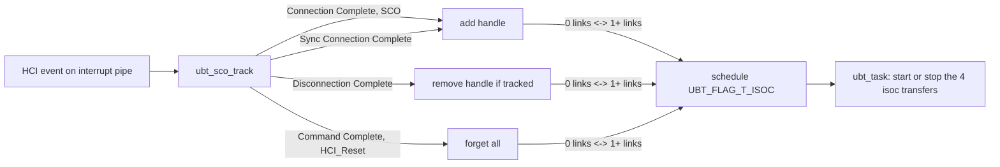

# ng_ubt: run SCO transfers only while a SCO link is open

Patch: [ng_ubt_sco_on_demand.patch](ng_ubt_sco_on_demand.patch),
branch `olivier-ubt-sco`, based on FreeBSD main 563c2f27e0ff (2026-11-16).
Machine: Beelink SER6, Intel AX200 Bluetooth (USB 8087:0029), see [../Beelink.SER6.md](../Beelink.SER6.md#interrupt-rates-at-idle).

## Background

### Bluetooth over USB

A USB Bluetooth adapter speaks HCI (Host Controller Interface): the host sends commands, the adapter answers with events.
The USB transport (Bluetooth Core Specification, Volume 4, Part B) maps each HCI channel to USB endpoints:

| Data | USB transfer | Interface | `ng_ubt` transfer |
|---|---|---|---|
| HCI commands | control | 0 | `UBT_IF_0_CTRL_DT_WR` |
| HCI events | interrupt IN | 0 | `UBT_IF_0_INTR_DT_RD` |
| ACL data (keyboards, mice, files, A2DP music) | bulk IN/OUT | 0 | `UBT_IF_0_BULK_DT_RD/WR` |
| SCO data (headset voice, HSP/HFP calls) | isochronous IN/OUT | 1 | `UBT_IF_1_ISOC_DT_RD1/RD2/WR1/WR2` |

Interface 1 has several alternate settings. Setting 0 has no bandwidth; the others reserve more bandwidth for more voice channels.

An isochronous transfer is a stream of fixed-size slots, one per USB frame (1 ms at full speed).
The host controller completes them whether or not there is data, and the driver resubmits them.
So a running isochronous transfer costs CPU interrupts even when nothing is sent.

### SCO links

A SCO (or eSCO) link is a voice channel to a headset or phone. It exists only during a call.
The adapter reports its life cycle as HCI events, on the interrupt endpoint:

- Connection Complete (event 0x03) with link type 0x00 (SCO), or Synchronous Connection Complete (event 0x2C) for SCO and eSCO;
- Disconnection Complete (event 0x05) for any link, with only the handle, not the link type;
- Command Complete (event 0x0E) for `HCI_Reset` (opcode 0x0C03): the controller drops all links without Disconnection Complete events.

Event layouts: Bluetooth Core Specification 5.x, Volume 4, Part E, section 7.7
(Connection Complete 7.7.3, Disconnection Complete 7.7.5, Command Complete 7.7.14, Synchronous Connection Complete 7.7.35;
section numbers from memory, not rechecked; the field layouts match the existing `ng_hci.h` structures).

### What ng_ubt did

`sys/netgraph/bluetooth/drivers/ubt/ng_ubt.c`:

- `ubt_attach()` selects the alternate setting of interface 1 with the largest packet size, and sets up the four isochronous transfers.
- `ubt_task()`, on `UBT_FLAG_T_START_ALL` (when `ng_hci` connects its hook), starts them with the comment
  "Get them going all the time even if we have nothing to send to avoid any delays."
- The tunable `net.bluetooth.usb_isoc_enable=0` skips their setup entirely: no transfers, but no SCO either.

## The problem

Measured on the SER6, 2026-11-16, idle machine, no call, `vmstat -i` over 10 s:

| State | `xhci1` interrupts/s |
|---|---|
| `ubt0` attached, stock `ng_ubt` | 1083 to 1226 |
| Bluetooth unconfigured (`usbconfig -d ugen1.3 set_config 255`) | 0 |
| `net.bluetooth.usb_isoc_enable=0`, re-attach | 0 |

`usbdump -i usbus1` shows only isochronous traffic from the adapter (endpoints 0x83 and 0x03, 32 frames each, without pause).
About 1100 wakeups per second for nothing, on every machine with a USB Bluetooth adapter.

Linux `btusb` keeps interface 1 on alternate setting 0 and starts isochronous traffic only when the stack reports a SCO connection.

## The fix

`ng_ubt` already sees every HCI event, so it can count SCO links itself, without help from `ng_hci`:

- `ng_hci.h`: `NG_HCI_EVENT_SYNC_CON_COMPL` (0x2C) and `ng_hci_sync_con_compl_ep`.
- `ng_ubt_var.h`: an array of up to `UBT_SCO_MAX` (4) open SCO handles, a counter for links beyond it, and the task flag `UBT_FLAG_T_ISOC`.
  BR/EDR allows at most 3 SCO links, so the overflow counter only guards against a misbehaving controller:
  such links keep the transfers on until `HCI_Reset` or detach.
- `ng_ubt.c`, `ubt_intr_read_callback()`: calls `ubt_sco_track()` on each valid event before passing it up.
- `ubt_sco_track()`: updates the handle list under `sc_ng_mtx`, and schedules the task only when the count goes from 0 to 1 or from 1 to 0.
  It ignores events once the hook is gone.
- `ubt_task()`: on `UBT_FLAG_T_START_ALL` or `UBT_FLAG_T_ISOC`, starts the four isochronous transfers if a link is open,
  otherwise stops them and frees the partial SCO reassembly buffer.
- `ng_ubt_disconnect()`: forgets all links.

Why in `ng_ubt`: it needs no new netgraph message between `ng_hci` and the driver, and it also sees links that user space
opens through a raw HCI socket.

Alternatives:

- Switch interface 1 to alternate setting 0 while idle, as Linux does. Frees the reserved USB bandwidth too,
  but needs the transfers torn down and set up again at each switch, with `usbd_set_alt_interface_index()` in a sleepable context.
  Not done: interrupts are the measured cost; bandwidth on a 12 Mbit/s full-speed device is not.
- Make `net.bluetooth.usb_isoc_enable=0` the default. Simpler, but breaks headset voice.

What the patch does NOT fix:

- The first SCO packets of a call can be lost: the transfers start a few milliseconds after the link comes up.
  The stock driver avoided that delay by streaming all the time.
- The alternate setting stays at the largest bandwidth, as before.

## Tested

Beelink SER6, FreeBSD 16.0-CURRENT main-n290674 (7806832f23fb), 2026-11-16.
The patched `ng_ubt.ko` was built against the running kernel's source (no difference in `sys/netgraph/bluetooth` between 7806832f23fb and 563c2f27e0ff)
and loaded in place of the stock module, with devd stopped during the swap so that devmatch could not reload the stock one.

| Test | Result |
|---|---|
| build with `WARNS` of the kernel module build | no warning |
| stock `ng_ubt`, idle | 1088 `xhci1` interrupts/s |
| patched `ng_ubt`, `ubt0` attached, `service bluetooth onestart ubt0` | `hccontrol read_bd_addr` answers; 0 `xhci1` interrupts/s |
| patched, `hccontrol reset`, then `inquiry` | reset completes, inquiry finds 2 devices; 0 `xhci1` interrupts/s |
| stock module loaded again | 1226 `xhci1` interrupts/s |

Not tested:

- A real SCO or eSCO call: no headset paired with this machine.
  Needed: the transfers start on Connection Complete or Synchronous Connection Complete, voice flows, and they stop on Disconnection Complete.
- Several SCO links at once; a controller that reuses a handle.
- Other adapters (Realtek, MediaTek, Broadcom).
