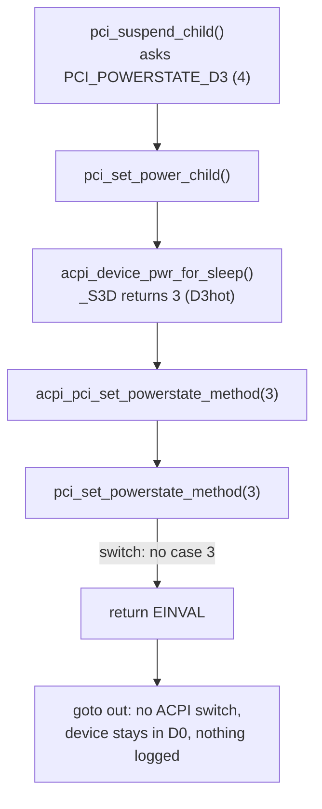

# pci: devices that ask for D3hot never leave D0

Patch: [pci_d3hot.patch](pci_d3hot.patch) (branch `olivier-pci-d3hot` on
github.com/ocochard/freebsd-src, based on main cf58c8667cfd).

Found while chasing suspend-to-idle on the HP ZBook Ultra G1a (Strix Halo),
see [amdsmu_strix_halo.md](amdsmu_strix_halo.md).

## Background

**PCI power states (D-states).** A PCI function can be in D0 (on), D1, D2
or D3 (off). The OS picks the state by writing two bits in the function's
Power Management capability register (`PCIR_POWER_STATUS`). The register
has a single D3 encoding (`PCIM_PSTAT_D3`).

**D3hot and D3cold.** ACPI splits D3 in two. D3hot: the function is off but
its slot still has power, so it answers config reads. D3cold: ACPI also
turns off the power resources (`_PR3`) feeding the slot. The difference is
only in ACPI power resources; the PCI register is the same.

**FreeBSD numbering.** Since commit 84bbfc32a3f4 ("acpi_powerres: D3cold
support", June 2025) FreeBSD follows ACPI (`sys/dev/pci/pcivar.h:518`):

```c
#define	PCI_POWERSTATE_D3_HOT	3
#define	PCI_POWERSTATE_D3_COLD	4
#define	PCI_POWERSTATE_D3	PCI_POWERSTATE_D3_COLD
```

Before that commit, `PCI_POWERSTATE_D3` was 3.

**Who picks the state on suspend.** `pci_suspend_child()`
(`sys/dev/pci/pci.c:5272`) asks for `PCI_POWERSTATE_D3` (line 5304).
`pci_set_power_child()` (line 5252) lets the firmware override it: via
`acpi_pcib_power_for_sleep()` and `acpi_device_pwr_for_sleep()`
(`sys/dev/acpica/acpi.c:2200`) it evaluates the device's ACPI `_S3D`
method (also for suspend-to-idle, line 2224). `_S3D` returns an ACPI
D-state number, so 3 means D3hot.

**Who writes the register.** On an ACPI system the request goes to
`acpi_pci_set_powerstate_method()` (`sys/dev/acpica/acpi_pci.c:289`). When
powering down it first calls `pci_set_powerstate_method()`
(`sys/dev/pci/pci.c:2881`) to write the register, then switches the ACPI
power resources. If the register write fails it jumps to `out` (line 313)
and skips ACPI.



## The problem

`pci_set_powerstate_method()` has one case per D-state, and the D3 case is
`case PCI_POWERSTATE_D3:`, which is now 4. A request for 3 (D3hot) falls
into `default: return (EINVAL);` (line 2939). Every device whose firmware
`_SxD` returns 3 silently stays in D0 over suspend. LinuxKPI maps
`PCI_D3hot` to `PCI_POWERSTATE_D3_HOT`, so `pci_set_power_state(pdev,
PCI_D3hot)` (used by `rtw88`) fails the same way, and LinuxKPI ignores the
error.

Measured on the ZBook. Its GPU (`vgapci0`, pci0:195:0:0) has
`Name (_S3D, 0x03)` in `\_SB.PCI0.GPPA.GFX0`. With `debug.bootverbose=1`,
`zzz` logs D3cold for every sibling function and the parent bridge, but
nothing for the GPU:

```
pci0:195:0:6: Transition from D0 to D3cold
pci0:195:0:4: Transition from D0 to D3cold
pci0:195:0:1: Transition from D0 to D3cold
pci0:0:8:1: Transition from D0 to D3cold
```

A temporary `printf` in `pci_set_power_child()` shows the override:

```
vgapci0: XXX suspend_child error 0 do_power 1
vgapci0: XXX set_power_child state 4 attached 1 cur 0
vgapci0: XXX dstate 3
```

So the GPU stays in D0 while its parent bridge is put in D3cold, and the
platform's low-power constraint for GFX0 (D3, in the LPS0 table) is never
met. DTrace cannot show this: over `zzz` it aborts with "processing
aborted: Abort due to systemic unresponsiveness".

## The fix

```diff
 	oldstate = pci_get_powerstate(child);
-	if (oldstate == state)
+	if (oldstate == state || (oldstate >= PCI_POWERSTATE_D3_HOT &&
+	    state >= PCI_POWERSTATE_D3_HOT))
 		return (0);
...
-	if (highest == PCI_POWERSTATE_D3)
+	if (highest >= PCI_POWERSTATE_D3_HOT)
 	    delay = 10000;
...
-	case PCI_POWERSTATE_D3:
+	case PCI_POWERSTATE_D3_HOT:
+	case PCI_POWERSTATE_D3_COLD:
 		status |= PCIM_PSTAT_D3;
```

`pci_set_powerstate_method()` is the right place: it is the only code that
turns a D-state number into register bits, and the register has one D3.
Whether the slot loses power (cold) is the ACPI layer's job, and
`acpi_pci_set_powerstate_method()` already passes the original state to
`acpi_pwr_switch_consumer()`.

- The no-change test: `pci_get_powerstate()` reads D3 back as
  `PCI_POWERSTATE_D3` (cold, 4), so a D3hot request on a device already in
  D3 would otherwise rewrite D3 to D3, which the comment says some devices
  dislike.
- The delay: the 10 ms D3 transition delay applies to both.

Alternatives:

- Map `_SxD` 3 to `PCI_POWERSTATE_D3` in `acpi_device_pwr_for_sleep()`:
  fixes suspend only, and loses the hot/cold distinction the ACPI power
  resource code now uses. LinuxKPI `PCI_D3hot` would stay broken.
- Make `pci_get_powerstate()` return D3hot: it cannot know, the register
  does not say.

Not fixed here: the "Transition from D3cold to D0" message on resume of a
device that was put in D3hot is still labelled D3cold, because the old
state comes from the register.

## Tested

HP ZBook Ultra G1a, FreeBSD main 83c8ec72ac6a plus the suspend-to-idle
work (test kernel `kernel.combo`), `kern.power.suspend=suspend_to_idle`.

| Configuration | Result |
|---|---|
| without the fix, `zzz` | GPU stays D0, no log line, no GFX0 ACPI switch |
| with the fix, `zzz` | `pci0:195:0:0: Transition from D0 to D3hot`, `pci3: set ACPI power state D3hot on \_SB_.PCI0.GPPA.GFX0` |
| with the fix, resume | GPU back to D0, amdgpu resumes (SMU, rings), network up |
| other devices (xhci, NVMe, HDA, bridges) | unchanged, still D3cold |
| LinuxKPI `pci_set_power_state(PCI_D3hot)` (rtw88) | untested |
| devices with `_PR3` that ask for D3hot | untested |

The commit itself (on main cf58c8667cfd) has the same code as the tested
kernel, but was not booted on its own.
