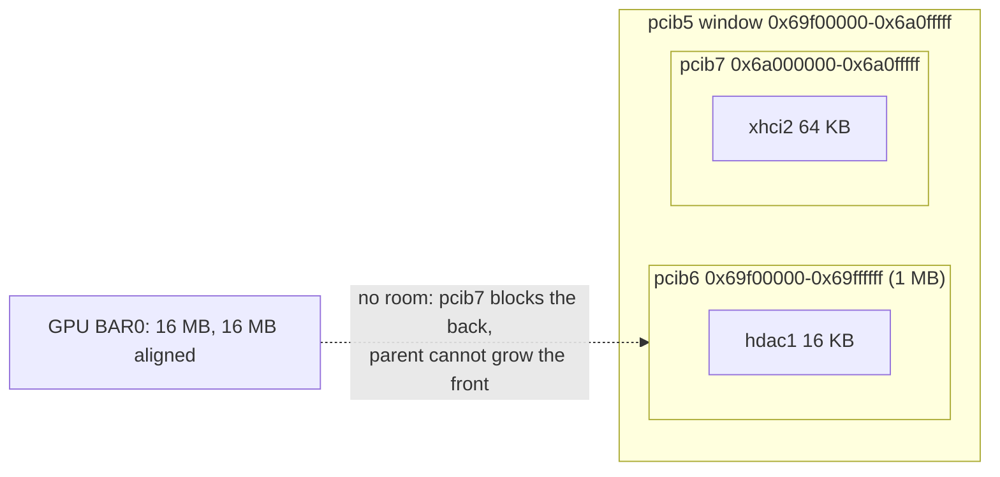

# Thunderbolt eGPU on FreeBSD: reserve BARs below hot-plug ports

Patch: [`pci_hotplug_bars.patch`](pci_hotplug_bars.patch), commit 3a43cccabf1c on main d5f0768e13f3 (tested build: same code on base 6dc19a71f70c).
Machine: Intel NUC 13 Pro (see [../Intel.NUC13.Pro.md](../Intel.NUC13.Pro.md)),
Thunderbolt 3 GPU dock with an Intel JHL7440 (Titan Ridge) controller and an NVIDIA GeForce RTX 3070 (10de:2488),
`nvidia-kmod-620.70.06`.

In short: when the dock is powered on after boot, FreeBSD finds the GPU but cannot give it memory addresses,
so the NVIDIA driver fails.
The patch makes FreeBSD reserve those addresses as soon as a device appears below a hot-plug port,
before its neighbours take the space.

## Background

### Thunderbolt is not involved

The NUC's Thunderbolt 4 controller is built into the CPU and runs its own firmware connection manager.
That firmware builds the PCIe tunnel to the dock, both at boot and when the dock is plugged in later.
FreeBSD's `thunderbolt(4)` driver is not loaded and not needed: to the OS, the dock is a PCIe switch
behind a PCIe root port with hot-plug support (`pcib3`, 0:7:2, "Raptor Lake-P Thunderbolt 4 PCI Express Root Port").
On AMD USB4 hosts there is no such firmware and the OS must build the tunnel; FreeBSD cannot do that yet.

### BARs and bridge windows

A PCI device asks for address space through its BARs (Base Address Registers).
Each BAR has a fixed size, a power of two, and must start at a multiple of its size.
The RTX 3070 has four: 16 MB of registers (BAR0), 256 MB of video memory aperture (BAR1, prefetchable),
32 MB (BAR3, prefetchable) and 128 bytes of I/O ports.

A PCI-PCI bridge forwards to its secondary bus only the addresses inside its windows:
one memory window, one prefetchable memory window and one I/O window.
A device's BARs must fit inside the windows of every bridge above it.

The dock is a tree of bridges:

```
pcib3 (root port, hot-plug)  - firmware gives it a big window for whatever gets plugged in
  pcib5 (dock upstream port)
    pcib6 (downstream port)  - GPU (vgapci1) and its HDMI audio (hdac1)
    pcib7 (downstream port)  - dock USB controller (xhci2)
    pcib8 (downstream port)  - empty
```

### How FreeBSD places BARs

`pci_add_child()` (`sys/dev/pci/pci.c`) runs for every new device, at boot and after a hot-plug,
and calls `pci_add_resources()`, which calls `pci_add_map()` once per BAR.
If firmware left a BAR at 0, `pci_add_map()` returns without reserving anything
("These will be allocated later if the driver specifically requests them", `pci.c` line 3487 on main),
unless its `force` argument is set.
Only CardBus passes `force`.

Bridge windows start empty and grow on demand: `pcib_grow_window()` (`sys/dev/pci/pci_pci.c`)
can only extend a window at its front or its back, and only if the space next to it is free in the parent window.
It never moves a window that already holds resources.

## The problem

Repeat: boot FreeBSD with the dock off, power the dock on, `kldload nvidia`.

Measured on FreeBSD main-n291498-6dc19a71f70c (GENERIC-NODEBUG), 2026-11-24.
The dock arrived after boot (`pci3: <ACPI PCI bus> on pcib3` is logged after `igc0: link state changed to UP`).

```
nvidia1: <NVIDIA GeForce RTX 3070> on vgapci1
vgapci1: child nvidia1 requested pci_enable_io
vgapci1: 0x1000000 bytes of rid 0x10 res 3 failed (0, 0xffffffffffffffff).
nvidia1: NVRM: NVIDIA MEM resource alloc failed, BAR0 @ 0x10.
nvidia1: NVRM: NVIDIA hardware alloc failed.
device_attach: nvidia1 attach returned 6
```

All four GPU BARs were still 0 (`pciconf -lb pci0:46:0:0`: `base 0, size 16777216`, etc.).
The address map, from `devinfo -u` and `pciconf -lcB`:

| Range | Owner |
|---|---|
| 0x69f00000-0x761fffff | `pcib3` memory window (set by firmware) |
| 0x69f00000-0x6a0fffff | `pcib5` memory window |
| 0x69f00000-0x69ffffff | `pcib6` memory window, 1 MB |
| 0x69f00000-0x69f03fff | `hdac1` (GPU HDMI audio) |
| 0x6a000000-0x6a0fffff | `pcib7` memory window |
| 0x6a000000-0x6a00ffff | `xhci2` (dock USB) |

The audio function and the dock USB controller have drivers, so they asked first and got small windows next to each other.
The GPU had no driver until `nvidia` loaded.
Then BAR0 needed 16 MB aligned on 16 MB inside `pcib6`:

- growing `pcib6` at the back hits `pcib7` at 0x6a000000;
- growing it at the front means 0x68000000-0x69ffffff, and the parent windows could not grow that far down.



Proof that this is the cause, without a reboot:

```
# devctl delete -f pcib7          # free the space behind pcib6
# kldunload nvidia; kldload nvidia
# pciconf -lb pci0:46:0:0
    bar   [10] = type Memory, range 32, base 0x6a000000, size 16777216, enabled
    bar   [14] = type Prefetchable Memory, range 64, base 0x60e0000000, size 268435456, enabled
    bar   [1c] = type Prefetchable Memory, range 64, base 0x60de000000, size 33554432, enabled
# nvidia-smi -L
GPU 0: NVIDIA GeForce RTX 3070 (UUID: GPU-...)
# devctl rescan pci4             # bring the dock USB back
pcib7: failed to allocate initial memory window: 0x6a000000-0x6a0fffff
xhci2: <Intel Titan Ridge Thunderbolt 3 USB controller> mem 0x69e00000-0x69e0ffff at device 0.0 on pci5
```

When the dock is already on at power-on, the BIOS assigns everything itself (BAR1 even gets 8 GB through Resizable BAR)
and the problem does not appear.

## The fix

```diff
+static bool
+pci_below_hotplug_port(device_t bus)
+{
+	device_t pcib;
+
+	for (pcib = device_get_parent(bus); is_pci_device(pcib);
+	    pcib = device_get_parent(device_get_parent(pcib))) {
+		if (pci_find_cap(pcib, PCIY_EXPRESS, NULL) != 0)
+			continue;
+		if ((pcie_read_config(pcib, PCIER_FLAGS, 2) &
+		    PCIEM_FLAGS_SLOT) == 0)
+			continue;
+		if ((pcie_read_config(pcib, PCIER_SLOT_CAP, 4) &
+		    PCIEM_SLOT_CAP_HPC) != 0)
+			return (true);
+	}
+	return (false);
+}
...
-	pci_add_resources(bus, dev, 0, 0);
+	pci_add_resources(bus, dev, pci_below_hotplug_port(bus), 0);
```

`pci_below_hotplug_port()` walks up from the device's bus: bus, bridge, bus, bridge, until the parent is no longer a PCI device
(the host bridge).
It returns true if one of those bridges is a PCIe port with a slot whose Slot Capabilities register has
Hot-Plug Capable set (PCI Express Base Specification, Slot Capabilities register, bit 6).
For such devices `pci_add_map()` gets `force`, so BARs left at 0 are reserved when the device is added,
the same path CardBus already uses.

Why here: new-bus attaches depth-first, so the GPU (function 0 below `pcib6`) is added and reserves its BARs
before `pcib7` claims a window.
Firmware cannot size windows for devices that were not there at boot, so below a hot-plug port a zero BAR
means "not assigned yet", not "disabled on purpose".

The PCIe capability check comes first because `pcie_read_config()` returns all ones when there is no PCIe capability,
which would look like a hot-plug slot.

Bounds: `pci_find_cap()` proves the PCIe capability exists, and `pcie_read_config()` reads at that same capability
(`cfg.pcie.pcie_location`).
PCIER_FLAGS (offset 0x02, 2 bytes) and PCIER_SLOT_CAP (offset 0x14, 4 bytes) are inside the version 1 capability too,
and the slot register is read only when the Slot Implemented flag is set, as `pcib_probe_hotplug()` does in `pci_pci.c`.

### Alternatives

| Option | Gain | Cost |
|---|---|---|
| This patch: force below hot-plug ports | automatic; only hot-plug hierarchies change | also reserves I/O BARs there (the GPU got 0x3000-0x307f), which uses 4 KB I/O windows on each bridge |
| A tunable that forces all zero BARs (Linux assigns them all) | covers non-hot-plug cases | devices whose firmware disabled a BAR on purpose would get it enabled; opt-in nobody finds |
| Move sibling windows in `pcib_grow_window()` | no early reservation | windows hold live resources; drivers would need to be stopped and moved |
| Pad hot-plug bridge windows (Linux `hpmemsize`) | room for later devices | does not help here: the space was there, it was taken in the wrong order |
| Userland `devctl delete` + rescan at boot | no kernel change | depends on the layout; breaks with another dock |

What the patch does not fix:

- Resizable BAR after a hot-plug: BAR1 stays at 256 MB (the BIOS gives 8 GB at boot).
- Hot-unplug with `nvidia` loaded: not tested; I unloaded `nvidia` before every unplug.
- DMA protection: no IOMMU is set up for the dock.
- USB4 hosts without a firmware connection manager (AMD): FreeBSD has no software connection manager,
  so the dock never appears there (Beelink SER6 test, 2026-11-24: `thunderbolt(4)` attaches `nhi0` and stops).

## Tested

Intel NUC 13 Pro, 2026-11-24.

| Kernel | Dock | GPU BARs | `nvidia-smi` |
|---|---|---|---|
| stock main-n291498-6dc19a71f70c | powered on after boot | all 0; `NVRM: NVIDIA MEM resource alloc failed, BAR0 @ 0x10` | no GPU |
| stock, after `devctl delete -f pcib7` | same boot | BAR0 0x6a000000, BAR1 0x60e0000000, BAR3 0x60de000000 | RTX 3070, 8192 MiB |
| stock | on at power-on | assigned by the BIOS (BAR1 8 GB at 0x6000000000) | RTX 3070, 8192 MiB, Gen3 x4 |
| stock | powered off, then on again after boot (dock USB added before the GPU, as in the patched run below) | all 0; same `NVRM` error | no GPU; `devctl delete -f` of the dock USB bridge, reload, rescan: works |
| patched | on at power-on | assigned by the BIOS (BAR1 8 GB at 0x6000000000) | RTX 3070, 8192 MiB, Gen3 x4 |
| patched | powered off, then on again after boot | `vgapci1: ... port 0x3000-0x307f mem 0x69000000-0x69ffffff,0x6000000000-0x600fffffff,0x5ffe000000-0x5fffffffff` when the GPU is added | RTX 3070, 8192 MiB, 54.69 C, Gen3 x4 |

Untested: other machines with hot-plug ports (NVMe U.2 bays,
desktop root ports); a GPU workload on the patched kernel (Vulkan `llama-bench` and `vkcube` ran on the stock kernel
after the `devctl` workaround, same 256 MB BAR1 as a patched hot-plug); hot-unplug with `nvidia` loaded.
