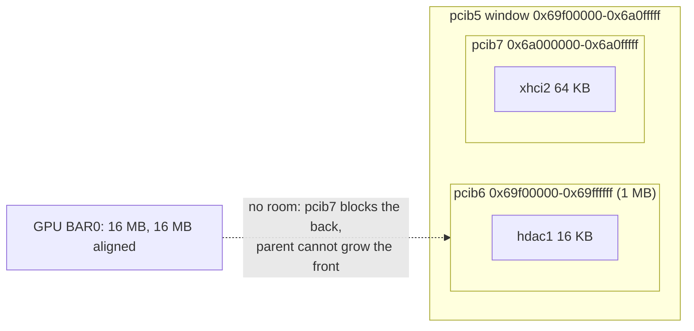

# Thunderbolt eGPU on FreeBSD: reserve BARs below hot-plug ports

Patch: [`pci_hotplug_bars.patch`](pci_hotplug_bars.patch), two commits on main d5f0768e13f3:
11735256af9c (limit BAR reservations to the BAR's width) and a68bb9f29f9e (reserve unassigned BARs below hot-plug ports).
Tested builds: the same code on main d5f0768e13f3 (QEMU) and on 6dc19a71f70c (NUC).
Machine: Intel NUC 13 Pro (see [../Intel.NUC13.Pro.md](../Intel.NUC13.Pro.md)),
Thunderbolt 3 GPU dock with an Intel JHL7440 (Titan Ridge) controller and an NVIDIA GeForce RTX 3070 (10de:2488),
`nvidia-kmod-620.70.06`.

In short: when the dock is powered on after boot, FreeBSD finds the GPU but cannot give it memory addresses,
so the NVIDIA driver fails.
The patch makes FreeBSD reserve those addresses as soon as all the devices on a bus below a hot-plug port
are known, before drivers and neighbouring bridges take the space.

## Background

### Thunderbolt is not involved

The NUC's Thunderbolt 4 controller is built into the CPU and runs its own firmware connection manager.
That firmware builds the PCIe tunnel to the dock, both at boot and when the dock is plugged in later.
FreeBSD's `thunderbolt(4)` driver is not loaded and not needed: to the OS, the dock is a PCIe switch
behind a PCIe root port with hot-plug support (`pcib3`, 0:7:2, "Raptor Lake-P Thunderbolt 4 PCI Express Root Port").
On AMD USB4 hosts there is no such firmware and the OS must build the tunnel; FreeBSD cannot do that yet.

### BARs and bridge windows

A PCI device asks for address space through its BARs (Base Address Registers).
Each BAR has a fixed size, a power of two, and must start at a multiple of its size.
The RTX 3070 has four: 16 MB of registers (BAR0), 256 MB of video memory aperture (BAR1, prefetchable),
32 MB (BAR3, prefetchable) and 128 bytes of I/O ports.

A PCI-PCI bridge forwards to its secondary bus only the addresses inside its windows:
one memory window, one prefetchable memory window and one I/O window.
A device's BARs must fit inside the windows of every bridge above it.

The dock is a tree of bridges:

```
pcib3 (root port, hot-plug)  - firmware gives it a big window for whatever gets plugged in
  pcib5 (dock upstream port)
    pcib6 (downstream port)  - GPU (vgapci1) and its HDMI audio (hdac1)
    pcib7 (downstream port)  - dock USB controller (xhci2)
    pcib8 (downstream port)  - empty
```

### How FreeBSD places BARs

`pci_add_child()` (`sys/dev/pci/pci.c`) runs for every new device, at boot and after a hot-plug,
and calls `pci_add_resources()`, which calls `pci_add_map()` once per BAR.
If firmware left a BAR at 0, `pci_add_map()` returns without reserving anything
("These will be allocated later if the driver specifically requests them", `pci.c` line 3487 on main),
unless its `force` argument is set.
Only CardBus passes `force`.

When a driver later asks for such a BAR, `pci_alloc_multi_resource()` calls `pci_reserve_map()` (`pci.c`):
it reserves a range of the BAR's size and alignment, turns decoding off, writes the BAR and restores the
command register. If the reservation fails, it prints `... bytes of rid ... failed` and returns NULL;
it never turns decoding off for the device.

Bridge windows start empty and grow on demand: `pcib_grow_window()` (`sys/dev/pci/pci_pci.c`)
can only extend a window at its front or its back, and only if the space next to it is free in the parent window.
It never moves a window that already holds resources.

## The problem

Repeat: boot FreeBSD with the dock off, power the dock on, `kldload nvidia`.

Measured on FreeBSD main-n291498-6dc19a71f70c (GENERIC-NODEBUG), 2026-11-24.
The dock arrived after boot (`pci3: <ACPI PCI bus> on pcib3` is logged after `igc0: link state changed to UP`).

```
nvidia1: <NVIDIA GeForce RTX 3070> on vgapci1
vgapci1: child nvidia1 requested pci_enable_io
vgapci1: 0x1000000 bytes of rid 0x10 res 3 failed (0, 0xffffffffffffffff).
nvidia1: NVRM: NVIDIA MEM resource alloc failed, BAR0 @ 0x10.
nvidia1: NVRM: NVIDIA hardware alloc failed.
device_attach: nvidia1 attach returned 6
```

All four GPU BARs were still 0 (`pciconf -lb pci0:46:0:0`: `base 0, size 16777216`, etc.).
The address map, from `devinfo -u` and `pciconf -lcB`:

| Range | Owner |
|---|---|
| 0x69f00000-0x761fffff | `pcib3` memory window (set by firmware) |
| 0x69f00000-0x6a0fffff | `pcib5` memory window |
| 0x69f00000-0x69ffffff | `pcib6` memory window, 1 MB |
| 0x69f00000-0x69f03fff | `hdac1` (GPU HDMI audio) |
| 0x6a000000-0x6a0fffff | `pcib7` memory window |
| 0x6a000000-0x6a00ffff | `xhci2` (dock USB) |

The audio function and the dock USB controller have drivers, so they asked first and got small windows next to each other.
The GPU had no driver until `nvidia` loaded.
Then BAR0 needed 16 MB aligned on 16 MB inside `pcib6`:

- growing `pcib6` at the back hits `pcib7` at 0x6a000000;
- growing it at the front means 0x68000000-0x69ffffff, and the parent windows could not grow that far down.



Proof that this is the cause, without a reboot:

```
# devctl delete -f pcib7          # free the space behind pcib6
# kldunload nvidia; kldload nvidia
# pciconf -lb pci0:46:0:0
    bar   [10] = type Memory, range 32, base 0x6a000000, size 16777216, enabled
    bar   [14] = type Prefetchable Memory, range 64, base 0x60e0000000, size 268435456, enabled
    bar   [1c] = type Prefetchable Memory, range 64, base 0x60de000000, size 33554432, enabled
# nvidia-smi -L
GPU 0: NVIDIA GeForce RTX 3070 (UUID: GPU-...)
# devctl rescan pci4             # bring the dock USB back
pcib7: failed to allocate initial memory window: 0x6a000000-0x6a0fffff
xhci2: <Intel Titan Ridge Thunderbolt 3 USB controller> mem 0x69e00000-0x69e0ffff at device 0.0 on pci5
```

When the dock is already on at power-on, the BIOS assigns everything itself (BAR1 even gets 8 GB through Resizable BAR)
and the problem does not appear.

## The fix

Two commits, both in `sys/dev/pci/pci.c`.

### 1. Limit BAR reservations to the BAR's width

A BAR decodes 64, 32 or (legacy) 20 address bits (`pci_maprange()`).
A reservation with a wildcard range (`0` to `~0`) can come back above 4 GB:
`pcib_alloc_resource()` (`pci_pci.c`) tries the prefetchable window first, and on this NUC that window is at
0x60_0000_0000. A 32-bit BAR then keeps only the low 32 bits of the address and decodes somewhere else.
This happens without the hot-plug change too: in the lazy path above, with `hw.pci.clear_bars`, and in the
`hw.pci.realloc_bars` retry.

```c
/* Highest address a BAR with this map value can decode. */
static rman_res_t
pci_bar_maxaddr(pci_addr_t mapreg)
{
	int ln2range;

	ln2range = pci_maprange(mapreg);
	if (ln2range == 20 || ln2range == 32)
		return (((rman_res_t)1 << ln2range) - 1);
	return (~0);
}
```

`pci_add_map()` uses it as the end of its wildcard range and of the `realloc_bars` retry;
`pci_reserve_map()` lowers the end a driver asks for to it.
When a prefetchable 32-bit BAR does not fit in a prefetchable window above 4 GB,
`pcib_alloc_resource()` falls back to the memory window, which is always below 4 GB.

### 2. Reserve unassigned BARs below hot-plug ports

```c
static void
pci_reserve_unassigned_bars(device_t bus)
{
	...
	if (!pci_below_hotplug_port(bus))
		return;
	...
	for (i = 0; i < devcount; i++) {
		if (device_is_attached(devlist[i]))
			continue;
		dinfo = device_get_ivars(devlist[i]);
		STAILQ_FOREACH(pm, &dinfo->cfg.maps, pm_link) {
			if (PCIR_IS_BIOS(&dinfo->cfg, pm->pm_reg) ||
			    pci_mapbase(pm->pm_value) != 0)
				continue;
			type = PCI_BAR_MEM(pm->pm_value) ? SYS_RES_MEMORY :
			    SYS_RES_IOPORT;
			if (resource_list_find(&dinfo->resources, type,
			    pm->pm_reg) != NULL)
				continue;
			(void)pci_reserve_map(bus, devlist[i], type,
			    pm->pm_reg, 0, ~0, 1, 1, 0);
		}
	}
	...
}
```

It runs at the end of `pci_add_children()` and in `pci_rescan_method()`, after new devices are added and before
they attach. A hot-plugged dock reaches `pci_add_children()` through `pci_attach()` of each new bus.

`pci_below_hotplug_port()` walks up from the bus: bus, bridge, bus, bridge, until the parent is no longer a PCI
device (the host bridge). It returns true if one of those bridges is a PCIe port with a slot whose Slot
Capabilities register has Hot-Plug Capable set (PCI Express Base Specification, Slot Capabilities register,
bit 6). The PCIe capability check comes first because `pcie_read_config()` returns all ones when there is no
PCIe capability, which would look like a hot-plug slot. The slot register is read only when the Slot
Implemented flag is set, as `pcib_probe_hotplug()` does in `pci_pci.c`.

Why this place and this order:

- Every function on the bus has reserved the BARs firmware assigned before the pass runs, so an unassigned
  BAR of function 0 cannot take the range firmware gave function 1.
- New-bus attaches depth-first, so the pass for the GPU's bus runs before the next sibling bridge (the dock
  USB controller's `pcib7`) claims a window. That is what fixes the eGPU.
- `pci_reserve_map()` is the path stock already uses for drivers. It keeps the command register, so a failure
  cannot turn off decoding for BARs that were working, and it leaves decoding off until the driver activates
  the resource (`pciconf` shows the GPU BARs `disabled` until `nvidia` loads).
- Below a hot-plug port, a zero BAR means "not assigned yet": firmware cannot size windows for devices that were
  not there at boot.

Devices that already have a driver are skipped, so a rescan does not reserve BARs a running driver chose not to use.

### Alternatives

| Option | Gain | Cost |
|---|---|---|
| This patch: a pass after enumeration, through `pci_reserve_map()` | firmware BARs first; failure keeps decoding; same path as driver requests | about 80 lines; two call sites |
| Pass `force` to `pci_add_resources()` in `pci_add_child()` | one line | a function's unassigned BAR can take a sibling function's firmware range; a 32-bit BAR can land above 4 GB; a failed reservation turns off decoding for the whole function (all three measured in QEMU below) |
| Size the whole hot-plugged tree before assigning (Linux `pci_assign_unassigned_bridge_resources()`) | no dependence on attach order | rewrite of bridge window management in `pci_pci.c` |
| Pad hot-plug bridge windows (Linux `hpmemsize`) | room for later devices | does not help here: the space was there, it was taken in the wrong order |
| A tunable that forces all zero BARs | covers non-hot-plug cases | devices whose firmware disabled a BAR on purpose would get it; opt-in nobody finds |
| Userland `devctl delete` + rescan at boot | no kernel change | depends on the layout; breaks with another dock |

What the patch does not fix:

- Attach order still matters: a layout where a parent window cannot grow can still fail. Only sizing the whole
  tree first removes that.
- Resizable BAR after a hot-plug: BAR1 stays at 256 MB (the BIOS gives 8 GB at boot).
- BARs firmware left all-ones (`map == testval` in `pci_add_map()`) stay lazy, as on stock; only zero BARs are
  reserved early.
- Unassigned I/O BARs are reserved too (the GPU gets 0x3000-0x307f), which needs a 4 KB I/O window on each bridge.
- A failed early reservation is logged with the device name `unknown`, as no driver owns the device yet.
- `sys/powerpc/ofw/ofw_pcibus.c` has its own copy of `pci_add_children()` and no rescan method, so the pass does
  not run there.
- ROM BARs are left out of the width cap (`pci_maprange()` does not apply to them).
- Hot-unplug with `nvidia` loaded: not tested; `nvidia` was unloaded before every unplug.
- DMA protection: no IOMMU is set up for the dock.
- USB4 hosts without a firmware connection manager (AMD): FreeBSD has no software connection manager,
  so the dock never appears there (Beelink SER6 test, 2026-11-24: `thunderbolt(4)` attaches `nhi0` and stops).

## Tested

### Intel NUC 13 Pro

Kernels on 6dc19a71f70c.

| Kernel | Dock | GPU BARs | `nvidia-smi` |
|---|---|---|---|
| stock | powered on after boot | all 0; `NVRM: NVIDIA MEM resource alloc failed, BAR0 @ 0x10` | no GPU |
| stock, after `devctl delete -f pcib7` | same boot | BAR0 0x6a000000, BAR1 0x60e0000000, BAR3 0x60de000000 | RTX 3070, 8192 MiB |
| stock | on at power-on | assigned by the BIOS (BAR1 8 GB at 0x6000000000) | RTX 3070, 8192 MiB, Gen3 x4 |
| stock | powered off, then on again after boot | all 0; same `NVRM` error | no GPU |
| this patch (2026-11-24) | on at power-on | BIOS layout kept: BAR0 0x6a000000, BAR1 8 GB at 0x6000000000; no failed reservation | RTX 3070, 8192 MiB, Gen3 x4, BAR1 8192 MiB |
| this patch (2026-11-24) | powered off, then on again after boot | BAR0 0x69000000, BAR1 0x6000000000 (256 MB), BAR3 0x5ffe000000, I/O 0x3000, reserved before any driver; no failed reservation | RTX 3070, 8192 MiB, Gen3 x4, BAR1 256 MiB |

### QEMU

[`pci_hotplug_bars_qemu.sh`](pci_hotplug_bars_qemu.sh) boots a q35 guest with UEFI firmware and three PCIe
root ports (Hot-Plug Capable set), once per kernel, and runs
[`pci_hotplug_bars_qemu_guest.sh`](pci_hotplug_bars_qemu_guest.sh) in it. The guest re-adds each root port with
`devctl delete` and `devctl rescan`, which runs `pci_add_children()` on the BAR values left in config space.
The guest boots with `hw.pci.enable_pcie_hp=0` and powers the hot-plug slot on by hand: under QEMU,
`pcib_pcie_dll_timeout()` sees the link up while `sc->pcie_link_sta` stays stale, so native hot-plug never adds
the child bus (also without this patch).

Kernels on main d5f0768e13f3, 2026-11-24.

| Case | Stock | `force` in `pci_add_child()` (alternative above) | This patch |
|---|---|---|---|
| 1: function 0's BAR2 (2 MB) zeroed; function 1's BAR2 (64 MB) at 0xc000000000 from firmware | f0 BAR2 stays 0; f1 kept | f0 takes 0xc000000000; f1 is moved to 0xc004000000 | f1 kept at 0xc000000000; f0 gets 0xc004000000 |
| 2: display hot-plugged, 32-bit prefetchable BAR0 (16 MB), prefetchable window 0xc040000000-0xc043ffffff | BARs stay 0 (no driver) | kernel holds 0xc040000000-0xc040ffffff, register reads `40000008`: the BAR decodes 0x40000000, guest RAM | BAR0 at 0x80000000, register `80000008` |
| 3: BAR0 assigned with decoding on; BAR2 (1 TB) zeroed, cannot fit | command 0x0002 kept | command 0x0003 becomes 0x0001: BAR0 `disabled` | command 0x0002 kept; `unknown: 0x10000000000 bytes of rid 0x18 res 3 failed` |

Untested: commit 1 alone on any machine; other machines with hot-plug ports (NVMe U.2 bays, desktop root ports);
native hot-plug under QEMU; hot-unplug with `nvidia` loaded; powerpc.
