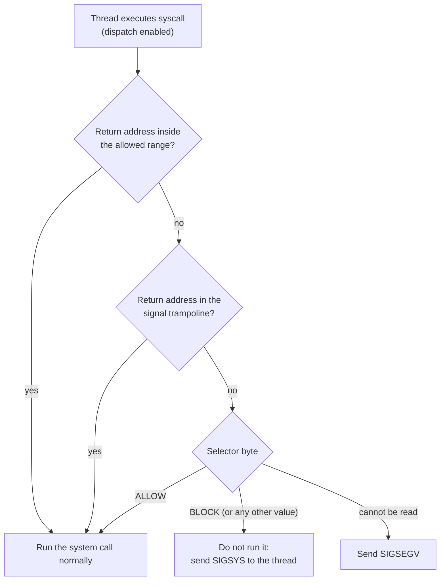
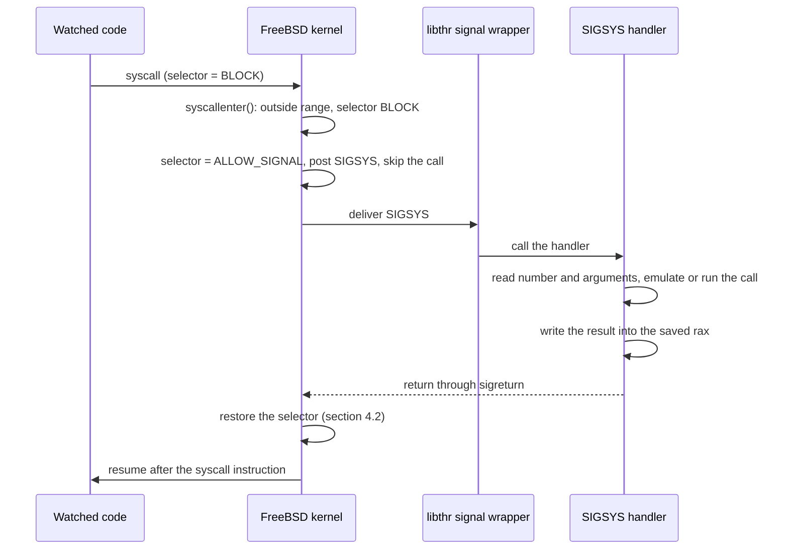

# Syscall dispatch: letting a FreeBSD program handle its own system calls

Some programs need to catch the system calls made by part of their own
code and handle them themselves, instead of letting the kernel run them:

- **Wine** runs Windows code natively. Some Windows programs, mostly copy
  protection and anti-cheat systems, execute the CPU `syscall`
  instruction themselves; on FreeBSD that instruction goes straight to the
  FreeBSD kernel, which runs whatever FreeBSD system call has the same
  number ([wine_direct_syscalls.md](wine_direct_syscalls.md) explains
  this case in detail).
- **Interposition tools** such as torsocks, proxychains or fakeroot replace
  libc functions with `LD_PRELOAD`, and silently miss every program that
  makes its system calls without libc: Go programs, static binaries.

FreeBSD has no way to do this today short of `ptrace(2)`, which needs a
second process that stops on every system call. This document describes
a new kernel feature, `procctl(PROC_SYSCALL_DISPATCH_CTL)`, modelled on
Linux's *Syscall User Dispatch*, and the two programs built on it: a Wine
port that runs the Denuvo-protected *Black Myth: Wukong Benchmark Tool*,
and `sudtrace`, an interposer that sees every system call of a Go
program.

It is written for a reader who knows what a system call, a signal and a
thread are.

Files:

- Kernel patch, with the man page and a Kyua test:
  [procctl_syscall_dispatch.patch](procctl_syscall_dispatch.patch)
  (FreeBSD main `30e3fd1811e3`)
- Stand-alone test program: [procctl_syscall_dispatch_test.c](procctl_syscall_dispatch_test.c)
- Interposer demo: [../sudtrace/](../sudtrace/)
- Wine side: [wine-proton_syscall_dispatch.patch](wine-proton_syscall_dispatch.patch)
  (wine-proton 11.0-2 sources); in the `emulators/wine-proton` port it is
  part of `patch-dlls_ntdll_unix_signal__x86__64.c`,
  `patch-dlls_ntdll_unix_loader.c` and `patch-dlls_ntdll_unix_unix__private.h`
  (wine-proton 11.0.2_5)

## TL;DR

- A thread tells the kernel: "system calls coming from this address range
  are mine, let them run; for the others, look at this byte in my memory:
  if it says *block*, do not run the system call, send me `SIGSYS`
  instead".
- The program flips that byte with a single memory write, without a
  system call, so it can switch interception on and off as often as it
  likes.
- The `SIGSYS` handler finds the system call number and arguments in the
  saved registers, does what it wants (emulate, translate, log, run the
  real call) and puts the result back.
- For a thread that does not use the feature, the cost is one bit test per
  system call.
- The semantics copy Linux's, so software that already uses Syscall User
  Dispatch on Linux (Wine since 11.5, research interposers such as
  lazypoline) ports with little code.
- FreeBSD-specific kernel code rebuilds `%r10` for the handler, allows
  system calls in every signal handler (libthr runs code before the
  program's handler), and delivers the trap even while rtld or libthr
  defer signals with `sigfastblock(2)`.
- Results: the Denuvo benchmark runs under Wine (226 Windows system calls
  trapped and emulated at startup); `sudtrace` sees all 2375 system calls
  that the GitHub client `gh` makes without libc, where an `LD_PRELOAD`
  hook sees none.

## 1. The idea: an address range and a selector byte

The kernel must decide, for every system call of a thread, whether to run
it or hand it back to the program. It cannot know by itself which code
the program wants to watch, so the thread tells it, in two ways:

1. **An allowed address range.** A system call whose return address is
   inside `[start, start + len)` always runs normally. This is where the
   program's own system calls come from: Wine gives the range of
   `libsys.so.7`, the FreeBSD library that contains the `syscall`
   instructions of libc and libthr (449 of them on this system; libc
   itself keeps only four functions with their own `syscall` instruction:
   `getcontext`, `vfork`, `rfork_thread` and `pdrfork_thread`).
   `sudtrace` gives a 54-byte assembly stub of its own, so that everything
   else, libc included, is trapped.
2. **A selector byte.** For a system call made from anywhere else, the
   kernel reads one byte in the thread's memory:
   `PROC_SYSCALL_DISPATCH_ALLOW` (0) lets it run,
   `PROC_SYSCALL_DISPATCH_BLOCK` (1) traps it. The selector is optional;
   without one, every call from outside the range is trapped.

Why a byte in memory and not a system call to switch interception on and
off? Because some programs switch very often. Wine traps only while
Windows code runs, and Windows code calls into Wine and back tens of
thousands of times per second in a game. Writing one byte costs one CPU
instruction; a system call costs hundreds of cycles each way.



The signal trampoline is the small piece of code, in a page the kernel
maps into every process, that returns from a signal handler by calling
`sigreturn(2)`. It must always be allowed, otherwise no signal handler
could ever return.

## 2. The interface

Like several other per-process settings in FreeBSD (ASLR, W^X, tracing),
the feature is a `procctl(2)` command. The argument is a structure
(`sys/sys/procctl.h`):

```c
struct procctl_syscall_dispatch {
	int		sd_mode;	/* PROC_SYSCALL_DISPATCH_ON/OFF */
	int		sd_pad0;
	uintptr_t	sd_start;	/* syscalls returning into */
	size_t		sd_len;		/*   [start, start + len) run */
	char		*sd_selector;	/* NULL or byte, see below */
	u_int		sd_pad1[8];
};
```

Enabling it for the calling thread:

```c
struct procctl_syscall_dispatch sd = {
	.sd_mode = PROC_SYSCALL_DISPATCH_ON,
	.sd_start = allowed_start,
	.sd_len = allowed_len,
	.sd_selector = &my_selector_byte,
};
procctl(P_PID, 0, PROC_SYSCALL_DISPATCH_CTL, &sd);
```

`PROC_SYSCALL_DISPATCH_STATUS` reads the setting back. The padding fields
must be zero; they leave room for later extensions without changing the
structure size.

When a system call is trapped, the thread receives `SIGSYS` with:

| Field | Value |
|---|---|
| `si_code` | `SYS_USER_DISPATCH` (2, the same value as Linux) |
| `si_addr` | the address right after the `syscall` instruction |
| `si_syscall` | the system call number |
| registers in the signal context | exactly as the `syscall` instruction left them: number in `rax`, arguments in `rdi`, `rsi`, `rdx`, `r10`, `r8`, `r9` |

The handler can change the saved registers (for example put a return
value in `rax`) and return; the thread then continues after the `syscall`
instruction as if the kernel had run it. To run the real call, the
handler executes it from inside the allowed range.

**Lifecycle**, the same as on Linux: the setting belongs to one thread.
New threads start without it, a child created by `fork(2)` starts without
it, and `execve(2)` clears it. A program that wants every thread covered
enables it in each one: Wine does it in its per-thread setup, `sudtrace`
catches `thr_new(2)` and starts each new thread in a function of its own
that turns the feature on.

## 3. The kernel path

All FreeBSD system calls go through one function, `syscallenter()` in
`sys/kern/subr_syscall.c`. It decodes the system call number and
arguments, lets a debugger stop the thread if one is attached, checks
Capsicum, then calls the handler. The patch adds one test before the
arguments are decoded, because a trapped call does not have to follow
FreeBSD's conventions (a Windows call under Wine does not), and decoding
a FreeBSD call with more than six arguments reads the user stack and
could fail before the trap:

```c
	/* Before decoding the arguments: they are not FreeBSD's. */
	if (__predict_false((td->td_pflags2 & TDP2_SYSCALL_DISPATCH) != 0) &&
	    syscall_dispatch_trap(td)) {
		td->td_errno = error = EJUSTRETURN;
		goto retval;
	}
```

- `td_pflags2` is a field of the current thread that `syscallenter()`
  already reads a few lines above, so for every thread that does not use
  the feature the cost is one bit test on data already in the cache.
- `syscall_dispatch_trap()` (in `sys/kern/kern_procctl.c`) applies the
  rules of section 1 and, if the call must be trapped, posts `SIGSYS`
  with `trapsignal()` and returns true.
- `EJUSTRETURN` is an existing error code meaning "return to user mode
  without touching the registers"; `sigreturn(2)` uses it too. It is what
  keeps `rax` holding the system call number for the handler.



## 4. Kernel details

### 4.1 Registers seen by the handler

Linux and Windows pass the fourth system call argument in `%r10`, because
the `syscall` instruction overwrites `%rcx` with the return address.
FreeBSD's system call entry (`sys/amd64/amd64/exception.S`) stores the
user's `%r10` in the trap frame slot named after `%rcx`, where FreeBSD's C
code expects the fourth argument, and does not save `%r10` and `%r11`
themselves:

```
	movq	%r10,TF_RCX(%rsp)	/* arg 4 */
```

Before posting `SIGSYS`, `syscall_dispatch_trap()` therefore rebuilds what
the CPU really had, so the handler sees the same registers as on Linux:

```c
		td->td_frame->tf_r10 = td->td_frame->tf_rcx;
		td->td_frame->tf_rcx = td->td_frame->tf_rip;
		td->td_frame->tf_r11 = td->td_frame->tf_rflags;
		set_pcb_flags(td->td_pcb, PCB_FULL_IRET);
```

`rcx` gets the return address and `r11` the flags, which is what the
`syscall` instruction puts there. `PCB_FULL_IRET` makes the kernel return
to user mode through the path that restores every register. The same
fix-up is done before the `SIGSEGV` sent for an unreadable selector.

### 4.2 The selector during signal handlers

Signal handlers are the program's own code, so they must run with system
calls allowed, whatever the selector said when the signal arrived. On
FreeBSD this matters more than on Linux: libthr installs its own wrapper,
`thr_sighandler()` in `lib/libthr/thread/thr_sig.c`, which takes a lock
and calls `__sys_sigprocmask()` before calling the program's handler, and
it calls `_umtx_op_err()`, outside libsys, when that lock is contended.

`sendsig()`, the amd64 function that builds the signal frame, therefore
writes `PROC_SYSCALL_DISPATCH_ALLOW_SIGNAL` (2) into the selector of a
thread that uses the feature, and saves the previous value in the signal
frame (in `mc_spare[0]` of the saved machine context, tagged so that a
random value is never mistaken for it). `sigreturn(2)` writes the saved
value back only if the byte still holds ALLOW_SIGNAL:

| Selector before the signal | Byte when the handler returns | After `sigreturn(2)` |
|---|---|---|
| BLOCK | ALLOW_SIGNAL (handler did not touch it) | BLOCK, restored |
| BLOCK | ALLOW or BLOCK (handler wrote it) | the handler's choice |
| ALLOW | ALLOW | ALLOW, nothing was saved |

A handler that does not know about the selector (libthr's internal
signal, a handler installed by some library) thus returns to the watched
code with the trap still armed, while a handler that writes the byte
chooses the state of the code it returns to: Wine sets BLOCK when it sends
the thread into Windows code, a SIGSYS handler may set ALLOW to keep
running unwatched code. ALLOW_SIGNAL is a distinct value so the kernel can
tell "the handler wrote ALLOW" from "the handler did not touch the byte".

### 4.3 Signals deferred by rtld and libthr

FreeBSD's run-time linker and thread library do not block signals with
`sigprocmask(2)` around their critical sections. They use a cheaper
mechanism, `sigfastblock(2)`: a word in user memory that the kernel reads
before delivering a signal. While it is non-zero, signals wait. Both
still make system calls in those sections: rtld calls `mprotect` while
loading libraries, libthr calls `_umtx_op` when a lock is contended.

A program that traps libsys (such as `sudtrace`) would see such a call
trapped while signals are deferred. `trapsignal()` therefore ignores the
fast-block word for a SIGSYS whose code is `SYS_USER_DISPATCH`: the
handler belongs to the program that asked for the trap, and it has to be
written to run anywhere anyway. A SIGSYS blocked with `sigprocmask(2)` or
ignored still kills the process, as on Linux. The man page says both.

Programs that trap libsys must also install their SIGSYS handler with the
raw system call (`__sys_sigaction`), not with libthr's `sigaction()`.
libthr's version holds a lock on the SIGSYS slot while it makes the
system call; if that call is trapped, libthr's signal wrapper waits for
the same lock and the thread hangs. Wine allows the whole of libsys, so
its `sigaction()` call is never trapped, and `sudtrace` installs its
handler directly.

### 4.4 Kernel binary interface

The feature adds three fields to `struct thread`: the selector address,
the range start and the range length. They sit at the end of the
structure, so no existing field moves and the offset assertions in
`kern_thread.c`, which protect separately built modules such as
`amdgpu.ko` from `drm-kmod`, are unchanged.

## 5. Two users

### 5.1 Wine: Windows programs that make their own system calls

Upstream Wine 11.5 already supports Linux's Syscall User Dispatch
(commits `cbb9906d` and `b90cdc04d77`). The FreeBSD port of
wine-proton 11.0 follows them, in `dlls/ntdll/unix/signal_x86_64.c`:

| Where | What |
|---|---|
| `struct amd64_thread_data` | a new `char syscall_dispatch` at offset `0x340` of the TEB (Windows' per-thread block), same as upstream |
| `signal_init_process()` | finds the address range of `libsys.so.7` with `dl_iterate_phdr()` (upstream uses `libc.so.6` on Linux) and installs the `SIGSYS` handler |
| `init_syscall_frame()` | runs in every new thread and calls `procctl(PROC_SYSCALL_DISPATCH_CTL)`; if the kernel does not support it, one warning is logged and Wine runs as before |
| `__wine_syscall_dispatcher`, `__wine_unix_call_dispatcher` | `movb $0,0x340(%r13)` (ALLOW) when Windows code enters Wine |
| the three paths back to Windows code | `movb $1,0x340(%r13)` (BLOCK) |
| `init_handler()` / `leave_handler()` | ALLOW when a signal handler starts, BLOCK when it returns to Windows code |
| `sigsys_handler()` | the macOS handler, now also used on FreeBSD: it turns the trapped call into a normal call of Wine's dispatcher. A `SIGSYS` with another `si_code` (an invalid native system call) is ignored |

`%r13` holds the address of the current thread's TEB in those functions,
so `0x340(%r13)` is the selector byte of the running thread.

With the Denuvo benchmark, `ktrace -t cs -p <pid>` showed:

- 173 calls to `procctl(P_PID,0,25,...)`, one per thread, all returning 0;
- 226 `PSIG SIGSYS`: Windows system calls trapped and emulated by Wine;
- none of the bogus `ioctl(<pointer>, ...)` calls and none of the 68 GB
  memory request seen without the feature;
- memory steady around 4.4 GB, where it grows past 30 GB in seconds
  without the feature; the benchmark compiled its shaders and ran to the
  end.

A second run on the current kernel, with ALLOW_SIGNAL (section 4.2) and the
`sigfastblock` rule (section 4.3), and no change to Wine, gave the same
result: 174 `procctl` calls, memory between 4.0 and 4.5 GB from startup
to the end of the benchmark, which ran to completion. The number of
trapped calls was not recounted on that run.

The same code covers any Windows program that executes `syscall` itself:
other copy protection systems and user-mode anti-cheat components,
applications that call `ntdll` system calls directly to avoid hooks, and
samples studied under Wine in malware analysis.

A system call made from native code outside libsys while the selector is
BLOCK would be trapped. In practice the selector is ALLOW whenever Wine's
native code runs, and Wine has upstream's fallback: loading an old-style
`.so` builtin DLL turns the feature off for the process.

### 5.2 sudtrace: interposition that also sees Go programs

Tools such as torsocks, proxychains, fakeroot or libfaketime replace libc
functions with `LD_PRELOAD`. A program that makes its own system calls
never calls those functions, and the tool silently does nothing. Go
programs do this even when they are linked against libc: the GitHub
client `gh` on this system links libthr, libc and libsys, and its own code
still contains 34 `syscall` instructions. torsocks' documentation warns
that such programs bypass Tor.

[`sudtrace`](../sudtrace/) is a preloaded library that allows only its own
small assembly stub and traps everything else. Its SIGSYS handler logs
the call, runs it through the stub, and returns the result. With
`gh api /zen`:

| | `LD_PRELOAD` hook on `connect`/`open`/`openat`/`execve` | `sudtrace` |
|---|---|---|
| lines logged | 0 | every file open, the DNS query, the HTTPS connection |
| system calls seen | the ones made through libc | 2829, of which 2375 bypass libc |
| threads covered | n/a | the main thread and the 12 it creates |

`gh api /zen` takes 0.30 s with `sudtrace`, the same as without any
preloaded library, and 0.36 s under `truss -f`.

Because it traps libsys too, it relies on section 4.3. Its handler also
emulates `sigprocmask` on the saved context so that SIGSYS is
never blocked, keeps the program from replacing its SIGSYS handler, runs
`sigaltstack` back in the program's context (from a handler running on the
alternate stack it fails with `EPERM`), and turns `vfork` into `fork`.
The research tool lazypoline (DSN 2024) builds the same kind of
interposer on the Linux feature, and adds rewriting each trapped
`syscall` instruction so that only the first call pays for a signal.

## 6. Comparison with other work

| | Linux Syscall User Dispatch | XaeroVincent's `freebsd-sud.patch` | this patch |
|---|---|---|---|
| Interface | `prctl(PR_SET_SYSCALL_USER_DISPATCH)` | `procctl(PROC_SUD_SET)` | `procctl(PROC_SYSCALL_DISPATCH_CTL)` |
| Where the check runs | generic entry code | amd64 assembly | `syscallenter()`, generic C code |
| `rax` seen by the handler | system call number | `ENOSYS`, number only in `si_syscall` | system call number |
| Exemptions | vdso signal return | `sigreturn`, `sigfastblock` by number | signal trampoline by address |
| Selector unreadable | `SIGSEGV` | system call runs | `SIGSEGV` |
| Selector on signal delivery | unchanged | set to ALLOW, never restored | set to ALLOW_SIGNAL, restored by `sigreturn` unless the handler wrote it (section 4.2) |
| Trap while signals are fast-blocked | n/a (no such mechanism) | process killed | delivered (section 4.3) |
| fork / new thread / exec | off / off / off | off / off / off | off / off / off |

[XaeroVincent/FreeBSD-Gaming-Kernel](https://github.com/XaeroVincent/FreeBSD-Gaming-Kernel)
targets FreeBSD 15.1 and Wine, with a Wine side in
[FreeBSD-Proton-Experimental](https://github.com/FreeBSD-Proton-Experimental-Porters/FreeBSD-Proton-Experimental).
Both patches use `procctl` commands 25 and 26, so they cannot be
installed together; they should be merged before going upstream.

## 7. Testing

[procctl_syscall_dispatch_test.c](procctl_syscall_dispatch_test.c) checks
the kernel side on its own. It enables dispatch with an empty allowed
range and a selector, then executes a raw `syscall` for `getpid` from
inline assembly, with a known value in `r10`:

```
PASS: status reports ON with our selector
PASS: blocked syscall is emulated by the SIGSYS handler
PASS: the handler's ALLOW survives sigreturn
PASS: si_code is SYS_USER_DISPATCH
PASS: si_syscall and rax hold the syscall number
PASS: r10 holds the fourth argument, rcx the return address
PASS: selector ALLOW runs the real syscall
PASS: signal delivery sets the selector to ALLOW_SIGNAL
PASS: sigreturn restores BLOCK the handler left alone
PASS: fork(2) child starts with the setting off
PASS: OFF is accepted
PASS: after OFF, BLOCK no longer traps
```

Run on main `30e3fd1811e3` with the patch. Before the checks, the
program also verifies that a non-zero padding member is
refused with `EINVAL`.

On a kernel without the patch it stops at the first `procctl` call with
`Invalid argument`.

### Kyua test for the FreeBSD tree

For upstream, the same checks and a few more are an ATF test in the
kernel test suite, `tests/sys/kern/procctl_syscall_dispatch.c`, built on
amd64 only and linked with libthr so that signals go through its wrapper
(it is part of [procctl_syscall_dispatch.patch](procctl_syscall_dispatch.patch)).
Most cases use libsys as the allowed range and make their trapped calls
from a small assembly function. The `stub_*` cases trap the whole
process, as `sudtrace` does: only a small assembly stub may make system
calls, and the SIGSYS handler runs every trapped call through it.

| Test case | Checks |
|---|---|
| `ctl_invalid` | `EINVAL` for non-zero padding, a bad mode, OFF with fields, a wrapping range, another process |
| `status` | `STATUS` reports OFF, then the ON settings, then OFF |
| `trap` | SIGSYS, `si_code`, `si_syscall`, `si_addr`, `rax`, `r10`, `rcx`, emulated return value, the handler's ALLOW kept |
| `selector_allow` | ALLOW runs the real system call |
| `range_allow` | a call from libsys runs while the selector says BLOCK |
| `null_selector` | no selector: every call from outside the range traps |
| `selector_fault` | unreadable selector: SIGSEGV with its address, call not run |
| `signal_selector` | ALLOW_SIGNAL inside a timer handler, BLOCK restored after it, no trap in libthr's wrapper |
| `fastblock` | a trap while rtld/libthr defer signals with `sigfastblock(2)` is delivered, not fatal |
| `stub_libc` | libc's own calls are trapped, `si_addr` is in libsys, and the results are right |
| `stub_dlopen` | `dlopen(3)` works while every call traps, including rtld's own `open`, `mmap` and `mprotect` |
| `fork_off` | a `fork(2)` child starts with the feature off |
| `thread_off` | a new thread starts with the feature off |
| `off` | after OFF, BLOCK no longer traps |

```
$ kyua test -k Kyuafile
...
14/14 passed (0 broken, 0 failed, 0 skipped)
```

## 8. Performance

| Case | Extra cost per system call |
|---|---|
| any process not using the feature | one bit test |
| thread using it, call from the allowed range | the bit test and one subtract-and-compare |
| call from elsewhere with the selector at ALLOW | the above and a one-byte read of user memory |
| trapped call | a full signal round trip |

These come from reading the code; no micro-benchmark has measured them
yet. For Wine, a trapped Windows system call should cost a few
microseconds instead
of about 0.1 µs through Wine's normal path; without the feature the call
cannot work at all, and the benchmark makes only a few hundred of them.
For `sudtrace`, which traps every system call, `gh api /zen` (about 2800
trapped calls, network bound) takes the same 0.30 s with or without it;
a system-call-heavy program would pay the signal on each call, which is
what lazypoline's rewriting avoids.

The kernel functions can be observed with DTrace without any extra code,
for example to count trapped and allowed calls per program:

```sh
dtrace -n 'fbt::syscall_dispatch_trap:return { @[execname, arg1 ? "trapped" : "allowed"] = count(); }'
```

## 9. Other uses

The feature answers one question: "a process wants to handle some of its
own system calls itself, chosen by where they come from, without a
debugger and without paying for the others". Besides the two users above:

### Other compatibility layers in user space

Wine's model, running foreign machine code natively and translating only
its requests to the operating system, works for other systems too. A
layer that runs, say, another Unix-like system's binaries can catch their
system calls with this feature and translate them in a library, instead
of adding a new system call personality to the kernel the way FreeBSD's
Linux compatibility layer does. A library is easier to write, debug and
update than kernel code, at the price of a signal per trapped call.

Binary translators, which rewrite machine code before running it (to run
amd64 code on arm64, for example), see every system call during
translation and need this less, but can use it for code they leave
untranslated.

### Selective interception without a debugger

`ptrace(2)` and `ktrace(1)` see every system call of a process. Syscall
dispatch traps only the calls made from outside a chosen range, so a
program can watch one part of itself and leave the rest at full speed:

- tracing or profiling the system calls of a single library, plugin or
  JIT-compiled region inside a large program;
- record and replay tools, which need to intercept the application's own
  system calls but not those of the tool itself;
- fault injection in tests: make the system calls of one module fail on
  purpose (return `ENOSPC`, `EINTR`, ...) to test its error handling,
  without touching the rest of the process.

### User-space kernels

Projects in the style of gVisor run a program on top of a kernel written
in user space, which must receive every system call the program makes.
On Linux, gVisor's newest backend traps them with seccomp signals.
Syscall dispatch, with an allowed range covering the user-space kernel
itself, gives FreeBSD the equivalent building block.

### What it is not: a security boundary

The selector byte lives in the process's own memory, so the trapped code
can write ALLOW into it and make its system calls directly; it can also
jump into the allowed range. Syscall dispatch only helps cooperating
code, or code that does not know it is watched. Linux's documentation
says the same of Syscall User Dispatch. To confine untrusted code on
FreeBSD, use Capsicum (`cap_enter(2)`), jails or a MAC policy instead.

## 10. Limitations and next steps

Limitations of the feature:

- amd64 only: the register fix-up and the signal-frame save and restore
  are amd64 code, so other architectures return `EOPNOTSUPP`, and 32-bit
  (freebsd32) processes cannot enable the feature.
- System calls made inside signal handlers are never trapped, because the
  kernel sets the selector to ALLOW_SIGNAL for the handler (section 4.2).
  Wine wants that; a tool that must see every system call, like
  `sudtrace`, misses those. Linux leaves the selector unchanged instead
  (section 6).
- Each trapped call costs a signal. A tool that traps hot paths has to
  avoid repeated traps itself, for example by rewriting the `syscall`
  instruction as lazypoline does.
- Programs that trap libsys must install their SIGSYS handler without
  libthr's `sigaction()` (section 4.3).
- Not a security boundary (section 9).

Next steps:

- Measure the cost per trapped call and per untrapped call with a
  micro-benchmark, to replace the estimates of section 8.
- Boot a kernel without the `sigfastblock` rule and check that the
  `fastblock` Kyua test fails there; so far that is shown by reading
  `trapsignal()`, not by a run.
- Upstream FreeBSD: review on Phabricator, a merge with XaeroVincent's
  work (the `procctl` numbers clash), and syzkaller descriptions for the
  new `procctl` commands. The patch does not bump `__FreeBSD_version`:
  earlier `procctl` additions did not either, and programs detect the
  feature with `#ifdef PROC_SYSCALL_DISPATCH_CTL` and `EINVAL` at run
  time. A bump, made in its own commit at commit time, would only help if
  the Wine ports want to apply their patch based on `OSVERSION`.
- FreeBSD ports: once the kernel side is in, submit the wine-proton
  changes to the port (they are in a local ports tree today), and port
  them to `emulators/wine` and `emulators/wine-devel`.
- Upstream Wine: the FreeBSD branch is a few lines on top of the Linux
  code, but WineHQ asks contributors not to submit code written with an
  LLM, which this is.

## Glossary

- **Return address:** the address of the instruction right after the
  `syscall` instruction, where the thread continues afterwards.
- **Selector byte:** one byte in the thread's memory that tells the
  kernel whether to trap system calls made from outside the allowed range.
- **Signal trampoline:** kernel-provided code that calls `sigreturn(2)`
  when a signal handler returns.
- **Trap frame (`struct trapframe`):** the copy of the user registers the
  kernel saves when a thread enters it.
- **TEB (Thread Environment Block):** the Windows per-thread data block;
  Wine keeps its own per-thread data in it.
- **libthr:** FreeBSD's POSIX threads library; it wraps signal handlers.
- **libsys:** the FreeBSD library that holds the system call stubs used by
  libc and libthr.
- **rtld:** the run-time linker, which loads shared libraries.
- **KBI (Kernel Binary Interface):** the layout of kernel structures that
  separately built modules rely on.
