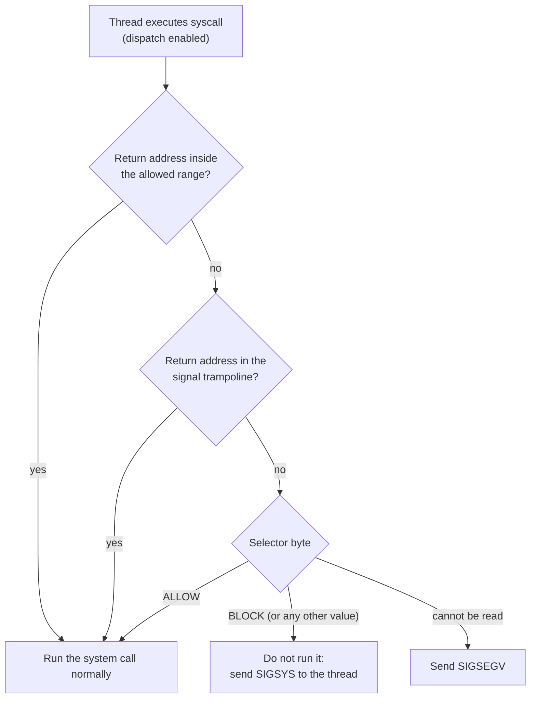
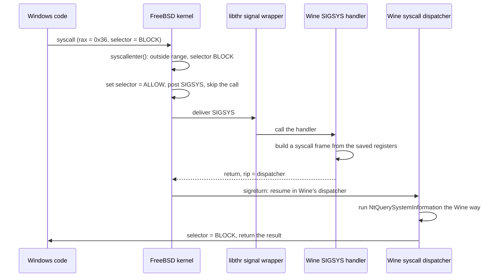

# Syscall dispatch: letting Wine catch the system calls of Windows code on FreeBSD

[wine_direct_syscalls.md](wine_direct_syscalls.md) explains the problem:
some Windows programs, mostly copy protection and anti-cheat systems,
execute the CPU `syscall` instruction themselves, and on FreeBSD that
instruction goes straight to the FreeBSD kernel, which runs whatever
FreeBSD system call has the same number. Wine never sees it.

This document explains the fix that was built: a new FreeBSD kernel
feature, `procctl(PROC_SYSCALL_DISPATCH_CTL)`, and the Wine code that uses
it. With both, the *Black Myth: Wukong Benchmark Tool* (protected by
Denuvo), which used to crash or eat all the memory at startup, runs on
FreeBSD.

It is written for a reader who has read the first document, or who knows
what a system call, a signal and a thread are.

Files:

- Kernel patch: [procctl_syscall_dispatch.patch](procctl_syscall_dispatch.patch)
  (FreeBSD main `30e3fd1811e3`)
- Test program: [procctl_syscall_dispatch_test.c](procctl_syscall_dispatch_test.c)
- Wine side: [wine-proton_syscall_dispatch.patch](wine-proton_syscall_dispatch.patch)
  (wine-proton 11.0-2 sources); in the `emulators/wine-proton` port it is
  part of `patch-dlls_ntdll_unix_signal__x86__64.c`,
  `patch-dlls_ntdll_unix_loader.c` and `patch-dlls_ntdll_unix_unix__private.h`
  (wine-proton 11.0.2_5)

## TL;DR

- A thread tells the kernel: "system calls coming from this address range
  are mine, let them run; for the others, look at this byte in my memory:
  if it says *block*, do not run the system call, send me `SIGSYS`
  instead".
- Wine flips that byte itself with a single memory write: *allow* while
  its own code runs, *block* while Windows code runs. No system call is
  needed to switch, so the switch costs almost nothing.
- Wine's `SIGSYS` handler reads the system call number and arguments from
  the registers and runs Wine's own version of the Windows call.
- The semantics copy Linux's *Syscall User Dispatch*, which upstream Wine
  already uses since 11.5, so the Wine port is small.
- Two FreeBSD details needed extra kernel code: the kernel's system call
  entry does not save the `%r10` register where the handler expects it,
  and FreeBSD's thread library makes system calls inside its signal
  wrapper, before Wine's handler can flip the byte.
- Result: the benchmark gets 226 Windows system calls trapped and
  emulated during its startup, then compiles its shaders and runs.

## 1. The idea: an address range and a selector byte

The kernel must decide, for every system call of a Wine thread, whether
it comes from Windows code (trap it) or from native code (run it). It
cannot know which code is "Windows" by itself, so the thread tells it,
in two ways:

1. **An allowed address range.** A system call whose return address is
   inside `[start, start + len)` always runs normally. Wine gives the
   range of `libsys.so.7`, the FreeBSD library that contains the
   `syscall` instructions of libc and libthr (449 of them on this system;
   libc itself keeps only four functions with their own `syscall`
   instruction: `getcontext`, `vfork`, `rfork_thread` and
   `pdrfork_thread`).
2. **A selector byte.** For a system call made from anywhere else, the
   kernel reads one byte in the thread's memory:
   `PROC_SYSCALL_DISPATCH_ALLOW` (0) lets it run,
   `PROC_SYSCALL_DISPATCH_BLOCK` (1) traps it.

Why a byte in memory and not a system call to switch interception on and
off? Because Wine switches very often: every time Windows code calls into
Wine and back, tens of thousands of times per second in a game. Writing
one byte costs one CPU instruction; a system call costs hundreds of
cycles each way.



The signal trampoline is the small piece of code, in a page the kernel
maps into every process, that returns from a signal handler by calling
`sigreturn(2)`. It must always be allowed, otherwise no signal handler
could ever return.

## 2. The interface

Like several other per-process settings in FreeBSD (ASLR, W^X, tracing),
the feature is a `procctl(2)` command. The argument is a structure
(`sys/sys/procctl.h`):

```c
struct procctl_syscall_dispatch {
	int		sd_mode;	/* PROC_SYSCALL_DISPATCH_ON/OFF */
	int		sd_pad0;
	uintptr_t	sd_start;	/* syscalls returning into */
	size_t		sd_len;		/*   [start, start + len) run */
	char		*sd_selector;	/* NULL or byte, see below */
	u_int		sd_pad1[8];
};
```

Enabling it for the calling thread:

```c
struct procctl_syscall_dispatch sd = {
	.sd_mode = PROC_SYSCALL_DISPATCH_ON,
	.sd_start = libsys_start,
	.sd_len = libsys_len,
	.sd_selector = &my_selector_byte,
};
procctl(P_PID, 0, PROC_SYSCALL_DISPATCH_CTL, &sd);
```

`PROC_SYSCALL_DISPATCH_STATUS` reads the setting back. The padding fields
leave room for later extensions without changing the structure size.

When a system call is trapped, the thread receives `SIGSYS` with:

| Field | Value |
|---|---|
| `si_code` | `SYS_USER_DISPATCH` (2, the same value as Linux) |
| `si_addr` | the address right after the `syscall` instruction |
| `si_syscall` | the system call number |
| registers in the signal context | exactly as the `syscall` instruction left them: number in `rax`, arguments in `rdi`, `rsi`, `rdx`, `r10`, `r8`, `r9` |

The handler can change the saved registers (for example put a return
value in `rax`) and return; the thread then continues after the `syscall`
instruction as if the kernel had run it.

**Lifecycle**, the same as on Linux: the setting belongs to one thread.
New threads start without it (Wine enables it in each thread), a child
created by `fork(2)` starts without it, and `execve(2)` clears it.

## 3. The kernel path

All FreeBSD system calls go through one function, `syscallenter()` in
`sys/kern/subr_syscall.c`. It decodes the system call number and
arguments, lets a debugger stop the thread if one is attached, checks
Capsicum, then calls the handler. The patch adds one test before the
arguments are decoded, because a trapped call follows Windows
conventions, not FreeBSD's (decoding a FreeBSD call with more than six
arguments reads the user stack and could fail before the trap):

```c
	/* Before decoding the arguments: they are not FreeBSD's. */
	if (__predict_false((td->td_pflags2 & TDP2_SYSCALL_DISPATCH) != 0) &&
	    syscall_dispatch_trap(td)) {
		td->td_errno = error = EJUSTRETURN;
		goto retval;
	}
```

- `td_pflags2` is a field of the current thread that `syscallenter()`
  already reads a few lines above, so for every thread that does not use
  the feature the cost is one bit test on data already in the cache.
- `syscall_dispatch_trap()` (in `sys/kern/kern_procctl.c`) applies the
  rules of section 1 and, if the call must be trapped, posts `SIGSYS`
  with `trapsignal()` and returns true.
- `EJUSTRETURN` is an existing error code meaning "return to user mode
  without touching the registers"; `sigreturn(2)` uses it too. It is what
  keeps `rax` holding the system call number for the handler.



## 4. Three FreeBSD-specific problems found on the way

### 4.1 The registers were not where the handler looked

Linux and Windows pass the fourth system call argument in `%r10`, because
the `syscall` instruction overwrites `%rcx` with the return address. The
first test showed that a FreeBSD signal handler saw garbage in `r10`.
The reason is in `sys/amd64/amd64/exception.S`, the assembly entry point
of system calls:

```
	movq	%r10,TF_RCX(%rsp)	/* arg 4 */
```

The kernel stores the user's `%r10` in the slot of the saved frame that is
named after `%rcx` (FreeBSD's C code expects the fourth argument there),
and never saves `%r10` or `%r11` themselves. That is fine for normal system
calls, but a signal handler would read the fourth argument in `rcx` and
junk in `r10` and `r11`. Before posting `SIGSYS`, `syscall_dispatch_trap()`
now rebuilds what the CPU really had:

```c
		td->td_frame->tf_r10 = td->td_frame->tf_rcx;
		td->td_frame->tf_rcx = td->td_frame->tf_rip;
		td->td_frame->tf_r11 = td->td_frame->tf_rflags;
		set_pcb_flags(td->td_pcb, PCB_FULL_IRET);
```

`rcx` gets the return address and `r11` the flags, which is what the
`syscall` instruction puts there. `PCB_FULL_IRET` makes the kernel return
to user mode through the slow path that restores every register.

### 4.2 Code ran before Wine could flip the selector

On Linux, when a signal arrives, the kernel jumps straight to the
program's handler. On FreeBSD, libthr (the thread library) installs its
own wrapper, `thr_sighandler()` in `lib/libthr/thread/thr_sig.c`, and it
calls the program's handler from there. Before doing so, the wrapper
takes a lock and calls `__sys_sigprocmask()`.

If a signal arrives while Windows code runs, the selector says BLOCK, and
Wine's handler only sets ALLOW once it starts running. With libsys as the
allowed range, the wrapper's `__sys_sigprocmask()` comes from libsys and
is allowed. But libthr makes one system call itself, outside libsys:
`_umtx_op_err()`, used when the wrapper's lock is contended. That one
would be trapped, and so would every system call of a program that uses
a smaller allowed range than libsys. This comes from reading
`thr_sig.c`: it is a rare case, and no test has triggered it.

The fix, an idea taken from XaeroVincent's patch (section 7), is in
`sendsig()`, the amd64 function that builds the signal frame: it sets the
selector to ALLOW when it delivers a signal to a thread that uses the
feature. Signal handlers are native code, so that is the right state.

Setting the byte is only half of it: the first version never put the
old value back, and the FreeBSD review checklist (section 8) caught it.
Wine's own handlers set BLOCK again in `leave_handler()` when they return
to Windows code, but handlers Wine does not own (libthr's internal
signal, a handler installed by a native library) would return to Windows
code with the selector stuck at ALLOW, and its next direct system call
would run as a FreeBSD call again.

So `sendsig()` also saves the previous value in the signal frame (in
`mc_spare[0]` of the saved machine context, tagged so that a random
value is never mistaken for it), and `sigreturn(2)` writes it back,
unless the handler wrote the byte itself. That last condition matters:
a Wine handler that redirects the thread into Windows code sets BLOCK
itself, and a SIGSYS handler that emulates a call sets ALLOW to keep
running native code; the kernel must not undo either.

To tell "the handler wrote ALLOW" from "the handler did not touch the
byte", the kernel does not write ALLOW (0) at signal delivery but a third
value, `PROC_SYSCALL_DISPATCH_ALLOW_SIGNAL` (2), which also allows system
calls. A first version wrote 0 and restored the old value whenever it
still read 0: the test program hung, because its SIGSYS handler's ALLOW
was turned back into BLOCK and every later system call of the test,
including `printf`'s `write`, was trapped and faked.

| Selector before the signal | Byte when the handler returns | After `sigreturn(2)` |
|---|---|---|
| BLOCK | ALLOW_SIGNAL (handler did not touch it) | BLOCK, restored |
| BLOCK | ALLOW or BLOCK (handler wrote it) | the handler's choice |
| ALLOW | ALLOW | ALLOW, nothing was saved |

### 4.3 Signals deferred by rtld and libthr

FreeBSD's run-time linker and thread library do not block signals with
`sigprocmask(2)` around their critical sections. They use a cheaper
mechanism, `sigfastblock(2)`: a word in user memory that the kernel reads
before delivering a signal. While it is non-zero, signals wait.

Both still make system calls while that word is set: rtld calls
`mprotect` while loading libraries, libthr calls `_umtx_op` when a lock is
contended. Wine never noticed, because it allows the whole of libsys and
only traps while Windows code runs. A tool that traps everything outside
its own small stub (see `FreeBSD/sudtrace`) hit it on the first
instruction after turning the feature on: `trapsignal()` saw a deferred
SIGSYS, could not deliver it, and killed the process with
"Bad system call".

The fix is one condition in `trapsignal()`: the fast-block word is ignored
for a SIGSYS whose code is `SYS_USER_DISPATCH`. The handler belongs to the
program that asked for the trap, and it has to be written to run anywhere
anyway. A signal blocked with `sigprocmask(2)` still kills the process, as
on Linux. The man page now says both.

One trap remains for such a tool: it must install its SIGSYS handler with
the raw system call (`__sys_sigaction`), not with libthr's `sigaction()`.
libthr's version holds a lock on the SIGSYS slot while it makes the system
call; if that call is trapped, libthr's signal wrapper waits for the same
lock and the thread hangs. Wine allows the whole of libsys, so its
`sigaction()` call is never trapped, and `FreeBSD/sudtrace` installs its
handler directly.

## 5. Keeping kernel modules working

Every kernel thread is described by a `struct thread`. The feature needs
three new fields in it: the selector address, the range start and the
range length. The first version put them in the middle of the structure,
and the kernel did not even compile:

```
kern_thread.c:93: static assertion failed due to requirement
'__builtin_offsetof(struct thread, td_frame) == 1256': struct thread KBI td_frame
```

FreeBSD checks the position (offset) of a few fields of `struct thread`,
because kernel modules built separately, such as the `amdgpu.ko` graphics
driver from the `drm-kmod` port, read some of these fields directly. If a
field moves, an old module reads the wrong memory and can crash the
machine. On FreeBSD's development branch, moving fields is allowed if the
assertions are updated, but then every such module must be rebuilt.

The final version puts the three fields at the very end of
`struct thread`. No existing field moves, the assertions stay as they
are, and modules keep working.

## 6. The Wine side

Upstream Wine 11.5 already supports Linux's Syscall User Dispatch
(commits `cbb9906d` and `b90cdc04d77`). The FreeBSD port of
wine-proton 11.0 follows them, in `dlls/ntdll/unix/signal_x86_64.c`:

| Where | What |
|---|---|
| `struct amd64_thread_data` | a new `char syscall_dispatch` at offset `0x340` of the TEB (Windows' per-thread block), same as upstream |
| `signal_init_process()` | finds the address range of `libsys.so.7` with `dl_iterate_phdr()` (upstream uses `libc.so.6` on Linux) and installs the `SIGSYS` handler |
| `init_syscall_frame()` | runs in every new thread and calls `procctl(PROC_SYSCALL_DISPATCH_CTL)`; if the kernel does not support it, one warning is logged and Wine runs as before |
| `__wine_syscall_dispatcher`, `__wine_unix_call_dispatcher` | `movb $0,0x340(%r13)` (ALLOW) when Windows code enters Wine |
| the three paths back to Windows code | `movb $1,0x340(%r13)` (BLOCK) |
| `init_handler()` / `leave_handler()` | ALLOW when a signal handler starts, BLOCK when it returns to Windows code |
| `sigsys_handler()` | the macOS handler, now also used on FreeBSD: it turns the trapped call into a normal call of Wine's dispatcher. A `SIGSYS` with another `si_code` (an invalid native system call) is ignored |

`%r13` holds the address of the current thread's TEB in those functions,
so `0x340(%r13)` is the selector byte of the running thread.

## 7. Comparison with other work

| | Linux Syscall User Dispatch | XaeroVincent's `freebsd-sud.patch` | this patch |
|---|---|---|---|
| Interface | `prctl(PR_SET_SYSCALL_USER_DISPATCH)` | `procctl(PROC_SUD_SET)` | `procctl(PROC_SYSCALL_DISPATCH_CTL)` |
| Where the check runs | generic entry code | amd64 assembly | `syscallenter()`, generic C code |
| `rax` seen by the handler | system call number | `ENOSYS`, number only in `si_syscall` | system call number |
| Exemptions | vdso signal return | `sigreturn`, `sigfastblock` by number | signal trampoline by address |
| Selector unreadable | `SIGSEGV` | system call runs | `SIGSEGV` |
| Selector on signal delivery | unchanged | set to ALLOW, never restored | set to ALLOW_SIGNAL, restored by `sigreturn` unless the handler wrote it (section 4.2) |
| fork / new thread / exec | off / off / off | off / off / off | off / off / off |

[XaeroVincent/FreeBSD-Gaming-Kernel](https://github.com/XaeroVincent/FreeBSD-Gaming-Kernel)
targets FreeBSD 15.1, with a Wine side in
[FreeBSD-Proton-Experimental](https://github.com/FreeBSD-Proton-Experimental-Porters/FreeBSD-Proton-Experimental).
Both use `procctl` commands 25 and 26, so the two patches cannot be
installed together; they should be merged before going upstream.

## 8. Testing

[procctl_syscall_dispatch_test.c](procctl_syscall_dispatch_test.c) checks
the kernel side without Wine. It enables dispatch with an empty allowed
range and a selector, then executes a raw `syscall` for `getpid` from
inline assembly, with a known value in `r10`:

```
PASS: status reports ON with our selector
PASS: blocked syscall is emulated by the SIGSYS handler
PASS: the handler's ALLOW survives sigreturn
PASS: si_code is SYS_USER_DISPATCH
PASS: si_syscall and rax hold the syscall number
PASS: r10 holds the fourth argument, rcx the return address
PASS: selector ALLOW runs the real syscall
PASS: signal delivery sets the selector to ALLOW_SIGNAL
PASS: sigreturn restores BLOCK the handler left alone
PASS: fork(2) child starts with the setting off
PASS: OFF is accepted
PASS: after OFF, BLOCK no longer traps
```

Run on the final kernel (main `30e3fd1811e3` with the patch). Before the
checks, the program also verifies that a non-zero padding member is
refused with `EINVAL`.

On a kernel without the patch it stops at the first `procctl` call with
`Invalid argument`.

### Kyua test for the FreeBSD tree

For upstream, the same checks and a few more are an ATF test in the
kernel test suite, `tests/sys/kern/procctl_syscall_dispatch.c`, built on
amd64 only and linked with libthr so that signals go through its wrapper
(it is part of [procctl_syscall_dispatch.patch](procctl_syscall_dispatch.patch)).
Unlike the stand-alone program, it uses libsys as the allowed range, as
Wine does, and makes its trapped calls from a small assembly function:

| Test case | Checks |
|---|---|
| `ctl_invalid` | `EINVAL` for non-zero padding, a bad mode, OFF with fields, a wrapping range, another process |
| `status` | `STATUS` reports OFF, then the ON settings, then OFF |
| `trap` | SIGSYS, `si_code`, `si_syscall`, `si_addr`, `rax`, `r10`, `rcx`, emulated return value, the handler's ALLOW kept |
| `selector_allow` | ALLOW runs the real system call |
| `range_allow` | a call from libsys runs while the selector says BLOCK |
| `null_selector` | no selector: every call from outside the range traps |
| `selector_fault` | unreadable selector: SIGSEGV with its address, call not run |
| `signal_selector` | ALLOW_SIGNAL inside a timer handler, BLOCK restored after it, no trap in libthr's wrapper |
| `fastblock` | a trap while rtld/libthr defer signals with `sigfastblock(2)` is delivered, not fatal |
| `fork_off` | a `fork(2)` child starts with the feature off |
| `off` | after OFF, BLOCK no longer traps |

```
$ kyua test -k Kyuafile
...
11/11 passed (0 broken, 0 failed, 0 skipped)
```

### Review

The patch went through the FreeBSD commit-review checklist
(`.agents/skills/freebsd-src/review.md`), by a reviewer that saw only the
checklist and the patch. It found three bugs, all fixed:

1. The selector reset at signal delivery was never undone, so a handler
   Wine does not own left direct system calls untrapped (section 4.2).
2. When the selector byte could not be read, `SIGSEGV` was posted before
   the register fix-up, so that handler saw the wrong `rcx`, `r10` and
   `r11`. The fix-up now happens before either signal.
3. The check ran after the arguments were decoded; for a Windows call
   whose number matches a FreeBSD call with more than six arguments, the
   decoding could fail with `EFAULT` before the trap (section 3).

It also asked for: the `EINVAL` cases in the man page's ERRORS section,
zero padding enforced so the padding can be given a meaning later, and
syzkaller descriptions for the new interface.

With the real game, `ktrace -t cs -p <pid>` on the benchmark showed:

- 173 calls to `procctl(P_PID,0,25,...)`, one per thread, all returning 0;
- 226 `PSIG SIGSYS`: Windows system calls trapped and emulated by Wine;
- none of the bogus `ioctl(<pointer>, ...)` calls of the failing runs, and
  no 68 GB memory request;
- memory steady around 4.4 GB, where the failing runs grew past 30 GB in
  seconds; the benchmark compiled its shaders and ran to the end.

## 9. Performance

Not measured with a benchmark yet. From the code:

| Case | Extra cost per system call |
|---|---|
| any process not using the feature | one bit test |
| Wine thread, call from libsys | the bit test and one subtract-and-compare |
| Wine thread, call from elsewhere with the selector at ALLOW | the above and a one-byte read of user memory |
| trapped Windows system call | a full signal round trip, a few microseconds, instead of about 0.1 µs through Wine's normal path; without the feature the call cannot work at all |

The kernel functions can be observed with DTrace without any extra code,
for example to count trapped and allowed calls per program:

```sh
dtrace -n 'fbt::syscall_dispatch_trap:return { @[execname, arg1 ? "trapped" : "allowed"] = count(); }'
```

## 10. Other uses

The feature is not specific to Denuvo, games or even Wine. It answers one
question: "a process wants to handle some of its own system calls itself,
chosen by where they come from, without a debugger and without paying
for the others". Anything that needs that can use it.

### Interposition tools that miss Go programs

Tools such as torsocks, proxychains, fakeroot or libfaketime replace libc
functions with `LD_PRELOAD`. A program that makes its own system calls
never calls those functions, and the tool silently does nothing: Go
programs do this even when they are linked against libc. The only
alternative today is `ptrace(2)`, with a second process stopping on every
call.

With syscall dispatch, a preloaded library allows only its own small stub
and traps everything else. `FreeBSD/sudtrace` is a demonstration: with the
GitHub client `gh`, a classic `LD_PRELOAD` hook sees none of its file
opens or network connections, while the dispatch version sees all of them
and reports that 2375 of its 2829 system calls never go through libc. The
research tool lazypoline (DSN 2024) builds the same kind of interposer on
the Linux feature.

### Other Windows programs on Wine

Any Windows program that executes `syscall` itself hits the same wall as
the benchmark, and the same Wine code handles it:

- other copy protection systems and user-mode anti-cheat components;
- launchers and applications that call `ntdll` system calls directly to
  avoid hooks;
- tools and samples studied under Wine in malware analysis, which often
  make direct system calls precisely to avoid monitoring.

### Other compatibility layers in user space

Wine's model, running foreign machine code natively and translating only
its requests to the operating system, works for other systems too. A
layer that runs, say, another Unix-like system's binaries can catch their
system calls with this feature and translate them in a library, instead
of adding a new system call personality to the kernel the way FreeBSD's
Linux compatibility layer does. A library is easier to write, debug and
update than kernel code, at the price of a signal per trapped call.

Binary translators, which rewrite machine code before running it (to run
amd64 code on arm64, for example), see every system call during
translation and need this less, but can use it for code they leave
untranslated.

### Selective interception without a debugger

`ptrace(2)` and `ktrace(1)` see every system call of a process. Syscall
dispatch traps only the calls made from outside a chosen range, so a
program can watch one part of itself and leave the rest at full speed:

- tracing or profiling the system calls of a single library, plugin or
  JIT-compiled region inside a large program;
- record and replay tools, which need to intercept the application's own
  system calls but not those of the tool itself;
- fault injection in tests: make the system calls of one module fail on
  purpose (return `ENOSPC`, `EINTR`, ...) to test its error handling,
  without touching the rest of the process.

### User-space kernels

Projects in the style of gVisor run a program on top of a kernel written
in user space, which must receive every system call the program makes.
On Linux, gVisor's newest backend traps them with seccomp signals, the
same mechanism Proton uses. Syscall dispatch, with an allowed range
covering the user-space kernel itself, gives FreeBSD the equivalent
building block.

### What it is not: a security boundary

The selector byte lives in the process's own memory, so the trapped code
can write ALLOW into it and make its system calls directly; it can also
jump into the allowed range. Syscall dispatch only helps cooperating
code. Linux's documentation says the same of Syscall User Dispatch. To
confine untrusted code on FreeBSD, use Capsicum (`cap_enter(2)`), jails
or a MAC policy instead.

## 11. Limitations and next steps

- amd64 only: the register fix-up and the signal-frame save and restore
  are amd64 code, so other architectures return `EOPNOTSUPP`, and 32-bit
  (freebsd32) processes cannot enable the feature.
- A system call made from native code outside libsys while the selector
  is BLOCK would be trapped. In practice the selector is ALLOW whenever
  Wine's native code runs, and Wine has upstream's fallback: loading an
  old-style `.so` builtin DLL turns the feature off for the process.
- Upstream FreeBSD: needs review on Phabricator, a merge with
  XaeroVincent's work (the `procctl` numbers clash), and syzkaller
  descriptions for the new `procctl` commands. The patch does not bump
  `__FreeBSD_version`: earlier `procctl` additions did not either, and
  programs detect the feature with `#ifdef PROC_SYSCALL_DISPATCH_CTL` and
  `EINVAL` at run time. A bump, made in its own commit at commit time,
  would only help if the Wine ports want to apply their patch based on
  `OSVERSION`.
- Upstream Wine: the FreeBSD branch is a few lines on top of the Linux
  code, but WineHQ asks contributors not to submit code written with an
  LLM, which this is.

## Glossary

- **Return address:** the address of the instruction right after the
  `syscall` instruction, where the thread continues afterwards.
- **Selector byte:** one byte in the thread's memory that tells the
  kernel whether to trap system calls made from outside the allowed range.
- **Signal trampoline:** kernel-provided code that calls `sigreturn(2)`
  when a signal handler returns.
- **Trap frame (`struct trapframe`):** the copy of the user registers the
  kernel saves when a thread enters it.
- **TEB (Thread Environment Block):** the Windows per-thread data block;
  Wine keeps its own per-thread data in it.
- **libthr:** FreeBSD's POSIX threads library; it wraps signal handlers.
- **libsys:** the FreeBSD library that holds the system call stubs used by
  libc and libthr.
- **KBI (Kernel Binary Interface):** the layout of kernel structures that
  separately built modules rely on.
