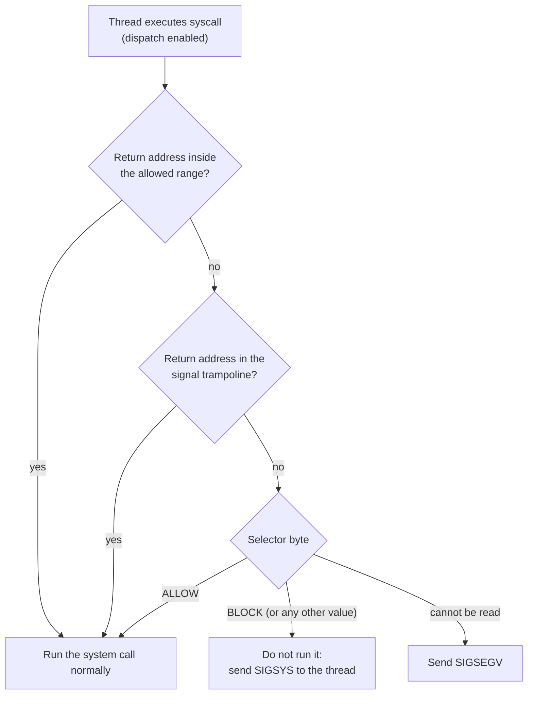
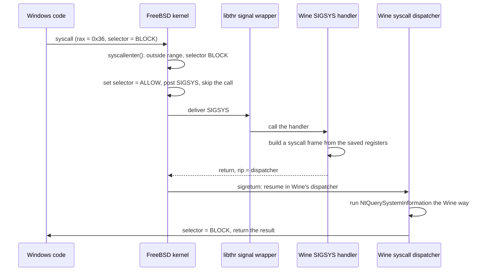

# Syscall dispatch: letting Wine catch the system calls of Windows code on FreeBSD

[wine_direct_syscalls.md](wine_direct_syscalls.md) explains the problem:
some Windows programs, mostly copy protection and anti-cheat systems,
execute the CPU `syscall` instruction themselves, and on FreeBSD that
instruction goes straight to the FreeBSD kernel, which runs whatever
FreeBSD system call has the same number. Wine never sees it.

This document explains the fix that was built: a new FreeBSD kernel
feature, `procctl(PROC_SYSCALL_DISPATCH_CTL)`, and the Wine code that uses
it. With both, the *Black Myth: Wukong Benchmark Tool* (protected by
Denuvo), which used to crash or eat all the memory at startup, runs on
FreeBSD.

It is written for a reader who has read the first document, or who knows
what a system call, a signal and a thread are.

Files:

- Kernel patch: [procctl_syscall_dispatch.patch](procctl_syscall_dispatch.patch)
  (FreeBSD main `30e3fd1811e3`)
- Test program: [procctl_syscall_dispatch_test.c](procctl_syscall_dispatch_test.c)
- Wine side: [wine-proton_syscall_dispatch.patch](wine-proton_syscall_dispatch.patch)
  (wine-proton 11.0-2 sources); in the `emulators/wine-proton` port it is
  part of `patch-dlls_ntdll_unix_signal__x86__64.c`,
  `patch-dlls_ntdll_unix_loader.c` and `patch-dlls_ntdll_unix_unix__private.h`
  (wine-proton 11.0.2_5)

## TL;DR

- A thread tells the kernel: "system calls coming from this address range
  are mine, let them run; for the others, look at this byte in my memory:
  if it says *block*, do not run the system call, send me `SIGSYS`
  instead".
- Wine flips that byte itself with a single memory write: *allow* while
  its own code runs, *block* while Windows code runs. No system call is
  needed to switch, so the switch costs almost nothing.
- Wine's `SIGSYS` handler reads the system call number and arguments from
  the registers and runs Wine's own version of the Windows call.
- The semantics copy Linux's *Syscall User Dispatch*, which upstream Wine
  already uses since 11.5, so the Wine port is small.
- Two FreeBSD details needed extra kernel code: the kernel's system call
  entry does not save the `%r10` register where the handler expects it,
  and FreeBSD's thread library makes system calls inside its signal
  wrapper, before Wine's handler can flip the byte.
- Result: the benchmark gets 226 Windows system calls trapped and
  emulated during its startup, then compiles its shaders and runs.

## 1. The idea: an address range and a selector byte

The kernel must decide, for every system call of a Wine thread, whether
it comes from Windows code (trap it) or from native code (run it). It
cannot know which code is "Windows" by itself, so the thread tells it,
in two ways:

1. **An allowed address range.** A system call whose return address is
   inside `[start, start + len)` always runs normally. Wine gives the
   range of `libsys.so.7`, the FreeBSD library that contains the
   `syscall` instructions of libc and libthr (449 of them on this system;
   libc itself keeps only four functions with their own `syscall`
   instruction: `getcontext`, `vfork`, `rfork_thread` and
   `pdrfork_thread`).
2. **A selector byte.** For a system call made from anywhere else, the
   kernel reads one byte in the thread's memory:
   `PROC_SYSCALL_DISPATCH_ALLOW` (0) lets it run,
   `PROC_SYSCALL_DISPATCH_BLOCK` (1) traps it.

Why a byte in memory and not a system call to switch interception on and
off? Because Wine switches very often: every time Windows code calls into
Wine and back, tens of thousands of times per second in a game. Writing
one byte costs one CPU instruction; a system call costs hundreds of
cycles each way.



The signal trampoline is the small piece of code, in a page the kernel
maps into every process, that returns from a signal handler by calling
`sigreturn(2)`. It must always be allowed, otherwise no signal handler
could ever return.

## 2. The interface

Like several other per-process settings in FreeBSD (ASLR, W^X, tracing),
the feature is a `procctl(2)` command. The argument is a structure
(`sys/sys/procctl.h`):

```c
struct procctl_syscall_dispatch {
	int		sd_mode;	/* PROC_SYSCALL_DISPATCH_ON/OFF */
	int		sd_pad0;
	uintptr_t	sd_start;	/* syscalls returning into */
	size_t		sd_len;		/*   [start, start + len) run */
	char		*sd_selector;	/* NULL or byte, see below */
	u_int		sd_pad1[8];
};
```

Enabling it for the calling thread:

```c
struct procctl_syscall_dispatch sd = {
	.sd_mode = PROC_SYSCALL_DISPATCH_ON,
	.sd_start = libsys_start,
	.sd_len = libsys_len,
	.sd_selector = &my_selector_byte,
};
procctl(P_PID, 0, PROC_SYSCALL_DISPATCH_CTL, &sd);
```

`PROC_SYSCALL_DISPATCH_STATUS` reads the setting back. The padding fields
leave room for later extensions without changing the structure size.

When a system call is trapped, the thread receives `SIGSYS` with:

| Field | Value |
|---|---|
| `si_code` | `SYS_USER_DISPATCH` (2, the same value as Linux) |
| `si_addr` | the address right after the `syscall` instruction |
| `si_syscall` | the system call number |
| registers in the signal context | exactly as the `syscall` instruction left them: number in `rax`, arguments in `rdi`, `rsi`, `rdx`, `r10`, `r8`, `r9` |

The handler can change the saved registers (for example put a return
value in `rax`) and return; the thread then continues after the `syscall`
instruction as if the kernel had run it.

**Lifecycle**, the same as on Linux: the setting belongs to one thread.
New threads start without it (Wine enables it in each thread), a child
created by `fork(2)` starts without it, and `execve(2)` clears it.

## 3. The kernel path

All FreeBSD system calls go through one function, `syscallenter()` in
`sys/kern/subr_syscall.c`. It fetches the system call number and
arguments, lets a debugger stop the thread if one is attached, checks
Capsicum, then calls the handler. The patch adds one test after the
debugger step:

```c
	if (__predict_false((td->td_pflags2 & TDP2_SYSCALL_DISPATCH) != 0) &&
	    syscall_dispatch_trap(td)) {
		td->td_errno = error = EJUSTRETURN;
		goto retval;
	}
```

- `td_pflags2` is a field of the current thread that `syscallenter()`
  already reads a few lines above, so for every thread that does not use
  the feature the cost is one bit test on data already in the cache.
- `syscall_dispatch_trap()` (in `sys/kern/kern_procctl.c`) applies the
  rules of section 1 and, if the call must be trapped, posts `SIGSYS`
  with `trapsignal()` and returns true.
- `EJUSTRETURN` is an existing error code meaning "return to user mode
  without touching the registers"; `sigreturn(2)` uses it too. It is what
  keeps `rax` holding the system call number for the handler.



## 4. Two FreeBSD-specific problems found on the way

### 4.1 The registers were not where the handler looked

Linux and Windows pass the fourth system call argument in `%r10`, because
the `syscall` instruction overwrites `%rcx` with the return address. The
first test showed that a FreeBSD signal handler saw garbage in `r10`.
The reason is in `sys/amd64/amd64/exception.S`, the assembly entry point
of system calls:

```
	movq	%r10,TF_RCX(%rsp)	/* arg 4 */
```

The kernel stores the user's `%r10` in the slot of the saved frame that is
named after `%rcx` (FreeBSD's C code expects the fourth argument there),
and never saves `%r10` or `%r11` themselves. That is fine for normal system
calls, but a signal handler would read the fourth argument in `rcx` and
junk in `r10` and `r11`. Before posting `SIGSYS`, `syscall_dispatch_trap()`
now rebuilds what the CPU really had:

```c
		td->td_frame->tf_r10 = td->td_frame->tf_rcx;
		td->td_frame->tf_rcx = td->td_frame->tf_rip;
		td->td_frame->tf_r11 = td->td_frame->tf_rflags;
		set_pcb_flags(td->td_pcb, PCB_FULL_IRET);
```

`rcx` gets the return address and `r11` the flags, which is what the
`syscall` instruction puts there. `PCB_FULL_IRET` makes the kernel return
to user mode through the slow path that restores every register.

### 4.2 Code ran before Wine could flip the selector

On Linux, when a signal arrives, the kernel jumps straight to the
program's handler. On FreeBSD, libthr (the thread library) installs its
own wrapper, `thr_sighandler()` in `lib/libthr/thread/thr_sig.c`, and it
calls the program's handler from there. Before doing so, the wrapper
takes a lock and calls `__sys_sigprocmask()`.

If a signal arrives while Windows code runs, the selector says BLOCK, and
Wine's handler only sets ALLOW once it starts running. With libsys as the
allowed range, the wrapper's `__sys_sigprocmask()` is allowed, but a
contended lock makes libthr's `_umtx_op_err()` execute its own `syscall`
instruction, outside the range, and any program using a different range
would be hit harder. The test program, which allows no range at all, made
this visible: with the selector at BLOCK, a timer signal's wrapper had its
`sigprocmask` trapped and "emulated" instead of executed.

The fix, an idea taken from XaeroVincent's patch (section 7), is in
`sendsig()`, the amd64 function that builds the signal frame: it sets the
selector to ALLOW when it delivers a signal to a thread that uses the
feature. Signal handlers are native code, so that is the right state.
Wine already sets the selector back to BLOCK in `leave_handler()` when a
handler returns to Windows code, so nothing is lost.

## 5. Keeping kernel modules working

Every kernel thread is described by a `struct thread`. The feature needs
three new fields in it: the selector address, the range start and the
range length. The first version put them in the middle of the structure,
and the kernel did not even compile:

```
kern_thread.c:93: static assertion failed due to requirement
'__builtin_offsetof(struct thread, td_frame) == 1256': struct thread KBI td_frame
```

FreeBSD checks the position (offset) of a few fields of `struct thread`,
because kernel modules built separately, such as the `amdgpu.ko` graphics
driver from the `drm-kmod` port, read some of these fields directly. If a
field moves, an old module reads the wrong memory and can crash the
machine. On FreeBSD's development branch, moving fields is allowed if the
assertions are updated, but then every such module must be rebuilt.

The final version puts the three fields at the very end of
`struct thread`. No existing field moves, the assertions stay as they
are, and modules keep working.

## 6. The Wine side

Upstream Wine 11.5 already supports Linux's Syscall User Dispatch
(commits `cbb9906d` and `b90cdc04d77`). The FreeBSD port of
wine-proton 11.0 follows them, in `dlls/ntdll/unix/signal_x86_64.c`:

| Where | What |
|---|---|
| `struct amd64_thread_data` | a new `char syscall_dispatch` at offset `0x340` of the TEB (Windows' per-thread block), same as upstream |
| `signal_init_process()` | finds the address range of `libsys.so.7` with `dl_iterate_phdr()` (upstream uses `libc.so.6` on Linux) and installs the `SIGSYS` handler |
| `init_syscall_frame()` | runs in every new thread and calls `procctl(PROC_SYSCALL_DISPATCH_CTL)`; if the kernel does not support it, one warning is logged and Wine runs as before |
| `__wine_syscall_dispatcher`, `__wine_unix_call_dispatcher` | `movb $0,0x340(%r13)` (ALLOW) when Windows code enters Wine |
| the three paths back to Windows code | `movb $1,0x340(%r13)` (BLOCK) |
| `init_handler()` / `leave_handler()` | ALLOW when a signal handler starts, BLOCK when it returns to Windows code |
| `sigsys_handler()` | the macOS handler, now also used on FreeBSD: it turns the trapped call into a normal call of Wine's dispatcher. A `SIGSYS` with another `si_code` (an invalid native system call) is ignored |

`%r13` holds the address of the current thread's TEB in those functions,
so `0x340(%r13)` is the selector byte of the running thread.

## 7. Comparison with other work

| | Linux Syscall User Dispatch | XaeroVincent's `freebsd-sud.patch` | this patch |
|---|---|---|---|
| Interface | `prctl(PR_SET_SYSCALL_USER_DISPATCH)` | `procctl(PROC_SUD_SET)` | `procctl(PROC_SYSCALL_DISPATCH_CTL)` |
| Where the check runs | generic entry code | amd64 assembly | `syscallenter()`, generic C code |
| `rax` seen by the handler | system call number | `ENOSYS`, number only in `si_syscall` | system call number |
| Exemptions | vdso signal return | `sigreturn`, `sigfastblock` by number | signal trampoline by address |
| Selector unreadable | `SIGSEGV` | system call runs | `SIGSEGV` |
| Selector on signal delivery | unchanged | set to ALLOW | set to ALLOW (section 4.2) |
| fork / new thread / exec | off / off / off | off / off / off | off / off / off |

[XaeroVincent/FreeBSD-Gaming-Kernel](https://github.com/XaeroVincent/FreeBSD-Gaming-Kernel)
targets FreeBSD 15.1, with a Wine side in
[FreeBSD-Proton-Experimental](https://github.com/FreeBSD-Proton-Experimental-Porters/FreeBSD-Proton-Experimental).
Both use `procctl` commands 25 and 26, so the two patches cannot be
installed together; they should be merged before going upstream.

## 8. Testing

[procctl_syscall_dispatch_test.c](procctl_syscall_dispatch_test.c) checks
the kernel side without Wine. It enables dispatch with an empty allowed
range and a selector, then executes a raw `syscall` for `getpid` from
inline assembly, with a known value in `r10`:

```
PASS: status reports ON with our selector
PASS: blocked syscall is emulated by the SIGSYS handler
PASS: si_code is SYS_USER_DISPATCH
PASS: si_syscall and rax hold the syscall number
PASS: r10 holds the fourth argument, rcx the return address
PASS: selector ALLOW runs the real syscall
PASS: signal delivery sets the selector to ALLOW
PASS: fork(2) child starts with the setting off
PASS: OFF is accepted
PASS: after OFF, BLOCK no longer traps
```

On a kernel without the patch it stops at the first `procctl` call with
`Invalid argument`.

With the real game, `ktrace -t cs -p <pid>` on the benchmark showed:

- 173 calls to `procctl(P_PID,0,25,...)`, one per thread, all returning 0;
- 226 `PSIG SIGSYS`: Windows system calls trapped and emulated by Wine;
- none of the bogus `ioctl(<pointer>, ...)` calls of the failing runs, and
  no 68 GB memory request;
- memory steady around 4.4 GB, where the failing runs grew past 30 GB in
  seconds; the benchmark compiled its shaders and ran to the end.

## 9. Performance

Not measured with a benchmark yet. From the code:

| Case | Extra cost per system call |
|---|---|
| any process not using the feature | one bit test |
| Wine thread, call from libsys | the bit test and one subtract-and-compare |
| Wine thread, call from elsewhere with the selector at ALLOW | the above and a one-byte read of user memory |
| trapped Windows system call | a full signal round trip, a few microseconds, instead of about 0.1 µs through Wine's normal path; without the feature the call cannot work at all |

The kernel functions can be observed with DTrace without any extra code,
for example to count trapped and allowed calls per program:

```sh
dtrace -n 'fbt::syscall_dispatch_trap:return { @[execname, arg1 ? "trapped" : "allowed"] = count(); }'
```

## 10. Limitations and next steps

- amd64 only: the register fix-up and the signal-delivery reset are amd64
  code, and 32-bit (freebsd32) processes cannot enable the feature.
- A system call made from native code outside libsys while the selector
  is BLOCK would be trapped. In practice the selector is ALLOW whenever
  Wine's native code runs, and Wine has upstream's fallback: loading an
  old-style `.so` builtin DLL turns the feature off for the process.
- Upstream FreeBSD: needs review, a merge with XaeroVincent's work (the
  `procctl` numbers clash), and an ATF version of the test.
- Upstream Wine: the FreeBSD branch is a few lines on top of the Linux
  code, but WineHQ asks contributors not to submit code written with an
  LLM, which this is.

## Glossary

- **Return address:** the address of the instruction right after the
  `syscall` instruction, where the thread continues afterwards.
- **Selector byte:** one byte in the thread's memory that tells the
  kernel whether to trap system calls made from outside the allowed range.
- **Signal trampoline:** kernel-provided code that calls `sigreturn(2)`
  when a signal handler returns.
- **Trap frame (`struct trapframe`):** the copy of the user registers the
  kernel saves when a thread enters it.
- **TEB (Thread Environment Block):** the Windows per-thread data block;
  Wine keeps its own per-thread data in it.
- **libthr:** FreeBSD's POSIX threads library; it wraps signal handlers.
- **libsys:** the FreeBSD library that holds the system call stubs used by
  libc and libthr.
- **KBI (Kernel Binary Interface):** the layout of kernel structures that
  separately built modules rely on.
