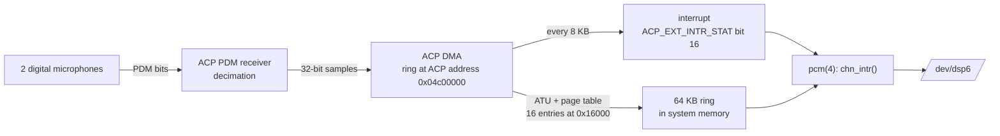

# snd_acp: recording from the built-in microphones of an AMD laptop

Patch: [snd_acp_dmic.patch](snd_acp_dmic.patch), branch
[`olivier-acp`](https://github.com/ocochard/freebsd-src/compare/main...olivier-acp)
(commit 6ba38c3ca4a6 on FreeBSD main d546356523f3).
Laptop: HP ZBook Ultra G1a (AMD Ryzen AI Max+ PRO 395, Strix Halo).
Line numbers below are `sys/dev/sound/pci/acp.c` in that commit.
Raw data from Linux: [acp/](acp/).

## 1. Background

**Digital microphones (DMIC) and PDM.** A laptop microphone does not
send numbers like a sound card does. Each digital microphone sends one
bit per clock tick, at a few MHz: a 1 when the air pressure goes up, a 0
when it goes down. This is *pulse density modulation* (PDM): the density
of 1s follows the sound. Something must count those bits over a short
window to get ordinary samples (32-bit numbers at 48 kHz here); that
step is called *decimation*.

**The Audio Coprocessor (ACP).** On recent AMD processors the PDM
microphones are not wired to the HDA codec (the Realtek ALC245 that
drives the headphone jack) but to a separate block, the ACP, PCI device
1022:15e2 (revision 0x70 on this laptop). The ACP contains a DSP, I2S
and SoundWire links, and the PDM receiver. This driver uses only the
PDM receiver and the ACP's DMA engine. The other three parts:

- **DSP** (digital signal processor): a small programmable audio
  processor, a Tensilica Xtensa core. Linux drives it with Sound Open
  Firmware (SOF, modules `snd_sof_amd_acp70` and `snd_sof_xtensa_dsp`;
  loaded on Ubuntu but unused on this laptop, which takes the plain
  path). With its firmware it processes audio without waking the CPU:
  noise suppression and echo cancellation on the microphones, and wake
  on voice (listening for a keyword during sleep; that is what the ACPI
  method `_WOV` describes). Without it the microphones deliver their raw
  signal, and any processing runs on the CPU, in user space.
- **I2S** (Inter-IC Sound): a simple serial bus that carries audio
  samples between chips. The ACP has three I2S ports (Linux registers
  them as `acp-i2s-sp`, `acp-i2s-bt` and `acp-i2s-hs`). On other designs
  they connect an external codec, amplifiers, or the Bluetooth call
  audio. This laptop's pin configuration (`0xa`) routes both I2S and
  PDM, but Linux builds only the microphone card on top of it: the
  speakers and the jack use the HDA codec and the CS35L54 amplifiers on
  I2C.
- **SoundWire**: a newer two-wire digital audio bus from the MIPI
  Alliance, which carries audio and control together and replaces
  I2S plus I2C on recent laptops with SoundWire codecs and amplifiers.
  ACP 6.3 and 7.x have SoundWire controllers (Linux module
  `soundwire_amd`, loaded on Ubuntu, nothing attached).

On this laptop none of the three is needed for audio; the DSP's
processing and wake on voice are the only features missing. A laptop
whose speakers or headset codec sit on I2S or SoundWire would need the
driver extended to those ports.

Would the DSP be worth a driver on FreeBSD? What it brings, against the
alternatives:

- Noise suppression and echo cancellation: the CPU can do it in user
  space (PipeWire's echo-cancel module, the WebRTC audio processing
  library) for a few percent of one core, and video-call software often
  does it itself.
- Wake on voice: needs the DSP, which listens while the system sleeps.
  It is only useful once the laptop reaches deep sleep (S0i3), which
  FreeBSD does not do yet on this laptop.
- Lower power while recording or playing: small, and only once deep
  sleep and idle power are in order.

The cost is a much larger driver than `snd_acp`: AMD's signed SOF
firmware (from linux-firmware), the SOF message protocol between the
driver and that firmware, and "topology" files that describe the audio
pipeline. So for this laptop: deep sleep first, then decide whether wake
on voice is worth the SOF work. The DC offset of the microphones does
not need the DSP: a high-pass filter in the driver or in user space
removes it.

**DMA through a page table.** The ACP does not write to system memory
by physical address directly. It writes to its own address space; an
*address translation unit* (ATU) maps those addresses to system pages
through a small page table that the driver fills, one entry per 4 KB
page (`acp_pdm_start()`, line 235):



**pcm(4) drivers.** FreeBSD's sound system does the format and rate
conversion, mixing and the `/dev/dsp` interface. A hardware driver gives
it channels: methods to set format and block size, start and stop
(`trigger`), and report the position in the ring (`getptr`). It calls
`chn_intr()` each time a block is ready (`acp_intr()`, line 294).

**Power and reset.** Before use, the ACP is powered on through its
power-gating state machine (`ACP_PGFSM_CONTROL`/`STATUS`) and reset
(`ACP_SOFT_RESET`) (`acp_hw_init()`, line 184; `acp_reset()`, line 173).

## 2. The problem

FreeBSD has no driver for the ACP, so the built-in microphones are
invisible:

```
$ pciconf -l pci0:195:0:5
none0@pci0:195:0:5: class=0x048000 rev=0x70 ... vendor=0x1022 device=0x15e2
$ cat /dev/sndstat
pcm4: <Realtek ALC245 (Analog)> (play/rec) default
...
```

`pcm4` records only from the headset jack: the codec's pin
configuration (`dev.hdaa.1.nid*_config`) has one microphone pin, nid 25,
"Mic, Jack, Left", and no internal one.

On Ubuntu the microphones work, through the Linux driver `snd_acp_pci`
and its `acp-pdm-mach` card: 2 channels, 32-bit, 48 kHz. A register
trace of Linux (mmiotrace, [acp/mmiotrace-summary.txt](acp/mmiotrace-summary.txt))
gave the sequence to repeat: power on and reset at probe; for a
capture, the ATU and its page table, the PDM clock, decimation and ring,
then enable; one interrupt per 8 KB.

## 3. The fix

A new `pcm(4)` driver, `snd_acp`, record only:

- Probe (line 438): PCI 1022:15e2 revisions 0x70 to 0x72.
- Attach (line 470): map BAR 0, power on and reset the ACP, then
  check that the firmware reports digital microphones (`acp_has_dmic()`,
  line 418): the pin configuration must route the PDM interface (the
  values Linux accepts), and the ACPI method `_WOV` of the ACP device,
  when present, must not return 0. Then one recording channel.
- Start (`acp_pdm_start()`, line 235): page table for the 64 KB ring
  (a contiguous buffer below 4 GB from `sndbuf_alloc()`), ATU, PDM
  interrupt enabled, 2 channels, decimation 64, PDM clock and control,
  ring address, size and interrupt watermark (the block size), then PDM
  and DMA enable, and wait for the DMA's running bit.
- Position (`acpchan_getptr()`, line 380): the ACP counts the bytes it
  wrote in a 64-bit counter (`acp_pdm_pos()`, line 223); the driver
  keeps the value at start and returns the difference modulo the ring
  size.
- Stop, detach, suspend and resume undo or redo the above.

Where the values come from: there is no public datasheet. Register
offsets and values are those of the Linux trace on this laptop; the
order follows AMD's Linux driver, whose files for this path
(`sound/soc/amd/acp/acp-pci.c`, `acp70.c`, `acp-pdm.c`, `acp-platform.c`,
`acp-legacy-common.c`, `amd.h`) are dual-licensed GPL-2.0-only or
BSD-3-Clause. The register names here are the driver's own; the Linux
header that names these registers (`acp7x_chip_offset_byte.h`) is
GPL-2.0+ and was not used.

Alternatives:

- Port the Linux ASoC stack: a machine driver, a DMIC codec, a DAI and a
  PCM layer. FreeBSD has no ASoC framework, and for one fixed capture
  path a single `pcm(4)` driver is far smaller.
- Use the ACP's DSP (Linux SOF): needs firmware and a much larger
  driver; only needed for offloaded processing or wake on voice.

What it does not do: no gain control (no mixer), no removal of the DC
offset the microphones carry (channel 0 at about -22 dBFS), no wake on
voice, no I2S or SoundWire devices, and no other ACP revisions (Renoir,
Rembrandt, ACP 6.3).

## 4. Tested

HP ZBook Ultra G1a, 2026-11-16, kernel of branch `zbook`
(zbook-n291260-5e39e91e9442), module built from the patch.
Recording with a small OSS program (5 s, stereo S32_LE, 48 kHz; level
per 0.5 s window; audio discarded):

| Test | Result |
|---|---|
| `kldload snd_acp` | `pcm6: <AMD ACP 7.x digital microphones> mem 0xa0400000-0xa043ffff,0x3000000000-0x30007fffff at device 0.5 on pci3`, record only |
| quiet room, 5 s | 1920000 bytes (the right amount); peak -16.8 dBFS; -36 to -41 dBFS per window; DC on channel 0 -21.8 dBFS (Linux: -22.9) |
| clapping, 5 s | peak 0.4 and 0.1 dBFS; windows -29 to -47 dBFS following the claps |
| interrupts | 469 in 5 s (about 94/s: `pcm(4)` chose 4 KB blocks) |
| unload and reload, twice | reattaches, records after each reload |
| two recordings back to back | stop and start work |
| default OSS format (`dd if=/dev/dsp6`) | 187 KB/s, 16-bit stereo 48 kHz converted by `pcm(4)` |

Same laptop on Ubuntu (Linux 7.0.0-43) for comparison: quiet -42 to -48
dBFS per window, clapping peak -2 dBFS. The quieter floor there may be
the room; it was not compared in the same conditions.

Not tested: suspend and resume while recording, desktop applications,
ACP revisions 0x71 and 0x72, other laptops.
