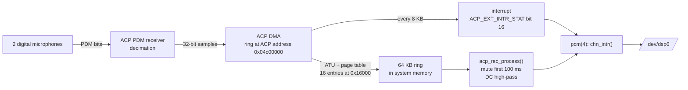

# snd_acp: recording from the built-in microphones of an AMD laptop

Patch: [snd_acp_dmic.patch](snd_acp_dmic.patch), commits 4a48d48141f8 (driver,
with the devmatch PCI ID folded in) and 228ca612790e (mute and DC filter) on
FreeBSD main 6dc19a71f70c, the version sent for review. An earlier
version, three commits (6ba38c3ca4a6, e4c888c47347, eac669d546ee) that
still enabled the ACP error interrupt, is in branch
[`olivier-acp`](https://github.com/ocochard/freebsd-src/compare/main...olivier-acp).
Laptop: HP ZBook Ultra G1a (AMD Ryzen AI Max+ PRO 395, Strix Halo).
Line numbers below are `sys/dev/sound/pci/acp.c` in eac669d546ee; the
final version moves code after `acp_hw_init()` down by a few lines.
Raw data from Linux: [acp/](acp/).

## 1. Background

**Digital microphones (DMIC) and PDM.** A laptop microphone does not
send numbers like a sound card does. Each digital microphone sends one
bit per clock tick, at a few MHz: a 1 when the air pressure goes up, a 0
when it goes down. This is *pulse density modulation* (PDM): the density
of 1s follows the sound. Something must count those bits over a short
window to get ordinary samples (32-bit numbers at 48 kHz here); that
step is called *decimation*.

**The Audio Coprocessor (ACP).** On recent AMD processors the PDM
microphones are not wired to the HDA codec (the Realtek ALC245 that
drives the headphone jack) but to a separate block, the ACP, PCI device
1022:15e2 (revision 0x70 on this laptop). The ACP contains a DSP, I2S
and SoundWire links, and the PDM receiver. This driver uses only the
PDM receiver and the ACP's DMA engine. The other three parts:

- **DSP** (digital signal processor): a small programmable audio
  processor, a Tensilica Xtensa core. Linux drives it with Sound Open
  Firmware (SOF, modules `snd_sof_amd_acp70` and `snd_sof_xtensa_dsp`;
  loaded on Ubuntu but unused on this laptop, which takes the plain
  path). With its firmware it processes audio without waking the CPU:
  noise suppression and echo cancellation on the microphones, and wake
  on voice (listening for a keyword during sleep; that is what the ACPI
  method `_WOV` describes). Without it the microphones deliver their raw
  signal, and any processing runs on the CPU, in user space.
- **I2S** (Inter-IC Sound): a simple serial bus that carries audio
  samples between chips. The ACP has three I2S ports (Linux registers
  them as `acp-i2s-sp`, `acp-i2s-bt` and `acp-i2s-hs`). On other designs
  they connect an external codec, amplifiers, or the Bluetooth call
  audio. This laptop's pin configuration (`0xa`) routes both I2S and
  PDM, but Linux builds only the microphone card on top of it: the
  speakers and the jack use the HDA codec and the CS35L54 amplifiers on
  I2C.
- **SoundWire**: a newer two-wire digital audio bus from the MIPI
  Alliance, which carries audio and control together and replaces
  I2S plus I2C on recent laptops with SoundWire codecs and amplifiers.
  ACP 6.3 and 7.x have SoundWire controllers (Linux module
  `soundwire_amd`, loaded on Ubuntu, nothing attached).

On this laptop none of the three is needed for audio; the DSP's
processing and wake on voice are the only features missing. A laptop
whose speakers or headset codec sit on I2S or SoundWire would need the
driver extended to those ports.

Would the DSP be worth a driver on FreeBSD? What it brings, against the
alternatives:

- Noise suppression and echo cancellation: the CPU can do it in user
  space (PipeWire's echo-cancel module, the WebRTC audio processing
  library) for a few percent of one core, and video-call software often
  does it itself.
- Wake on voice: needs the DSP, which listens while the system sleeps.
  It is only useful once the laptop reaches deep sleep (S0i3), which
  FreeBSD does not do yet on this laptop.
- Lower power while recording or playing: small, and only once deep
  sleep and idle power are in order.

The cost is a much larger driver than `snd_acp`: AMD's signed SOF
firmware (from linux-firmware), the SOF message protocol between the
driver and that firmware, and "topology" files that describe the audio
pipeline. So for this laptop: deep sleep first, then decide whether wake
on voice is worth the SOF work. The DC offset of the microphones does
not need the DSP: the driver removes it with a small filter (below).

**DMA through a page table.** The ACP does not write to system memory
by physical address directly. It writes to its own address space; an
*address translation unit* (ATU) maps those addresses to system pages
through a small page table that the driver fills, one entry per 4 KB
page (`acp_pdm_start()`, line 240):



**pcm(4) drivers.** FreeBSD's sound system does the format and rate
conversion, mixing and the `/dev/dsp` interface. A hardware driver gives
it channels: methods to set format and block size, start and stop
(`trigger`), and report the position in the ring (`getptr`). It calls
`chn_intr()` each time a block is ready (`acp_intr()`, line 303).

**Power and reset.** Before use, the ACP is powered on through its
power-gating state machine (`ACP_PGFSM_CONTROL`/`STATUS`) and reset
(`ACP_SOFT_RESET`) (`acp_hw_init()`, line 189; `acp_reset()`, line 178).

**DC offset and high-pass filter.** A recording is a list of numbers
that swing around zero. When the microphone's zero point is off, every
sample carries the same constant on top of the sound: a *DC offset*
(DC as in direct current, a level that does not change). It cannot be
heard, but it eats headroom (the signal clips sooner on one side),
fools level meters and voice detectors, and clicks when a recording
starts or stops. A *high-pass filter* lets fast changes through and
blocks slow ones; a constant is the slowest change there is (0 Hz). The
simplest one keeps a running average of the signal and subtracts it:

```
mean = mean + (x - mean) / 1024     /* follows slow changes only */
y    = x - mean                     /* what is left: the sound */
```

The average follows changes slower than about 7.5 Hz at 48 kHz
(48000 / 1024 / 2 pi); speech (100 Hz and up) passes unchanged. The
kernel does not use floating point, so `mean` is kept multiplied by
1024 in a 64-bit integer and the division is a shift (`ACP_DC_SHIFT`,
line 113).

**How a driver module gets loaded.** At boot, `devmatch(8)` lists the
devices that have no driver and loads the modules that declare their
IDs with `MODULE_PNP_INFO` (`kldxref(8)` collects these declarations in
`linker.hints`). A driver without that declaration loads only when it
is in the kernel configuration or named in `kld_list`.

## 2. The problem

FreeBSD has no driver for the ACP, so the built-in microphones are
invisible:

```
$ pciconf -l pci0:195:0:5
none0@pci0:195:0:5: class=0x048000 rev=0x70 ... vendor=0x1022 device=0x15e2
$ cat /dev/sndstat
pcm4: <Realtek ALC245 (Analog)> (play/rec) default
...
```

`pcm4` records only from the headset jack: the codec's pin
configuration (`dev.hdaa.1.nid*_config`) has one microphone pin, nid 25,
"Mic, Jack, Left", and no internal one.

Once the first version of the driver recorded, two flaws showed in the
samples (1 s recordings, raw samples saved and analysed afterwards):

- Every recording starts with a burst of noise at full scale (peak 0
  dBFS) that lasts about 60 ms, in all 5 recordings; then the level of
  channel 0 drifts for 300 to 500 ms before it settles. This is the
  click at the start of each recording.
- After that, channel 0 carries a DC offset of -22 to -24 dBFS (Linux
  on the same laptop: -22.9), channel 1 a much smaller one.

And the driver did not load by itself: `devmatch -v` compared 1022:15e2
with no table of `snd_acp`, which declared none.

On Ubuntu the microphones work, through the Linux driver `snd_acp_pci`
and its `acp-pdm-mach` card: 2 channels, 32-bit, 48 kHz. A register
trace of Linux (mmiotrace, [acp/mmiotrace-summary.txt](acp/mmiotrace-summary.txt))
gave the sequence to repeat: power on and reset at probe; for a
capture, the ATU and its page table, the PDM clock, decimation and ring,
then enable; one interrupt per 8 KB.

## 3. The fix

A new `pcm(4)` driver, `snd_acp`, record only:

- Probe (line 486): PCI 1022:15e2 revisions 0x70 to 0x72.
- Attach (line 518): map BAR 0, power on and reset the ACP, then
  check that the firmware reports digital microphones (`acp_has_dmic()`,
  line 466): the pin configuration must route the PDM interface (the
  values Linux accepts), and the ACPI method `_WOV` of the ACP device,
  when present, must not return 0. Then one recording channel.
- Start (`acp_pdm_start()`, line 240): page table for the 64 KB ring
  (a contiguous buffer below 4 GB from `sndbuf_alloc()`), ATU, PDM
  interrupt enabled, 2 channels, decimation 64, PDM clock and control,
  ring address, size and interrupt watermark (the block size), then PDM
  and DMA enable, and wait for the DMA's running bit.
- Position (`acpchan_getptr()`, line 427): the ACP counts the bytes it
  wrote in a 64-bit counter (`acp_pdm_pos()`, line 228); the driver
  keeps the value at start and returns the difference modulo the ring
  size.
- Cleaning (`acp_rec_process()`, line 392, commit e4c888c47347):
  `pcm(4)` calls `getptr` before it reads the ring, so the driver
  processes the samples that arrived since the last call in place, and
  only then reports them: it writes zeros over the first 100 ms
  (`ACP_MUTE_BYTES`, line 112), starts the running average of each
  channel from its first sample after that, and subtracts it (the
  filter above, saturated to 32 bits). It tracks its progress in bytes
  since the start, not as a ring offset, so the mute window survives the
  ring wrapping. The filter is skipped when `dev.pcm.N.bitperfect` is
  set, the standard sound(4) switch for unprocessed samples; the mute
  stays, since the burst is not sound.
- Gain: bits 4:3 of `ACP_WOV_MISC_CTRL` (0x2c5c) are a 2-bit PDM gain,
  0 to 3, each step 6 dB (measured, section 4). Linux's PS PDM driver
  sets it from its `pdm_gain` module parameter, default 3, with no mixer
  control. Here the mixer's recording level (`rec`) sets it: 0-24 is
  gain 0, then one step per 25; `mixer.c` gives `rec` 75 at attach, which
  keeps gain 3. A change applies at once, also during a recording.
- Interrupt: the PDM DMA interrupt is enabled in `EXT_INTR_CNTL(0)` only,
  so `acp_intr()` reads and clears `EXT_INTR_STAT(0)` only.
- Loading: one `pci_device_table` (`acp_ids[]`, vendor 0x1022, device
  0x15e2) serves `PCI_MATCH()` in probe and `PCI_PNP_INFO()` for
  `devmatch(8)`. The revision check stays in probe: pci(4) gives devmatch
  no `revid` to match. The microphone checks stay in attach.
- Stop, detach, suspend and resume undo or redo the above.

Where the values come from: there is no public datasheet. Register
offsets and values are those of the Linux trace on this laptop; the
order follows AMD's Linux driver, whose files for this path
(`sound/soc/amd/acp/acp-pci.c`, `acp70.c`, `acp-pdm.c`, `acp-platform.c`,
`acp-legacy-common.c`, `amd.h`) are dual-licensed GPL-2.0-only or
BSD-3-Clause. The register names here are the driver's own; the Linux
header that names these registers (`acp7x_chip_offset_byte.h`) is
GPL-2.0+ and was not used.

Alternatives:

- Port the Linux ASoC stack: a machine driver, a DMIC codec, a DAI and a
  PCM layer. FreeBSD has no ASoC framework, and for one fixed capture
  path a single `pcm(4)` driver is far smaller.
- Use the ACP's DSP (Linux SOF): needs firmware and a much larger
  driver; only needed for offloaded processing or wake on voice.
- Remove the DC offset in user space (each application, or a sound
  server): every program would have to do it, and the start burst would
  still reach them. In the driver it costs one pass over the new samples.
- A filter with a higher cutoff (say 20 Hz) follows the drift of the
  first 500 ms better but starts to touch low notes; 7.5 Hz leaves all
  audible sound alone.
- Add `device snd_acp` to GENERIC, as the other PCI sound drivers are:
  every amd64 kernel would carry it. With `MODULE_PNP_INFO` the module
  is loaded only on machines with an ACP; on an ACP without
  microphones it loads, attach fails, and it stays unused.

What it does not do: no gain control (no mixer), no wake on voice, no
I2S or SoundWire devices, and no other ACP revisions (Renoir,
Rembrandt, ACP 6.3). The residual drift in the first half second is
reduced, not removed (see the tests).

## 4. Tested

HP ZBook Ultra G1a, 2026-11-16, kernel of branch `zbook`
(zbook-n291260-5e39e91e9442), module built from the patch.
Recording with a small OSS program (5 s, stereo S32_LE, 48 kHz; level
per 0.5 s window; audio discarded):

| Test | Result |
|---|---|
| `kldload snd_acp` | `pcm6: <AMD ACP 7.x digital microphones> mem 0xa0400000-0xa043ffff,0x3000000000-0x30007fffff at device 0.5 on pci3`, record only |
| quiet room, 5 s | 1920000 bytes (the right amount); peak -16.8 dBFS; -36 to -41 dBFS per window; DC on channel 0 -21.8 dBFS (Linux: -22.9) |
| clapping, 5 s | peak 0.4 and 0.1 dBFS; windows -29 to -47 dBFS following the claps |
| interrupts | 469 in 5 s (about 94/s: `pcm(4)` chose 4 KB blocks) |
| unload and reload, twice | reattaches, records after each reload |
| two recordings back to back | stop and start work |
| default OSS format (`dd if=/dev/dsp6`) | 187 KB/s, 16-bit stereo 48 kHz converted by `pcm(4)` |

Mute, filter and loading, 2026-11-17, kernel olivier-npu-n291242
(module built from the three commits). Each 1 s recording saved and
analysed on another machine:

| Test | Result |
|---|---|
| start of 6 recordings, filter on and off | first 100 ms exactly zero on both channels; peak after it -21 to -44 dBFS (before: 0 dBFS) |
| filter off, 3 runs | channel 0 DC from 0.5 to 1 s -23.5 to -23.6 dBFS |
| filter on, 3 runs | channel 0 DC from 0.5 to 1 s -49.2, -72.1, -88.2 dBFS (first run after load: the drift was not over) |
| 5 s, filter on | DC -74.7 dBFS channel 0, -92.9 dBFS channel 1 (before: -21.8); peak -37.4 dBFS; -54 to -60 dBFS per window |
| filter in the driver vs the same arithmetic in Python on a raw recording | same output shape; both settle to zero after the start |
| `kldxref -d` | `pnp info for bus pci format M16:mask;U16:vendor;U16:device;U16:subvendor;U16:subdevice;U16:class;U16:subclass;U16:revid; 1 entries` |
| `devmatch -a` with the module unloaded | `unattached: snd_acp.ko` (plain `devmatch` skips a device that had a driver since boot) |
| boot of kernel zbook-n291263-fcbccb606aad, `snd_acp` in neither `kld_list` nor `loader.conf` | loaded from `/boot/kernel.zbook/snd_acp.ko` by `devmatch`, `pcm6` attached; 5 s recording: DC -70.6 / -75.0 dBFS |

Review changes (`bitperfect`, one status register, `pci_device_table`),
2026-11-23: module built from the two commits against the laptop's
kernel, swapped in with `kldunload`/`kldload`, recorded natively
(stereo S32_LE, 48 kHz) with Python's `ossaudiodev`:

| Test | Result |
|---|---|
| 5 s, filter on | 1920000 bytes; DC -90.5 / -95.9 dBFS |
| 5 s, `dev.pcm.6.bitperfect=1` | 1920000 bytes; DC on channel 0 -24.0 dBFS: the raw offset |
| interrupts during a 5 s recording | 471 (about 94/s) |
| `dev.pcm.6.dc_filter` | no longer exists |
| `devmatch -a -h` on the new module's `linker.hints` | `pcm6: snd_acp.ko` |
| `buildkernel GENERIC` on main 6dc19a71f70c | no warning |

PDM gain, 2026-11-24, quiet room: a 440 Hz tone played through the
laptop speakers, recorded by the microphones (3 s, stereo S32_LE,
Goertzel level, [snd_acp_gain_level.py](snd_acp_gain_level.py)), first with a test build writing the gain field
directly (three runs per gain), then through the mixer:

| Gain | Register test, channel 0 | `mixer -f /dev/mixer6 rec.volume=` | Mixer test, channel 0 |
|---|---|---|---|
| 0 | -85.1, -85.1, -85.4 dBFS | 0.10 | -85.3 dBFS |
| 1 | -79.1, -79.2, -79.4 | 0.30 | -79.4 |
| 2 | -72.9, -73.1, -73.1 | 0.60 | -73.5 |
| 3 | -67.0, -66.9, -67.1 | 1.00 (0.75, the default, gives the same gain) | -67.3 |

Each step adds 6 dB on both channels, and the room noise rises by about
as much: the gain scales the level, it does not improve the
signal-to-noise ratio. Changing `rec.volume` from 0.75 to 0.10 during a
4 s recording moved the tone from -67 dBFS to -86 dBFS at the change.
pcm(4) also lists `bass` and `treble` (playback, its software EQ) on
this mixer; they do nothing on a record-only device.

Same laptop on Ubuntu (Linux 7.0.0-43) for comparison: quiet -42 to -48
dBFS per window, clapping peak -2 dBFS. The quieter floor there may be
the room; it was not compared in the same conditions.

Final version, 2026-11-21, kernel zbook-n291269-0d71515aee38, module
built from the two final commits against that kernel's source,
swapped in with `kldunload`/`kldload` and compared with the installed
earlier module (`dd if=/dev/dsp6 bs=4k count=200`, 800 KB):

| Test | Earlier module | Final module |
|---|---|---|
| attach | `pcm6` on irq 37 | `pcm6` on irq 37 |
| irq 37 interrupts, 3 s idle | 0 | 0 |
| irq 37 interrupts, 4.27 s recording | 400 (about 94/s) | 400 (about 94/s) |
| recorded data | 191995 bytes/s, not silent | 191986 bytes/s, not silent |
| standalone `make` in `sys/modules/sound/driver/acp` | fails (`acpi_if.h` missing) | builds |

The final module no longer enables the ACP error interrupt: nothing
acknowledged it, so an ACP error would have kept the shared interrupt
line asserted. `acp_hw_init()` now masks that source in
`ACP_EXT_INTR_CNTL(1)` and clears both status registers before enabling
the interrupt. No ACP error was provoked, so that path is untested.

Not tested: suspend and resume while recording,
desktop applications, ACP revisions 0x71 and 0x72, other laptops.

## 5. Review

[#124](https://ron-dev.freebsd.org/FreeBSD/src/pulls/124), christos (line
numbers of the first commit), with wulf. Answers checked against the code
and the Linux `sound/soc/amd` drivers; all changes are made and tested
(section 4).

| Question | Answer | Change |
|---|---|---|
| Is the `dc_filter` sysctl needed? | Only to read raw samples (offset included), which is what `dev.pcm.%d.bitperfect` already means. | done: no sysctl, the high-pass is skipped when bitperfect is set; the 100 ms mute stays |
| Why 2 loops over `EXT_INTR_STAT(n)`? | Copied from Linux's generic ACP handler. PDM is enabled only in `EXT_INTR_CNTL(0)`, so it latches only in `STAT(0)`: 141 of 141 interrupts in the Linux trace, as Linux's PS driver checks. | done |
| One format: retire `acp_fmt[]`? | Every Linux AMD PDM path accepts only S32_LE (wulf: same on ACP 6.x). The array stays: pcm(4) walks a zero-terminated `fmtlist`; only the channel count (2/4/6 in hardware) could add entries. | none |
| More than 7.x IDs? | Linux drives 0x70-0x72 with one code path. 0x7D-0x7F use another interrupt register layout and have no Linux PDM support yet. Only 0x70 is tested. | none |
| Check `acp_ids[]` in probe? | Yes, one table for probe and devmatch: `pci_device_table`, `PCI_MATCH()`, `PCI_PNP_INFO()`. The revision check stays in code: pci(4) pnpinfo has no `revid`, so devmatch could never match it. | done |
| Clear `running` in detach, as in suspend? | `acp_pdm_stop()` already clears it; suspend sets it back on purpose so resume restarts the DMA. `pcm_unregister()` has stopped the channel before. | none |
| `mixer_init()`? | wulf pointed out the input gain register: bits 4:3 of `ACP_WOV_MISC_CTRL`, 0 to 3. Linux sets it from a module parameter (default 3) and exposes no mixer control, which is why amixer showed none; the driver wrote 3 under a misleading name. Measured: 6 dB per step. | done: the recording level (`rec`) sets the gain, default unchanged |
| How does `getptr` work? | The ACP counts DMA bytes in a 64-bit counter that does not restart; start saves it, getptr returns (count - start) modulo the ring, rounded down to an 8-byte frame, as Linux's PS PDM driver does. | comment added above `acpchan_getptr()` |
