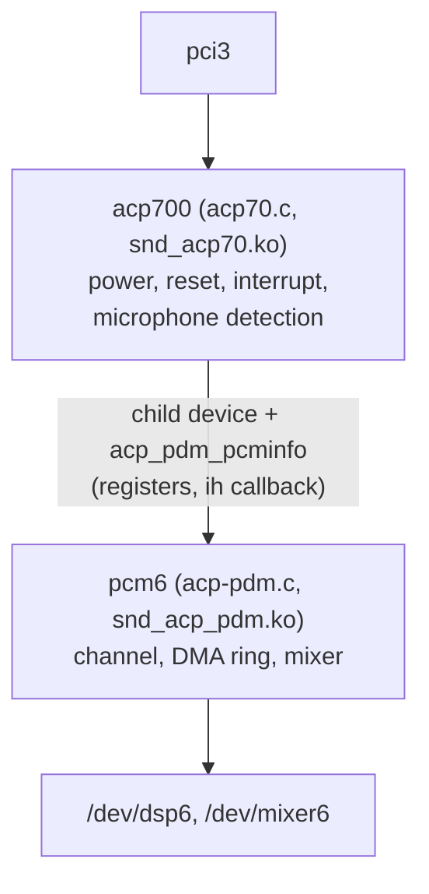
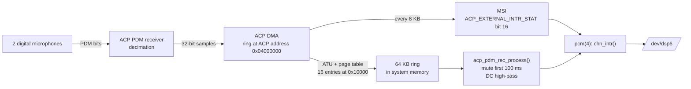

# snd_acp70: recording from the built-in microphones of an AMD laptop

Patch: [snd_acp_dmic.patch](snd_acp_dmic.patch), three commits on FreeBSD
main b29084ae698f, in review as
[#124](https://ron-dev.freebsd.org/FreeBSD/src/pulls/124):

| Commit | Subject |
|---|---|
| e41bc0d68ec6 | snd_acp70: Add a driver for AMD ACP 7.x digital microphones |
| 02497907dec5 | snd_acp_pdm: Mute the start burst and remove the DC offset |
| b64e7aaeeb55 | snd_acp_pdm: Set the microphone gain with the recording level |

The capture part, `acp-pdm.c`, is Vladimir Kondratyev's (wulf) driver
from [#136](https://ron-dev.freebsd.org/FreeBSD/src/pulls/136), written
for ACP 6.x, with the fixes of section 3; the first commit carries his
`Co-authored-by:`. His ACP 6.x PCI drivers from #136 attach to the same
capture driver after this lands.

Laptop: HP ZBook Ultra G1a (AMD Ryzen AI Max+ PRO 395, Strix Halo).
Line numbers below are `sys/dev/sound/pci/acp-pdm.c` and `acp70.c` in
b64e7aaeeb55. Raw data from Linux: [acp/](acp/).

## 1. Background

**Digital microphones (DMIC) and PDM.** A laptop microphone does not
send numbers like a sound card does. Each digital microphone sends one
bit per clock tick, at a few MHz: a 1 when the air pressure goes up, a 0
when it goes down. This is *pulse density modulation* (PDM): the density
of 1s follows the sound. Something must count those bits over a short
window to get ordinary samples (32-bit numbers at 48 kHz here); that
step is called *decimation*.

**The Audio Coprocessor (ACP).** On recent AMD processors the PDM
microphones are not wired to the HDA codec (the Realtek ALC245 that
drives the headphone jack) but to a separate block, the ACP, PCI device
1022:15e2 (revision 0x70 on this laptop). The ACP contains a DSP, I2S
and SoundWire links, and the PDM receiver. This driver uses only the
PDM receiver and the ACP's DMA engine. The other three parts:

- **DSP** (digital signal processor): a small programmable audio
  processor, a Tensilica Xtensa core. Linux drives it with Sound Open
  Firmware (SOF, modules `snd_sof_amd_acp70` and `snd_sof_xtensa_dsp`;
  loaded on Ubuntu but unused on this laptop, which takes the plain
  path). With its firmware it processes audio without waking the CPU:
  noise suppression and echo cancellation on the microphones, and wake
  on voice (listening for a keyword during sleep; that is what the ACPI
  method `_WOV` describes). Without it the microphones deliver their raw
  signal, and any processing runs on the CPU, in user space.
- **I2S** (Inter-IC Sound): a simple serial bus that carries audio
  samples between chips. On other designs the ACP's I2S ports connect
  an external codec, amplifiers, or the Bluetooth call audio. This
  laptop's speakers and jack use the HDA codec and the CS35L54
  amplifiers on I2C instead.
- **SoundWire**: a newer two-wire digital audio bus from the MIPI
  Alliance, which carries audio and control together. ACP 6.3 and 7.x
  have SoundWire controllers (Linux module `soundwire_amd`, loaded on
  Ubuntu, nothing attached here).

On this laptop none of the three is needed for audio; the DSP's
processing and wake on voice are the only features missing. Wake on
voice is only useful once the laptop reaches deep sleep (S0i3), which
FreeBSD does not do yet here, and noise suppression can run in user
space. The DSP would need AMD's signed SOF firmware, the SOF message
protocol and topology files: a much larger driver, not worth it now.

**One PCI driver per ACP generation, one capture driver.** The PDM
receiver and its DMA have the same registers on ACP 6.x, 6.3 and 7.x
(Linux drives 6.3 and 7.x with one PDM file, `sound/soc/amd/ps/ps-pdm-dma.c`).
What differs is the power-up, the interrupt registers besides PDM, and
how the firmware says microphones are wired. So the work is split in
two drivers, joined by the structure `acp_pdm_pcminfo` in `acp.h`:



The parent owns the PCI function: it maps the registers, powers the
ACP on, owns the interrupt and creates the `pcm` child. The child is an
ordinary `pcm(4)` driver that uses the parent's registers through the
shared structure; the parent's interrupt handler calls the child's
`ih` callback on each PDM period (`acp70_intr()`, line 78).

**DMA through a page table.** The ACP does not write to system memory
by physical address directly. It writes to its own address space; an
*address translation unit* (ATU) maps those addresses to system pages
through a small page table that the driver fills, one entry per 4 KB
page (`acp_pdm_start()`, line 119):



**pcm(4) drivers.** FreeBSD's sound system does the format and rate
conversion, mixing and the `/dev/dsp` interface. A hardware driver gives
it channels: methods to set format and block size, start and stop
(`trigger`), and report the position in the ring (`getptr`). It calls
`chn_intr()` each time a block is ready (`acp_pdm_intr()`, line 168).

**Locks.** pcm(4) calls `trigger` and `getptr` with the channel lock
held, and `chn_intr()` takes that lock itself. The mixer runs under the
device lock, and when the device goes away `pcm_unregister()` frees the
channel *before* `mixer_uninit()` sets every mixer control one last
time. So the capture driver keeps its own small lock for its state:
taken inside the channel lock, never held across `chn_intr()`, and
alive after the channel is gone.

**Power and reset.** Before use, the ACP is powered on through its
power-gating state machine (`ACP_PGFSM_CONTROL`/`STATUS`) and reset
(`ACP_SOFT_RESET`) (`acp70_init()`, line 121; `acp70_reset()`, line 105).

**DC offset and high-pass filter.** A recording is a list of numbers
that swing around zero. When the microphone's zero point is off, every
sample carries the same constant on top of the sound: a *DC offset*
(DC as in direct current, a level that does not change). It cannot be
heard, but it eats headroom (the signal clips sooner on one side),
fools level meters and voice detectors, and clicks when a recording
starts or stops. A *high-pass filter* lets fast changes through and
blocks slow ones; a constant is the slowest change there is (0 Hz). The
simplest one keeps a running average of the signal and subtracts it:

```
mean = mean + (x - mean) / 1024     /* follows slow changes only */
y    = x - mean                     /* what is left: the sound */
```

The average follows changes slower than about 7.5 Hz at 48 kHz
(48000 / 1024 / 2 pi); speech (100 Hz and up) passes unchanged. The
kernel does not use floating point, so `mean` is kept multiplied by
1024 in a 64-bit integer and the division is a shift
(`ACP_PDM_DC_SHIFT`, line 49).

**How a driver module gets loaded.** At boot, `devmatch(8)` lists the
devices that have no driver and loads the modules that declare their
IDs with `MODULE_PNP_INFO` (`kldxref(8)` collects these declarations in
`linker.hints`). `snd_acp70.ko` declares 1022:15e2; loading it loads
`snd_acp_pdm.ko`, which it depends on.

## 2. The problem

FreeBSD has no driver for the ACP, so the built-in microphones are
invisible:

```
$ pciconf -l pci0:195:0:5
none0@pci0:195:0:5: class=0x048000 rev=0x70 ... vendor=0x1022 device=0x15e2
$ cat /dev/sndstat
pcm4: <Realtek ALC245 (Analog)> (play/rec) default
...
```

`pcm4` records only from the headset jack: the codec's pin
configuration (`dev.hdaa.1.nid*_config`) has one microphone pin, nid 25,
"Mic, Jack, Left", and no internal one.

Once a driver records, two flaws show in the samples (raw recordings
saved and analysed afterwards, filter off):

- Every recording starts with a burst of noise at full scale (peak 0
  dBFS) that lasts about 60 ms; then the level of channel 0 drifts for
  300 to 500 ms before it settles. This is the click at the start of
  each recording.
- After that, channel 0 carries a DC offset of -22 to -24 dBFS (Linux
  on the same laptop: -22.9), channel 1 a much smaller one. wulf sees
  an offset on Lenovo ThinkBooks (ACP 6.x) too, the same on every model
  he tried, and the clicks it causes at start and stop.

On Ubuntu the microphones work, through Linux's `snd_acp_pci` and its
`acp-pdm-mach` card: 2 channels, 32-bit, 48 kHz. A register trace of
Linux (mmiotrace, [acp/mmiotrace-summary.txt](acp/mmiotrace-summary.txt))
shows the sequence: power on and reset at probe; for a capture, the ATU
and its page table, the PDM clock, decimation and ring, then enable;
one interrupt per 8 KB.

wulf's capture driver from #136, tried on this laptop with only its
ACP 6.3 probe extended to revision 0x70, recorded at the right rate, so
the PDM block is the same. It also showed six problems, which this
patch fixes:

| # | Problem in #136 | Measured or read |
|---|---|---|
| 1 | `mixer_init()` after `pcm_register()`: no `/dev/mixer6`, since `pcm_register()` creates the mixer device only when the mixer exists | measured: no `/dev/mixer6` |
| 2 | the interrupt held the channel lock and `chn_intr()` took it again | read: panics on an INVARIANTS kernel |
| 3 | a recording across suspend and resume stopped: the reset cleared the PDM and DMA enables and resume did not set them again | measured: `read` returns EAGAIN |
| 4 | pcm(4) picked 512-byte blocks | measured: 750 interrupts/s |
| 5 | `getptr` subtracted the start count only once bytes had arrived; the 64-bit counter was read in two halves without a retry | read |
| 6 | `kldunload` panicked: the mixer callback took the lock of the channel `pcm_unregister()` had just freed | measured: page fault in `__mtx_lock_sleep()`, backtrace `acp_pdm_mixer_set` < `mixer_set` < `mixer_uninit` < `pcm_unregister` |

## 3. The fix

**acp70.c, the ACP 7.x PCI driver** (first commit):

- Probe (line 258): PCI 1022:15e2 revisions 0x70 to 0x72, the revisions
  Linux's `ps/` driver drives as ACP 7.x. 1022:15e2 is the ID of every
  ACP since Raven, so devmatch(8) loads the module on any Ryzen machine
  with an ACP; probe then refuses the other revisions. One
  `pci_device_table` serves `PCI_MATCH()` and `PCI_PNP_INFO()`; the
  revision check stays in code because pci(4) gives devmatch no
  `revid`.
- Attach (line 292): map BAR 0 and check it covers the highest register
  the drivers touch (the last page table entry, 0x10080; the BAR is 256
  KB). Power on (PGFSM mask 0x1F), `ACP_CONTROL`, reset, `ZSC_DSP_CTRL`
  0, as Linux's `acp70_init()`. Then the microphone check
  (`acp70_has_dmic()`, line 226), as Linux's `get_acp63_device_config()`:
  the pin configuration routes the PDM interface (Linux's ACP 7.x list),
  the ACPI node at address 2 below the ACP has the `_DSD` property
  `acp-audio-device-type` 2 (`acp70_get_dsd_int()`, line 162, finds the
  device-properties UUID anywhere in `_DSD`), and `_WOV`, when present,
  is not 0. Without microphones the attach fails and resets the ACP.
  Then MSI (or a shared INTx), and the `pcm` child.
- Interrupt (line 78): only the PDM source is enabled, so the handler
  reads and acknowledges bit 16 of `ACP_EXTERNAL_INTR_STAT`, then calls
  the child.
- Detach (line 350): remove the interrupt handler first, mark it gone
  (`intr_gone`), then detach the child, deinit and release. The child
  refuses to detach on its own (`devctl detach pcm6` gets EBUSY):
  otherwise a handler already running could reach the freed channel.
- Suspend and resume: the child stops (and remembers to restart), the
  ACP is reset; on resume the ACP is powered up again before the child
  restarts.

**acp-pdm.c, the capture driver** (first commit, wulf's structure and
register sequence, with the fixes):

- Its own lock (`scp->lock`) for its state: problems 2 and 6.
  `acp_pdm_intr()` reads `run` under it and calls `chn_intr()` after
  releasing it.
- Mixer created before `pcm_register()`: problem 1.
- Start (`acp_pdm_start()`, line 119): page table for the 64 KB ring (a
  contiguous buffer below 4 GB), ATU, PDM interrupt, 2 channels,
  decimation, PDM clock, gain, ring address, size and interrupt
  watermark (the block size), then PDM and DMA enable, and wait for the
  DMA's running bit. If it does not start, the driver stops it and
  `trigger` returns EIO.
- Stop (line 101) clears the DMA enable whenever it is set, also after a
  start that timed out, so no late DMA writes into a freed ring.
- Blocks are powers of two from 4 KB to 32 KB, the ring stays 64 KB:
  problem 4.
- Position (`acp_pdm_chan_getptr()`, line 362): the ACP counts the bytes
  it wrote in a 64-bit counter that goes on across recordings
  (`acp_pdm_get_byte_count()`, line 78, re-reads until the high half is
  stable); start saves it, getptr returns the difference modulo the
  ring, rounded down to an 8-byte frame: problem 5.
- Suspend stops the DMA and remembers it ran; resume zeroes the ring
  and starts again: problem 3. The DMA restarts at offset 0 while
  pcm(4) keeps its read pointer, so what it reads before catching up
  is silence, not old audio.
- Detach stops the DMA, then `pcm_unregister()`.

**Cleaning** (`acp_pdm_rec_process()`, line 315, second commit):
`pcm(4)` calls `getptr` before it reads the ring, so the driver
processes the samples that arrived since the last call in place, and
only then reports them. It writes zeros over the first 100 ms
(`ACP_PDM_MUTE_BYTES`, line 50), starts the running average of each
channel from the first sample it keeps (also after an overrun or a
mute), and subtracts it (the filter above, saturated to 32 bits). It
tracks its progress in bytes since the start, not as a ring offset, so
the mute window survives the ring wrapping. The filter is skipped when
`dev.pcm.N.bitperfect` is set, the standard sound(4) switch for
unprocessed samples; the mute stays, since the burst is not sound.

**Gain** (`acp_pdm_mixer_set()`, line 195, third commit): bits 4:3 of
`ACP_WOV_MISC_CTRL` (0x2c5c) are a 2-bit PDM gain, 0 to 3, each step 6
dB (measured, section 4). Linux's PS PDM driver sets it from its
`pdm_gain` module parameter, default 3, with no mixer control; #136
exposed it as `igain`. Here the mixer's recording level (`rec`) sets
it: 1-24 is gain 0, then one step per 25; `mixer.c` gives `rec` 75 at
attach, which keeps gain 3. A change applies at once, also during a
recording, and the DC estimate is scaled with it so the filter stays
settled. Level 0 (what mixer(8) sets to mute `rec`) zeroes the samples,
`bitperfect` included: the lowest gain is only 18 dB down and still
records.

Where the values come from: there is no public datasheet. Register
offsets and sequences follow Linux's `sound/soc/amd/ps` driver, which
drives ACP 6.3 and 7.x; the register trace of Linux on this laptop
confirms the order. No Linux text is copied (those files are GPL); the
register names are those of #136.

Alternatives:

- Two drivers, `snd_acp` (#124's first version, one file for ACP 7.x)
  and #136 for ACP 6.x: the same PDM code twice. wulf asked to merge
  them here, and to add his ACP 6.x PCI glue afterwards.
- One PCI driver for ACP 6.3 and 7.x, as Linux's `ps/`: possible, but
  #124 has no ACP 6.3 hardware to test, and wulf's `acp63.c` comes
  with #136.
- A table of measured DC offsets per laptop model instead of the filter
  (wulf's idea, since the offset is the same on every ThinkBook he
  saw): no computation, but it needs a measurement for each model and
  does not mute the start burst. The filter works on any laptop.
- Remove the DC offset in user space (each application, or a sound
  server): every program would have to do it, and the start burst would
  still reach them. In the driver it costs one pass over the new samples.
- A filter with a higher cutoff (say 20 Hz) follows the drift of the
  first 500 ms better but starts to touch low notes; 7.5 Hz leaves all
  audible sound alone.
- Add `device snd_acp70` to GENERIC: every amd64 kernel would carry it.
  With `MODULE_PNP_INFO` the module is loaded only on machines with an
  ACP; on an ACP without microphones it loads, attach fails, and it
  stays unused.

What it does not do: no wake on voice, no I2S or SoundWire devices, no
ACP 6.x (#136 adds it), and no ACP revisions 0x7D-0x7F (another
interrupt layout, no Linux PDM support yet). The drift of the first
half second is reduced, not removed. The ACP stays powered from attach
to detach, where Linux resets it 2 s after use; measured on the package
energy counter, the earlier version made no difference.

## 4. Tested

Laptop, 2026-11-26, kernel `zbook-n291269-0d71515aee38` (GENERIC-NODEBUG,
no INVARIANTS), modules built from b64e7aaeeb55 against that kernel's
source and swapped in with `kldunload`/`kldload`, devd stopped and
`debug.debugger_on_panic=0` (so a panic leaves a dump). Recordings:
stereo S32_LE, 48 kHz, through Python's `ossaudiodev`, analysed with
[acp_review_stats.py](acp_review_stats.py); no sound played.

| Test | Result |
|---|---|
| attach | `acp700: <AMD ACP 7.x Audio Coprocessor>`, MSI (irq86); `pcm6: <AMD ACP digital microphones> on acp700`; `/dev/mixer6` with `rec = 0.75` |
| 5 s recording | 1920000 bytes, 469 interrupts (94/s); first 100 ms all zero; DC -63.4 / -67.0 dBFS (first recording after load, the filter still settling) |
| second 5 s recording | DC -83.2 / -96.9 dBFS |
| `dev.pcm.6.bitperfect=1`, 2 s | DC on channel 0 -24.2 dBFS: the raw offset |
| `rec.volume=0` / `rec.mute=on`, 2 s | all 86400 samples zero, both |
| `rec.volume=0.10` / `0.75`, 2 s, channel 0 | peak -61.7 / -42.5 dBFS, DC -113 / -87 dBFS |
| recording started at level 0, unmuted at 1 s | zeros, then DC per 250 ms -47, -91, -85 ... -99 dBFS: the filter seeds at the unmute |
| `devctl suspend acp700` / `resume` during a 5 s recording | 1920000 bytes in 5.49 s: the recording goes on |
| `devctl detach pcm6` | refused, "Device busy" |
| `devctl detach acp700`, `devctl attach pci0:195:0:5` | reattaches, records |
| `kldunload` / `kldload` of both modules, 3 cycles, recording after each | rc 0, all record, no panic |
| `kldunload snd_acp70` during a recording | rc 0; the recording gets EINVAL; no panic |
| each commit, modules built against main f0692bcb9aa0 | no warning |
| `buildkernel` GENERIC + `device snd_acp70` | no warning |

Same tests, 2026-11-27, on a kernel built from main 748b510477b3 with
the three commits (GENERIC-NODEBUG, booted once with `nextboot`), so with
main's current pcm(4) locking:

| Test | Result |
|---|---|
| boot | `devmatch` loads `snd_acp70.ko` and `snd_acp_pdm.ko`; `acp700` on MSI (irq85), `pcm6`, `/dev/mixer6` with `rec = 0.75` |
| 5 s recording, then a second one | 1920000 bytes, 469 interrupts; first 100 ms zero; DC -63 / -63 dBFS, then -83 / -95 dBFS |
| `bitperfect=1` | DC -24.2 dBFS |
| `rec.volume=0`, `rec.mute=on` | all samples zero |
| `rec.volume=0.10` / `0.75`, channel 0 | peak -58.9 / -39.3 dBFS |
| started at level 0, unmuted at 1 s | zeros, then DC per 250 ms -47, -81 ... -87 dBFS |
| `devctl suspend/resume acp700` during a 5 s recording | 1920000 bytes in 5.49 s |
| `devctl detach pcm6` | "Device busy" |
| `kldunload`/`kldload snd_acp70`, 3 cycles (`snd_acp_pdm` follows as its dependency) | all record |
| `devctl detach acp700`, `devctl attach pci0:195:0:5` | records |
| `kldunload snd_acp70` during a recording | rc 0, the recording gets EINVAL, no panic |

PDM gain, 2026-11-24, quiet room: a 440 Hz tone played through the
laptop speakers, recorded by the microphones (3 s, Goertzel level,
[snd_acp_gain_level.py](snd_acp_gain_level.py)). The gain field is the
hardware's, the same in this driver; measured with the earlier driver:

| Gain | Register test, channel 0 | `mixer -f /dev/mixer6 rec.volume=` | Mixer test, channel 0 |
|---|---|---|---|
| 0 | -85.1, -85.1, -85.4 dBFS | 0.10 | -85.3 dBFS |
| 1 | -79.1, -79.2, -79.4 | 0.30 | -79.4 |
| 2 | -72.9, -73.1, -73.1 | 0.60 | -73.5 |
| 3 | -67.0, -66.9, -67.1 | 1.00 (0.75, the default, gives the same gain) | -67.3 |

Each step adds 6 dB on both channels, and the room noise rises by about
as much: the gain scales the level, it does not improve the
signal-to-noise ratio.

Not tested: an INVARIANTS/WITNESS kernel, a real suspend to idle with a
recording open, desktop applications, ACP revisions 0x71 and 0x72,
other laptops, the INTx fallback.

## 5. Review

[#124](https://ron-dev.freebsd.org/FreeBSD/src/pulls/124), christos and
wulf, on the first version; [#136](https://ron-dev.freebsd.org/FreeBSD/src/pulls/136),
wulf's ACP 6.x driver.

| Question | Answer | Where |
|---|---|---|
| Is a `dc_filter` sysctl needed? | Only to read raw samples, which is what `dev.pcm.%d.bitperfect` already means. | no sysctl; the filter is skipped with bitperfect |
| Why loop over two interrupt status registers? | PDM is enabled only in `ACP_EXTERNAL_INTR_CNTL`, so it latches only in `ACP_EXTERNAL_INTR_STAT`, as Linux's PS driver checks. | `acp70_intr()` |
| One format? | Every Linux AMD PDM path accepts only S32_LE (wulf: same on ACP 6.x). The array stays: pcm(4) walks a zero-terminated format list. | `acp_pdm_fmt[]` |
| More than 7.x IDs? | Linux drives 0x70-0x72 with one code path; 0x7D-0x7F have no Linux PDM support. Only 0x70 is tested. | `acp70_probe()` |
| One ID table for probe and devmatch? | Yes, a `pci_device_table`; the revision stays in code, pci(4) gives devmatch no `revid`. | `acp70_ids[]` |
| A mixer control? | wulf pointed out the gain bits; #136 had `igain`. wulf has no strong opinion between `igain` and `rec`: `rec` here, with level 0 muting. | `acp_pdm_mixer_set()` |
| How does `getptr` work? | A 64-bit byte counter that goes on across recordings: (count - start) modulo the ring, in whole frames, as Linux's PS PDM driver does. | comment above `acp_pdm_chan_getptr()` |
| One driver or two? (#136) | wulf: import `acp-pdm.c` and `acp.h` into #124, fix and commit; he adds the ACP 6.x PCI glue after. | this patch |

A review of the three commits with the FreeBSD commit-review prompt
(2026-11-26) found no runtime bug and six minor points, all changed:
`igain` answering for every control in the first commit, a DMA start
timeout reported as success, `_DSD` read only at its first entry, the
reset poll stricter than Linux, the DC estimate seeded only right after
the mute window, and a detach path that could not run.
