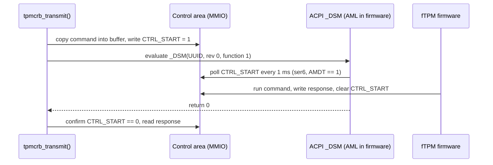

# tpm_crb: how the driver works, and adding the ACPI start method (2)

```
Status:    patch written and tested on ser6, not submitted
Patch:     tpm_crb_acpi_start_method.patch (sys/dev/tpm/tpm_crb.c, +80 -3 lines)
Driver:    sys/dev/tpm/tpm_crb.c
Base:      sections 1 and 2 cite main at 584f44221f45 (2026-10-29);
           the patch applies to main at db8444c1b7e4 (2026-11-04)
Machine:   ser6, Beelink SER (AMD Ryzen 7 7735HS, AMI BIOS 113)
```

**Summary.** ser6 has a working AMD firmware TPM, but FreeBSD gives it no
driver, so `/dev/tpm0` does not exist.  The firmware describes the TPM with
start method 2, "ACPI start", and `tpm_crb` only accepts methods 7 and 13.
This document first explains how `tpm_crb` works, then describes the patch
that adds method 2.  With the patch, ser6 attaches `tpmcrb0`, passes the TPM
self-test, and ran 32000 commands without a failure.

---

## 1. Background: how tpm_crb works

### 1.1 What a TPM is, and what the driver does

A TPM (Trusted Platform Module) is a small security processor.  It stores
keys, measures the boot process, and generates random numbers.  On recent AMD
and Intel machines it is not a separate chip: it is firmware running on a
security core inside the CPU package, called a firmware TPM or fTPM.

Software talks to a TPM by sending it a *command*, a byte string such as "give
me 32 random bytes", and reading back a *response*.  The format of these byte
strings is the same on every TPM.  What changes between machines is how the
bytes travel to the TPM.  That is the driver's whole job: move a command in,
tell the TPM to run it, wait, and move the response out.

FreeBSD splits the work in two layers:

| Layer | File | Job |
|---|---|---|
| Common TPM 2.0 code | `tpm20.c` | `/dev/tpm0`, command timeouts, the random-number task |
| Transport | `tpm_crb.c` or `tpm_tis_core.c` | Move bytes to and from one kind of hardware interface |

The common layer calls the transport through one method, `TPM_TRANSMIT`
(`tpm20.c:179`).  The CRB transport implements it as `tpmcrb_transmit()`
(`tpm_crb.c:623`).

### 1.2 What CRB is

CRB means Command Response Buffer.  It is one of the two hardware interfaces
defined by the TCG PC Client Platform TPM Profile (PTP) specification.  The
other is FIFO, also called TIS, which `tpm_tis_core.c` handles.

A CRB TPM gives the CPU two things in physical memory:

* A **control area**: twelve 32-bit registers.  Reading or writing one is a
  message to the TPM firmware.  Their offsets are at `tpm_crb.c:43-54`.
* A **command buffer** and a **response buffer**.  The control area holds their
  addresses and sizes.  They can be the same buffer.

The registers that matter here:

| Register | Offset | Meaning |
|---|---|---|
| `CTRL_REQ` | 0x00 | Ask for a state change: `GO_READY` or `GO_IDLE`.  The TPM clears the bit to acknowledge |
| `CTRL_STS` | 0x04 | Status: error bit, idle bit |
| `CTRL_CANCEL` | 0x08 | Ask the TPM to abandon the running command |
| `CTRL_START` | 0x0C | Write 1 to start the command.  The TPM clears it when the response is ready |
| `CMD_SIZE`, `CMD_LADDR`, `CMD_HADDR` | 0x18 to 0x20 | Size and address of the command buffer |
| `RSP_SIZE`, `RSP_ADDR` | 0x24, 0x28 | Size and address of the response buffer |

The habit to remember: **writing a register only asks.**  The TPM has done the
work when it changes the register back, some time later.  The driver polls for
that with `tpmcrb_ctrl_wait()` (`tpm_crb.c:485`), which sleeps one clock tick
between reads.

Some CRB TPMs also have *locality* registers in the 64 bytes before the control
area.  A locality is a form of ownership of the interface: request it, use the
TPM, release it.  The driver uses them only when they are really there
(`has_locality`, `tpm_crb.c:337`).  The bug report
[`bugreport_tpm_crb_back_to_back_eio.md`](bugreport_tpm_crb_back_to_back_eio.md),
section 1.2, explains localities in more detail.

### 1.3 How the driver finds the TPM: ACPI

The kernel learns about the TPM from ACPI, the firmware's description of the
hardware.  Two ACPI objects matter:

* The **device** `\_SB.TPM` with hardware ID `MSFT0101`.  Its `_CRS` method
  lists the memory ranges the device uses.
* The **TPM2 table**, defined by the TCG ACPI specification, section 3.3.  It
  holds `ControlAddress`, the physical address of `CTRL_REQ`, and
  `StartMethod`.

**The start method** answers one question: after writing the command into the
buffer, how does the driver tell the TPM to run it?  The TCG ACPI
specification, Table 8, lists the values.  These are the ones FreeBSD knows:

| Value | Meaning | FreeBSD driver |
|---|---|---|
| 2 | ACPI start method | **none** |
| 6 | FIFO (TIS) | `tpm_tis_acpi.c:51` |
| 7 | CRB: write `CTRL_START` | `tpm_crb.c:104` |
| 8 | CRB plus the ACPI start method | **none** |
| 13 | CRB plus an AMD mailbox ("Pluton") | `tpm_crb.c:109` |

The constants are in `tpm20.h:106-109`.  Value 13 is
`ACPI_TPM2_COMMAND_BUFFER_WITH_PLUTON` from ACPICA.

### 1.4 The driver's life cycle

**Probe** (`tpmcrb_acpi_probe()`, `tpm_crb.c:219`).  The kernel asks each driver
whether it wants the device.  `tpm_crb` says yes only when the hardware ID is
`MSFT0101` *and* the TPM2 table's start method is in its table
`tpmcrb_sm_cfg_map[]` (`tpm_crb.c:98-118`).

**Attach** (`tpmcrb_attach()`, `tpm_crb.c:359`):

1. Allocate the first `_CRS` memory range (`tpm_crb.c:374`).
2. Read the TPM2 table and map the control area (`tpmcrb_attach_acpi()`,
   `tpm_crb.c:307`).  If the control area is outside the `_CRS` range,
   `tpmcrb_map()` (`tpm_crb.c:251`) maps it separately.
3. Run the start method's own attach hook, if it has one.  Pluton uses this to
   map its two mailbox registers (`pluton_attach()`, `tpm_crb.c:779`).
4. Read the buffer addresses and sizes from the control area and map both
   buffers (`tpm_crb.c:413-440`).
5. Hand over to the common layer: `tpm20_init()` (`tpm20.c:260`) creates
   `/dev/tpm0` and starts the random-number task.

**Transmit** (`tpmcrb_transmit()`, `tpm_crb.c:623`), for every command:

```
request locality (if the registers exist)
check CTRL_STS error bit
GO_IDLE if not idle, then GO_READY          each waits up to 200 ms
copy the command into the command buffer
write CTRL_START = 1
call the start method's sm_cmdready hook    Pluton rings its doorbell here
wait for CTRL_START to read 0
check the error bit, read the response
GO_IDLE (no wait), release locality
```

### 1.5 The start-method hooks

The difference between start methods 7 and 13 is kept in one small structure,
`struct tpmcrb_sm_cfg` (`tpm_crb.c:87`):

| Hook | Called | Pluton uses it to |
|---|---|---|
| `sm_attach` | once, at attach | map the mailbox registers |
| `sm_detach` | once, at detach | unmap them |
| `sm_statechange` | after each write to `CTRL_REQ` | ring the doorbell |
| `sm_cmdready` | after each write to `CTRL_START` | ring the doorbell |

Method 7 sets all four to `NULL`: writing the register is enough.  This design
matters for the patch: a new start method is one more entry in
`tpmcrb_sm_cfg_map[]` plus its hook functions.

---

## 2. The problem: ser6's TPM has no driver

### What you see

No `/dev/tpm0`, and the ACPI device has no driver attached:

```
$ ls /dev/tpm*
ls: /dev/tpm*: No such file or directory
$ devinfo -v | grep MSFT0101
    unknown pnpinfo _HID=MSFT0101 _UID=1 _CID=none at handle=\_SB_.TPM_
```

The `tpm` driver is compiled into ser6's kernel (`kldstat -v` lists
`acpi/tpmcrb` and `acpi/tpmtis` under `kernel`), so this is not a missing
module.

### Why

The TPM2 table, dumped with `acpidump -b` on ser6 (76 bytes):

```
00000020: 0000 0000 0000 0000 1005 21fd 0000 0000  ..........!.....
00000030: 0200 0000 0000 0000 0000 0000 0000 0000  ................
00000040: 0000 0100 0040 f7b7 0000 0000            .....@......
```

* Offset 0x28, `ControlAddress` = `0xFD210510`.
* Offset 0x30, `StartMethod` = **2**, the ACPI start method.

`tpmcrb_acpi_probe()` finds no entry for 2 and returns `ENXIO`.  The TIS
driver only accepts 6.  No driver claims the device.

### What the hardware looks like

The control area, read through `/dev/mem` on ser6 (read-only, no driver
loaded):

```
0xfd210510 CTRL_REQ     0x00000000
0xfd210514 CTRL_STS     0x00000000
0xfd210518 CTRL_CANCEL  0x00000000
0xfd21051c CTRL_START   0x00000000
0xfd210528 CMD_SIZE     0x00004000
0xfd21052c CMD_LADDR    0xb2ea3000
0xfd210534 RSP_SIZE     0x00004000
0xfd210538 RSP_ADDR_LO  0xb2ea7000
```

So this is a normal CRB control area, with separate 16 KiB command and
response buffers.  The values are sane, not all-ones.  `CTRL_STS` does not
have its idle bit set.

The decompiled ACPI tables show three more facts:

* `_CRS` returns **two** memory ranges: `0xB2EA3000` and `0xB2EA7000`, 16 KiB
  each, which are the two buffers.  The control area at `0xFD210510` is **not**
  in `_CRS`.
* The control area does not start 0x40 bytes after the first `_CRS` range, so
  the driver would set `has_locality` to false (`tpm_crb.c:337`) and never
  touch locality registers.
* `_DSM` with UUID `6bbf6cab-5463-4714-b7cd-f0203c0368d4` calls a method
  `STRT`.  On this machine (`AMDT == 1`), function 1 **polls `CTRL_START`**
  every millisecond, for up to 512 ms, until the firmware clears it.  Function
  0 returns `0x03`: functions 0 and 1 are supported.

### What the ACPI start method is

The TCG ACPI specification, section 4.1, defines it.  The driver sets up the
command as usual, writes `CTRL_START`, and then evaluates `_DSM` on the TPM
device:

| Argument | Value |
|---|---|
| Arg0, UUID | `6bbf6cab-5463-4714-b7cd-f0203c0368d4` |
| Arg1, revision | 0 |
| Arg2, function | 1 |
| Arg3 | empty package |

It returns 0 for success and 1 for "general failure".  The specification says
the call asks the firmware to "review the fields in the TPM 2.0 device control
area and take the appropriate action, such as [...] execute or cancel a TPM
2.0 command".  It also says the call should be non-blocking.  ser6's firmware
blocks instead, for up to 512 ms, which is allowed in practice because the
driver can sleep while transmitting.



---

### The idle and ready states are not implemented

Before writing the patch, the idle and ready requests were tried by hand
through `/dev/mem`, with no driver attached.  The driver would wait up to
200 ms for the TPM to clear each bit:

```
initial        REQ=0x0 STS=0x0 CANCEL=0x0 START=0x0
GO_READY       REQ=0x1 STS=0x0 CANCEL=0x0 START=0x0
  ack ms: None
GO_IDLE        REQ=0x2 STS=0x0 CANCEL=0x0 START=0x0
  ack ms: None  idle bit: 0
```

The firmware never clears `CTRL_REQ` and never sets the idle bit.  Without a
change, every command would fail with "Failed to transition to ready state".

A `TPM2_GetRandom` sent the same way, with `GO_READY` ignored and only a
`CTRL_START` write, worked: `CTRL_START` cleared after 12.9 ms and the
response had return code 0.  So on this firmware the `_DSM` call is not what
starts the command; it only waits for it.  The patch calls it anyway, because
the specification requires it and other firmware may depend on it.

---

## 3. The fix

### What changed

All in `tpm_crb.c`: 80 lines added, 3 removed.

1. **Accept method 2.**  An entry to `tpmcrb_sm_cfg_map[]` for
   `TPM2_START_METHOD_ACPI`, with description "Trusted Platform Module 2.0,
   CRB mode (ACPI start)".

2. **An attach hook**, `acpi_start_attach()`.  It stores the device's ACPI
   handle from `acpi_get_handle()`, calls `acpi_DSMQuery()` (`acpi.c:3187`)
   at revision 0, and refuses to attach unless bit 1 (function 1) is set.
   This rejects firmware that advertises method 2 but has no start function,
   with the message "No ACPI start method in _DSM".

3. **A cmdready hook**, `acpi_start_invoke()`.  It evaluates `_DSM` function
   1 with `acpi_EvaluateDSMTyped()` (`acpi.c:3248`), asking for an integer,
   and fails if the evaluation fails or the integer is not 0.  The existing
   `sm_cmdready` call site (`tpm_crb.c:726`) already runs right after the
   `CTRL_START` write, which is the order the specification asks for.  No
   change to `tpmcrb_transmit()` is needed for the normal path.

4. **A cancel hook.**  The specification uses the same `_DSM` call for
   cancellation.  `tpmcrb_cancel_cmd()` had no start-method hook, so the
   patch adds `sm_cancel` and calls it after writing `CTRL_CANCEL`.  Only
   method 2 sets it, so Pluton and plain CRB behave as before.

5. **Skip the idle and ready states.**  A new flag in `struct tpmcrb_sm_cfg`,
   `no_idle_states`, makes `tpmcrb_state_idle()` and `tpmcrb_state_ready()`
   return at once.  Only the method 2 entry sets it, because of the
   measurement in section 2.

6. **A correct failure message.**  When the `sm_cmdready` hook fails,
   `tpmcrb_transmit()` printed "Timeout while waiting for device to ready".
   That was true for the Pluton doorbell, but not for a `_DSM` call that
   returned an error.  It now prints "Start method failed (cmd=...)", which
   is true for both.  The hook prints the detail first.

Nothing needs to change for the memory layout.  `tpmcrb_map()` already maps a
control area that lies outside `_CRS`.  The command buffer is inside the first
`_CRS` range and reuses its mapping.  The response buffer is in the second
range, which the driver does not allocate, so it is mapped separately, as the
Pluton mailbox already is.

### Why this is the right place

The start-method hooks were built for exactly this: Pluton differs from plain
CRB only in "what to do after writing a register", and so does the ACPI start
method.  Putting the `_DSM` call in a hook keeps `tpmcrb_transmit()`
unchanged for every other machine.

The `_DSM` helpers already exist in `sys/dev/acpica/acpi.c` and are used by
other drivers (`acpi_spibus.c`, `acpi_spmc.c`).

### Which machines start attaching

The patch is not limited to AMD.  Any machine whose TPM2 table reports
method 2 now gets `tpmcrb0`, where before it had no TPM driver.  Another major
OS's driver says that the Intel PTT in 4th generation Core CPUs (Haswell)
reports method 2, and that it also needs the `CTRL_START` write.  FreeBSD
always writes `CTRL_START`, so that case should work, but no Intel machine was
tested.  This is why the comment in the patch says "some firmware" and not
"AMD fTPM firmware".

### Alternatives and their tradeoffs

**Idle and ready states.**  Keeping them was not an option on ser6: the
measurement in section 2 shows every command would fail.  Skipping them for
all method 2 machines matches what another major OS does for methods 2 and 8.
The risk is a method 2 firmware that does implement them: it would never be
asked to go idle, which costs power, not correctness.

**Revision 0 or 1.**  The TCG ACPI specification (the 2014 draft, 1.3, 1.4
and 1.5) and Microsoft's TEE ACPI profile say revision 0.  Another major OS
passes 1.  ser6's `STRT` method ignores the revision, so both work here.  The
patch uses 0 only.  An earlier version retried with 1 when revision 0 had no
function 1.  It was removed for three reasons: firmware vendors validate
against Windows, which uses 0; no known machine needs the retry, so it was
untested; and on firmware without `_DSM`, each try logged "Failed to
enumerate DSM functions", so the message appeared twice.

**Method 8 too.**  Method 8 is "CRB plus ACPI start", the same `_DSM` call.
Adding it is one more table entry.  But no available machine reports method 8,
so it would ship untested.  The patch leaves it out.

**Allocate the second `_CRS` range.**  The driver allocates only resource 0.
Allocating resource 1 too would register the response buffer with the kernel's
resource manager instead of mapping it anonymously.  That is cleaner but
changes attach for every CRB machine with two ranges.  Not in this patch.

### What the patch does NOT fix

* **The back-to-back `EIO` bug.**  That is a separate patch
  ([`tpm_crb_settle_before_next_command.patch`](tpm_crb_settle_before_next_command.patch)).
  ser6 now runs its reproducer, `tpm_crb_sweep.py`, cleanly, but that says
  nothing about the race: ser6 has no locality registers and skips the idle
  request, which are the two steps the race involves.
* **Interrupts.**  The driver still polls.
* **AMD fTPM random-number stalls.**  Another major OS never uses the TPM as
  a random source on an AMD x86 machine, unless the start method is Pluton.
  The reason is AMD advisory PA-410: fTPM accesses can make the whole system
  stutter.  That OS applies the rule to every AMD CRB fTPM, without checking
  the firmware version, so ser6 is in the affected group.  FreeBSD's
  `tpm20_harvest()` (`tpm20.c:418`) asks for random bytes every 10 seconds
  when the kernel has `RANDOM_ENABLE_TPM`, as ser6's does.  It runs on the
  shared `taskqueue_thread`.  Whether ser6 stutters has not been measured.
  If it does, the fix is a separate patch that skips the harvest on AMD,
  like that OS.

---

## 4. Tested

Patched kernel `tpm-crb-acpi-start-n290663-db8444c1b7e4-dirty`
(GENERIC-NODEBUG), booted once on ser6 with `nextboot -k kernel.tpm` on
2026-11-04:

```
tpmcrb0: <Trusted Platform Module 2.0, CRB mode (ACPI start)> iomem 0xb2ea3000-0xb2ea6fff,0xb2ea7000-0xb2eaafff on acpi0
random: registering fast source TPM
```

| Configuration | Result |
|---|---|
| ser6, unpatched kernel: driver attaches? | No: `devinfo` shows `unknown` |
| ser6, patched: attach, `/dev/tpm0` appears | Yes |
| ser6, patched: `TPM2_SelfTest(full)` | Return code 0, 13.0 ms |
| ser6, patched: `TPM2_GetTestResult` | testResult 0 |
| ser6, patched: one `_DSM` call per command | 200 `acpi_EvaluateDSMTyped` for 200 `tpmcrb_transmit` (dtrace) |
| ser6, patched: sweep, no gap, 8 runs of 2000 | 0 failures of 16000 |
| ser6, patched: sweep, 0.5 to 50 ms gaps, 8 runs of 2000 | 0 failures of 16000 |
| ser6, patched: new `tpmcrb0` kernel messages | None |
| ser6, patched: real S3 suspend and resume | untestable: S3 resume hangs on the stock kernel too (below) |
| ser6, patched: `debug.acpi.suspend_bounce` cycle | `tpm20_suspend` and `tpm20_resume` returned 0, TPM works afterwards (below) |
| ser6, patched: under load | untested |
| ser6, patched: `TPM2_CreatePrimary` RSA 2048, 2 runs of 5 | 10 of 10 return code 0, 1.1 to 2.2 s |
| ser6, patched: `_DSM` during those commands (dtrace) | 5 calls of 256 to 511 ms (the `STRT` poll ending at 512 ms, return 0), 5 under 16 ms (`FlushContext`); `tpmcrb_cancel_cmd` never called |
| ser6, patched (current version): sweep, no gap, 2 runs of 2000, and 1 ms gap | 0 failures of 6000, no new kernel messages |
| Framework Desktop, method 7, patched: attach | `tpmcrb0: <Trusted Platform Module 2.0, CRB mode>`, as before |
| Framework Desktop, method 7, patched: `TPM2_CreatePrimary` RSA 2048 | 3 of 3 return code 0, 2.6 to 7.5 s (stock kernel: 5.0 to 6.1 s) |
| Framework Desktop, method 7, patched: sweep, no gap, 2 runs of 2000 | 14 and 8 failures, the back-to-back `EIO` bug; unpatched quiet baseline is 12 |
| Framework Desktop, method 7, patched: sweep, 1 ms gap, 2000 | 0 failures |
| Start method 13 (Pluton) machines: no regression | untested |
| Start method 8 machines | none available |

The ser6 rows were measured with the first version of the patch.  The
current version drops the revision 1 retry and changes one error message.  On
ser6, revision 0 already succeeded, so the code path is the same.  The rows
marked "current version", the `TPM2_CreatePrimary` rows and the Framework
Desktop rows use the current version, kernel
`tpm-crb-acpi-start-n290663-db8444c1b7e4-dirty` built on 2026-11-10, with
`tpm_crb_long_command.py 3` and `tpm_crb_sweep.py 2000 0 0 1`.

The sweep was `tpm_crb_sweep.py 2000 0 0 0 0 0 0 0 0 0.5 1 2 3 5 10 20 50`
and took 281 s.  A command costs about 13 ms on this TPM.

### Suspend and resume could not be tested on ser6

ser6 enters S3 but never resumes from it, with or without the patch:

| Kernel | Suspend | After a short press of the power button |
|---|---|---|
| Patched (`tpmcrb0` attached) | `suspend at 20261104 22:39:31` logged, LED blinks slowly | LED steady, no video signal, no ping, no `resumed at` line |
| Stock `main-n290446-0974ef03b43f` (no TPM driver attached) | `suspend at 20261104 22:56:51` logged, LED blinks slowly | Same |

`/etc/rc.suspend` writes the "suspend at" line and `/etc/rc.resume` writes
"resumed at", so the hang is in the kernel's resume, before userland runs.
Both cases needed a forced power-off.  Wake-on-LAN does not wake ser6 from S3.

Since the stock kernel hangs the same way, the hang is a platform problem and
says nothing about the patch.

### The driver's suspend path, tested with suspend_bounce

`debug.acpi.suspend_bounce` runs the software side of a suspend and skips the
step that powers the machine down.  Drivers are suspended, then the kernel
jumps straight into its resume code:

* `AcpiOsEnterSleep()` (`sys/dev/acpica/Osd/OsdHardware.c:47`) is called just
  before ACPICA writes the sleep type into the firmware power register.  With
  bounce set it returns `AE_CTRL_TERMINATE`, so that write never happens.
* `sys/amd64/acpica/acpi_wakeup.c:246` then calls `resumectx()`, which enters
  the same resume code a real wake would reach, without the firmware.

So bounce tests the driver code, `tpm20_suspend()` sending `TPM2_Shutdown`
and `tpm20_resume()` sending `TPM2_Startup` through the ACPI start method.
It does not test the firmware's wake path or the TPM losing power.

The switch is read only at the power-register step, a few seconds after
`acpiconf -s 3` returns, because that command only queues the request.  It
must stay set until `/etc/rc.resume` has run.  The first attempt here cleared
it too early and became the real S3 in the first row of the table above.

Patched kernel, 2026-11-04, with the switch kept set until "resumed at" was
logged (4 s):

| Check | Result |
|---|---|
| `/var/log/messages` | `suspend at 23:04:04`, `resumed at 23:04:10` |
| `tpm20_suspend()` (dtrace) | returned 0 at 23:04:07 |
| `tpm20_resume()` (dtrace) | returned 0 at 23:04:10 |
| `_DSM` start calls during the cycle | 11 |
| `TPM2_GetRandom(16)` after resume | return code 0 |
| Sweep after resume, 2000 commands with no gap | 0 failures |
| New `tpmcrb0` kernel messages | none |

### How to repeat the test

ser6 has `tpm` compiled into its kernel, so the patch needs a full kernel
build and install, not a module reload:

```sh
make -j"$(sysctl -n hw.ncpu)" buildkernel KERNCONF=GENERIC-NODEBUG
make installkernel KERNCONF=GENERIC-NODEBUG KODIR=/boot/kernel.tpm
nextboot -k kernel.tpm && shutdown -r now
# after the reboot:
dmesg | grep tpmcrb
sudo python3 tpm_crb_sweep.py 2000 0 0 0 0 0.5 1 2 5 10 50
sudo python3 tpm_crb_long_command.py 3
```

### Sources

* TCG ACPI Specification, Version 1.4, Revision 15: Table 7 (TPM2 table),
  Table 8 (start method values), section 4.1 (ACPI start method `_DSM`).
* TCG PC Client Platform TPM Profile Specification 1.03, section 5.5.3.1,
  Table 23 (CRB register layout), as already cited in `tpm_crb.c`.
* Revision 0 of the start `_DSM`: [TCG ACPI Specification 1.5](https://trustedcomputinggroup.org/wp-content/uploads/TCG-ACPI-General-Specification_v1.50_pub.pdf),
  [1.4 r14](https://trustedcomputinggroup.org/wp-content/uploads/TCG-ACPI-Specification-Version-1.4-Revision-14_28November23.pdf),
  and Microsoft's [Trusted Execution Environment ACPI Profile](https://learn.microsoft.com/en-us/windows-hardware/test/hlk/testref/trusted-execution-environment-acpi-profile).
* Another major OS: Linux `drivers/char/tpm/tpm_crb.c` at 7.2-rc5
  (`tpm_crb_has_idle()`, `crb_do_acpi_start()`, the PA-410 hwrng quirk in
  `crb_acpi_probe()`).
* ser6: `acpidump -b`, `iasl -d dsdt.dat`, a `/dev/mem` dump of the control
  area, and the `/dev/mem` `GO_READY`/`GO_IDLE`/`TPM2_GetRandom` test, all
  taken on 2026-11-04.
