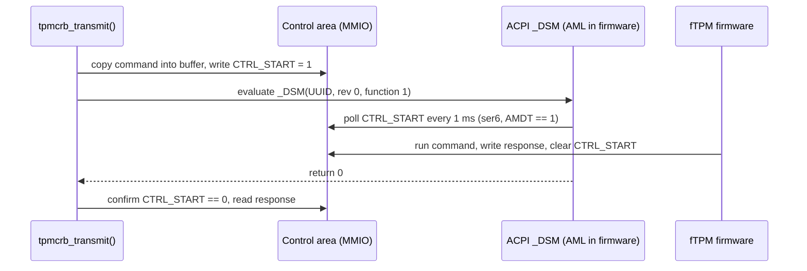

# tpm_crb: how the driver works, and adding the ACPI start method (2)

```
Status:    scope only, no patch yet
Driver:    sys/dev/tpm/tpm_crb.c
Base:      main at 584f44221f45 (2026-10-29); line numbers below refer to it
Machine:   ser6, Beelink SER (AMD Ryzen 7 7735HS, AMI BIOS 113)
```

**Summary.** ser6 has a working AMD firmware TPM, but FreeBSD gives it no
driver, so `/dev/tpm0` does not exist.  The firmware describes the TPM with
start method 2, "ACPI start", and `tpm_crb` only accepts methods 7 and 13.
This document first explains how `tpm_crb` works, then scopes the patch that
would add method 2.  Everything in sections 1 and 2 was read from the source
or measured on ser6.  Section 3 is a plan; nothing in it has been built or run.

---

## 1. Background: how tpm_crb works

### 1.1 What a TPM is, and what the driver does

A TPM (Trusted Platform Module) is a small security processor.  It stores
keys, measures the boot process, and generates random numbers.  On recent AMD
and Intel machines it is not a separate chip: it is firmware running on a
security core inside the CPU package, called a firmware TPM or fTPM.

Software talks to a TPM by sending it a *command*, a byte string such as "give
me 32 random bytes", and reading back a *response*.  The format of these byte
strings is the same on every TPM.  What changes between machines is how the
bytes travel to the TPM.  That is the driver's whole job: move a command in,
tell the TPM to run it, wait, and move the response out.

FreeBSD splits the work in two layers:

| Layer | File | Job |
|---|---|---|
| Common TPM 2.0 code | `tpm20.c` | `/dev/tpm0`, command timeouts, the random-number task |
| Transport | `tpm_crb.c` or `tpm_tis_core.c` | Move bytes to and from one kind of hardware interface |

The common layer calls the transport through one method, `TPM_TRANSMIT`
(`tpm20.c:179`).  The CRB transport implements it as `tpmcrb_transmit()`
(`tpm_crb.c:623`).

### 1.2 What CRB is

CRB means Command Response Buffer.  It is one of the two hardware interfaces
defined by the TCG PC Client Platform TPM Profile (PTP) specification.  The
other is FIFO, also called TIS, which `tpm_tis_core.c` handles.

A CRB TPM gives the CPU two things in physical memory:

* A **control area**: twelve 32-bit registers.  Reading or writing one is a
  message to the TPM firmware.  Their offsets are at `tpm_crb.c:43-54`.
* A **command buffer** and a **response buffer**.  The control area holds their
  addresses and sizes.  They can be the same buffer.

The registers that matter here:

| Register | Offset | Meaning |
|---|---|---|
| `CTRL_REQ` | 0x00 | Ask for a state change: `GO_READY` or `GO_IDLE`.  The TPM clears the bit to acknowledge |
| `CTRL_STS` | 0x04 | Status: error bit, idle bit |
| `CTRL_CANCEL` | 0x08 | Ask the TPM to abandon the running command |
| `CTRL_START` | 0x0C | Write 1 to start the command.  The TPM clears it when the response is ready |
| `CMD_SIZE`, `CMD_LADDR`, `CMD_HADDR` | 0x18 to 0x20 | Size and address of the command buffer |
| `RSP_SIZE`, `RSP_ADDR` | 0x24, 0x28 | Size and address of the response buffer |

The habit to remember: **writing a register only asks.**  The TPM has done the
work when it changes the register back, some time later.  The driver polls for
that with `tpmcrb_ctrl_wait()` (`tpm_crb.c:485`), which sleeps one clock tick
between reads.

Some CRB TPMs also have *locality* registers in the 64 bytes before the control
area.  A locality is a form of ownership of the interface: request it, use the
TPM, release it.  The driver uses them only when they are really there
(`has_locality`, `tpm_crb.c:337`).  The bug report
[`bugreport_tpm_crb_back_to_back_eio.md`](bugreport_tpm_crb_back_to_back_eio.md),
section 1.2, explains localities in more detail.

### 1.3 How the driver finds the TPM: ACPI

The kernel learns about the TPM from ACPI, the firmware's description of the
hardware.  Two ACPI objects matter:

* The **device** `\_SB.TPM` with hardware ID `MSFT0101`.  Its `_CRS` method
  lists the memory ranges the device uses.
* The **TPM2 table**, defined by the TCG ACPI specification, section 3.3.  It
  holds `ControlAddress`, the physical address of `CTRL_REQ`, and
  `StartMethod`.

**The start method** answers one question: after writing the command into the
buffer, how does the driver tell the TPM to run it?  The TCG ACPI
specification, Table 8, lists the values.  These are the ones FreeBSD knows:

| Value | Meaning | FreeBSD driver |
|---|---|---|
| 2 | ACPI start method | **none** |
| 6 | FIFO (TIS) | `tpm_tis_acpi.c:51` |
| 7 | CRB: write `CTRL_START` | `tpm_crb.c:104` |
| 8 | CRB plus the ACPI start method | **none** |
| 13 | CRB plus an AMD mailbox ("Pluton") | `tpm_crb.c:109` |

The constants are in `tpm20.h:106-109`.  Value 13 is
`ACPI_TPM2_COMMAND_BUFFER_WITH_PLUTON` from ACPICA.

### 1.4 The driver's life cycle

**Probe** (`tpmcrb_acpi_probe()`, `tpm_crb.c:219`).  The kernel asks each driver
whether it wants the device.  `tpm_crb` says yes only when the hardware ID is
`MSFT0101` *and* the TPM2 table's start method is in its table
`tpmcrb_sm_cfg_map[]` (`tpm_crb.c:98-118`).

**Attach** (`tpmcrb_attach()`, `tpm_crb.c:359`):

1. Allocate the first `_CRS` memory range (`tpm_crb.c:374`).
2. Read the TPM2 table and map the control area (`tpmcrb_attach_acpi()`,
   `tpm_crb.c:307`).  If the control area is outside the `_CRS` range,
   `tpmcrb_map()` (`tpm_crb.c:250`) maps it separately.
3. Run the start method's own attach hook, if it has one.  Pluton uses this to
   map its two mailbox registers (`pluton_attach()`, `tpm_crb.c:779`).
4. Read the buffer addresses and sizes from the control area and map both
   buffers (`tpm_crb.c:413-440`).
5. Hand over to the common layer: `tpm20_init()` (`tpm20.c:260`) creates
   `/dev/tpm0` and starts the random-number task.

**Transmit** (`tpmcrb_transmit()`, `tpm_crb.c:623`), for every command:

```
request locality (if the registers exist)
check CTRL_STS error bit
GO_IDLE if not idle, then GO_READY          each waits up to 200 ms
copy the command into the command buffer
write CTRL_START = 1
call the start method's sm_cmdready hook    Pluton rings its doorbell here
wait for CTRL_START to read 0
check the error bit, read the response
GO_IDLE (no wait), release locality
```

### 1.5 The start-method hooks

The difference between start methods 7 and 13 is kept in one small structure,
`struct tpmcrb_sm_cfg` (`tpm_crb.c:87`):

| Hook | Called | Pluton uses it to |
|---|---|---|
| `sm_attach` | once, at attach | map the mailbox registers |
| `sm_detach` | once, at detach | unmap them |
| `sm_statechange` | after each write to `CTRL_REQ` | ring the doorbell |
| `sm_cmdready` | after each write to `CTRL_START` | ring the doorbell |

Method 7 sets all four to `NULL`: writing the register is enough.  This design
matters for the patch: a new start method is one more entry in
`tpmcrb_sm_cfg_map[]` plus its hook functions.

---

## 2. The problem: ser6's TPM has no driver

### What you see

No `/dev/tpm0`, and the ACPI device has no driver attached:

```
$ ls /dev/tpm*
ls: /dev/tpm*: No such file or directory
$ devinfo -v | grep MSFT0101
    unknown pnpinfo _HID=MSFT0101 _UID=1 _CID=none at handle=\_SB_.TPM_
```

The `tpm` driver is compiled into ser6's kernel (`kldstat -v` lists
`acpi/tpmcrb` and `acpi/tpmtis` under `kernel`), so this is not a missing
module.

### Why

The TPM2 table, dumped with `acpidump -b` on ser6 (76 bytes):

```
00000020: 0000 0000 0000 0000 1005 21fd 0000 0000  ..........!.....
00000030: 0200 0000 0000 0000 0000 0000 0000 0000  ................
00000040: 0000 0100 0040 f7b7 0000 0000            .....@......
```

* Offset 0x28, `ControlAddress` = `0xFD210510`.
* Offset 0x30, `StartMethod` = **2**, the ACPI start method.

`tpmcrb_acpi_probe()` finds no entry for 2 and returns `ENXIO`.  The TIS
driver only accepts 6.  No driver claims the device.

### What the hardware looks like

The control area, read through `/dev/mem` on ser6 (read-only, no driver
loaded):

```
0xfd210510 CTRL_REQ     0x00000000
0xfd210514 CTRL_STS     0x00000000
0xfd210518 CTRL_CANCEL  0x00000000
0xfd21051c CTRL_START   0x00000000
0xfd210528 CMD_SIZE     0x00004000
0xfd21052c CMD_LADDR    0xb2ea3000
0xfd210534 RSP_SIZE     0x00004000
0xfd210538 RSP_ADDR_LO  0xb2ea7000
```

So this is a normal CRB control area, with separate 16 KiB command and
response buffers.  The values are sane, not all-ones.  `CTRL_STS` does not
have its idle bit set.

The decompiled ACPI tables show three more facts:

* `_CRS` returns **two** memory ranges: `0xB2EA3000` and `0xB2EA7000`, 16 KiB
  each, which are the two buffers.  The control area at `0xFD210510` is **not**
  in `_CRS`.
* The control area does not start 0x40 bytes after the first `_CRS` range, so
  the driver would set `has_locality` to false (`tpm_crb.c:337`) and never
  touch locality registers.
* `_DSM` with UUID `6bbf6cab-5463-4714-b7cd-f0203c0368d4` calls a method
  `STRT`.  On this machine (`AMDT == 1`), function 1 **polls `CTRL_START`**
  every millisecond, for up to 512 ms, until the firmware clears it.  Function
  0 returns `0x03`: functions 0 and 1 are supported.

### What the ACPI start method is

The TCG ACPI specification, section 4.1, defines it.  The driver sets up the
command as usual, writes `CTRL_START`, and then evaluates `_DSM` on the TPM
device:

| Argument | Value |
|---|---|
| Arg0, UUID | `6bbf6cab-5463-4714-b7cd-f0203c0368d4` |
| Arg1, revision | 0 |
| Arg2, function | 1 |
| Arg3 | empty package |

It returns 0 for success and 1 for "general failure".  The specification says
the call asks the firmware to "review the fields in the TPM 2.0 device control
area and take the appropriate action, such as [...] execute or cancel a TPM
2.0 command".  It also says the call should be non-blocking.  ser6's firmware
blocks instead, for up to 512 ms, which is allowed in practice because the
driver can sleep while transmitting.



---

## 3. The fix (planned, not written)

### What to change

All in `tpm_crb.c`.  Estimated size: 60 to 90 lines.

1. **Accept method 2.**  Add an entry to `tpmcrb_sm_cfg_map[]` for
   `TPM2_START_METHOD_ACPI` with description "Trusted Platform Module 2.0, CRB
   mode (ACPI start)".

2. **An attach hook.**  Store the device's ACPI handle with
   `acpi_get_handle()`.  Call `acpi_DSMQuery()` (`acpi.c:3187`) and refuse to
   attach unless bit 1 (function 1) is set.  This rejects firmware that
   advertises method 2 but has no start function.

3. **A cmdready hook.**  Evaluate `_DSM` function 1 with
   `acpi_EvaluateDSMTyped()` (`acpi.c:3248`), asking for an integer.  Return
   failure if the evaluation fails or the integer is not 0.  The existing
   `sm_cmdready` call site (`tpm_crb.c:701`) already runs right after the
   `CTRL_START` write, which is the order the specification asks for.  No
   change to `tpmcrb_transmit()` is needed for the normal path.

4. **Cancel.**  The specification uses the same `_DSM` call for cancellation.
   `tpmcrb_cancel_cmd()` (`tpm_crb.c:537`) writes `CTRL_CANCEL` but has no
   start-method hook.  It needs one, or the cancel will never reach this
   firmware.

5. **Idle and ready states: decide by measurement.**  See the alternatives
   below.

Nothing needs to change for the memory layout.  `tpmcrb_map()` already maps a
control area that lies outside `_CRS`.  The command buffer is inside the first
`_CRS` range and reuses its mapping.  The response buffer is in the second
range, which the driver does not allocate, so it is mapped separately, as the
Pluton mailbox already is.

### Why this is the right place

The start-method hooks were built for exactly this: Pluton differs from plain
CRB only in "what to do after writing a register", and so does the ACPI start
method.  Putting the `_DSM` call in a hook keeps `tpmcrb_transmit()`
unchanged for every other machine.

The `_DSM` helpers already exist in `sys/dev/acpica/acpi.c` and are used by
other drivers (`acpi_spibus.c`, `acpi_spmc.c`).

### Alternatives and their tradeoffs

**Idle and ready states.**  `tpmcrb_transmit()` asks for `GO_IDLE` and
`GO_READY` and waits up to 200 ms for each acknowledgement.  Neither the
specification nor ser6's AML says whether this firmware honours those
requests.

| Option | Gain | Risk |
|---|---|---|
| Keep them | No new code path; same behaviour as method 7 | If the firmware never clears `CTRL_REQ`, every command fails with "Failed to transition to ready state" after 200 ms |
| Skip them for method 2 | Matches what another major OS does for methods 2 and 8 | A firmware that does need them would misbehave silently |

Recommendation: build with them kept, run one command on ser6, and read
`CTRL_REQ` after each request.  Skip them only if the measurement shows they
are ignored.

**Revision 0 or 1.**  The specification says revision 0.  At least one other
operating system passes 1.  ser6's `STRT` method ignores the revision, so both
work here.  Other firmware may have been tested only with 1.  Recommendation:
use 0, as specified, and fall back to 1 only if function 1 is missing at
revision 0.  I don't know of a machine that needs the fallback.

**Method 8 too.**  Method 8 is "CRB plus ACPI start", the same `_DSM` call.
Adding it is one more table entry.  But no available machine reports method 8,
so it would ship untested.  Recommendation: leave it out of this patch and say
so in the commit message.

**Allocate the second `_CRS` range.**  The driver allocates only resource 0.
Allocating resource 1 too would register the response buffer with the kernel's
resource manager instead of mapping it anonymously.  That is cleaner but
changes attach for every CRB machine with two ranges.  Recommendation: not in
this patch.

### What the patch does NOT fix

* **The back-to-back `EIO` bug.**  That is a separate patch
  ([`tpm_crb_settle_before_next_command.patch`](tpm_crb_settle_before_next_command.patch)).
  ser6 would, however, become the first non-Pluton CRB machine able to run its
  reproducer, `tpm_crb_sweep.py`.
* **Interrupts.**  The driver still polls.
* **AMD fTPM random-number stalls.**  Another OS disables the AMD fTPM as a
  random source, because reading it can stall the system on some firmware.
  FreeBSD's `tpm20_harvest()` (`tpm20.c:418`) asks for random bytes every 10
  seconds.  Whether this firmware stalls has not been measured.

---

## 4. Tested

Nothing has been built yet.

| Configuration | Result |
|---|---|
| ser6, unpatched kernel: driver attaches? | No: `devinfo` shows `unknown` (measured) |
| ser6, control area readable before a driver attaches? | Yes: sane values (measured) |
| ser6, `_DSM` function 0 result | `0x03`, read from the decompiled AML, not evaluated at run time |
| ser6, patched: attach, `/dev/tpm0` appears | untested |
| ser6, patched: `GO_IDLE`/`GO_READY` acknowledged? | untested |
| ser6, patched: `tpm2_selftest`, `tpm2_getrandom` | untested |
| ser6, patched: `tpm_crb_sweep.py 2000 0 0 0 0 0.5 1 2 5 10 50` | untested |
| ser6, patched: suspend and resume | untested |
| Start method 7 and 13 machines: no regression | untested |
| Start method 8 machines | none available |

### How to test, once written

ser6 has `tpm` compiled into its kernel, so the patch needs a full kernel
build and install, not a module reload.  Then:

```sh
dmesg | grep tpmcrb
ls -l /dev/tpm0
sudo python3 tpm_crb_sweep.py 2000 0 0 0 0 0.5 1 2 5 10 50
```

### Sources

* TCG ACPI Specification, Version 1.4, Revision 15: Table 7 (TPM2 table),
  Table 8 (start method values), section 4.1 (ACPI start method `_DSM`).
* TCG PC Client Platform TPM Profile Specification 1.03, section 5.5.3.1,
  Table 23 (CRB register layout), as already cited in `tpm_crb.c`.
* ser6: `acpidump -b`, `iasl -d dsdt.dat`, and a read-only `/dev/mem` dump of
  the control area, all taken on 2026-11-04.
