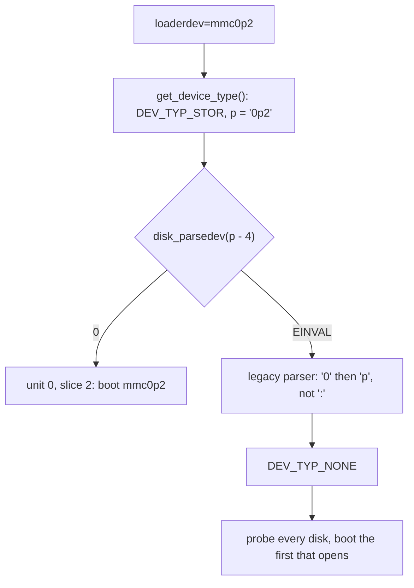

# ubldr: `loaderdev=mmc0p2` is ignored

Patch: [`ubldr_loaderdev_parsedev.patch`](ubldr_loaderdev_parsedev.patch),
against `main` at `29b24020f6fa` (2026-11-12). It needs `d687c9fc7efe`
("stand: Accept any device name in disk_parsedev()") first.
Test: [`ubldr_loaderdev_parsedev_test.sh`](ubldr_loaderdev_parsedev_test.sh).
Reported by: llm-postcr, finding
`POSTCR-d687c9fc7efe55d1ba7bc7bea056352ce0437588-1` in its review of
`d687c9fc7efe`.

This bug is in ubldr only, the loader that U-Boot starts on ARM boards. The
amd64 UEFI netboot in `FreeBSD/iPXE.md` never runs ubldr and is not
affected.

## 1. Background

**ubldr and `loaderdev`.** U-Boot is the firmware of many ARM boards. It
starts `ubldr` (`stand/uboot/`), the FreeBSD loader for U-Boot. ubldr reads
the U-Boot environment variable `loaderdev` to know which device to boot
from. The comment above `get_load_device()` (`stand/uboot/main.c:174`)
accepts two forms:

    legacy:            <type_name><unit>:<slice>.<partition>, e.g. mmc0:2
    loader(8) format:  disk0s1, disk1s2a, disk0p4, and in the comment of the
                       code itself (line 230) mmc1p12

**Device type prefix.** `get_device_type()` (`stand/uboot/main.c:140`)
compares the start of the string with the names in `device_types[]` (line
59): `disk`, `ide`, `mmc`, `sata`, `scsi`, `usb`, `net`. It returns `p`, a
pointer just past the matched name:

    devstr:   m m c 0 p 2 \0
              ^     ^
              |     p = devstr + 3
              p - 4 = devstr - 1   (one byte before the string)

**`disk_parsedev()`** (`stand/common/disk.c:413`) parses a disk name such
as `disk0p2` into unit 0, slice 2. It is shared by all loaders. Its
`devspec` argument must point to the start of the whole name, including
the type prefix. This rule dates from `33bbe5ddcbbc` ("stand: parsedev API
change: devspec now points to start of full device name", 2022). How it
skips the prefix changed twice:

| commit | prefix handling |
|---|---|
| `33bbe5ddcbbc` (2022) | `np = devspec + 4`: skips 4 bytes, whatever they are |
| `d18ed8e19c3c` (2025-11-10) | accepts only `disk` or `vdisk`, else `EINVAL` |
| `d687c9fc7efe` (2026-11-08) | skips any run of letters; `EINVAL` if there is none |

**The ubldr call.** Since `33bbe5ddcbbc`, `get_load_device()` calls
`disk_parsedev(..., p - 4, NULL)`. Its comment calls this a hack:
`disk_parsedev()` "always adds 4", so `p - 4` gives back `p`. That holds for
4-letter types. For `ide`, `mmc` and `usb`, `p - 4` points one byte before
the string. C does not allow a pointer before the start of an object, and
the byte there belongs to something else.

**What happens when the parse fails.** ubldr goes on with the legacy
parser. For `mmc0p2` it reads unit 0, then sees `p` where it wants `:` and
sets the type to `DEV_TYP_NONE` (value 0, `stand/uboot/api_public.h:125`).
`probe_disks()` then calls `uboot_diskgetunit(0, unit)`
(`stand/uboot/uboot_disk.c:304`). Its test `(type & 0) == 0` is true for
every disk, so ubldr boots from the first disk that opens.



## 2. The problem

The test script compiles the real `disk_parsedev()` of each of the three
commits for the host. It calls each one with ubldr's argument `p - 4` and
with `devstr`. The byte before the string is first `0`, then `'Z'`.

    $ ./ubldr_loaderdev_parsedev_test.sh ~/freebsd-official/src

Measured on 2026-11-12 (errors: 22 = `EINVAL`, 1001 = `EUNIT`):

| loaderdev | byte[-1] | `33bbe5ddcbbc`, `p - 4` | `d18ed8e19c3c`, `p - 4` | `d687c9fc7efe`, `p - 4` | `d687c9fc7efe`, `devstr` |
|---|---|---|---|---|---|
| `disk0p2` | any | OK | OK | OK | OK |
| `sata0p2` | any | OK | error 22 | OK | OK |
| `mmc0p2` | `0` | OK | error 22 | error 22 | OK |
| `mmc0p2` | `'Z'` | OK | error 22 | OK | OK |

How to read it:
- `33bbe5ddcbbc` works by accident: it skips 4 bytes from `devstr - 1` and
  lands on `0p2`. It never reads the byte before the string.
- `d18ed8e19c3c` breaks every type except `disk`, including `sata` and
  `scsi`, because `strncmp()` wants the literal `disk`. stable/15 has this
  commit (`efa78078be9d`) but not `d687c9fc7efe`.
- `d687c9fc7efe` fixes `sata` and `scsi`. For `ide`, `mmc` and `usb`, the
  result now depends on a byte outside the string. That byte is not under
  ubldr's control. It is the byte before the value in U-Boot's environment
  storage.

## 3. The fix

```diff
-		    disk_parsedev((struct devdesc **)&dev, p - 4, NULL) == 0) { /* Hack */
+		    disk_parsedev((struct devdesc **)&dev, devstr, NULL) == 0) {
```

The comment paragraph that explains the `p - 4` hack goes too. `devstr` is
the start of the whole name, which is what `disk_parsedev()` expects since
`33bbe5ddcbbc`. Since `d687c9fc7efe`, `disk_parsedev()` skips whatever
letters the name starts with, so `mmc`, `ide` and `usb` work like `disk`.

The checks before the call (`strcspn()` on `p` for spaces, dots and colons)
still look at the part after the prefix, as before.

Alternatives:

| option | tradeoff |
|---|---|
| **pass `devstr`** (this patch) | one argument; correct for every prefix; wrong on trees without `d687c9fc7efe` |
| build a fake `disk...` string, as the old comment suggests | works with the `d18ed8e19c3c` parser too, but adds a buffer and a copy to fix a pointer |
| `p - strlen(type name)` | gives `devstr` back, the long way |

What the patch does NOT fix:
- **Trees without `d687c9fc7efe`**, such as stable/15: `devstr` would then
  fail for every type except `disk`. An MFC must take `d687c9fc7efe` first.
- **The legacy parser**: `mmc0:2` is untouched and still works.
- **Unknown prefixes**: `get_device_type()` still rejects names that are
  not in `device_types[]`.

## 4. Tested

| configuration | result |
|---|---|
| host harness, real `disk_parsedev()` of three commits, see section 2 | `devstr` parses `disk0p2`, `sata0p2`, `mmc0p2` on `d687c9fc7efe` whatever the byte before |
| `stand/uboot/main.c` compiled for armv7 (clang `-target armv7-unknown-freebsd16.0-gnueabihf`, ubldr's own flags) | builds without warnings; the call argument changes from `sub r1, r6, #4` to `mov r1, r8` (`devstr`) |
| ubldr booted by U-Boot on a board | untested: no board here |
| `ide`, `usb`, `scsi` prefixes | not run; same code path as `mmc` (3 letters) or `sata` (4 letters) |

## 5. Commit message

```
ubldr: Pass the whole loaderdev name to disk_parsedev()

p - 4 is one byte before the string for 3-letter types, so whether
loaderdev=mmc0p2 parsed depended on that byte.  disk_parsedev() now
skips any name prefix itself.

Reported by:	llm-postcr
Fixes:		d18ed8e19c3c ("stand: Try to parse vdisk correctly")
```
