# virtual_oss: known problems and settings

virtual_oss(8) is the FreeBSD sound server: it opens a sound card and
offers a virtual `/dev/dsp` from userspace (cuse(3)) that several
programs can share, plus optional loopback devices that give back what is
played. FreeBSD base ships it with an rc.d script, `/etc/rc.d/virtual_oss`,
enabled with `virtual_oss_enable="YES"`.

This document gathers the problems found with it on two machines:

- ser6: Beelink SER6, Conexant codec on `hdac1` (`/dev/dsp3`).
- framework (frwk-bsd): Ryzen AI MAX+ 395 (Strix Halo), Realtek ALC623 on
  `hdac1` (`/dev/dsp4`), used as a game streaming host (Moonshine).

Both run FreeBSD 16.0-CURRENT with `hw.snd.latency=2` (the default).

## The default configuration

`/etc/rc.d/virtual_oss` starts one instance, `dsp`, with these arguments
unless `virtual_oss_dsp` is set in rc.conf:

```
-S -C 2 -c 2 -r 48000 -b 24 -s 8ms -i 8 -f /dev/dsp${default_unit}
-d dsp -l dsp.loop -t vdsp.ctl
```

- `-f /dev/dspN` opens the default sound card for playback **and
  recording**.
- `-s 8ms` sets the buffer size.
- `-d dsp` creates `/dev/dsp`; `-l dsp.loop` creates a loopback device
  that returns everything played on `/dev/dsp` (Moonshine and
  [../record-xorg-demo.sh](../record-xorg-demo.sh) record the game sound
  from it).

## Problem 1: the microphone is recorded all the time

Because of `-f`, virtual_oss reads the microphone input permanently, even
when no program records. That recording, not playback, is what keeps the
codec busy.

hdac1 interrupts per second, measured on ser6 with a second virtual_oss
instance (moonlight playing on the same card the whole time):

| virtual_oss arguments | hdac1 interrupts/s |
|---|---|
| none (moonlight alone) | 120 |
| `-s 8ms -f /dev/dsp3` (default) | 937 |
| `-s 8ms -R /dev/null -P /dev/dsp3` (no recording) | 187 |
| `-s 20ms -f /dev/dsp3` | 938 |
| `-s 20ms -R /dev/null -P /dev/dsp3` | 187 |

So recording costs about 750 interrupts a second, and the `-s` buffer
size does not change the interrupt rate (the sound driver's block size,
set by `hw.snd.latency`, does). The framework shows the same 935 to 938
interrupts a second from `hdac1` with the default configuration.

The cost in power on the framework, idle, 60 s, from
[amdxdna_npu.md](amdxdna_npu.md) section 6:

| frwk-bsd, idle | RAPL | Wall |
|---|---|---|
| virtual_oss running (default) | 12.8 W | 24.7 W |
| virtual_oss stopped | 3.97 W | 12.3 W |

That test stopped virtual_oss completely; the share of the recording
alone was not measured in watts.

Fix: give a playback device only, with `-R /dev/null -P /dev/dspN`
instead of `-f /dev/dspN`. Programs then cannot record from `/dev/dsp`.
A machine that needs the microphone only sometimes can run a second
instance for recording when needed, or stop the service.

## Problem 2: the default buffer is too small (crackling sound under Wine)

A program that does not ask for a buffer size gets two fragments of the
`-s` size from virtual_oss, much less than a kernel sound device gives
(`SNDCTL_DSP_GETOSPACE`, 48 kHz, 16-bit stereo, `hw.snd.latency=2`):

| device | fragments | fragment size | buffer |
|---|---|---|---|
| kernel `/dev/dsp3` (ser6) | 8 | 1024 bytes | 42.7 ms |
| virtual_oss `/dev/dsp`, `-s 8ms` (default) | 2 | 1536 bytes | 16 ms |
| virtual_oss `/dev/dsp`, `-s 20ms` | 2 | 3840 bytes | 40 ms |

Wine's OSS driver (`dlls/wineoss.drv/oss.c`, `oss_write_data()`) writes
every 10 ms and tries to keep three periods (30 ms) queued; it never
sends `SNDCTL_DSP_SETFRAGMENT` and relies on the device's default. That
works on a kernel device (42.7 ms) but not on virtual_oss with its
default arguments (16 ms).

Symptom: Cyberpunk 2077 under wine-proton, streamed by Moonshine, crackled.
Six seconds recorded from `/dev/dsp.loop` on the framework had no clipping,
but 150 runs of exact silence, each 8.0 ms long and exactly 40.0 ms apart:
one virtual_oss block out of five was empty. 40 ms is the common multiple
of virtual_oss's 8 ms block and Wine's 10 ms period.

The timing over one 40 ms cycle, as recorded. Which of the five blocks is
the empty one is drawn for illustration; the recording shows one empty
block every 40 ms, not its position in Wine's cycle.

```mermaid
gantt
    title One 40 ms cycle, Wine writing into virtual_oss
    dateFormat x
    axisFormat %L ms

    section Wine (period 10 ms)
    write 10 ms       :w1, 0, 10
    write 10 ms       :w2, 10, 20
    write 10 ms       :w3, 20, 30
    write 10 ms       :w4, 30, 40

    section -s 8ms (buffer 2 x 8 = 16 ms)
    block 8 ms        :r1, 0, 8
    block 8 ms        :r2, 8, 16
    block 8 ms        :r3, 16, 24
    block 8 ms        :r4, 24, 32
    empty, silence    :crit, r5, 32, 40

    section -s 20ms (buffer 2 x 20 = 40 ms)
    block 20 ms       :s1, 0, 20
    block 20 ms       :s2, 20, 40
```



With `-s 8ms`, Wine wants 30 ms queued but only 16 ms fit, so any delay
on Wine's side leaves an 8 ms block with nothing in it: virtual_oss
plays silence there, which is heard as crackling 25 times a second. With
`-s 20ms`, the 40 ms buffer holds Wine's three periods, and a late write
is absorbed.

A client can ask for more: `SNDCTL_DSP_SETFRAGMENT` with 8 fragments of
2 KB gave 16416 bytes (85 ms) on the default instance.

Fixes:

- `-s 20ms` (40 ms of buffer). It adds about 24 ms of audio delay, which
  does not matter for streaming or games. Verified on the framework with
  the same game: 6 s from `/dev/dsp.loop` had no silent run of 1 ms or
  more (150 before), peak 16383, no clipping.
- FreeBSD base: a larger `-s` in the default arguments of
  `/etc/rc.d/virtual_oss`, so every user gets a buffer close to the
  kernel's.
- virtual_oss itself: `-s` sets both the mixing block and the buffer a
  client gets by default (two blocks). Giving clients more blocks by
  default, about 40 ms like the kernel, would keep a short mixing block
  without starving programs that do not ask for a size. Not checked in
  the virtual_oss source yet.

Not chosen: making Wine request its buffer with `SNDCTL_DSP_SETFRAGMENT`.
Wine's assumption holds on kernel devices; the problem is virtual_oss's
small default, which any program that relies on the default would hit.

## Problem 3: Wine does not find virtual_oss's /dev/dsp

wineoss builds its device list from the kernel (`SNDCTL_SYSINFO` and
`SNDCTL_AUDIOINFO`). `/dev/dsp` from virtual_oss is a userspace device, so
it is not in that list, and wineoss falls back to the first kernel device
(on the framework `/dev/dsp0`, an HDMI output): the game's sound bypassed
virtual_oss and never reached the stream.

Fixed by a Wine patch that adds the default device when it is missing from
the list: commit `e09a9985bb9` "wineoss.drv: Add a default device that is
not a kernel device." in `~/wine` (branch
`wineoss-userspace-default-device`), and the same change in the
wine-proton port (`files/patch-dlls_wineoss.drv_oss.c`, PORTREVISION 6).
[../wine-game.sh](../wine-game.sh) then points Wine's default output at
`/dev/dsp` when a streaming server sets `AUDIODEV`.

## Recommended settings

Streaming host (framework), in `/etc/rc.conf`:

```sh
# virtual_oss for Moonshine: no microphone capture (-R /dev/null), 20 ms
# buffer (Wine needs more than the default 2 x 8 ms)
virtual_oss_dsp="-S -C 2 -c 2 -r 48000 -b 24 -s 20ms -i 8 -R /dev/null -P /dev/dsp4 -d dsp -l dsp.loop -t vdsp.ctl"
```

`-P` names the card explicitly, where the default arguments use
`hw.snd.default_unit`.

Applied on the framework on 2026-11-20: `hdac1` went from 937 to 187
interrupts a second, a client gets 40 ms of buffer, and the game sound
streamed by Moonshine has no more gaps.

Without any sound card (no local sound, no hdac interrupts at all),
virtual_oss can run with `-f /dev/null` and a loopback master device
(`-L`); not tested here.

## Not done

- Measure the power of the playback-only configuration.
- A FreeBSD bug report on the default arguments in
  `/etc/rc.d/virtual_oss`: recording permanently costs about 750
  interrupts a second on every machine that enables the service, and the
  16 ms default buffer is a third of what a kernel device gives.
- Read the virtual_oss source to see how the client's default buffer is
  derived from `-s`.
