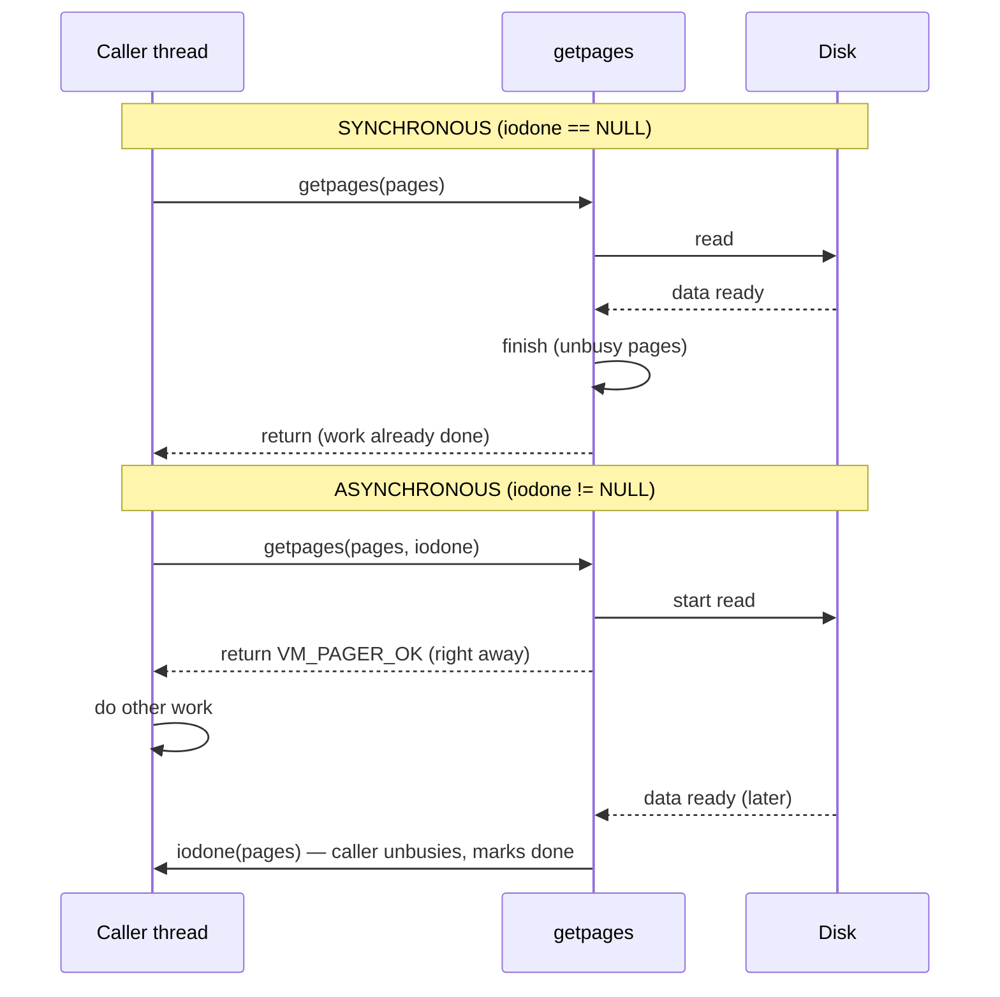
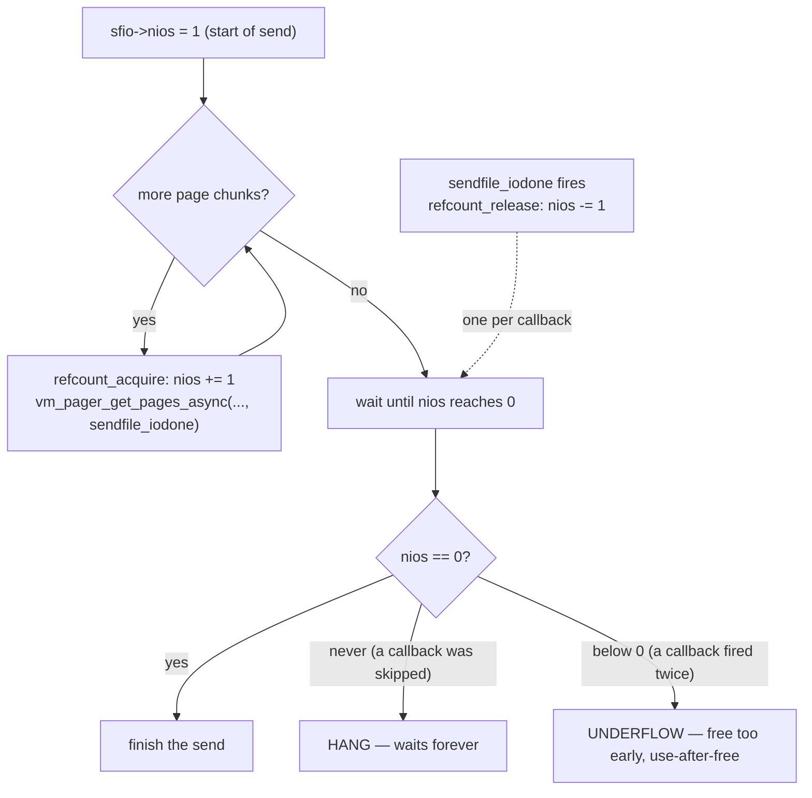
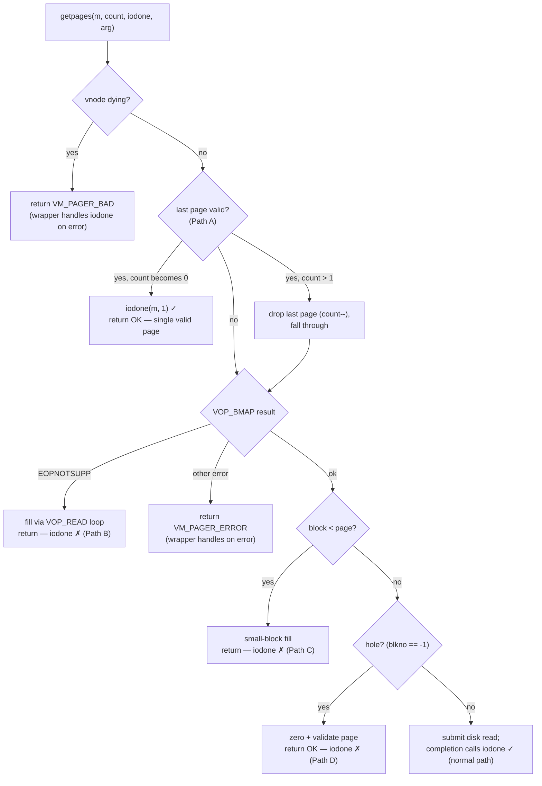

# The getpages async completion puzzle in the FreeBSD VM

*How a CBMC proof led to a wrong kernel patch, what the code really does,
and all the operating-system theory a first-year student needs to judge
it.*

> **Status: teaching note.** This walks through a real episode: a bounded
> model checker (CBMC) flagged something in
> `vnode_pager_generic_getpages()`, a fix was written and committed to a
> personal branch, the FreeBSD VM maintainer (kib@) replied "I do not
> understand this change. Isn't it a reverse of what you state as the
> reason for the patch?", and the fix was reverted. The goal here is not
> to hand you a patch — it is to teach you enough that you can read the
> function yourself and form your own opinion. Line numbers are from
> `main` around `43c79c64af48` (October 2026); they drift, so re-`grep`
> if they do not line up.

---

## 0. What you will learn

By the end you should understand, from first principles:

1. what a *page* is and why the kernel serves files one page at a time;
2. what "reading a file" actually does inside the kernel;
3. the difference between a **synchronous** and an **asynchronous** call,
   and what a **completion callback** is;
4. why `sendfile(2)` uses the asynchronous path, and what "zero-copy"
   means;
5. what a *reference count* is and how one missed callback can hang a
   whole operation forever;
6. the exact function at the centre of this, `vnode_pager_generic_getpages()`,
   and the four places it can return early;
7. why the "obvious" fix was wrong, and why deciding whether there is a
   bug at all needs the maintainer, not a model checker.

You do not need to know C deeply. You need to be willing to read a dozen
lines of it slowly.

---

## 1. Pages: the unit everything is measured in

Physical memory (RAM) is not handed out byte by byte. The hardware and
the kernel divide it into fixed-size blocks called **pages**. On amd64 a
page is 4096 bytes (4 KiB). Every piece of memory the kernel tracks — a
chunk of a running program, a slice of a file cached in RAM — is a whole
number of pages.

A file on disk is also thought of in pages. If you have a 10000-byte
file, the kernel pictures it as three pages: bytes 0–4095, 4096–8191,
and 8192–9999 (the last page is partly empty). When a program reads the
file, the kernel's job is to get the right pages of that file into RAM.

A page of a file that is currently in RAM is represented by a kernel
object called a `vm_page`. A `vm_page` can be:

- **valid** — its contents in RAM match what is on disk, ready to use;
- **invalid** — the RAM is allocated but has not been filled from disk
  yet;
- partly valid — only some of its bytes are filled (this happens at the
  very end of a file, where the last page is not completely covered by
  file data).

Key idea for later: *a page that is already valid does not need to be
read from disk.* The data is already there.

---

## 2. What "reading a file" does inside the kernel

When you call `read()` on a file, or when the kernel needs file data for
any reason, it does roughly:

1. Work out which pages of the file are wanted.
2. For each wanted page, check if it is already in RAM and valid. If so,
   use it — no disk access.
3. For the pages that are missing or invalid, ask the storage layer to
   fetch them from disk into RAM.
4. Wait for the disk to deliver them.
5. Use the pages.

Step 3 is where the **pager** comes in. A "pager" is the kernel component
that knows how to move pages between a backing store and RAM. For a file
on a filesystem, that is the **vnode pager**
(`sys/vm/vnode_pager.c`). The function that does "fetch these file pages"
is:

```c
int
vnode_pager_generic_getpages(struct vnode *vp, vm_page_t *m, int count,
    int *a_rbehind, int *a_rahead, vop_getpages_iodone_t iodone, void *arg)
```

Read the parameters:

- `vp` — the vnode, i.e. the open file.
- `m` — an array of `vm_page` pointers: the pages the caller wants.
- `count` — how many pages are in that array.
- `a_rbehind`, `a_rahead` — hints: "while you're at it, also pull in this
  many pages before / after, because the program will probably want them
  soon" (read-behind / read-ahead; an optimisation, ignore for now).
- `iodone`, `arg` — **the completion callback and its argument.** This is
  the heart of the story. Hold that thought until section 4.

So "getpages" means: *given an array of `count` file pages, make them
valid (fetch from disk what is missing), and tell me when it is done.*

---

## 3. "Busy": the do-not-touch flag on a page

Many threads run at once in a kernel. If thread A is in the middle of
filling a page from disk, thread B must not read that half-filled page.
The kernel marks such a page **busy** (the exact flag is "exclusive
busy", xbusy). Rules:

- Before starting I/O on a page, the kernel marks it busy.
- While a page is busy, other threads that want it must wait.
- When the work is finished, the page is marked **unbusy** and anyone
  waiting is woken.

A page that is left **busy forever** is a disaster in slow motion:
nobody can ever use it again, and any thread that later asks for it waits
forever. "Leaked busy page" is one of the two failure modes in this
story. Remember it.

---

## 4. Synchronous vs asynchronous, and the completion callback

This is the single most important concept. Take it slowly.

**Synchronous** means "do it and do not return until it is finished."
You call `fetch_pages()`, and when the function returns, the pages are
ready. Simple, but the calling thread is stuck waiting the whole time the
disk is working — milliseconds, during which it could have done other
useful work.

**Asynchronous** means "start it, return immediately, and call me back
when it is really finished." You hand the function a second function —
the **callback** — and an argument to pass to it. The function kicks off
the disk I/O, returns right away, and your thread goes off and does other
things. Later, when the disk delivers the data, the kernel invokes your
callback. In this code the callback has the type:

```c
typedef void vop_getpages_iodone_t(void *arg, vm_page_t *m, int count, int error);
```

"iodone" = "I/O done." When it fires, it receives the pages that are now
ready, how many, and whether there was an error. Inside the callback the
caller finishes up: typically it **unbusies** the pages (section 3) and
records that this chunk of work is complete.

The two shapes side by side — notice *when* the caller is free to do
other work, and *who* runs the finishing step:



In the async case the finishing step happens **inside `iodone`, later**.
If `iodone` is never called, that finishing step never happens.

`vnode_pager_generic_getpages()` is *both*: if `iodone` is `NULL` it
behaves synchronously (do everything, then return); if `iodone` is
non-`NULL` it behaves asynchronously (start the I/O, return
`VM_PAGER_OK`, and arrange for `iodone` to be called later by the
disk-completion machinery).

### The contract

Here is the promise the asynchronous mode must keep, stated plainly:

> If you pass a non-`NULL` `iodone`, it will be called, **exactly once**,
> and the pages it reports will cover **every** page you asked for.

Why *exactly once* and *every page* matter is section 5.

---

## 5. Reference counts, and how one missing callback hangs everything

### 5.1 What a reference count is

A **reference count** is an integer that answers "how many outstanding
things still have to happen before this job is finished?" You bump it up
by one each time you start a sub-task, and each sub-task bumps it down by
one when it finishes. When it reaches zero, the whole job is done and can
be cleaned up. It is the kernel's way of tracking "are we there yet?"
without a central scheduler watching everyone.

### 5.2 How `sendfile(2)` uses it

`sendfile(2)` is the system call a web server uses to send a file down a
socket. Its whole point is **zero-copy**: instead of copying the file's
bytes from the disk cache into a userspace buffer and then back into the
network stack (two copies), it hands the kernel's own file pages straight
to the network card. Fewer copies, less CPU, faster serving. That is why
an HTTP server cares about this code path.

To send a big file, `sendfile` splits it into page-sized chunks and, for
the chunks not already in RAM, fires off **asynchronous** getpages calls
so it does not block the serving thread. It tracks progress with a
reference count called `nios` ("number of I/Os") inside its per-request
structure `sfio`:

```c
refcount_acquire(&sfio->nios);                 /* +1: an I/O is starting */
rv = vm_pager_get_pages_async(obj, pa + i, count, NULL,
    ..., &sendfile_iodone, sfio);              /* iodone = sendfile_iodone */
```
(`sys/kern/kern_sendfile.c` around line 500.)

And the callback, when the disk delivers, does:

```c
if (!refcount_release(&sfio->nios))            /* -1; true when it hits 0 */
    return;
/* ... whoever drops it to zero finishes the send ... */
```
(around line 285.)

So the arithmetic is: **one `+1` per getpages call, one `-1` per callback.**
They must balance.

### 5.3 The two failure modes

Now you can see why the contract is strict:

- **A skipped callback** (`+1` with no matching `-1`): `nios` never
  reaches zero. The send never completes. The thread that waits on it
  (`sendfile_iowait`) waits forever. The file transfer hangs.
- **A doubled callback** (`+1` with two `-1`): `nios` underflows past
  zero, the cleanup code runs too early and frees the `sfio` structure
  while it is still in use — a use-after-free, which is a security bug.

"Exactly once" is not pedantry. One missed call hangs the server; one
extra call corrupts memory. This is the lens through which every early
return in the function must be checked.

The balance, drawn out — every `+1` must meet exactly one `-1`:



---

## 6. The function, path by path

Open `vnode_pager_generic_getpages()` and walk its early exits. Each one
is a place where the function returns *before* reaching the normal
disk-I/O machinery at the bottom. For each, ask the one question:
**does `iodone` get called exactly once, covering every requested page?**

The map of early exits (✓ = calls `iodone` in async mode, ✗ = does not):



Paths B, C, D are the ✗ marks CBMC objected to. Path A's two outcomes are
the ones that caused the confusion. Now walk each.

### Path A — the "last page already valid" trim (~line 924)

```c
if (!vm_page_none_valid(m[count - 1]) && --count == 0) {
    if (iodone != NULL)
        iodone(arg, m, 1, 0);
    return (VM_PAGER_OK);
}
```

Read it carefully, because this is the line that caused the confusion.

- `!vm_page_none_valid(m[count - 1])` — "the last requested page is not
  entirely invalid", i.e. it already has valid data. (Recall from
  section 1: a valid page needs no disk read.)
- `--count == 0` — C evaluates `&&` left to right and **short-circuits**:
  the right side runs only if the left side was true. So `--count`
  (decrement `count`, then test) runs *only when the last page is
  valid*. If it was the only page (`count` was 1, now 0), the test is
  true: there is nothing left to read, so complete immediately with
  `iodone(arg, m, 1, 0)` and return.
- If `count` was greater than 1, `--count` is not zero, the `if` body is
  skipped, but **`count` has still been decremented** — the already-valid
  last page has been dropped from the run, and execution falls through to
  fetch the remaining `count` pages.

So this branch does two different things depending on how many pages were
asked for:
- *one page, already valid* → complete it immediately (correct, and it
  already calls `iodone`);
- *many pages, last one valid* → drop that last page, read the rest.

### Paths B, C, D — the "no disk I/O needed" success exits

Further down there are three places that fill the pages **without**
submitting a disk read, and then `return (VM_PAGER_OK)` (or `return 0`):

- **B, EOPNOTSUPP (~line 939):** the filesystem does not implement the
  block-map operation `VOP_BMAP`, so pages are filled a different way
  (`vnode_pager_input_old`) in a loop, then it returns.
- **C, small blocks (~line 962):** the filesystem's block size is smaller
  than a page; a special routine (`vnode_pager_input_smlfs`) fills them,
  then it returns.
- **D, sparse file (~line 974):** the requested region is a *hole* in the
  file (a sparse file has ranges that were never written and read back as
  zeros). The page is simply zeroed and marked valid, then it returns.

In the current code, **none of B, C, D calls `iodone`.** They just return
`VM_PAGER_OK`.

### The normal path (bottom of the function)

If none of the early exits fire, the function allocates a buffer, fills
in the page array, submits the disk read, and returns `VM_PAGER_OK`. The
completion machinery later calls `iodone` on the requested pages. This is
the common case and it is correct.

---

## 7. What the model checker complained about

CBMC (the bounded model checker — a tool that explores *every* possible
input within set limits and checks assertions) was pointed at this
function with the assertion "on success, `iodone` runs exactly once over
the requested pages." It found that paths B, C, D return `VM_PAGER_OK`
without ever calling `iodone`. Under the contract of section 4, that
looks like the "skipped callback" failure of section 5.3: a hang.

It also noticed path A: when `count > 1` and the last page is valid, that
page is dropped (`--count`) and the completion later covers one fewer
page than requested.

Both look, on the face of it, like real violations of "every page gets a
completion."

---

## 8. The wrong fix, and why it was wrong

The patch that was written and then reverted did two things:

1. For paths B, C, D: add `if (iodone != NULL) iodone(arg, m, count, 0);`
   before the return.
2. For path A: change the condition so the trim is skipped in the async
   case:
   ```c
   if (!vm_page_none_valid(m[count - 1]) && iodone == NULL && --count == 0)
       return (VM_PAGER_OK);
   ```

Item 2 is where it went wrong, and kib@'s reply — *"isn't this the
reverse of what you state as the reason?"* — points exactly at it.

The stated reason for the patch was "make sure the completion runs for
every page." But look at what item 2 actually does to the simplest case:
a **single** already-valid page in async mode. Before the patch, that hit
the `--count == 0` branch and completed **immediately** with
`iodone(arg, m, 1, 0)` — correct and cheap. After the patch,
`iodone == NULL` is false, the whole condition is false, and the function
falls through to **allocate a buffer and perform a real disk read of a
page that was already valid.** So the patch, in the name of "always
complete," made the clean immediate-completion case do a pointless I/O
instead. That is literally the reverse of the intent — more work, not a
cleaner completion — and it is what a careful reader sees on the diff
without any extra context. kib@ saw it.

There is a second, deeper reason the whole patch was built on sand (next
section).

---

## 9. Why it may not be a bug at all: the caller's half of the contract

A contract has two sides. Section 4 stated the pager's promise. But the
*caller* also has responsibilities, and `sendfile` meets them in a way
that makes the "missing completion" harmless.

Before `sendfile` ever calls the async pager, it walks the pages itself
(`sys/kern/kern_sendfile.c` around line 418):

```c
/* Skip valid pages. */
if (vm_page_is_valid(pa[i], ...)) {
    vm_page_xunbusy(pa[i]);     /* unbusy it here, now */
    SFSTAT_INC(sf_pages_valid);
    i++;
    continue;                   /* do NOT include it in the pager run */
}
```

Two things follow:

1. `sendfile` **unbusies already-valid pages itself**, before the pager
   call. So the "leaked busy page" fear of section 3 does not apply to
   those pages — they were already released.
2. It does **not** include valid pages in the array handed to the pager,
   and it only does `refcount_acquire(&nios)` for the chunks it actually
   submits. So the reference-count arithmetic (section 5) already
   excludes the valid page. There is no `+1` waiting for a `-1`.

In other words, for the real caller the trim in path A is *consistent
with the caller's own bookkeeping*, and the normal I/O path at the bottom
also runs the completion on the trimmed `count` — so even the working,
common path "completes `count` of `count+1`" when the last page was
valid, and that is fine, because the caller already dealt with that page.

So the "bug" CBMC found assumes an async caller that (a) passes an
already-valid page into the pager and (b) expects a completion for it.
**No in-tree caller does that.** `sendfile` is the only async caller, and
it does the opposite. The model checker was proving a property that is
stronger than the real contract, and the real contract is upheld.

That is the heart of kib@'s scepticism: the change "fixes" a violation of
a rule that is not actually the rule.

---

## 10. The honest conclusion

- Paths B, C, D genuinely do not call `iodone`. Whether that is a latent
  bug (a future async caller might rely on it) or intentional (the caller
  is responsible, as `sendfile` demonstrates) is a **design question for
  the maintainer**, not something a model checker or a patch author can
  settle from the code alone.
- Path A was **not** a bug; the attempted fix broke the clean case and
  was correctly rejected.
- The right move after the maintainer pushed back was to revert (which
  was done) and to send kib@ the analysis above as a question, not to
  ship a second guess.

The general lesson, worth more than the specific function: **a formal
proof is only as good as the property you give it.** CBMC did exactly
what it was told — it found inputs where "iodone runs for every requested
page" is false. But that property was stricter than the real kernel
contract, which splits responsibility between the pager and its caller.
Verifying the wrong specification produces a confident, wrong result.
Understanding the system — pages, busy state, sync vs async, reference
counts, *and who is responsible for what* — is what tells you whether the
proof's finding is a bug or a misunderstanding.

---

## 11. Glossary

- **page** — fixed-size (4 KiB on amd64) unit of memory; files and RAM
  are both tracked in whole pages.
- **vm_page** — the kernel object representing one page of a file or of
  memory; can be valid, invalid, or partly valid.
- **valid page** — its RAM contents match the disk; no read needed.
- **pager** — kernel component that moves pages between backing store and
  RAM; the *vnode pager* handles files.
- **busy / xbusy** — "I am working on this page, hands off" flag; must be
  cleared (unbusied) when done, or the page is stuck forever.
- **synchronous call** — returns only when the work is finished.
- **asynchronous call** — returns immediately; a **completion callback**
  (`iodone`) runs later when the work really finishes.
- **reference count** — integer tracking outstanding sub-tasks; reaches
  zero when the whole job is done. Here: `sfio->nios`.
- **zero-copy** — moving data (e.g. file to network) without copying it
  through a userspace buffer; `sendfile(2)`'s reason to exist.
- **sparse file / hole** — a file region never written, read back as
  zeros, occupying no disk blocks.
- **VM_PAGER_OK / VM_PAGER_ERROR / VM_PAGER_BAD** — the pager's return
  codes: success, I/O error, and "the vnode is being torn down."
- **CBMC** — a bounded model checker; explores all inputs up to a size
  limit and checks that your assertions always hold.
