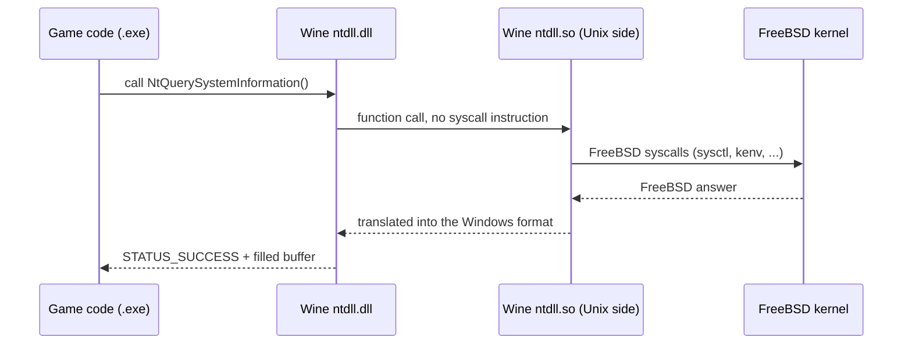
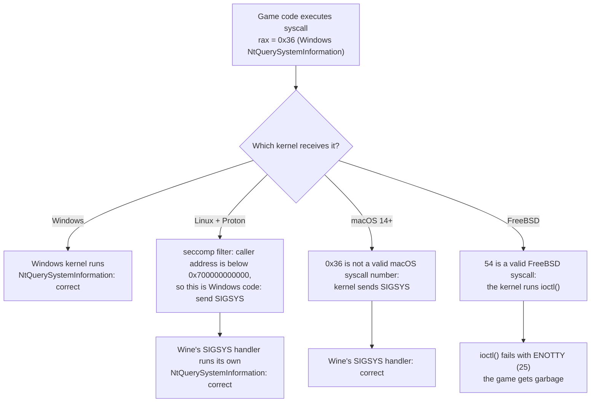

# Why Wine on FreeBSD cannot catch Windows system calls made directly by a game

This note explains, from the ground up, why a Windows game protected by
Denuvo (the *Black Myth: Wukong Benchmark Tool*, Steam app 3132990) cannot
start under Wine on FreeBSD, while the same game runs under Proton on Linux.
The short answer: the game sometimes talks to the operating system kernel
directly, skipping Wine, and FreeBSD offers Wine no way to notice.

It assumes you know what a program, a process and a CPU register are, and
nothing more.

## TL;DR

- Wine does not emulate a Windows computer. It runs the Windows program's
  machine code directly on the CPU and replaces the Windows libraries with
  its own, so every request the program makes to "Windows" lands in Wine.
- Some programs, mostly anti-cheat and copy protection, skip the libraries
  and execute the CPU `syscall` instruction themselves, with a Windows
  system call number in the `rax` register.
- That instruction goes straight to the kernel of the machine actually
  running, here FreeBSD. Wine is not involved, so it cannot translate it.
- On Linux, Wine asks the kernel (Proton with seccomp, upstream Wine 11.5
  and later with Syscall User Dispatch) to turn every `syscall` coming
  from Windows code into a signal that Wine handles. On macOS 14 the
  Windows numbers are invalid macOS syscalls, so the kernel raises a signal
  by itself. FreeBSD has no such filter, and the Windows numbers happen to
  be valid FreeBSD syscalls, so FreeBSD silently runs the wrong one.
- In the trace of the game, Windows `NtQuerySystemInformation` (number
  0x36 = 54) runs as FreeBSD `ioctl` (also number 54), fails with
  `ENOTTY`, the game reads the error code as "success", uses an unfilled
  buffer, then asks for a 68 GB block of memory or crashes.
- Fixing it needs a new FreeBSD kernel feature (a way for a process to say
  "send me a signal for syscalls made from this address range") plus a few
  lines in Wine to use it. Linux's Syscall User Dispatch is the model, and
  no FreeBSD work in progress was found (November 2026).

## 1. What a system call is

A program cannot touch the hardware, open a file or allocate memory on its
own. It has to ask the kernel. That request is a **system call**.

On x86-64 CPUs a system call works like this:

1. The program puts a **number** in the `rax` register. The number says
   which service it wants ("open a file", "map memory", ...).
2. It puts the arguments in other registers.
3. It executes the `syscall` instruction. The CPU jumps into the kernel.
4. The kernel looks the number up in its **system call table**, runs the
   matching function, puts the result in `rax` and returns.

Each operating system has its own table. The same number means different
things on different systems:

| Number | FreeBSD | Windows 10/11 |
|---|---|---|
| 54 (0x36) | `ioctl()` | `NtQuerySystemInformation()` |
| 24 (0x18) | `getuid()` | `NtAllocateVirtualMemory()` |

The registers used for the arguments also differ:

| Argument | FreeBSD | Windows |
|---|---|---|
| 1st | `rdi` | `r10` |
| 2nd | `rsi` | `rdx` |
| 3rd | `rdx` | `r8` |
| 4th | `r10` | `r9` |

Normal programs never write `syscall` themselves. They call a library
function (`open()` in libc on FreeBSD, `CreateFileW()` in kernel32.dll on
Windows), and the library does the system call for them. On Windows the
last library before the kernel is `ntdll.dll`: it contains one tiny stub
per system call that loads the number and executes `syscall`.

## 2. How Wine runs a Windows program

Wine is **not** an emulator. A Windows `.exe` contains x86-64 machine code,
and the CPU in a FreeBSD machine executes x86-64 code just as well. Wine
loads the `.exe` into memory and lets the CPU run it at full speed.

What Wine replaces are the Windows **libraries**. When the game calls
`NtQuerySystemInformation()` in `ntdll.dll`, it gets Wine's `ntdll.dll`,
which does not enter any Windows kernel (there is none). It jumps into
Wine's Unix side (`ntdll.so`), which asks FreeBSD for the information with
FreeBSD system calls and fills the answer in the format Windows programs
expect.

Wine's stub even has the same bytes as the Windows one, because some
programs (Chromium, for example) check them. It just never reaches its
`syscall` instruction (`include/wine/asm.h`):

```
00: movq  %rcx,%r10          same as Windows
03: movl  $0x36,%eax         the Windows number for NtQuerySystemInformation
08: testb $1,0x7ffe0308      a flag in the shared page; Wine always sets it
10: jne   15                 so this jump is always taken
12: syscall                  never executed under Wine
14: ret
15: jmp   18
18: callq *(0x7ffe1000)      call Wine's dispatcher: an ordinary function call
```



Everything works because every request goes through a library that Wine
controls.

## 3. The shortcut: a program that makes its own system calls

Some programs do not trust the libraries. Anti-cheat and copy protection
systems (Denuvo here) want to know whether someone is watching or
modifying the program, and debuggers and cheat tools often work by
intercepting library functions. So these programs execute `syscall` from
their own code, with the Windows number in `rax`. They typically take the
number from the `ntdll.dll` stub (the `movl $0x36,%eax` above) or carry
their own table, and they skip the flag test that diverts Wine's stub.

On real Windows that is fine: the Windows kernel understands Windows
numbers. Under Wine, the instruction does not go to Wine. The CPU sends
it directly to the kernel that is actually running, and no library is
involved, so Wine does not even know it happened.

What then happens depends on that kernel:



### Linux: seccomp

Linux has **seccomp**, a filter a process installs on itself: a tiny
program (in the BPF language) that the kernel runs before every system call
of that process. Proton's filter (`install_bpf()` in
`dlls/ntdll/unix/signal_x86_64.c`) looks at the address of the `syscall`
instruction. Wine's own Unix libraries live at high addresses, above
`0x700000000000`; Windows code lives below. For calls from below, the
filter tells the kernel not to run anything and to send the process a
`SIGSYS` signal instead. Wine catches the signal, reads `rax`, and runs its
own version of the Windows call, exactly as if the game had gone through
`ntdll.dll`.

A seccomp filter runs for every system call, and comparing 64-bit
addresses in classic BPF is clumsy, so Linux 5.11 added a feature made
for this case: **Syscall User Dispatch**
(`prctl(PR_SET_SYSCALL_USER_DISPATCH)`). The process gives the kernel one
address range whose system calls always run normally (Wine's own code),
plus the address of a one-byte "selector" in its memory. When the
selector says "block", any `syscall` from outside the range raises
`SIGSYS`. Wine flips the byte itself when it enters and leaves its own
code, without any system call. Upstream Wine uses it since version 11.5
(commit `cbb9906d`, "ntdll: Implement syscall emulation on Linux using
Syscall User Dispatch", March 2026), with the same `SIGSYS` handler as on
macOS. FreeBSD's `emulators/wine-proton` is based on Proton 11.0, which
still uses the seccomp version.

### macOS 14 and later

macOS system call numbers start at `0x2000000`, so a small Windows number
like `0x36` is not a valid macOS system call. The kernel answers an
invalid number with `SIGSYS`, and Wine uses the same signal handler.

### FreeBSD

FreeBSD has neither a seccomp-like filter nor a "syscall user dispatch"
switch, and its numbers are small, like Windows ones. Most Windows numbers
are therefore valid FreeBSD system calls. The kernel runs whatever FreeBSD
call has that number, with whatever values happen to be in the FreeBSD
argument registers. When Wine starts, it can only log:

```
warn:seh:install_bpf Built without seccomp.
```

## 4. What happens to the game

`ktrace(1)` records every system call a process makes, with its arguments
and result. Attached to the game process (`ktrace -t c -p <pid>`), it shows
this on the main thread, just before the failure:

```
CALL  ioctl(0xc9f940,0x16b5665a4,0xc9fd10)
RET   ioctl -1 errno 25 Inappropriate ioctl for device
CALL  mmap(0x180010000,0x10f42fb000,0x3<PROT_READ|PROT_WRITE>,0x5012<MAP_PRIVATE|MAP_FIXED|MAP_ANON|MAP_EXCL>,0xffffffff,0)
RET   mmap -1 errno 12 Cannot allocate memory
```

Reading it with the tables of section 1:

- System call 54 is `ioctl` for FreeBSD, but `NtQuerySystemInformation`
  for the game. Wine itself never calls `ioctl` like this: the "file
  descriptor" `0xc9f940` is a stack address, and the "request"
  `0x16b5665a4` is an address inside the game's `.exe` (loaded at
  `0x140000000`). They are leftovers in the FreeBSD argument registers.
- The third FreeBSD argument is `rdx`, which is also the second Windows
  argument: `0xc9fd10` is the buffer the game wanted filled.
- FreeBSD reports the error by setting the carry flag and putting the error
  number, 25 (`ENOTTY`), in `rax`. Windows code knows nothing about the
  carry flag. It reads `rax` as an `NTSTATUS`, and `0x19` is a positive
  value, which Windows treats as **success**.
- So the game believes it received the system information, and uses a
  buffer that was never filled. A few instructions later it asks for
  `0x10f42fb000` bytes, about 68 GB, of memory.

The main thread makes seven such direct calls, all returning `ENOTTY`.
Depending on what garbage the buffer holds on a given run, the game either
keeps allocating memory until FreeBSD runs out (with no swap the whole
machine freezes), or crashes with an access violation inside its protected
code.

To find them in your own trace, look for `ioctl` calls whose first
argument is a large number instead of a small file descriptor:

```sh
ktrace -t c -f game.ktrace -p "$(pgrep -f 'b1-Win64-Shipping\.exe')"
# ... let the game fail, then:
kdump -H -f game.ktrace | grep -A1 'CALL  ioctl(0x[0-9a-f]\{5,\},'
```

## 5. Why Wine cannot fix this by itself

Wine runs in the same process as the game, but it only gets control when
the game calls one of Wine's functions, or when the kernel delivers a
signal. A `syscall` instruction does neither: the CPU goes straight into
the kernel and back. The options Wine has without kernel help are poor:

- **Find and rewrite every `syscall` instruction in the game.** Protected
  code is encrypted and decrypted at run time, rewrites itself, and checks
  that nobody changed it. Patching it is both unreliable and exactly what
  the protection is designed to detect.
- **Run the game under a debugger (`ptrace`) and stop on every system
  call.** FreeBSD head has the pieces since July 2026: `PT_TO_SCE` stops a
  thread at each system call entry, `PT_GETREGS` shows the caller's
  address, and the new `PT_SET_SC_RET` request skips the kernel handler
  ("The current system call handler is not executed"), so a helper
  process could redirect the thread into Wine's dispatcher the way the
  `SIGSYS` handler does. But `PT_TO_SCE` has no filter: every system call
  of the game, including the tens of thousands per second that go
  through Wine normally, would cost extra context switches through the
  helper, and a process under `ptrace` cannot be debugged by anything
  else. Good enough for a proof of concept, not for playing.

The clean fix is the one Linux and macOS provide: the kernel itself must
recognise these calls and hand them to Wine.

## 6. What a FreeBSD fix would look like

Two pieces:

1. **Kernel:** a per-thread setting with the semantics of Linux's Syscall
   User Dispatch, for example a new `procctl(2)` command: one address
   range whose system calls always run, the address of a selector byte,
   and `SIGSYS` (with the caller's address in `si_addr`) for any other
   `syscall` while the selector says "block". The amd64 system call entry
   path already has the caller's `rip` at hand, so the check costs one
   comparison when the feature is off.
2. **Wine:** upstream's Syscall User Dispatch code (Wine 11.5 and later)
   already has the selector handling and the `SIGSYS` handler. FreeBSD
   support would mostly be a `procctl()` call where Linux calls `prctl()`,
   plus `__FreeBSD__` in the guard that today reads "Apple or Linux".
   `emulators/wine-proton` would need that commit backported, or a base
   newer than Proton 11.0.

As of November 2026 no FreeBSD work in progress on this was found: no
Phabricator review, bug report or mailing list thread, and nothing in the
head tree (`7806832f23fb`). The closest existing mechanisms do not fit:
`kern.signosys` raises `SIGSYS` only for invalid numbers, Capsicum's
`PROC_TRAPCAP_CTL` needs the whole process in capability mode, and the
Linux ABI's `seccomp()` is a stub. A FreeBSD bug report with the trace
above is the natural first step. The benefit is not limited to one game:
any Windows program that makes direct system calls (several anti-cheat
systems do) hits the same wall.

References:

- Linux documentation: [Syscall User Dispatch](https://docs.kernel.org/admin-guide/syscall-user-dispatch.html)
- Why seccomp was not enough for Wine: [LWN, "Emulating Windows system calls in Linux"](https://lwn.net/Articles/824525/)
- Wine commit `cbb9906d`: [wine-commits](https://list.winehq.org/archives/list/wine-commits@list.winehq.org/thread/PUTSTL3ZM3XUWLV2N2ZR4EA67BGBEDAB)

## 7. Things that were ruled out on the way

Each change below was tested on its own, under Steam with
`emulators/wine-proton` (`LSU_FreeBSD_Wine`). The game failed the same way
every time, right after its Steam initialisation:

| Change | Result |
|---|---|
| wineoss reports a 32-bit float mix format (audio fix), ntsync(4) loaded | same |
| Real SMBIOS data (`kenv smbios.*`, `kern.hostuuid`) instead of "The Wine project" | same |
| Release Mesa 26.2.2 instead of the mesa-devel RADV, via a private Vulkan ICD file | same, and no shader compiler threads busy: not a driver problem |
| Real free memory reported to `GlobalMemoryStatusEx()` | same |

Two of these were genuine FreeBSD bugs in Wine and stay fixed in the
local `emulators/wine-proton` port, in `files/patch-dlls_ntdll_unix_system.c`:

- `create_smbios_data()` had no FreeBSD version, so Windows programs saw
  the vendor "The Wine project" and an all-zero machine UUID. The FreeBSD
  version reads the strings the loader exports with `kenv(2)`.
- `get_performance_info()` reported `hw.usermem` (physical memory minus
  wired pages) as available memory. That value does not shrink as programs
  allocate memory, so Windows programs always saw about 51 GB free on a
  64 GB machine. It now reports free plus inactive pages.

## Glossary

- **Kernel:** the core of the operating system. The only code allowed to
  talk to the hardware.
- **System call (syscall):** a request from a program to the kernel,
  identified by a number.
- **`ntdll.dll`:** the lowest Windows library, the one that makes system
  calls on Windows. Wine provides its own.
- **Signal:** an asynchronous notification the kernel sends to a process
  (`SIGSEGV` for a bad memory access, `SIGSYS` for a bad system call). A
  program can install a function, a handler, that runs when it arrives.
- **seccomp:** a Linux feature that filters a process's system calls with a
  small BPF program.
- **Proton:** Valve's version of Wine for Steam. FreeBSD's
  `emulators/wine-proton` port is built from it.
- **Denuvo:** a commercial copy protection system for games.
- **ktrace / kdump:** FreeBSD tools that record and print the system calls
  of a process.
