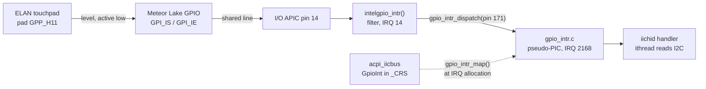
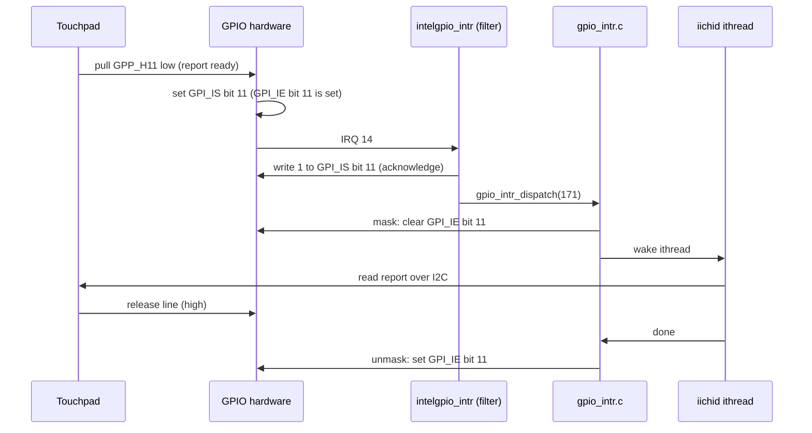

# GPIO interrupts on x86: a touchpad that stopped polling

Patch: [x86_gpio_intr_mtl.patch](x86_gpio_intr_mtl.patch), against FreeBSD main
240d81169286 (branch `gpio-intr-x86` in `~/freebsd-src-gpiointr`).
Machine: Lenovo ThinkPad X1 Carbon Gen 12 ("carbon"), Intel Core Ultra 7 165U (Meteor Lake).

This document explains the work for a first-year computer science student:
someone who knows C and what an operating system does, but has never looked
at FreeBSD interrupts, GPIO controllers, or ACPI.

## 1. Background

### 1.1 What an interrupt is, and how x86 FreeBSD numbers them

A device raises an *interrupt* to tell the CPU "I have something for you",
instead of the CPU asking again and again ("polling").
On a PC, device interrupt lines go to an *I/O APIC*, a chip that turns a line
into a message for a CPU.
FreeBSD gives every interrupt source a number, the *IRQ*.
On carbon, IRQs 0-119 are the I/O APIC pins, and IRQs 120-2167 are reserved
for MSI (message-signalled interrupts used by PCI devices); the boot sets
this up in `apic_setup_io()` (`sys/x86/x86/local_apic.c:2248`, `msi_init()`).

Two kernel structures describe a source (`sys/x86/include/intr_machdep.h`):

- `struct pic`: a "programmable interrupt controller" as a table of
  functions: enable, disable (mask), acknowledge (EOI), configure trigger.
- `struct intsrc`: one interrupt source, pointing to its `pic`.

`intr_register_source()` (`sys/x86/x86/intr_machdep.c:219`) puts a source in
the global table, indexed by IRQ number.
The table is sized once, at boot, by `intr_init_sources()`
(`intr_machdep.c:164`), so every IRQ number must be reserved before that.

When the hardware fires, `intr_execute_handlers()` (`intr_machdep.c:339`)
runs the handlers of the source.
A driver handler has two parts: a *filter*, which runs at once in interrupt
context and may not sleep, and an *ithread*, a kernel thread that runs later
and may sleep.
For a level-triggered source, the kernel masks the source before it wakes the
ithread and unmasks it after the ithread finishes
(`intr_disable_src` and `pic_enable_source` passed to `intr_event_create()`,
`intr_machdep.c:230`).

### 1.2 Level and edge triggers

- *Level-triggered*: the line stays active as long as the device needs
  attention.  "Active low" means the line goes to 0 volts when active.
- *Edge-triggered*: only the change (rising or falling edge) counts.

The carbon touchpad uses a level-triggered, active-low line.

### 1.3 GPIO pins and the Intel GPIO controller

A *GPIO* (general purpose input/output) pin is a chip pin that software can
read, drive, or use as an interrupt input.
The Meteor Lake chip has hundreds of pins ("pads"), grouped like this:

- a *community* is a block of registers at its own memory address;
- a community holds *groups* (GPP_A, GPP_H, ...), each of up to 32 pads;
- each pad has a 16-byte configuration (PAD_CFG_DW0, DW1, ...).

Registers used by this work, from the Intel datasheet *Intel Core Ultra
Processors for H-series and U-series Platforms SOC I/O Registers*, document
795260, and measured on carbon:

| Register | Offset in community | Meaning |
|---|---|---|
| PADBAR | 0x00c | offset of the first pad configuration (0x600) |
| HOSTSW_OWN | 0x140 + 4 x group | 1 = the OS GPIO driver owns the pad's events |
| GPI_IS | 0x200 + 4 x group | interrupt status, one bit per pad, write 1 to clear |
| GPI_IE | 0x210 + 4 x group | interrupt enable, one bit per pad |
| PAD_CFG_DW0 | PADBAR + 16 x pad | pad mode (bits 13:10), RX state (bit 1), RXINV (bit 23), RXEVCFG (bits 26:25) |

RXEVCFG selects how the pad generates an event: 0 = level, 1 = edge.
RXINV inverts the input, so "level, inverted" means "event while the pin is
low": exactly an active-low level interrupt.

All five communities share **one** interrupt line to the I/O APIC (IRQ 14 on
carbon).
The GPIO driver must therefore read GPI_IS and GPI_IE to find which pad fired.

FreeBSD has a generic Intel GPIO driver framework,
`sys/dev/gpio/intel/intelgpio.c`, used by the Tiger Lake-H (`tglhgpio.c`)
and Alder Lake-N (`adlngpio.c`) drivers.
Before this work it could read and drive pins, but not take interrupts, and
there was no Meteor Lake driver.

### 1.4 ACPI tells the OS how devices are wired

The firmware describes the machine in ACPI tables.
For each device, the `_CRS` method returns its resources: memory ranges,
interrupt lines, I2C address.
An interrupt can be described two ways:

- `Interrupt (...) {N}`: an I/O APIC line, usable directly as IRQ N.
- `GpioInt (...) "\_SB.GPI0" {171}`: "pin 171 of the GPIO controller
  `\_SB.GPI0`".  The OS must ask the GPIO driver to turn this into an
  interrupt.

### 1.5 INTRNG, and why x86 had no GpioInt path

On arm64 and RISC-V, FreeBSD uses INTRNG, a framework in which any driver,
including a GPIO controller, can act as an interrupt controller.
`gpio_alloc_intr_resource()` (`sys/dev/gpio/gpiobus.c:99`) uses it to give a
pin an IRQ.
x86 does not use INTRNG.
On x86 the same function was a stub that returned NULL
(`gpiobus.c:135` in the patched file), and `acpi_iicbus.c` ignored GpioInt
resources with the comment "Not supported by FreeBSD yet".

### 1.6 iichid and its sampling mode

`iichid` is the driver for HID devices (touchpads, touchscreens) on an I2C
bus.
It asks for an IRQ (`sys/dev/iicbus/iichid.c:1156`).
If there is none, it prints "Interrupt setup failed" and "Using sampling
mode" (`iichid.c:1166`, `iichid.c:1172`): it then reads the touchpad from a
timer, at 10 Hz when idle and 80 Hz after activity
(`dev.iichid.0.sampling_rate_slow` and `sampling_rate_fast`).

## 2. The problem

Every boot of carbon printed:

```
iichid0: <ELAN06D4:00 04F3:32B5 I2C HID device> at addr 0x15 on iicbus0
iichid0: Interrupt setup failed
iichid0: Using sampling mode
```

The touchpad `_CRS` (`\_SB.PC00.I2C0.TPD0` in the DSDT) chooses between two
interrupt descriptions with a firmware variable:

```
If ((TPDM == Zero))
{
    Return (ConcatenateResTemplate (I2CM (I2CX, BADR, SPED), SBFG))
}
Return (ConcatenateResTemplate (I2CM (I2CX, BADR, SPED), SBFI))
```

`SBFG` holds a GpioInt, `SBFI` an APIC Interrupt.
Values read from firmware memory on carbon:

| Variable | Value | Meaning |
|---|---|---|
| TPDM | 0 | the GpioInt path (`SBFG`) is used |
| GPDI | 0x0014080b | community index 2, group 0, pad 11: pin `GPP_H11`, ACPI GPIO number 171 |
| SGIR | 14 | the GPIO controller's shared IRQ |
| SBRG | 0xE0000000 | base of the community register blocks (0xE0D10000 to 0xE0D50000) |

So the touchpad interrupt is a GpioInt, and FreeBSD on x86 could not deliver
it.
The touchpad worked only through polling.

Cost of polling, measured on battery (see `FreeBSD/X1.Carbon.Gen.12.md`):
at most about 90 mW at idle, an upper bound because the run was
unbalanced.
The larger cost is quality: the first touch after idle waits for the next
10 Hz poll (up to 100 ms), and at 80 Hz the driver cannot keep up with the
touchpad, which reports about 290 times per second (measured below).

## 3. The fix

### 3.1 The pieces



1. **Meteor Lake pad table** (`sys/dev/gpio/intel/mtlgpio.c`, new).
   Lists the 5 communities and 14 groups for ACPI ID `INTC1083`.
   Group names and register offsets come from Intel document 795260; pad
   counts and ACPI GPIO numbers come from the firmware's own GPIO group table
   (`GPCM` in the DSDT).
   Five groups have no public name and are called `COM<n>_GRP<m>_`.
2. **Interrupt support in intelgpio** (`sys/dev/gpio/intel/intelgpio.c`).
   A platform now declares its HOSTSW_OWN, GPI_IS and GPI_IE offsets; only
   Meteor Lake does, so Tiger Lake-H and Alder Lake-N behave as before.
   - `intelgpio_intr_config()` (`intelgpio.c:388`) sets RXEVCFG and RXINV
     for the trigger mode, takes host ownership (HOSTSW_OWN), and clears a
     stale status bit.  It refuses a pad that is not in GPIO mode, and a pad
     whose configuration is locked (the write does not stick).
   - `intelgpio_intr()` (`intelgpio.c:471`) is the filter on the shared
     IRQ.  For each group it computes `GPI_IS & GPI_IE`, clears those status
     bits, and dispatches each pending pin.
   - At attach, every GPI_IE bit is cleared: no consumer exists yet.
3. **x86 GPIO pseudo-PIC** (`sys/x86/x86/gpio_intr.c`, new).
   This is the x86 replacement for what INTRNG does on arm64.
   - `gpio_intr_init()` (`gpio_intr.c:177`), called right after
     `msi_init()`, reserves a block of IRQ numbers (32 by default, tunable
     `machdep.num_gpio_irqs`) before the IRQ table is sized.  On carbon the
     block starts at 2168, after the MSI block.
   - A GPIO driver registers mask, unmask and configure functions with
     `gpio_intr_register()` (`gpio_intr.c:194`).
   - `gpio_intr_map()` (`gpio_intr.c:291`) gives a (controller, pin) an IRQ
     number, creating an `intsrc` on first use, like MSI does.
   - `gpio_intr_dispatch()` (`gpio_intr.c:351`) runs that IRQ's handlers,
     nested inside the controller's filter.
4. **gpiobus** (`sys/dev/gpio/gpiobus.c:123`): the x86 branch of
   `gpio_alloc_intr_resource()` now calls `gpio_intr_map()` instead of
   returning NULL.  The `gpioaei` ACPI event driver also uses this function.
5. **acpi_iicbus** (`sys/dev/iicbus/acpi_iicbus.c:464`): a new
   `bus_alloc_resource` method maps the child's GpioInt when the child asks
   for IRQ 0.

### 3.2 One touchpad interrupt, step by step



Clearing GPI_IS while the line is still low makes the bit latch again at
once.
That is harmless because the pin is masked before the filter returns, and
correct: if the line is still low when the pin is unmasked, a new interrupt
fires.

### 3.3 Why map at allocation time

The first version mapped the GpioInt when `acpi_iicbus` parsed the child's
resources.
At boot, `devmatch` loaded `ig4` (the I2C controller, which enumerates the
touchpad) before `mtlgpio`, so the GPIO controller did not exist yet and the
touchpad still fell back to polling.

The second version mapped lazily, but only when no IRQ entry existed.
Testing found a bug in it: after `kldunload iichid mtlgpio` and a reload, the
old IRQ entry stayed in the child's resource list, the pin was never bound to
the new controller, and the touchpad was dead with GPI_IE bit 11 still 0
while moused held the device open.
Polling was disabled too, because iichid did get an IRQ.

The final version maps the GpioInt each time the child allocates IRQ 0, and
deletes the entry if the controller is missing, so iichid falls back to
polling.

### 3.4 Alternatives considered

| Alternative | Why not |
|---|---|
| DSDT override forcing the APIC `SBFI` path | Machine-specific, needs `acpi_dsdt_load` in loader.conf (a bad DSDT can stop the boot), and must be redone after every BIOS update. |
| Route the pad to the I/O APIC (GPIROUTIOXAPIC) from the driver | Works only for pads with a fixed APIC line, still Intel-specific, and bypasses the ACPI description. |
| Implement INTRNG on x86 | The right long-term model, but a rewrite of x86 interrupt handling, far larger than this problem. |
| Map in `acpi_iicbus` at enumeration time | Fails when the GPIO driver loads after `ig4` (measured, section 3.3). |

### 3.5 What this patch does NOT do

- **Only I2C children.**  A GpioInt on a device attached directly to the
  ACPI bus (`acpi_resource.c`) is still ignored.
- **Only Meteor Lake.**  Tiger Lake-H and Alder Lake-N get no interrupts:
  their register offsets were not verified on hardware.
- **No edge-both mode.**  The RXEVCFG encoding for "both edges" is not
  confirmed, so `GPIO_INTR_EDGE_BOTH` returns EOPNOTSUPP.
- **No CPU binding.**  Pin handlers run on the CPU that takes IRQ 14;
  `pic_assign_cpu` returns EOPNOTSUPP.
- **Load order still matters once.**  If iichid attaches before the GPIO
  driver, it stays in polling mode until it is attached again.
- **Cosmetic:** when the controller is absent, the attach line can still
  print the old `irq 2168` before the fallback messages.

## 4. Tested

On carbon, kernel built from the patched tree at 240d81169286
(GENERIC-NODEBUG), booted once with `nextboot -k kernel.gpio`.
"IE bit" is GPI_IE of community 2 group 0 (physical 0xE0D30210), bit 11,
read with moused holding `/dev/input/event8` open.

| Configuration | Result |
|---|---|
| `mtlgpio` loaded, `gpioctl -l` | 451 pins; pin 171 = `GPP_H11`, input, high (idle). Five sample pins match the raw PAD_CFG_DW0 RX bit. |
| Normal boot, final patch | `irq2168: iichid0` in `vmstat -i`, no "Interrupt setup failed", IE bit = 1 |
| Touchpad in use (moused, console) | 270-290 interrupts/s on both `gpio0` (IRQ 14) and `iichid0` (IRQ 2168), counts identical; clicks and drag selection work |
| Touchpad idle | 0 interrupts/s (no interrupt storm), 0 stray interrupts |
| `kldunload mtlgpio` while iichid holds the pin | refused: "Device busy" |
| Unload iichid and mtlgpio, reload mtlgpio then iichid | IRQ 2168 reused, IE bit = 1 |
| devd stopped, mtlgpio absent, load iichid | "Interrupt setup failed", "Using sampling mode" (fallback works) |
| Then load mtlgpio, reload iichid | interrupt mode again, IE bit = 1 |

Not tested:

- suspend and resume (the pad configuration and GPI_IE may need restoring);
- the vt mouse pointer is not drawn on carbon's console (clicks and drags
  work); not yet compared with the unpatched kernel;
- i386 and machines without an Intel GPIO controller (the new code only
  reserves 32 IRQ numbers there);
- `gpioaei` on x86 (it now gets IRQs through the same path; carbon has no
  `_AEI` to test it);
- upstream review: the x86 interrupt code has not been reviewed by FreeBSD
  developers.

## 5. Reproduce

```sh
# Build (on the build host, ccache disabled: it served stale module objects)
cd ~/freebsd-src-gpiointr
export MAKEOBJDIRPREFIX=/tmp/gpiointr-kobj
make -j64 buildkernel KERNCONF=GENERIC-NODEBUG WITHOUT_CCACHE_BUILD=yes
make installkernel KERNCONF=GENERIC-NODEBUG DESTDIR=/tmp/gpiointr-stage \
    KODIR=/boot/kernel.gpio -DNO_ROOT METALOG=/tmp/gpiointr-stage/METALOG

# Install on the laptop next to the running kernel, boot it once
sudo kldxref /boot/kernel.gpio
sudo nextboot -k kernel.gpio
sudo shutdown -r now

# Check
vmstat -i | grep -E 'gpio0|iichid'
sudo moused -p /dev/input/event8 -t evdev   # something must open the touchpad
```
