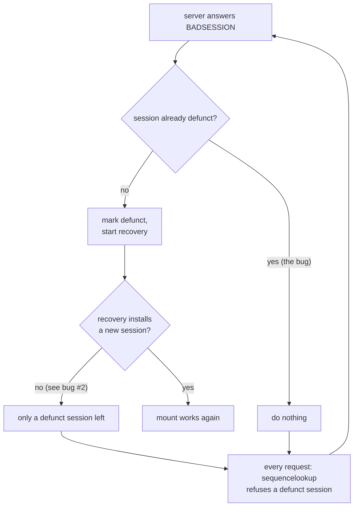

# Bug #1: the NFS mount that hangs until reboot

Patch: [`badsession.patch`](badsession.patch). Committed upstream as
5ab48fb9f7ac ("nfs_commonkrpc.c: Fix recovery that was broken by
4d80d4913e79"), PR 297252. Bugzilla text: [`BUGREPORT.txt`](BUGREPORT.txt).
Full investigation: [`nfsbug.md`](nfsbug.md).

## 1. Background

You need four ideas to follow this bug.

**NFS.** A network file system: files live on a server, and the client's
kernel turns every `open()`, `read()` or `stat()` on the mount into a request
over the network. If the client cannot get an answer, the program waits. It
waits inside the kernel, so even `kill -9` cannot stop it. `ps` shows such a
process in state `D`.

**Client ID and session.** NFS version 4.1 is stateful: the server remembers
each client. The client introduces itself once with EXCHANGE_ID and receives
a *client ID*. It then opens a *session* with CREATE_SESSION. Every later
request starts with a SEQUENCE operation that names the session, so the
server knows who is asking. In the FreeBSD client, a session is a
`struct nfsclsession` (`sys/fs/nfs/nfsclstate.h`).

**Recovery.** A server may forget a session, for example after a restart. It
then answers `NFS4ERR_BADSESSION` (error 10052). The client must *recover*:
open a new session and, if the server also forgot the client ID
(`NFS4ERR_STALE_CLIENTID`, 10022), introduce itself again. The FreeBSD client
does this in `nfscl_recover()` (`sys/fs/nfsclient/nfs_clstate.c`), run by a
kernel thread called the renew thread.

**The defunct flag.** While a recovery is pending, the old session is marked
*defunct* (`nfsess_defunct = 1`) so that new requests do not use it.
`nfsv4_sequencelookup()` (`sys/fs/nfs/nfs_commonsubs.c`) refuses to start a
request on a defunct session and returns `NFS4ERR_BADSESSION` at once. A
successful recovery installs a brand-new session, which is not defunct.

## 2. The problem

Amazon EFS forgets the session and the client ID every time it resets a TCP
connection, which can happen many times a day. A FreeBSD client survived
most of these, then, after some hours, every process touching the mount
hung: `ps -o pid,stat,wchan,command` showed them in state `D` with wait
channel `nfsbadse`, and they could not be killed.

The kernel debug log (`sysctl vfs.nfs.debuglevel=1`) of an 8.5-hour run on
EFS showed what happened:

| time | event |
|---|---|
| 07:34, 12:05 | server forgets the client; recovery runs and succeeds |
| 12:30:43 | server forgets the client; recovery runs |
| 12:31:28 | server forgets the client again, 45 s later; recovery fails |
| 12:31 to 14:49 | the server answers BADSESSION every 45 s; no recovery for 2 h 17 min |
| 14:49:07 | a program touches the mount; `Badsession looping` once per second, forever |

`nfsstat -c -E` stayed frozen at `ExchangeId=4, CreateSess=8`: the client
never tried again.

Two pieces of code met in a dead end:



- The second recovery inside 45 s failed without installing a new session.
  Why it failed is bug #2 ([`staleclientid.md`](staleclientid.md)). The
  client was left with only its old, defunct session.
- Every request on that session got BADSESSION from
  `nfsv4_sequencelookup()`.
- The code handling BADSESSION in `newnfs_request()`
  (`sys/fs/nfs/nfs_commonkrpc.c`) started a recovery only if the session was
  *not* already defunct:

```c
if (bcmp(sep->nfsess_sessionid, nd->nd_sessionid,
    NFSX_V4SESSIONID) == 0 &&
    sep->nfsess_defunct == 0) {
	/* Initiate recovery. */
```

Nothing else clears the flag, so no recovery could ever happen again.

This was a regression. The `nfsess_defunct == 0` test arrived on 2026-05-25
with 4d80d4913e79 ("nfs: Fix argument typo to avoid a crash"), a fix for
something else. No test exercised recovery, so nothing caught it.

## 3. The fix

Drop the extra test, so that BADSESSION on the current session always asks
for a recovery:

```diff
 				if (bcmp(sep->nfsess_sessionid,
-				    nd->nd_sessionid, NFSX_V4SESSIONID) == 0 &&
-				    sep->nfsess_defunct == 0) {
-					/* Initiate recovery. */
+				    nd->nd_sessionid, NFSX_V4SESSIONID) == 0) {
```

Why this is safe: the test was meant to avoid starting many recoveries at
once. Two client flags already do that job: `NFSCLFLAGS_RECOVER` (a
recovery is requested) and `NFSCLFLAGS_RECVRINPROG` (one is running). Setting
the defunct flag twice does no harm.

Alternatives:

- **Make recovery always install a session.** That is fixing bug #2, which
  was done too. But any future way for recovery to fail would bring the hang
  back. Both fixes are needed: #2 avoids the failure, and this fix makes sure
  a failure is not permanent.
- **Clear the defunct flag when recovery fails.** Requests would then use a
  session the server has already forgotten, and fail anyway.

What this does NOT fix: the 45-second outage while the second recovery waits
(bug #2), and the memory leak of old sessions (bug #3).

## 4. Tested

| Configuration | Result |
|---|---|
| EC2 + EFS, stock 16.0-CURRENT, 8.5 h | hung at 14:49, only reboot recovers |
| test machine, local nfsd + `badsession-proxy.py`, stock | hung within about 3 minutes |
| same, patched, about 6 h of injected errors | recovery kept running, mount always readable |
| bhyve, `tests/sys/fs/nfs` `server_reset_twice`, kernel before 5ab48fb9f7ac | failed: no NFS I/O during the last 61 s |
| same test, kernel with 5ab48fb9f7ac and 7a0021a0988f | passed |

Untested: whether the stock kernel's mount stays hung forever in the test
VM; the run was stopped after 61 s, while on EFS it lasted hours until
reboot.
