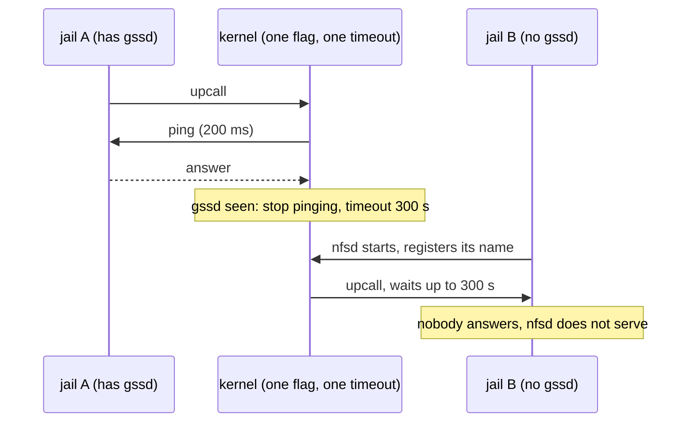

# #5: one jail's Kerberos daemon makes NFS servers in other jails hang

Patch: [`kgss_vnet.patch`](kgss_vnet.patch), against main 7868958f5c79.
Branch `kgss-vnet` in `~/freebsd-src-kgssvnet`. Not filed or committed.

Summary for Bugzilla: kgssapi: once gssd answers in one vnet, upcalls from
vnets without gssd wait for minutes, so nfsd in such a jail does not serve.

## 1. Background

**Kerberos in the kernel.** NFS can use Kerberos to authenticate users and
encrypt traffic. The kernel does not do the Kerberos work itself: it sends
each request to a userland daemon, `gssd(8)`, and waits for the answer. That
kernel-to-daemon message is called an *upcall*. The code is in
`sys/kgssapi`.

**One gssd per jail.** The upcall travels over netlink, a kernel messaging
channel, and reaches the gssd of the *calling jail's* network stack
(`sys/rpc/clnt_nl.c:271-278`). Each vnet jail runs its own gssd, or none.
The kernel object that sends the upcalls, `kgss_gssd_handle`, is shared by
all jails (4602d45eb3b1).

**Not waiting for a gssd that does not exist.** Many machines load the
Kerberos module but run no gssd. Since 455c354dd4db, the kernel first checks
whether gssd is there with an empty "ping" upcall that times out after
200 ms. If the ping fails, it gives up at once and tries again 5 s later.
Once gssd has answered one ping, it stops pinging and allows each upcall up
to 300 s, with 30 retries, to ride out a gssd restart.

**nfsd asks gssd at startup.** When `nfsd` starts and the Kerberos module is
loaded, it registers its Kerberos name, `nfs@<hostname>`, before it serves
anything (`sys/fs/nfsserver/nfs_nfsdkrpc.c:667-678`). Each registration is an
upcall.

## 2. The problem

"gssd has answered" was remembered for the whole machine, but gssd runs per
jail. And the 300 s timeout was set on the shared object, so it applied to
every jail.



Found by the NFS tests: after a Kerberos test ran, the plain `basic` test
failed:

```
nfsd: can't register svc name nfs@srv.nfstest.test jid:3
[tcp] 192.0.2.2:/: NFSPROC_NULL: RPC: Timed out
```

In a standalone run, the mount from the test machine never succeeded: it
retried every 2 s until the test timed out after 300 s. The same setup on a
kernel without the Kerberos module serves at once.

## 3. The fix

Two changes:

```diff
+VNET_DEFINE_STATIC(bool, kgss_gssd_seen);
+VNET_DEFINE_STATIC(time_t, kgss_nextrpc);
...
-	clnt_control(cl, CLSET_RETRIES, &(int){30});
-	clnt_control(cl, CLSET_TIMEOUT, &nulltimo);
+	clnt_control(cl, CLSET_TIMEOUT, &(struct timeval){0});
...
-		CLNT_CONTROL(cl, CLSET_TIMEOUT, &rpctimo);
```

```diff
 	case CLSET_TIMEOUT:
-		nl->nl_timo = tvtohz((struct timeval *)info);
+		/* A zero timeout makes each call use its own. */
+		if (timevalisset((struct timeval *)info))
+			nl->nl_timo = tvtohz((struct timeval *)info);
+		else
+			nl->nl_timo = 0;
```

1. **"gssd has answered" becomes per jail.** `VNET_DEFINE` gives each
   network stack its own copy of a variable. Each jail pings its own gssd
   until it answers once.
2. **The shared object no longer has a timeout of its own.** Each upcall
   brings its timeout: 200 ms for the ping, 25 s for the others (the value
   the generated `gssd_clnt.c` passes). A netlink handle normally ignores
   the timeout of each call: it starts with a 60 s timeout of its own
   (`sys/rpc/clnt_nl.c:202`) that wins. Setting a zero timeout now means
   "use each call's".
3. **No retry.** With 30 retries and no handle timeout, each try would get
   25/30 s, and a slow Kerberos call would be sent twice before gssd
   answered.

The first version had only change 1, and did not fix the hang. A kernel
stack of the stuck nfsd showed the 200 ms ping itself waiting:

```
_sleep clnt_nl_call clnt_call_private kgss_gssd_client gss_import_name
rpc_gss_acquire_svc_cred rpc_gss_set_svc_name nfsrvd_nfsd
```

The ping used the shared object's timeout, not its own. That is how change 2
was found.

Tradeoff: in a jail whose gssd answered once and then died, an upcall now
waits 25 s, not 300 s with retries. The long wait was meant for a gssd
starting late at boot; the 5 s re-ping covers that, now per jail.

Alternatives:

- **Have netlink report "nobody is listening".** That would fail upcalls at
  once, but it changes a return value seen by every netlink user
  (`sys/netlink/netlink_domain.c:242-250`).
- **One upcall object per jail.** That undoes 4602d45eb3b1, and netlink
  refuses two channels with the same name.
- **Keep 300 s for the normal upcalls.** It would need a per-call timeout
  field in `struct rpc_callextra`, a binary interface change.

What the patch does NOT change: the TLS and rpcbind helpers also use netlink
but never set a zero timeout, so they behave as before.

## 4. Tested

bhyve VM, GENERIC (with INVARIANTS and WITNESS) plus `options KGSSAPI`, on
main 7868958f5c79. `nfscl_jail.patch` was also applied, because the
Kerberos tests need jailed clients. The tests ran with their gssd
workaround removed, Kerberos first, in one boot:

| Case | Unpatched | First version (change 1 only) | Patched |
|---|---|---|---|
| `krb5` (a gssd answers in a jail) | failed on a test bug since fixed (TMPDIR), but its gssd answered | passed | passed |
| `basic` (server jail without gssd) | failed: `NFSPROC_NULL: RPC: Timed out` | failed: same | passed |
| `two_clients` | failed: same | failed: same | passed |
| `server_reset` | not run | failed: same | passed |
| `krb5i`, `krb5p` | not run in this order | passed | passed, twice each |

"Unpatched" is 584f44221f45 with `nfscl_jail.patch` and `KGSSAPI`, built as
GENERIC-NODEBUG. The patched `krb5i` and `krb5p` results come from a second
boot: in the first, `krb5i` failed because the test wrote before `tcpdump`
was capturing, a test bug fixed since.

The kgssapi module also builds with the patch, with warnings as errors.
WITNESS reported two lock order reversals, neither in this code: on nullfs
and tmpfs unmount, and in `vnet_destroy()`.

Untested:

- the patch without `nfscl_jail.patch`;
- the module loaded on a real system;
- gssd killed and restarted while upcalls wait;
- a KDC slow enough to approach 25 s;
- the Kerberos module loaded with no gssd ever started (the case
  455c354dd4db fixed).
