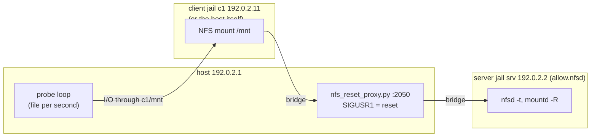

# NFSv4.1 regression tests with the server in a vnet jail

Patch: `nfs_vnet_tests.patch` (adds `tests/sys/fs/nfs/`). Optional
kernel patch for jailed clients: `nfscl_jail.patch`.
Against: main 7a0021a0988f.

Before this patch, the tree had no test that runs a real NFS client against a
real NFS server. Neither of the two recent client recovery fixes had a test:

- 5ab48fb9f7ac "nfs_commonkrpc.c: Fix recovery that was broken by
  4d80d4913e79" (PR 297252), and
- 7a0021a0988f "nfscl: Do not delay recovery for a stale ClientID"
  (PR 299221).

This patch adds a small NFS test framework (`nfs.subr`) and four test cases.
Two of them catch both bugs. The framework puts every NFS server in a vnet
jail. It also puts every client in a vnet jail when the kernel allows it
(`nfscl_jail.patch`), and uses the host as the only client otherwise.

## 1. Background

**NFSv4.1 client ID and session.** An NFSv4.1 client starts with
EXCHANGE_ID, and the server returns a *client ID*. The client then sends
CREATE_SESSION with that client ID, and the server returns a *session ID*.
Every later request starts with a SEQUENCE operation that carries the
session ID. Recovery code in the FreeBSD client uses both IDs; see
`sys/fs/nfsclient/nfs_clrpcops.c`, function `nfsrpc_setclient()`.

**Server state loss.** A server can lose its record of a session and even of
the client ID. A restart causes that, and so does a cluster that moves the
client to another node. RFC 8881 Section 8.4.2 says how the client finds
out and what it must do:

1. SEQUENCE returns `NFS4ERR_BADSESSION` (10052).
2. The client tries CREATE_SESSION with the old client ID.
3. If that returns `NFS4ERR_STALE_CLIENTID` (10022), the client must do a
   new EXCHANGE_ID, a new CREATE_SESSION, and reclaim its opens and locks.

AWS EFS does this every time it resets a client TCP connection. A healthy
mount can see it many times per hour.

**Renew window.** The FreeBSD client allows only one full recovery (the one
with EXCHANGE_ID) per `nfsc_renew` seconds. `nfsc_renew` is half the
server lease (`NFSCL_RENEW()`, `sys/fs/nfs/nfscl.h:60`). The FreeBSD server
lease is 120 s (`NFSRV_LEASE`, `sys/fs/nfs/nfs.h:81`), so the window is
60 s. The gate is in `nfscl_renewthread()`,
`sys/fs/nfsclient/nfs_clstate.c:2798`. The two bugs both happen when the
server loses state twice inside one window:

- Before 5ab48fb9f7ac the session could stay marked defunct
  (`nfsess_defunct`, `sys/fs/nfs/nfs_commonkrpc.c:1339`) with no
  replacement, and recovery was never started again.
- Before 7a0021a0988f the second recovery stopped at `STALE_CLIENTID` and
  returned EIO until the window ended
  (`sys/fs/nfsclient/nfs_clrpcops.c:1072`).

**vnet jail.** A jail with its own network stack (`options VIMAGE`). The test
connects it to the host with an `epair(4)` pair of interfaces.

**allow.nfsd.** Since 15.0, `nfsd(8)` and `mountd(8)` can run in a vnet jail
created with `allow.nfsd`. `prison_check_nfsd()`
(`sys/kern/kern_jail.c:4161`) also requires the jail root to be a mount
point and `enforce_statfs` to be non-zero.

**The client can be jailed only with `nfscl_jail.patch`.** In main, the NFS
client file system is registered without `VFCF_JAIL`
(`sys/fs/nfsclient/nfs_clvfsops.c:160`), so a jail cannot mount NFS. The
framework then mounts on the host, and a client bug leaves hung processes
on the machine that runs the tests. With the patch, the client is a jail
too, and a test can have several clients (see `nfscl_jail.md`).

## 2. The problem the tests detect

A proxy sits between the client and nfsd. On a signal it does what EFS does
on a connection reset: it resets the client connection, then answers the
old session with BADSESSION and the old client ID with STALE_CLIENTID. A
background loop creates a file on the mount every second and logs each
success. A gap in that log is an outage the user would see.

Measured in a bhyve VM, with the same image and userland and three kernels:

```
nostale (main just before 7a0021a0988f):
  nfs_test:server_reset_twice  ->  failed: NFS I/O stalled for 47s
  (plus 47 "Initiate recovery" console lines: the CREATE_SESSION storm)

nobadsess (main just before 5ab48fb9f7ac):
  nfs_test:server_reset_twice  ->  failed: no NFS I/O for 61s
```

The 47 s stall matches what was measured on EFS (42, 46, 46 and 45 s).

## 3. The change



All jails and the host sit on one `if_bridge(4)`, with one `epair(4)` per
jail. The test does its file I/O from the host, through the path at which
the host sees the client's mount (`$(nfs_mnt c1)`). That I/O still goes
through c1's NFS mount, so it uses c1's client ID.

Files:

- `tests/sys/fs/nfs/nfs.subr` is the framework. Its main functions:
  - `nfs_init`;
  - `nfs_server_start <jail>`;
  - `nfs_client_start <jail>` and `nfs_client <jail>`, which gives the
    jail name, or `host`;
  - `nfs_mount <client> <addr>[:port] [options]`;
  - `nfs_mnt <client>`;
  - `nfs_proxy_start <server>` and `nfs_reset`;
  - `nfs_probe_start <dir>` and `nfs_probe_check <since>`;
  - `nfs_require_clients <n>`;
  - `nfs_cleanup`.

  A new feature is a new `<feature>_test.sh` that sources it.
- `tests/sys/fs/nfs/basic_test.sh`:
  - `basic`: NFSv4.1 write, read, mkdir, rename, readdir, an 8 MB checksum
    and remove. It checks the result on the server side too.
  - `two_clients`: two client jails share a file, and a lock held through
    one conflicts with a lock asked through the other. It skips when
    clients cannot be jails.
- `tests/sys/fs/nfs/krb5_test.sh` needs jailed clients and kgssapi_krb5.
  The KDC (`krb5kdc`), nfsd and gssd run in the server jail. The client
  jail runs `gssd -h` with a `host/` keytab entry, and mounts with
  `sec=<flavor>,gssname=host,allgssname`, so root needs no kinit. Cases:
  - `krb5`: write and read work, `nfsstat -m` shows `sec=krb5`, and a
    `sec=sys` mount of the krb5-only export is refused.
  - `krb5i`: the written data is visible in a tcpdump capture on the
    bridge. Integrity protection does not hide data, and this also proves
    that the capture works.
  - `krb5p`: the same capture does not contain the data.
- `tests/sys/fs/nfs/recovery_test.sh`:
  - `server_reset`: one server state loss. I/O must resume within 10 s.
  - `server_reset_twice`: two losses 15 s apart, inside one renew window,
    then a 60 s wait for the window to end. No probe may stall more than
    10 s.
- `tests/sys/fs/nfs/nfs_reset_proxy.py` is the fault-injecting TCP proxy. It
  learns the IDs from the EXCHANGE_ID and CREATE_SESSION replies. A reset
  marks them dead. It answers requests that use them itself and forwards
  everything else.

Setup details that are easy to get wrong, each found by a failed run:

- **The export lives on the jail root file system.** With the default
  `enforce_statfs=2`, a jail sees only its own root mount
  (`prison_canseemount()`, `sys/kern/kern_jail.c:4326`). An extra tmpfs
  mounted under the jail root is invisible, and mountd logs "mnt unsucc".
  This is why jail(8) requires the root to be a mount point.
- **The jail root is a tmpfs with read-only nullfs mounts of the base
  system.** Using `path=/` would make the jailed mountd share
  `/var/run/mountd.pid` with a host mountd.
- **`vfs.nfsd.nfs_privport=0` is set explicitly.** The proxy connects from an
  unprivileged port. `mountd -n` clears that sysctl only on the rpcbind
  path (`usr.sbin/mountd/mountd.c:591`), which `-R` skips. The sysctl is
  per vnet (`sys/fs/nfsserver/nfs_nfsdkrpc.c:86`).
- **`vfs.nfsd.server_min_nfsvers=4`** keeps nfsd from registering with
  rpcbind, which the jail does not run.
- **The probe never blocks the test body**, so a hung mount turns into a
  failure message instead of a hung test.
- **Setup functions run in the test shell, never in `$(...)`.** In a
  subshell, `atf_fail` would end only the subshell and the test would go
  on. They record addresses in files, and `nfs_addr` reads them back.
- **NFSv4 locks need `lockf -w`.** An exclusive NFSv4 lock needs a file
  opened for writing; lockf(1) says so.
- **Kerberos daemons start with `TMPDIR` unset.** MIT krb5 keeps its replay
  cache in `$TMPDIR` before `/var/tmp`
  (`crypto/krb5/src/lib/krb5/rcache/rc_dfl.c:94-100`). kyua points
  `TMPDIR` at the work directory, which the jail cannot see. With it set,
  `gss_accept_sec_context` fails with ENOENT right after it decrypts the
  AP-REQ.
- **Each jail gets a writable copy of `/etc`.** It also gets a host name
  under `nfstest.test` and an `/etc/hosts` that lists every jail. Kerberos
  needs real host names: the client asks for `nfs@<server name>`, and nfsd
  registers `nfs@<its hostname>`.
- **Kerberos uses only aes-cts-hmac-sha1-96 encryption types.** The
  kernel's krb5 mechanism supports nothing newer, while MIT may prefer the
  sha2 types.
- **Every server jail runs gssd while kgssapi is loaded.** It works around
  a kgssapi bug: once a gssd answered in any vnet, nfsd in a vnet without
  gssd hangs at startup (`bugreport_kgss_vnet_upcall.md`).
- **A Kerberos client jail needs `allow.nfsd`.** gssd's netlink commands
  require `PRIV_NFS_DAEMON` (`sys/rpc/clnt_nl.c:114`).

Alternatives considered:

- **Use a real EFS.** The behaviour is EFS-specific in frequency only;
  RFC 8881 allows it from any server. The proxy keeps the tests
  vendor-neutral and offline.
- **Rewrite replies in flight**, as the first reproducer
  `badsession-proxy.py` did. That reproducer injects errors on a timer
  and needs minutes of load to hit the race. The reset model is
  deterministic: the double reset fails on every run.
- **Write the proxy in C.** Python is already a test dependency
  (`require.progs python3` in netpfil). C would be longer for no gain.

What the tests do NOT cover:

- The `struct nfsclds` leak per recovery (`session-leak.patch`, not
  committed).
- NFSv4.2, pNFS and TLS.
- Protocol conformance: this is not pynfs.
- The `nobadsess` failure was observed for 61 s. I did not wait to prove the
  mount stays wedged forever.

Known side effect: after the reset cases, the jail stays in the dying state
for at least 300 s, well past the 120 s lease. The proxy declares client IDs
dead without telling nfsd, and nfsd state for them appears to keep the vnet
alive. That is not proven, and it may be an nfsd bug of its own. Cleanup
force-unmounts the jail root so that kyua can remove the work directory.

## 4. Tested

bhyve VM, 4 CPUs, 4 GB. GENERIC-NODEBUG plus `device epair`,
`device if_bridge` and `options NULLFS`. The host userland (main,
2026-11-01) is shared by all runs.

Kerberos, kernel main 584f44221f45 + nfscl_jail.patch + `options KGSSAPI`
(jailed clients), in one boot:

| krb5 | krb5i | krb5p | then basic | two_clients | server_reset |
|---|---|---|---|---|---|
| passed | passed | passed | passed | passed | passed |

The same suite on main 7a0021a0988f, with host clients and no
kgssapi_krb5 module in the VM:
- `basic`, `server_reset` and `server_reset_twice` passed;
- `two_clients` and the three Kerberos cases skipped.

Framework layout before Kerberos (four cases), by kernel and client mode:

| Kernel | Clients | basic | two_clients | server_reset | server_reset_twice |
|---|---|---|---|---|---|
| main 584f44221f45 + nfscl_jail.patch | jails | passed | passed | passed | passed |
| main 7a0021a0988f | host | passed | skipped | passed | passed |
| 64857418bb23 + nfscl_jail.patch | jails | passed | passed | passed | failed: stalled 46s |

Earlier single-file version (host client only):

| Kernel | basic | server_reset | server_reset_twice |
|---|---|---|---|
| main 7a0021a0988f (both fixes) | passed | passed | passed |
| 64857418bb23 (before 7a0021a0988f) | passed | passed | failed: stalled 47s |
| d3a0bf0a79ef (before 5ab48fb9f7ac) | passed | passed | failed: no I/O 61s |

The two lines below were not rerun on the framework layout:

- the `: > proxy.log` line added to `nfs_proxy_start` after the last VM
  run. It removes a harmless "No such file" message;
- the d3a0bf0a79ef kernel.

Untested:

- Running the tests on bare metal.
- Running them with the client and server kernels as modules, not
  compiled in.
- Running them on stable/15.
- Running them through `make check` from an installed `/usr/tests`. The
  VM installed the files by hand. `make -n install` shows the expected
  files.
