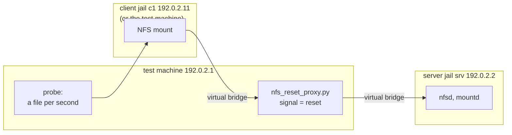

# #6: regression tests for the FreeBSD NFS client

Patch: [`nfs_vnet_tests.patch`](nfs_vnet_tests.patch), adds
`tests/sys/fs/nfs/`, against main 7a0021a0988f. Branch `nfs-vnet-tests` in
`~/freebsd-src-nfstest`. Not committed upstream.

Read [`badsession.md`](badsession.md) and
[`staleclientid.md`](staleclientid.md) first: these tests exist to catch
those two bugs again if they ever come back.

## 1. Background

**Why tests.** Bug #1 was a regression: a change meant to fix something else
(4d80d4913e79) broke recovery, and nobody noticed for two months because
the FreeBSD tree had no test that runs an NFS client against an NFS server.
FreeBSD's tests live in `/usr/tests` and run with `kyua`. Each test is a
small shell script using the ATF library (`atf_check`, `atf_fail`,
`atf_skip`).

**Jails and vnet jails.** A jail is a sandbox on one FreeBSD machine with
its own processes and files. A *vnet* jail also has its own network stack:
its own interfaces, addresses and routing. Two vnet jails on one machine
talk to each other over a virtual cable, like two separate computers. That
is exactly what an NFS test needs: a server and a client that really talk
over TCP, without a second machine.

**What can run in a jail.** Since FreeBSD 15.0, `nfsd` and `mountd` can run
in a vnet jail created with `allow.nfsd`. An NFS *client* cannot, unless the
kernel has [`nfscl_jail.patch`](nfscl_jail.md). Without it, these tests
mount on the test machine itself, so a client bug can leave hung processes
there: run them in a VM.

**How a server forgets a client.** Recovery bugs only show when the server
forgets the client's session and client ID. A real server does that after a
restart; Amazon EFS does it on every connection reset. The tests need to
cause it on demand.

## 2. The problem the tests catch

The tests put a small proxy, `nfs_reset_proxy.py`, between the client and a
normal FreeBSD `nfsd`. On a signal it *resets*: it cuts the client's TCP
connection, then answers for the server as if the server had restarted.
Requests on the old session get `NFS4ERR_BADSESSION`, and CREATE_SESSION
with the old client ID gets `NFS4ERR_STALE_CLIENTID`. Everything else goes
to the real server.

While that happens, a *probe* creates a file on the mount every second and
logs the time of each success. A gap in that log is an outage a user would
see. A gap of more than 10 s fails the test.

On a kernel from just before each fix, the test resetting twice within 15 s
fails:

```
just before 7a0021a0988f (bug #2 present):
  server_reset_twice  ->  failed: NFS I/O stalled for 47s

just before 5ab48fb9f7ac (bug #1 present):
  server_reset_twice  ->  failed: no NFS I/O for 61s
```

The 47 s stall matches what was measured on EFS (42, 46, 46 and 45 s).

## 3. The change



The test machine and every jail plug into one virtual switch (`if_bridge`),
each through a virtual cable (`epair`). The probe runs on the test machine
but writes through the client jail's mount, so the NFS traffic is the
client jail's.

**The framework, `nfs.subr`.** Shared shell functions, so that a new test
is short:

| function | what it does |
|---|---|
| `nfs_init` | create the virtual switch, load the modules or skip |
| `nfs_server_start srv` | jail `srv` running an NFSv4 server exporting `/export` |
| `nfs_client_start c1` | client jail `c1`, if the kernel allows NFS in jails |
| `nfs_mount <client> <server>` | mount with NFSv4.1 |
| `nfs_proxy_start srv`, `nfs_reset` | put the proxy in front of `srv`; make it forget |
| `nfs_probe_start`, `nfs_probe_check` | start the probe; fail on a gap over 10 s |
| `nfs_kdc_start`, `nfs_krb5_keytab`, `nfs_gssd_start` | Kerberos realm, keys and daemons |
| `nfs_cleanup` | unmount, stop everything, remove the jails |

**The tests.** One file per feature; a new feature is a new file.

| file | case | checks |
|---|---|---|
| `basic_test.sh` | `basic` | write, read, mkdir, rename, readdir, an 8 MB checksum, remove; also checked on the server side |
| | `two_clients` | two client jails share a file; a lock taken through one blocks the other (needs jailed clients) |
| `recovery_test.sh` | `server_reset` | one reset: I/O resumes within 10 s |
| | `server_reset_twice` | two resets 15 s apart: never more than 10 s without I/O |
| `krb5_test.sh` | `krb5` | Kerberos mount works, and a mount without Kerberos is refused |
| | `krb5i` | integrity only: the data is visible on the wire |
| | `krb5p` | privacy: the data is not visible on the wire |

`krb5i` and `krb5p` check each other: both capture the traffic with
`tcpdump`. With krb5i the written text must be in the capture, which proves
the capture works. With krb5p it must not be.

**Traps found by failed runs.** Each of these broke a run before it was
handled:

- A jail sees only its own root file system (with the default
  `enforce_statfs=2`), so the export must be a directory on the jail root,
  not a separate mount.
- The proxy connects from an unprivileged port, so the server jail sets
  `vfs.nfsd.nfs_privport=0` itself: `mountd -R` does not.
- Kerberos needs host names: each jail gets a name under `nfstest.test` and
  an `/etc/hosts` listing all jails.
- kyua sets `TMPDIR` to a directory the jail cannot see, and Kerberos keeps
  its replay cache there. The Kerberos daemons start without `TMPDIR`.
- Once a gssd answered in one jail, an `nfsd` in a jail without gssd hangs
  at startup. That is a kernel bug, #5
  ([`bugreport_kgss_vnet_upcall.md`](bugreport_kgss_vnet_upcall.md)); until
  it is fixed, every server jail runs gssd.
- An exclusive NFSv4 lock needs a file opened for writing: `lockf -w`.
- Setup runs in the test's own shell. In a `$(...)` subshell, `atf_fail`
  would stop only the subshell, and the test would carry on.

Alternatives:

- **Use a real EFS.** It needs AWS and a network, and the behaviour is
  allowed by the RFC from any server; the proxy reproduces it offline.
- **Inject errors on a timer**, as the first reproducer
  `scripts/badsession-proxy.py` did. That needs minutes of load to hit the
  bug. Two resets 15 s apart fail on every run.
- **Write the proxy in C.** Python is already a test dependency in
  `tests/sys/netpfil`; C would be longer for no gain.

What the tests do NOT cover: the session leak (#3), NFSv4.2, pNFS, NFS over
TLS, and protocol conformance in general.

Known side effect: after a reset test, the server jail stays in the "dying"
state for at least 300 s, longer than the 120 s lease. A server jail whose
client unmounted cleanly is gone in 1 s. This looks like server state kept
for the client IDs the proxy declared dead; it is not proven, and may be a
bug of its own. Cleanup force-unmounts the jail root so kyua can finish.

## 4. Tested

bhyve VM, 4 CPUs, 4 GB, kernels with `device epair`, `device if_bridge` and
`options NULLFS` compiled in (the VM loads no modules).

| Kernel | Clients | basic | two_clients | server_reset | server_reset_twice | krb5, krb5i, krb5p |
|---|---|---|---|---|---|---|
| main 7a0021a0988f | test machine | passed | skipped | passed | passed | skipped |
| 64857418bb23 (before #2's fix) | test machine | passed | not run | passed | failed: stalled 47 s | not run |
| d3a0bf0a79ef (before #1's fix) | test machine | passed | not run | passed | failed: no I/O for 61 s | not run |
| main 584f44221f45 + #4 | jails | passed | passed | passed | passed | not run |
| 64857418bb23 + #4 | jails | passed | passed | passed | failed: stalled 46 s | not run |
| main 584f44221f45 + #4 + `KGSSAPI` | jails | passed | passed | passed | not run | passed |
| main 7868958f5c79 + #4 + #5 + `KGSSAPI` (GENERIC, gssd workaround removed) | jails | passed | passed | passed | not run | passed |

The pre-fix kernels were run with the first, single-file version of the
tests, which had `basic` and both reset cases.

Untested: bare metal, kernels loading NFS and Kerberos as modules, stable/15,
and `make check` from an installed `/usr/tests` (the VM installed the files
by hand; `make -n install` lists the expected files).
